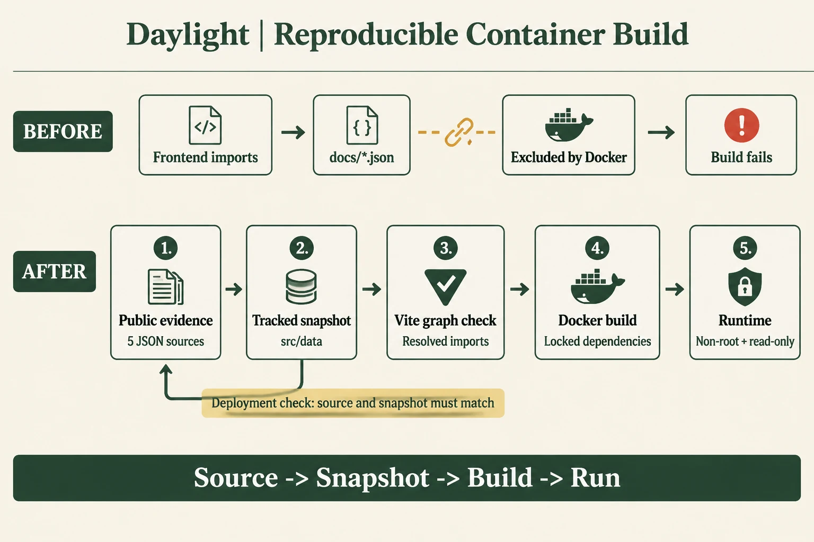
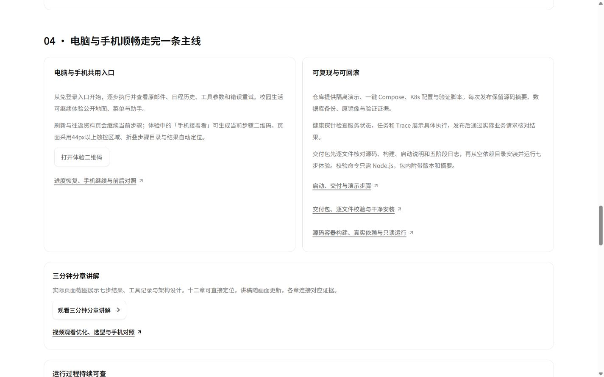

# Daylight 竞赛收尾交接

交接日期：2026-11-04，北京时间。竞赛截止11月6日。新增模型与云资源总预算¥500；实际调用用量与供应商账单分别登记。

## 接手先读

1. 本文：最新部署、文件位置、运行和回滚命令、明确待办。
2. [README.md](README.md)、[STATUS.md](STATUS.md)：运行方式与各轮实际结果。
3. [本轮源码容器图文](docs/competition-container-2026-11-04/README.md)：本轮源码构建修复、英文图、失败与成功证据。
4. [v22 发布回执](docs/competition-container-2026-11-04/deployment-v22.md)：本轮固定版本、回滚点和正式验收。
5. [真人对照主持包](docs/competition-value-2026-11-04/facilitator-kit.md)：真人对照的主持说明、匿名编号和回传步骤。


## 交接摘要

**当前公网已部署 v22，业务与材料发布源码固定为 `8ff41a1`；后写的交接、正式截图与发布回执归档在本文件所在提交。** 本轮 08:27 开始一小时收尾，源码固定、全量验证、完整镜像、服务器发布和私有包复现已经完成。

| 入口／交付物 | 位置 |
| --- | --- |
| 评委三分钟体验 | <https://daylight.yunforis.com/experience> |
| 五项设计与实测 | <https://daylight.yunforis.com/evidence> |
| 三分钟分章演示 | <https://daylight.yunforis.com/demo> |
| 当前在线技术报告／PDF入口 | <https://daylight.yunforis.com/competition/technical-report.html> |
| 本轮源码构建图文 | <https://daylight.yunforis.com/competition/container-report.html> |
| 可复现运行说明 | <https://daylight.yunforis.com/competition/reproduce.html> |
| 主源码分支 | `feat/competition-experience-20261103`，私有远端 `origin` |
| 最新私有便携包 | `output/delivery/daylight-demo-20261104T003718.tar.gz` |
| 参与者本机双击工具 | `output/participant-kit-20261104/` |

比赛前剩余关键事项：**真人3–5人对照、微信真机最终验收、评委私有源码交付渠道与比赛平台提交**。最终报告／讲稿和实际账单随这些结果定稿。负责人和建议日期见下表；角色是接手建议，尚未指派具体人员。

| 优先级 | 后续事项 | 建议负责人 | 建议完成时间 | 完成标志 |
| --- | --- | --- | --- | --- |
| P0 | 3–5位真人对照 | 项目负责人／主持人 | 11月4日 | 原始导出、manifest、逐人配对表与图 |
| P0 | 微信真机全流程 | 项目负责人／一名测试者 | 11月4–5日 | 机型/系统/微信/网络、逐项结果与录屏 |
| P0 | 私有源码评审渠道 | 项目负责人 | 11月5日前 | 评委可获取固定源码／包并复现 |
| P0 | 比赛平台正式提交 | 项目负责人 | 平台11月6日截止前，优先11月5日 | 提交成功回执、最终链接与附件快照 |
| P1 | 报告／视频讲稿定稿 | 材料负责人／工程负责人 | 11月5日 | 内容、版本、数字一致并复验 |
| P1 | 稳定性观察与账单 | 运维／项目负责人 | 11月4–6日 | 健康记录、费用明细与预算余额 |

## 当前成果

- 三分钟免登录七步体验、步骤地址恢复、手机二维码接续、技术与实测页、21页PDF、分章三分钟视频与同步讲稿。
- 邮箱／日历／待办／招聘／发票／校园工作区；公开体验采用原创通知和预置提取，日历与Trace工具现场执行；真实邮箱与模型路径在认证工作区。
- API／Worker／Scheduler解耦；PostgreSQL权威状态、Redis、RabbitMQ、私有MinIO、HTTPS入口。持久任务、租约、重试、checkpoint、人工审核与运行指标已有实现和验证记录。
- 逐文件交付校验、空依赖安装、源码容器构建与真实依赖验证；原始材料和每轮图文已归档。核心图使用gpt-image-2.5，图内英文。
- 本轮修复Docker上下文缺5份前端证据JSON；增加版本化快照、来源一致性检查和Vite真实导入边界。Windows离线验证保留原生路径方法。

## 五项考核与仍需补齐的证据

| 方向 | 已完成内容 | 后续要做、尚未完成 |
| --- | --- | --- |
| 场景价值 | 明确申请通知痛点、七步闭环、A/B材料、主持工具、10次真实模型预检 | 3–5位目标用户实际参与、逐人计时/质量/反馈及配对汇总 |
| 云原生架构 | 当前Compose真实依赖、角色分离、完整源码镜像、历史独立k3s多副本与容量记录 | 当前公网单节点；长期容量/SLO、跨节点高可用及托管UCloud替换验收 |
| Agent链路 | 规划/工具/状态/异常重试、真实模型固定集、RAG三轮对照、回复审核与持久任务验证 | 更多自然邮件的长期误报/漏报、跨场景回归，以及当前最终镜像下完整真实邮箱附件闭环 |
| 工程与Demo | 公网体验、桌面/手机尺寸、资料/视频/PDF、版本清单、源码包、备份与回滚 | 微信真机最终清单、评委私有源码权限/交付渠道、比赛系统正式提交 |
| 成本与性能 | Token费用复算、时延前后、首屏、资源快照与运行指标 | 图片供应商实际账单、现有实例/存储/流量摊销、长时间真实负载测量 |

## 比赛前按优先级接续

### P0 · 真人对照（项目负责人主持，优先11月4日完成）

已确认可安排3–5人，优先4人覆盖完整顺序。主持材料已准备，实际参与数据尚未采集。每位12–15分钟，阅读、模型等待、核验与修改都计时。

启动：`npm run study -- --practice`先主持预演；关闭后执行`npm run study -- --live --settings data/settings.json --max-calls 30`。打开`http://127.0.0.1:3190`；也可使用`output/participant-kit-20261104/Start-Live.cmd`。顶层配置从本机读取。

按主持包P01–P05轮换，每位两轮，主持人完成标题和冲突复核；每完成一位导出一次，最后导出全场JSON。将全场导出与本场manifest交给接续工程人员，逐人配对展示耗时、自动12项、人工两项、修正及主观反馈。项目成员自查和目标用户参与分别汇总，保留中断记录。5位正常约25次调用，上限30；按既有平均Token估算约¥0.43／¥0.52，最终按本场usage登记。

验收产物：匿名原始JSON、逐人配对表、耗时/质量图、原文反馈摘要及实际Token费用，补入技术页和最终报告。

### P0 · 微信真机（项目负责人，11月4–5日）

桌面IAB的390/320px结果已保存，真实微信设备的最终一轮清单待完成。至少一部日常使用的手机，以微信扫码进入正式`/experience`：

1. 弱网首开、字号、纵向滚动与固定操作区。
2. 顺序执行七步；第五步看到错误、第六步重试、第七步查看取消历史。
3. 第三步到资料页返回、刷新，仍是第三步。
4. 「手机接着看」下载PNG、微信长按保存，再扫二维码进入准确步骤。
5. 视频播放／章节跳转、MP4与PDF打开或下载、返回体验。
6. 如展示真实工作区，用本人账号登录，检查邮件图片、附件、月历和小D。

记录机型、系统、微信版本、网络、时间、截图/录屏与每项结果。遇到下载限制时记录实际路径和提示，修复后重测具体项目。验收产物为真机记录表和一次完整录屏。

### P0 · 私有源码评审与正式提交（项目负责人，11月5日前）

源码仓库保持私有。评委获得访问权限还是通过比赛系统接收私有交付包，具体渠道尚未确定。待确认后提供固定提交、压缩包及SHA-256、`START-HERE.md`，用评委实际获得的身份/文件走一遍入口。

比赛系统的报名、团队信息、项目描述、链接和附件上传尚未执行。按平台要求提交在线体验、技术页、PDF、视频与可复现说明，并保存提交成功回执及截止时间截图。

### P1 · 最终报告与讲解定稿（工程/材料负责人，11月5日）

现有21页PDF保存v14运行快照，新一轮改进通过HTML补充链接阅读。收齐真人、微信和最终发布证据后，统一更新报告到最终版本，重查字体、页码、书签和链接；需要同步重建PDF及对应manifest，运行`npm run evidence:sync`后重走验证。

现有三分钟分章视频可以演示完整主线。根据比赛对视频、旁白和分辨率的具体要求，决定是否录制最终公网版本；最终讲稿中的版本、样本和费用数字要与报告一致。保存视频源、字幕和导出摘要。

### P1 · 提交前稳定观察与费用结算（运维负责人，11月4–6日）

每日/提交前手动复查readiness、七步、PDF/视频、匿名权限和三个角色指标；检查重启、OOM、丢样、磁盘、队列失败。出现具体异常再修复；无变化时保持已验收版本。当前没有新建定时监控或自动后续任务。

取供应商图片调用账单，将累计16次图片金额、84次文本估算¥0.516094与实际账户流水核对；登记现有服务器、存储和流量的归属期间。新增资源采购0，继续使用¥500总上限。

## 比赛后演进（尚未完成）

- 真实多用户持续使用，按场景统计漏报、误报、人工修正、成功率和端到端耗时；扩充邮件/附件变化回归集。
- 当前公网数据库与对象存储仍在单台主机；规划托管数据库/缓存/对象存储、自动备份、恢复目标与告警，再验收跨主机故障。
- 当前Dockerfile同镜像打包预览能力；按真实OCR/PDF负载测量Worker内存和并发，再决定拆分文档转换服务。首次OCR语言下载、全部附件格式与当前新源码镜像的真实业务闭环继续验收。
- 真实业务负载下的扩缩容与资源预算、长时间压测、费用账单；历史读接口QPS和当前公网业务分别说明。
- 数据保留/删除、用户导出、管理员操作审计、长期密钥与依赖维护等运营流程继续完善。

### 各功能继续补齐的事项

| 功能 | 当前进度 | 后续工作与完成标志 |
| --- | --- | --- |
| 自助注册／找回密码 | 系统SMTP实际投递已有记录 | 用新测试账号走完验证码、注册、登录、找回及旧会话失效，保存回执和实际邮件投递结果 |
| 飞书会议 | 预约链接、审核草稿与状态保存已有实现 | 配置真实应用后验证创建／更新预约和外部参与者入会；ICS附件与飞书日历参与人登记尚未接入 |
| 外部日历 | OAuth／CalDAV／ICS与unknown恢复API已有实现 | Google／Outlook／iCloud逐提供方实连；接入unknown人工恢复UI与明确重新创建流程，核对旧共享连接归属 |
| 校园定位与资料 | 校园页、腾讯步行导航入口、私人安排和已导入资料已上线 | 微信定位／跳转与校内路网实地核验，维护菜单有效期、道路入口及数据许可；学校Chrome Cookie依赖的连接器另做服务器方案 |
| 社区模板 | 预置模板、个人声明式导入导出可用 | 第三方模板分享、版本管理和审核市场尚未开放，按权限与审核流程设计后验收 |

以上按当前README、接口和状态记录整理。较早STATUS中的故障和验收缺口保留其当时版本；接手先以本文v22基线判断当前工作。

## 运行与发布纪律

- 修改源证据后`npm run evidence:sync`；`npm run deploy:check`检查快照与来源；构建Vite插件检查实际导入范围。
- 开发依赖`npm ci`，正式交付`npm run verify`五阶段通过后`npm run release:bundle`。新源码不能复用旧验证回执。
- 每轮更新README/STATUS和对应图文；发布前备份并固定原镜像；正式HTTPS、资源字节、浏览器和运行文件清单通过后追加发布回执。
- 公网资料是发布快照；仓库内后写的部署回执、交接说明不会自动出现公网。需要公开时明确渲染并发布。
- 本次一小时收尾后，按本文待办承接下一轮任务。

## 最终版本与验证基线

| 版本项 | 固定值 |
| --- | --- |
| 发布／包／完整源码镜像提交 | `8ff41a1ba28576dd8bfa9fa3a109a96ffa00606a` |
| 正式运行镜像 | `daylight:public-competition-20261104-v22` |
| 正式镜像 ID | `sha256:11b018846e30ed419440c812d4e5e8d99f2f37e75ba1a94a481e5fd74e9b97af` |
| 完整源码镜像 | `daylight:source-release-20261104-v22-final` |
| 完整源码镜像 ID | `sha256:551cf718c2f5198fe5c6b57c20ff0218e287e20d74c480a245cf1b0b81737fcd` |
| 包大小／文件数 | 116,057,471 bytes／2,558，另有清单自身 |
| 包 SHA-256 | `8495c32bb81f65696f30a77dacee2b59bb21027a0adac32134786d981f9c0d0e` |
| 发布目录 | `/opt/daylight-container-release-v22` |
| 发布前备份 | `/opt/daylight-backups/before-container-build-20261104083753` |

正式增量镜像继承服务器已有OCR资源与业务后端；完整源码镜像在本地Linux Docker中从固定提交构建，并使用独立真实依赖验证。完整版本关系和文件清单见[v22发布回执](docs/competition-container-2026-11-04/deployment-v22.md)。

| 最终验证范围 | 结果与证据 |
| --- | --- |
| 固定源码五阶段 | [1051项，1021通过／30条件跳过／0失败；五阶段全部通过](docs/competition-container-2026-11-04/evidence/final-verification-summary.json) |
| 完整源码Linux镜像 | [9/9，UID1000、根只读、native canvas／LibreOffice可用](docs/competition-container-2026-11-04/evidence/final-candidate-runtime.json) |
| 实际持久任务／对象存储 | [PostgreSQL／RabbitMQ 8/8](docs/competition-container-2026-11-04/evidence/final-real-jobs.txt)；[MinIO 14/14](docs/competition-container-2026-11-04/evidence/final-real-oss.txt) |
| 正式候选 | 业务／指标／进度38/38，交付6/6，构建／原生路径9/9 |
| 正式HTTPS／资料 | [120项](docs/competition-container-2026-11-04/evidence/public-checks-v22.json)／[330份完整字节及MIME](docs/competition-container-2026-11-04/evidence/public-resources-v22.json) |
| 正式浏览器 | [9组布局](docs/competition-container-2026-11-04/evidence/public-layouts-v22.json)、[11项交互](docs/competition-container-2026-11-04/evidence/public-behavior-v22.json)，console error 0 |
| 运行文件与服务 | [三角色各741文件、完整前端690文件一致；8服务healthy、restart0／OOMfalse](docs/competition-container-2026-11-04/evidence/runtime-verification-v22.json) |
| 全新解压包 | [541包安装60.184秒，完整性／源码预检／24次HTTP Demo通过](docs/competition-container-2026-11-04/evidence/final-package-reproduction.json) |

最终门禁在Windows独立离线环境运行；真实依赖和云端记录各有自己的环境、版本和原始输出。当前21页PDF为v14运行快照，v16–v22通过在线补充链接阅读；下一轮定稿时统一更新。

## 运行、发布与回滚

### 本机启动

日常完整环境：项目根目录执行 `npm run up`，访问 `http://127.0.0.1:3000`；`npm run down`停止本项目应用和依赖、保留数据卷。修改前端后先 `npm run build`。新机器的隔离演示按包内 `START-HERE.md`执行：

```sh
node scripts/verify-delivery.mjs . --out work/package-integrity.json
npm ci
npm run deploy:check
npm run demo:check
npm run demo -- --no-build
```

便携包和参与者双击工具都在本机 `output/`，该目录由Git忽略；交接时单独传递私有包，元数据和原始验证已在仓库留档。包内 `START-HERE.md`、版本及清单与固定提交相对应。

### 服务器访问与日常检查

服务器连接说明在 `E:/Codex_why/UserData/.codex/private/daylight-public-server.md`；引用的 `daylight-public-server.credential.xml`由本机Windows用户DPAPI加密。接手服务器任务先读取该说明。异机数据副本和密钥说明在同一private目录的 `daylight-backups/README.md`。密码和密钥通过本机凭据管理读取。

服务器当前工作目录 `/opt/daylight`，使用已有 `manage.sh`叠加正式Compose配置。SSH进入后：

```sh
cd /opt/daylight
./manage.sh ps
curl -fsS --max-time 30 https://daylight.yunforis.com/health/ready
docker inspect daylight-api-1 daylight-worker-1 daylight-scheduler-1 --format '{{.Name}} {{.Config.Image}} {{.State.Health.Status}} restart={{.RestartCount}} oom={{.State.OOMKilled}}'
df -h /opt/daylight
```

检查三个角色 `metrics.enabled=true`、written持续增加、dropped=0、sinkError为空；实际接口和记录格式见[v22运行核对](docs/competition-container-2026-11-04/evidence/runtime-verification-v22.json)。队列失败、磁盘、重启、OOM与具体业务异常一起判断。

08:52收尾复查：8服务healthy、三角色restart0／OOMfalse，指标写入4267／12500／1819、丢样0／写错为空；正式readiness和七步读取通过，磁盘可用10,322,907,136 bytes。[最后健康回执](docs/competition-container-2026-11-04/evidence/closeout-health.json)。

### 需要回到v21时

回滚目标为 `daylight:public-competition-20261104-v21`，固定ID `sha256:55f7a1780e8e8766e2b9a449b8804b333d93c578621cc0a573c9736044bc9dc2`。以下命令在服务器以 `sh`运行；会先保存当前配置、前端和验证脚本，再恢复发布前版本。本轮无数据库结构变更，应用回滚使用现有业务数据。

```sh
set -eu
umask 077
cd /opt/daylight
exec 9>/opt/daylight/.competition-deploy.lock
flock -n 9
task_backup=/opt/daylight-backups/before-container-build-20261104083753
task_capture=/opt/daylight-container-release-v22/manual-rollback-$(date +%Y%m%d%H%M%S)
test -s "$task_backup/compose.env"
test -d "$task_backup/host-dist"
test "$(docker image inspect daylight:public-competition-20261104-v21 --format '{{.Id}}')" = sha256:55f7a1780e8e8766e2b9a449b8804b333d93c578621cc0a573c9736044bc9dc2
mkdir -p "$task_capture/runtime"
cp deploy/compose.env "$task_capture/compose.env"
cp "$task_backup/compose.env" deploy/compose.env
./manage.sh up -d --no-deps --no-build --pull never --wait --wait-timeout 180 api worker scheduler
mv dist "$task_capture/dist"
cp -a "$task_backup/host-dist" dist
for task_file in package.json scripts/verify-competition.mjs scripts/verify-competition-resources.py scripts/deploy-check.mjs scripts/sync-competition-evidence.mjs scripts/lib/competition-evidence.mjs scripts/lib/frontend-inputs.mjs scripts/fixtures/offline-guard.cjs server/container-source.test.js server/offline-guard-native.test.js; do
  mkdir -p "$(dirname "$task_capture/runtime/$task_file")"
  if [ -f "$task_file" ]; then mv "$task_file" "$task_capture/runtime/$task_file"; fi
  if [ -f "$task_backup/runtime/$task_file" ]; then cp "$task_backup/runtime/$task_file" "$task_file"; fi
done
./manage.sh ps
curl -fsS --max-time 30 https://daylight.yunforis.com/health/ready
docker inspect daylight-api-1 daylight-worker-1 daylight-scheduler-1 --format '{{.Name}} {{.Config.Image}} {{.State.Health.Status}} restart={{.RestartCount}} oom={{.State.OOMKilled}}'
```

回滚后重新走正式七步、PDF／视频与匿名权限检查，记录时间、实际镜像和结果。数据库／附件灾难恢复按[实际数据恢复与异机加密副本](docs/competition-recovery-2026-11-04/README.md)执行。当前备份含数据库dump、完整前端和发布配置，保留在服务器私有目录。

### 下一次发布

修改公开源记录后运行 `npm run evidence:sync`，检查变更，执行 `npm run deploy:check`及与改动相应的验证。最终固定源码运行 `npm run verify`、`npm run release:bundle`；发布时生成新的清单和备份，复核HTTPS、关联资源、真实浏览器及运行文件。完整源码容器构建、首次OCR语言下载和附件业务验收按实际镜像记录。

报告定稿入口：`python scripts/competition_report_baseline.py`、`python scripts/build-competition-report.py`、`python scripts/verify-competition-report.py`，再用 `scripts/competition-public-report.py`更新公开HTML。先更新报告源和基线中的版本／证据，再生成PDF和HTML；构建后渲染并核对书签、字体与链接。具体既有流程见[报告更新记录](docs/competition-report-refresh-2026-11-04/README.md)。

## 本地收尾与资料归档

- 隔离源码验证项目 `daylight-container-20261104`于08:47停止，9个容器／5个测试卷清理，项目容器及卷剩余0；其余20个容器ID保持一致。[清理回执](docs/competition-container-2026-11-04/evidence/local-cleanup.json)。
- 本轮临时本地浏览器页已关闭，正式源码构建图文页作为交付入口保留。
- 完整源码镜像、`work/container-source-20261104/`原始测量、私有便携包、参与者工具保留；`work/`和`output/`不随Git提交。
- 发布后的最终五阶段、构建、空依赖安装、实连、正式资源、截图和部署输出已复制到 `docs/competition-container-2026-11-04/`；结构化总索引为[final-publication-summary.json](docs/competition-container-2026-11-04/evidence/final-publication-summary.json)。
- 文档一致性回执位于[交接核对记录](docs/competition-container-2026-11-04/evidence/handoff-check.json)；本文件所在归档提交由`feat/competition-experience-20261103`分支承载，固定发布源码仍为上表的`8ff41a1`。

## 图文与长期设计索引

| 主题 | 文档 |
| --- | --- |
| 当前正式发布／电脑和手机截图 | [v22发布回执](docs/competition-container-2026-11-04/deployment-v22.md) |
| 架构、容错、容量和历史k3s | [云原生建设基线](docs/cloud-native-roadmap.md) · [分布式与容量](docs/distributed-ha-and-capacity.md) |
| 公网业务性能优化 | [11月3日前后实测](docs/performance-2026-11-03/README.md) |
| Agent问答质量／时延 | [上下文与引用](docs/competition-rag-2026-11-04/README.md) · [时延与Token对照](docs/competition-rag-latency-2026-11-04/README.md) |
| 指标采集与费用公式 | [运行观测](docs/competition-2026-11-04/README.md) · [累计费用](docs/competition-container-2026-11-04/evidence/budget-total.json) |
| 价值实验／回复审核 | [主持工具与方法](docs/competition-value-2026-11-04/README.md) · [持久回复审核](docs/competition-reply-2026-11-04/README.md) |
| 首屏／步骤接续 | [首屏测量](docs/competition-entry-2026-11-04/README.md) · [二维码与恢复](docs/competition-continuity-2026-11-04/README.md) |
| 便携包／源码容器 | [交付完整性](docs/competition-delivery-2026-11-04/README.md) · [本轮源码构建](docs/competition-container-2026-11-04/README.md) |
| 全部文档 | [docs/README.md](docs/README.md) |




