<div align="center">
  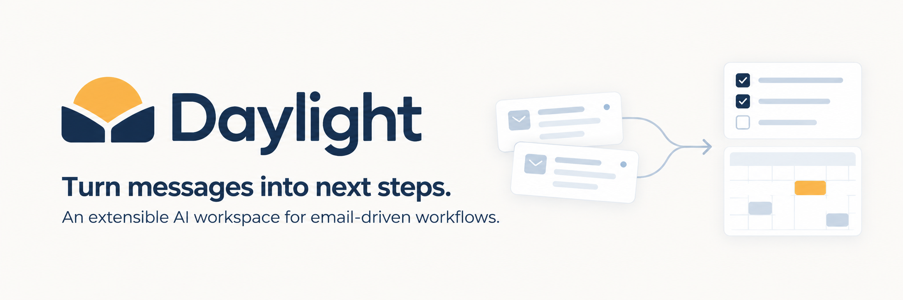
  <p><strong>让分散的信息，成为可追踪的下一步。</strong></p>
  <p>邮件驱动的多场景 Agent 工作台 · UCloud 优刻得 AI 黑客松 · Track B / AI Application</p>
  <p><strong>简体中文 · <a href="README_EN.md">English</a></strong></p>
  <p>
    
    =22.19" />
    
    
    
  </p>
  <p><a href="#public-access">在线体验</a> · <a href="#experience">三分钟导览</a> · <a href="#screenshots">界面展示</a> · <a href="#quickstart">本地运行</a> · <a href="#architecture">系统架构</a> · <a href="#deploy">部署</a> · <a href="docs/README.md">完整文档</a></p>
</div>

<a id="overview"></a>

## 项目介绍

**Daylight 是一个可自行部署的邮件管理 Agent 工作台，将邮件和附件中的信息整理成日程、待办与可追踪的行动。** 面向校园日常、个人安排和招聘、报销等工作事务，支持阅读原文、检索资料、处理变更，并由小 D 协助查询和准备沟通。

项目从上海科技大学的日常邮件使用出发：讲座报名、竞赛截止、材料补交和面试改期经常同时出现在收件箱里。Daylight 将这些通知连接到日历、待办和校园地图，也将简历、发票等附件连接到对应工作台，让每个处理结果都能回到来源核对。

<a id="public-access"></a>

## 公网体验与手机扫码

<p align="center">
  <a href="https://daylight.yunforis.com/">
    
  </a>
  <br />
  <strong><a href="https://daylight.yunforis.com/">打开 Daylight 官网</a></strong> · 手机 / 微信扫码访问同一入口
</p>

| 想体验什么 | 入口与使用方式 |
| --- | --- |
| **先了解核心功能** | [三分钟体验](https://daylight.yunforis.com/experience)：免登录浏览两组场景、11 个功能入口，支持截图放大、校园多图切换与示例问法复制 |
| **实际操作工作区** | [登录体验账号](https://daylight.yunforis.com/login)：按登录页提示卡填写体验账号、密码和当次图形验证码；登录后进入 [工作区](https://daylight.yunforis.com/app) |
| **看看校园生活** | [校园生活](https://daylight.yunforis.com/campus)：游客可浏览地图、菜单、活动与交流；本人学校邮箱安排需登录并绑定邮箱 |
| **查看技术与验证** | [技术与实测](https://daylight.yunforis.com/evidence) · [分章视频与讲稿](https://daylight.yunforis.com/demo) |

**推荐顺序：** 官网 → 三分钟导览 → 登录体验账号 → 先看上科大邮箱的日常安排，再切换 QQ 邮箱体验发票与招聘。导览展示实际页面截图，浏览时不会同步邮箱或调用模型；发票和候选人中的演示资料均有标注。

手机登录后可从侧栏底部切换邮箱或混合视图。小 D 位于工作区顶部入口，校园小 D 位于校园页右下角；日历点击日期数字查看当天完整安排。图片与 PDF 通过站内鉴权读取，未支持预览的附件可下载打开。微信图片查看已有用户确认，真机 PDF、定位与导航仍需逐项核验。

<details>
<summary><strong>目录：功能、运行与工程资料</strong></summary>

- **核心功能：** [三分钟导览](#experience) · [校园生活](#campus) · [多邮箱](#mailboxes) · [招聘与发票](#workflows) · [界面展示](#screenshots)
- **开始使用：** [本地运行](#quickstart) · [连接本人邮箱与模型](#usage) · [模板扩展](#templates)
- **工程与交付：** [最新进展](#progress) · [系统架构](#architecture) · [完整部署](#deploy) · [运维排障](#operations) · [开发与脚本](#development) · [验证与比赛材料](#evidence) · [项目结构](#structure) · [路线图](#roadmap) · [参与贡献](#contributing)

</details>

<a id="experience"></a>

## 三分钟导览：从通知到下一步

导览按「校园日常 / 上科大邮箱」和「工作事务 / QQ 邮箱」组织。下表与线上 11 个功能入口一致，点击功能名称可直接进入对应章节。

### 校园日常：安排、行动与来源放在一起

| 功能 | 可以做什么 | 核对与跟进 |
| --- | --- | --- |
| [**01 · 总览**](https://daylight.yunforis.com/experience?view=overview) | 集中查看今日安排、待办、待确认冲突与最近邮件 | 从总览继续打开日程、原邮件或小 D |
| [**02 · 日历**](https://daylight.yunforis.com/experience?view=calendar) | 邮件提取日程，月 / 周 / 日视图查看忙闲，也可手动添加 | 重叠安排保留并提示冲突；取消保留原因，改期关联新旧日程 |
| [**03 · 待办**](https://daylight.yunforis.com/experience?view=todos) | 提取报名、补材料等行动要求，记录截止与优先级 | 进行中与已完成分别管理，可回查来源及完成条件 |
| [**04 · 邮件**](https://daylight.yunforis.com/experience?view=mail) | 阅读 HTML 正文、查看附件，检索已入库邮件和资料 | 邮件、日程和待办双向关联；问答引用可返回原文 |
| [**05 · 校园生活**](https://daylight.yunforis.com/experience?view=campus) | 将学校邮箱安排连接地图，查看活动、菜单、地点与路线 | 私人安排仅本人可见；菜单供应与通行以现场为准 |
| [**06 · 证据链**](https://daylight.yunforis.com/experience?view=traces) | 回看收信、解析、提取、写入等阶段，以及工具调用、耗时与用量 | 异常有记录；费用按实际 usage 和配置单价估算，缺失时显示未知 |
| [**07 · 后台任务**](https://daylight.yunforis.com/experience?view=jobs) | 查看同步任务的排队、运行、完成和失败状态 | 查看执行次数与结果，按允许的操作取消或重新排队 |
| [**08 · 小 D**](https://daylight.yunforis.com/experience?view=assistant) | 查询日程和待办、整理近七天活动简报、准备会议邀约 | 使用当前邮箱上下文；真实发信需核对草稿并确认 |

### 工作事务：附件进入专用工作台

| 功能 | 可以做什么 | 核对与跟进 |
| --- | --- | --- |
| [**09 · 发票助手**](https://daylight.yunforis.com/experience?view=invoices) | 集中整理票据附件，提取票号、日期、购销方与金额，按币种汇总并复制字段 | 保留原邮件与附件入口；用于报销准备，需对照原件 |
| [**10 · 智能招聘**](https://daylight.yunforis.com/experience?view=recruitment) | 从 PDF 简历建立人才库，自然语言查找候选人，准备面试与邀约 | 回查简历依据，筛选与录用由人决定，发送前审核 |
| [**11 · 工作小 D**](https://daylight.yunforis.com/experience?view=work-assistant) | 查询 QQ 邮箱往来、整理工作待办、起草提醒或面试邀约 | 全局小 D 处理邮箱事务，招聘助手负责候选人专项检索 |

### 可以直接试的问法

> 帮我查看明天的日程安排，按时间顺序列出地点和待办。
>
> 总结过去 7 天学校邮件中的活动，生成一份本周活动简报，附上来源。
>
> 今天下一项安排在哪里？帮我规划过去的步行路线。
>
> 查找这个邮箱最近的报销相关邮件，列出还需要处理的事项和来源。

新邮件需先同步，查询范围以当前用户已保存、已建立索引的内容为准。小 D 和真实邮件提取使用所配置的模型服务；实际发送还需可用的 SMTP，飞书会议与外部日历需另行配置。

<a id="campus"></a>

## 校园生活：从邮件安排到校园现场

[公开校园页](https://daylight.yunforis.com/campus) 将日程、地图、活动、菜单与校园小 D 放在一起；工作区内的科大学习站保留在 `/app/campus`。

| 想做什么 | 操作方式 |
| --- | --- |
| **看学校邮件里的安排** | 登录并绑定学校邮箱、配置模型 → 同步邮件 → 在校园「日程 / 活动」查看本人有效安排，跟随后续取消与改期 |
| **去教学楼或食堂** | 地图定位或手动选起点 → 选择目的地 → 规划路线 → 打开腾讯步行导航；站内路线依赖已维护路网，可选高德步行服务 |
| **看菜单与价格** | 「美食」选择日期、餐次与食堂，查看已录入菜品和原图；已发布 2026.11.2–11.15 两周菜单，第二周经资料提供者确认沿用 |
| **请校园小 D 帮忙** | 右下角打开助手，查询地点、搭配预算餐食、找自习空档或不冲突的活动；登录并配置模型后使用本人模型，游客提供标注的基础查询 |

学校底图及目录包含 109 个可搜索地点，支持手动课表、ICS 导出、活动浏览与交流。地点中心不等于真实入口，菜单与路网仍需持续维护；教务 / Piazza / Blackboard 的本机 Chrome Cookie 不随数据库迁移到 Linux，服务器侧接入有平台限制。

完整功能与资料维护见 [校园生活说明](docs/campus-guide.md)、[Demo 资料清单](docs/campus-demo-data-checklist.md) 和 [校园小 D 公网验证](docs/campus-assistant-public-2026-11-03.md)。

<a id="mailboxes"></a>

## 多邮箱，分开看，也能一起找

为校园、生活和工作邮箱设置分类。日历与待办按当前范围展示；邮件页问答和小 D 的知识检索也使用所选范围，从已入库内容中找回通知。

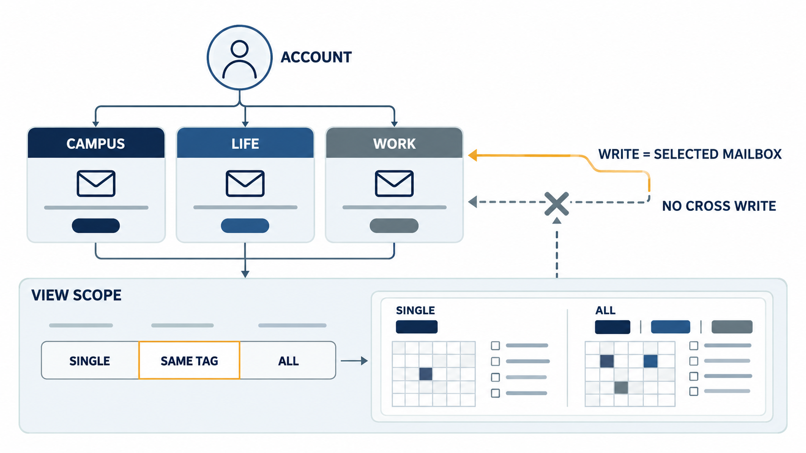

| 视图 | 适合什么情况 | 检索范围 |
| --- | --- | --- |
| **单邮箱** | 只处理当前收件箱 | 当前自有邮箱的已入库内容 |
| **同类混合** | 一起看校园或工作分类 | 同标签下自有邮箱的已入库内容 |
| **全部混合** | 找不清在哪个邮箱的通知、统筹安排 | 当前用户全部自有邮箱的已入库内容 |

混合查看不会赋予访问他人邮箱的权限，也不会把写操作广播到全部邮箱。普通建日程、草稿和发送仍使用当前选中的邮箱；工作台使用其绑定邮箱，并按业务接口检查归属。检索只能找回已建立索引的内容，不能保证历史邮箱全部覆盖。

<a id="workflows"></a>

## 招聘与发票：两条主要使用流程

### 招聘：从简历到面试沟通

收到求职邮件 → 保存附件 → 提取 PDF 文字或 OCR → 整理候选人资料 → 对话筛选 → 准备邀约 → 人工审核发送。

在人才库查看资料、简历与来源，提问时可以返回对应页码和原文。扫描件、识别失败与信息不全需回查或重试；飞书建会是可选能力，需自行配置。既有招聘数据直接复用，不因添加工作台复制一份。

<details>
<summary>查看招聘处理流程图</summary>

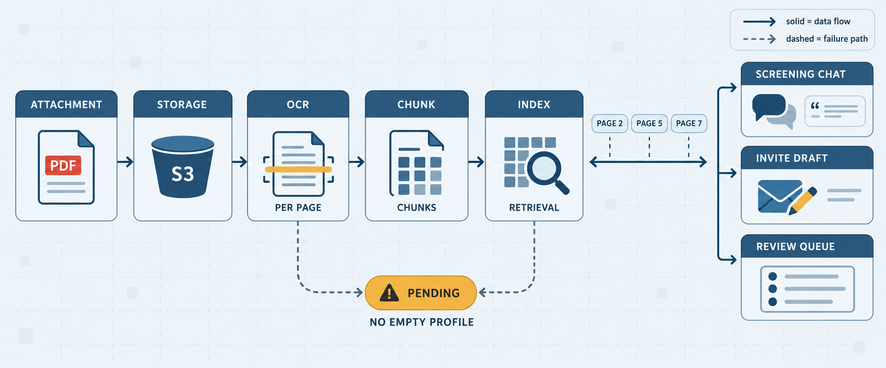

</details>

### 发票：从邮件附件到字段核对

发现票据附件 → 提取号码、日期、购销方、金额/税额和明细 → 对照原票 → 整理报销材料。

发票页保留原附件查看/下载入口；提取结果需要核对，不代表税务验真、已经报销或完成付款。识别发票本身不会自动生成日程与待办。

<details>
<summary>查看发票处理流程图</summary>

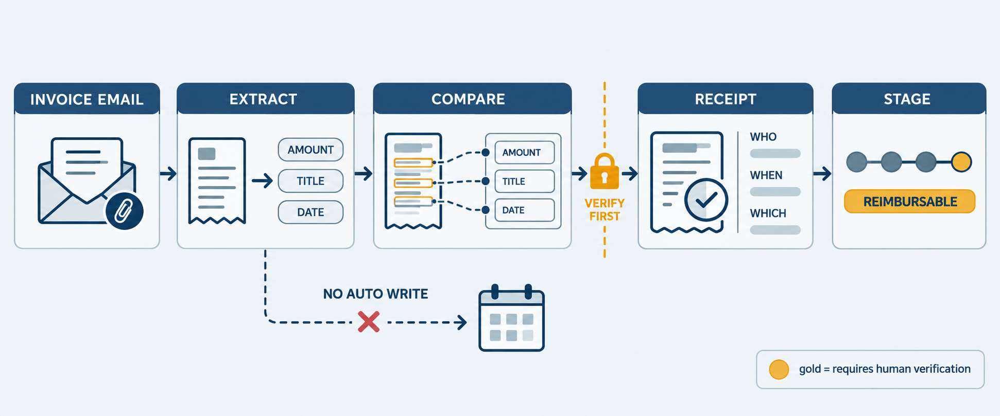

</details>

<a id="screenshots"></a>

## 界面展示

以下为隔离演示工作区的实际页面截图，邮箱、邮件、日程、票据和候选人均为虚构预置资料；图片来源与资料性质见 [截图说明](public/experience/README.md)。点击图片可查看完整尺寸。

[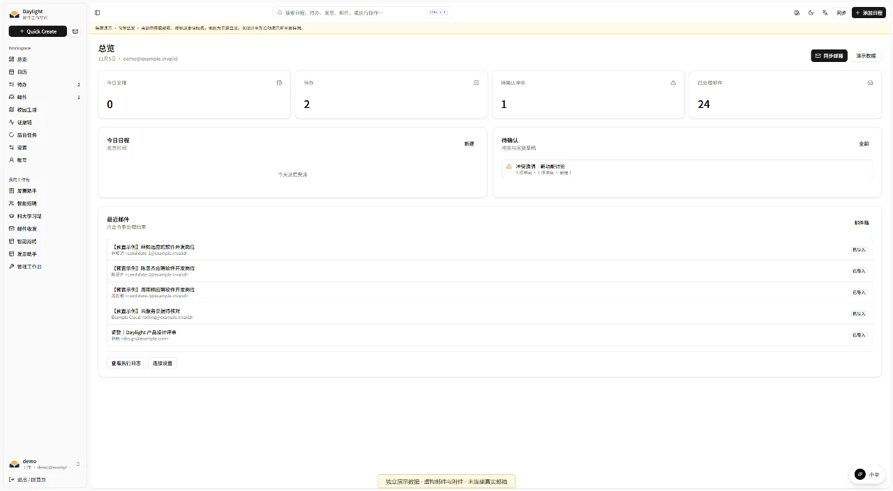](public/experience/overview.webp)

<details>
<summary><strong>展开查看日历、待办、邮件、校园、发票、招聘与执行记录</strong></summary>

<table>
  <tr>
    <td width="50%" align="center"><a href="public/experience/calendar.webp">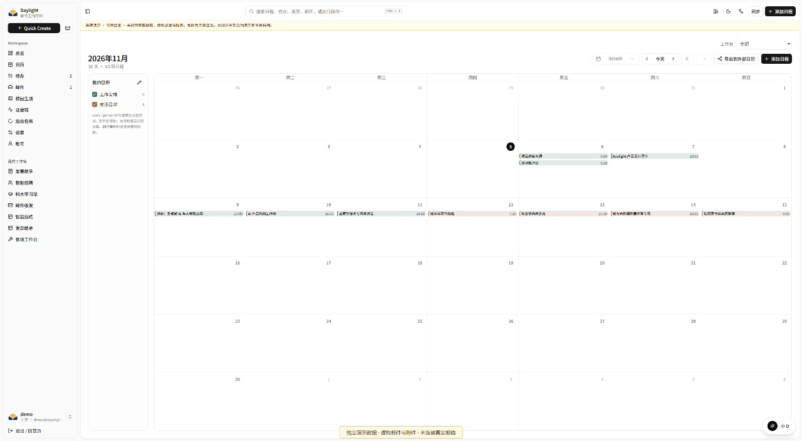</a><br /><b>日历：忙闲、冲突与来源</b></td>
    <td width="50%" align="center"><a href="public/experience/todos.webp">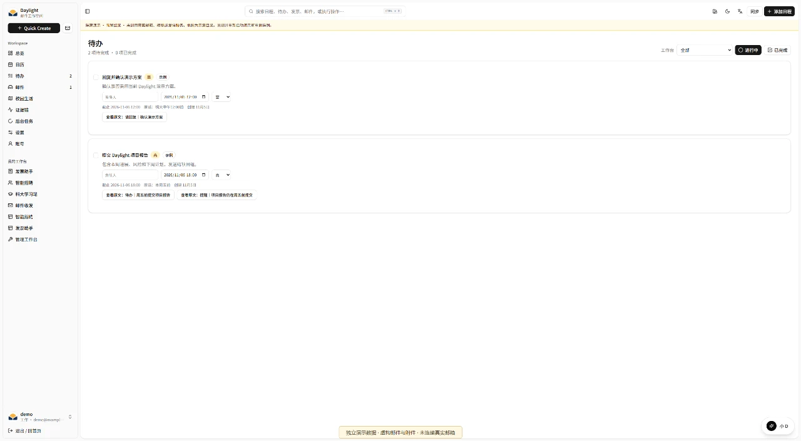</a><br /><b>待办：截止、优先级与来源</b></td>
  </tr>
  <tr>
    <td width="50%" align="center"><a href="public/experience/mail.webp">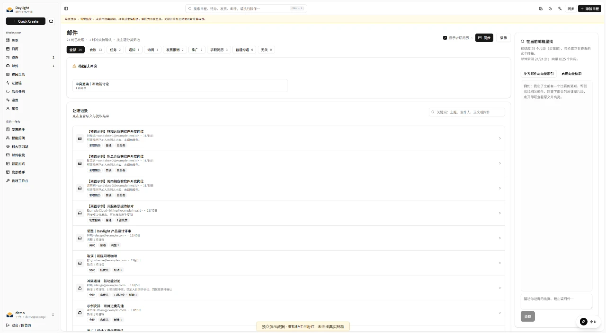</a><br /><b>邮件：分类、处理记录与检索</b></td>
    <td width="50%" align="center"><a href="public/experience/campus-activities.webp">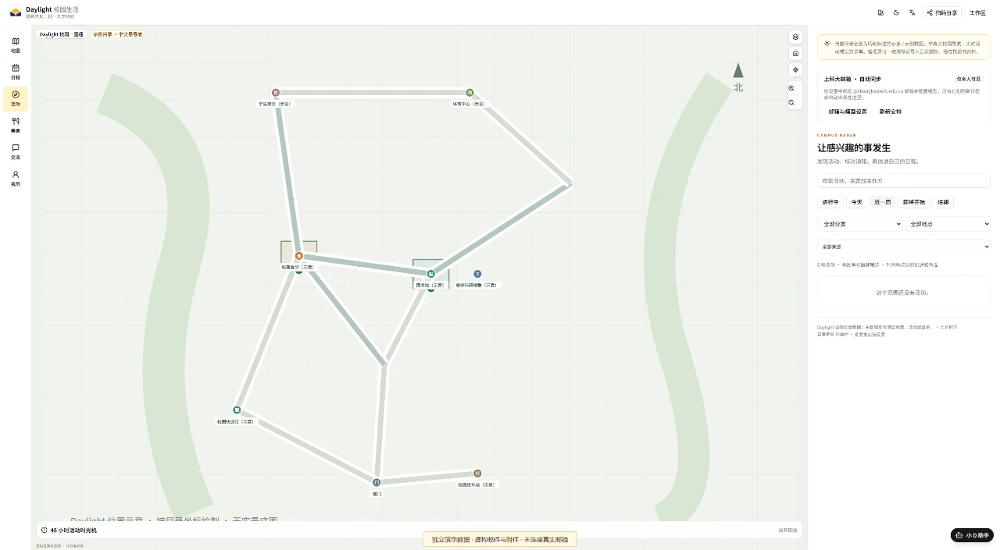</a><br /><b>校园：本人安排与地图</b></td>
  </tr>
  <tr>
    <td width="50%" align="center"><a href="public/experience/campus-food.webp">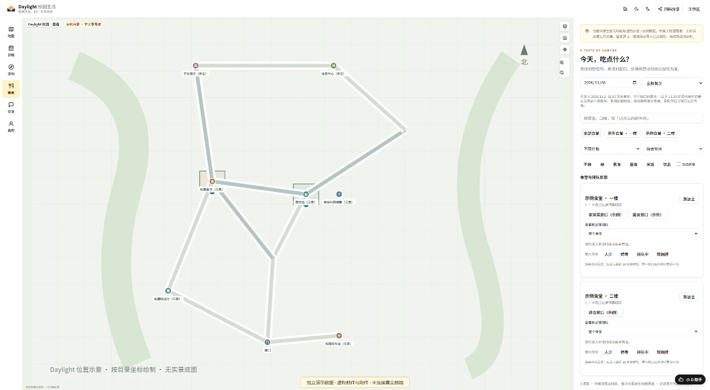</a><br /><b>美食：菜单、价格与地点</b></td>
    <td width="50%" align="center"><a href="public/experience/campus-assistant.webp">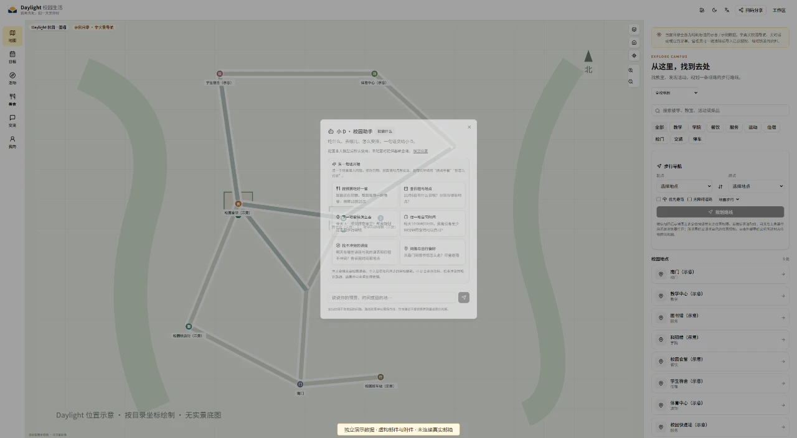</a><br /><b>校园小 D：餐食、空档与路线</b></td>
  </tr>
  <tr>
    <td width="50%" align="center"><a href="public/experience/invoices.webp">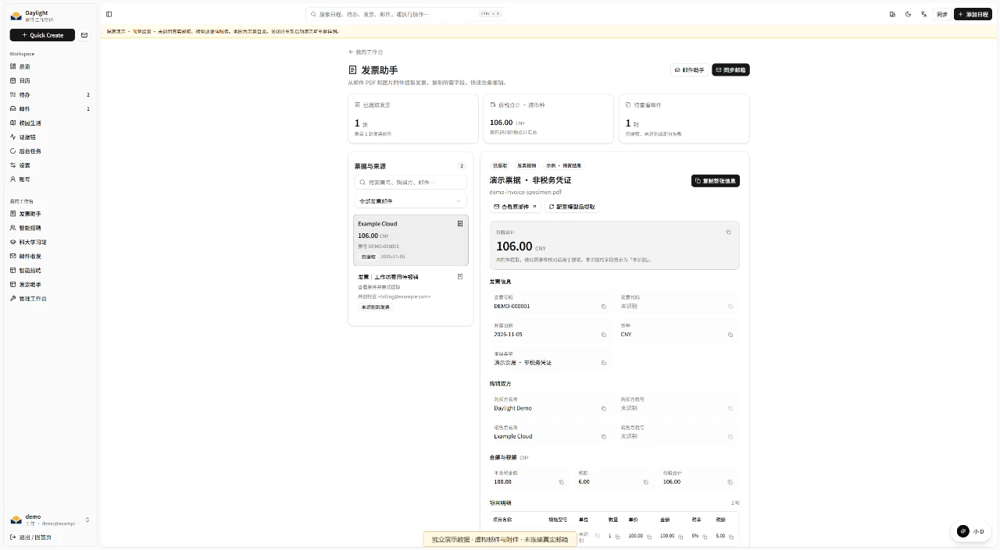</a><br /><b>发票助手：虚构票据字段展示</b></td>
    <td width="50%" align="center"><a href="public/experience/recruitment.webp">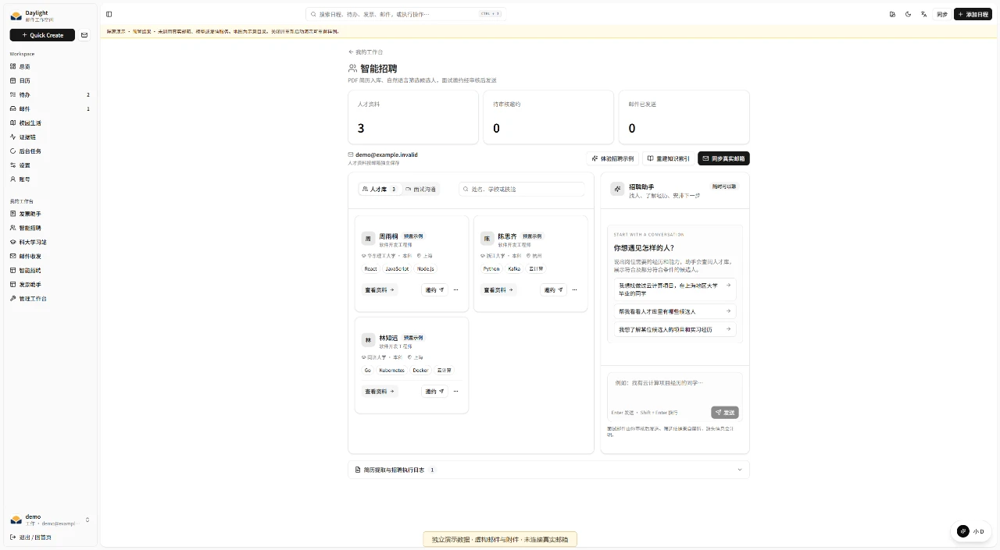</a><br /><b>智能招聘：含演示候选人</b></td>
  </tr>
  <tr>
    <td width="50%" align="center"><a href="public/experience/traces.webp">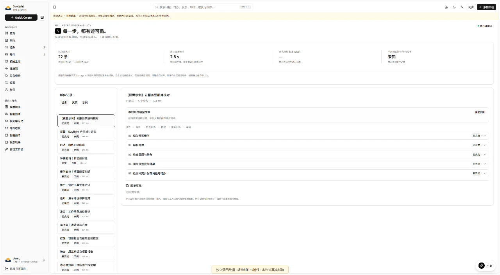</a><br /><b>证据链：处理阶段、用量与费用</b></td>
    <td width="50%" align="center"><a href="public/experience/jobs.webp">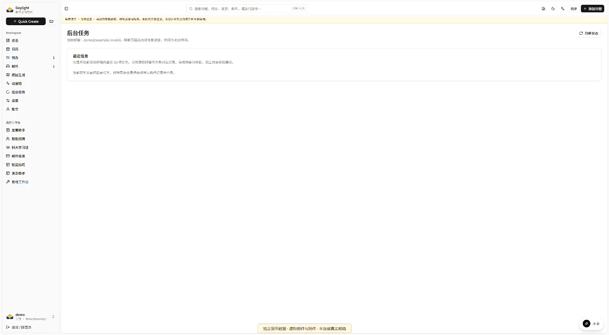</a><br /><b>后台任务：状态、次数与结果</b></td>
  </tr>
</table>

</details>

<a id="quickstart"></a>

## 本地运行

### 直接演示（无需邮箱和模型配置）

准备 **Node.js ≥22.19、npm**，在当前项目或交付包根目录执行：

```bash
npm ci
npm run demo
```

打开 **[http://127.0.0.1:3180/experience](http://127.0.0.1:3180/experience)**，免登录浏览功能导览，可切换校园日常 / 工作事务，点截图放大，复制小 D 示例问法；技术页为 `/evidence`，历史分章视频为 `/demo`。完整工作区在 `/login`，点击「进入演示工作区」。预置邮件、改期/取消、冲突、待办、招聘 PDF、发票、检索引用与校园地图已就绪。每次运行使用新的 `work/demo-*`，页面标注预置结果。演示账户为 `demo` / `DaylightDemo2026!`。Ctrl+C 结束。

**完整交付：** [启动、账号与打包](docs/delivery/README.md) · [现场演示脚本](docs/delivery/demo-script.md) · [云端部署方案](docs/delivery/cloud-deployment.md) · [逐文件校验与干净安装](docs/competition-delivery-2026-11-04/README.md)。`npm run verify` 运行五阶段检查，`npm run release:bundle` 生成带源码及构建摘要、逐文件 SHA-256 的交付包。解压后先执行 `node scripts/verify-delivery.mjs .`，再安装和启动。

### 启动完整生产拓扑

安装好 **Docker、Compose v2、openssl、curl** 后，在当前交付版本根目录的 Linux、macOS 终端或 Windows WSL 中执行：

```bash
sh deploy/up.sh
```

访问地址：**[http://localhost:3000](http://localhost:3000)**

脚本自动生成配置和随机服务密码，构建镜像、初始化数据库与私有桶，并检查应用健康状态。宿主机无需单独安装 Node.js 或数据库。部署前核对当前检出的提交；使用交付包时，以包内 manifest 确认源码版本。

**首次使用还需三步：** [创建管理员](#admin-setup) → [配置系统 SMTP（供普通用户注册）](#system-mail) → [连接工作邮箱与模型](#usage)。平台启动不会自动连接私人邮箱或购买模型服务。

- 需要完整操作和配置：[一键部署](#deploy)
- 已有环境，查运维和问题：[更新与排障](#operations)
- 需要改代码：[本地开发](#development)
- 需要查看实现范围与比赛材料：[验证与交付](#evidence)

<details>
<summary><strong>Windows 已配置环境：日常启动与终止</strong></summary>

在项目根目录的 PowerShell 中执行（需要 Node.js ≥22.19、已安装 npm 依赖、Docker Desktop，并已完成生产配置及数据迁移）：

```powershell
# 启动完整本地运行环境，保持当前终端运行
npm run up
```

默认访问 **[http://127.0.0.1:3000](http://127.0.0.1:3000)**，工作区为 `/app`。启动器复用 `data/runtime/environment.json` 和 `data/runtime/dependencies.env`，先等待 PostgreSQL、Redis、RabbitMQ 健康，再启动 Worker、API、Scheduler。前端构建缺失时自动构建；修改前端源码后需先执行 `npm run build` 更新已有构建。

**终止：**在启动终端按 **Ctrl+C**，或在另一个 PowerShell 终端进入同一项目根目录执行：

```powershell
# 停止本项目的应用角色和依赖容器，保留数据卷
npm run down
```

查看启动或停止后的状态：

```powershell
npm run status
```

停止会等待应用角色退出后再停止依赖容器，Docker Desktop 本身保持运行。首次配置与排障见 [Windows 生产运行说明](docs/windows-production.md)；全新环境可使用下方的隔离演示或 Compose 部署。

本地依赖仅由本项目命令显式启动，Compose 项目名固定为 `daylight-services`，容器使用 `restart: "no"`：启动或重启 Docker Desktop 不会自动启动它们，容器退出后需显式重新启动。其他本地项目也应关闭随引擎自动恢复的重启策略，避免启动 Docker Desktop 时一起恢复。各项目的启停命令只管理自身容器；已手动启动的其他项目可继续独立运行。

若 Docker 尚未运行，`npm run up` 会尝试启动已安装的 Docker Desktop，并等待引擎就绪（最多约 180 秒）后再启动依赖。若仍出现 `open //./pipe/docker_engine: The system cannot find the file specified`，在 Docker Desktop 中检查引擎 / WSL2 状态，待引擎就绪后重试；可用 `docker version --format '{{json .Server}}'` 核对是否返回包含 `Version` 的服务端信息。

</details>

<a id="progress"></a>

## 最新进展

截至 **2026-11-04（北京时间）**，核心导览、独立截图与登录页体验账号提示已发布公网。详细版本、验证过程与未完成项记录在 [STATUS](STATUS.md)，交接与下一步见 [收尾交接](HANDOFF-2026-11-04.md)。

| 更新 | 已完成范围 | 验证记录 |
| --- | --- | --- |
| **11 项功能导览（v23）** | 校园日常与工作事务两组入口，截图放大、示例问法复制、手机功能选择器 | 11 功能 × 3 尺寸共 33 组布局及主要交互通过；[发布记录](docs/deployment-2026-11-04-v23/README.md) |
| **独立页面截图（v24）** | 待办、邮件、证据链、后台任务换用各自截图 | 四章节 × 3 尺寸共 12 组布局及放大检查通过；[发布记录](docs/deployment-2026-11-04-v24/README.md) |
| **登录体验账号提示（v25）** | 登录表单上方展示体验账号信息 | 正式 HTTPS、文件核对与提示卡浏览器检查通过，8 服务 healthy；本轮未提交登录表单，未新增邮箱、模型或 SMTP 实连；[发布记录](docs/deployment-2026-11-04-v25/README.md) |

当前公网采用单节点 Compose + Caddy；独立 k3s 多副本、容量和故障测试另有记录。真实用户收益、更多真机交互、完整高可用与长期容量仍需继续验收，详见 [验证与比赛交付](#evidence)。

<a id="architecture"></a>

## 系统架构

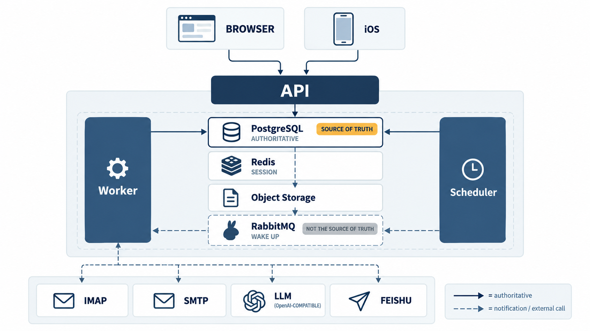

| 组件 | 职责 | 主要技术与状态 |
| --- | --- | --- |
| **Web** | 工作台、邮箱、日历、待办、审核与执行记录 | React 19、Vite 7、Tailwind CSS 4、shadcn/Radix、FullCalendar |
| **API** | 鉴权、邮箱归属、用户交互、业务提交、后台任务回执 | Node.js 22.19+、Express；生产模式使用共享状态 |
| **Worker** | 执行邮箱同步、事项分析、外部日历任务 | 持久任务 claim、心跳、检查点、有限重试 |
| **Scheduler** | 定时同步、任务调度与恢复协作 | 检查邮箱运行中任务和失败退避，避免重复积压 |
| **PostgreSQL** | 业务快照、任务、步骤、outbox 等权威状态 | 事务、版本/CAS、租约与提交校验 |
| **Redis** | 验证码、会话辅助及共享临时状态 | 生产依赖明确失败，不静默替换为进程内状态 |
| **RabbitMQ** | 发布确认与任务唤醒通知 | 任务权威在 PG；通知可重复，数据库轮询承担恢复路径 |
| **对象存储** | 附件与文件 | Compose 自带私有 MinIO；可配置 US3、S3 兼容及其他已有提供商 |
| **外部服务** | 收信、回信、模型、日历和会议 | IMAP/SMTP、OpenAI 兼容 Chat Completions、Embedding、可选飞书等 |

### 部署拓扑与一致性

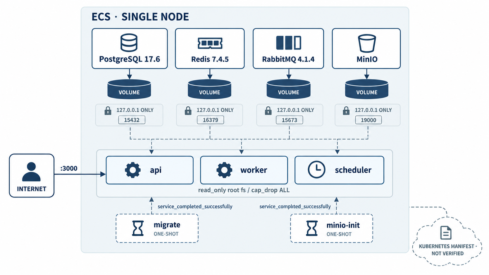

当前 Compose 包含 **7 个常驻服务 + 2 个一次性初始化任务**。图中公网 `:3000` 为可配置的发布方式，**实际默认仅绑定 `127.0.0.1:3000`**；依赖端口也仅映射回环。生产配置通过环境变量注入，首次启动显式迁移和创建私有桶，应用等待初始化成功后启动。开发模式可使用 JSON/本地文件；生产模式不会把静默文件回退作为故障恢复。

任务与 outbox 同事务入库；Worker 根据 PG claim 执行，同邮箱有序、不同邮箱可并行。数据库步骤可用检查点恢复；SMTP 等远端副作用不能随数据库事务回滚，结果未知时保留 `unknown` 并人工核查，不能盲目重发。扩缩容取决于邮箱并行度、数据库及模型配额；KEDA 示例尚不能视为已验收自动伸缩。

**启动期依赖重试（代码已实现、本地测试通过，已随历史 k3s 镜像上线）**：生产模式下启动连不上 PostgreSQL/Redis 时按退避重试（默认总窗口 60s、500ms 起、上限 8s），只重试连接类错误，配置或 schema 错误立刻失败；窗口用尽后明确报错退出。可用 `DAYLIGHT_BOOT_DEP_TIMEOUT_MS`、`DAYLIGHT_BOOT_DEP_BACKOFF_MS`、`DAYLIGHT_BOOT_DEP_MAX_BACKOFF_MS` 调整。历史故障测试中，删 PG 主库 Pod 曾造成 9 个 API 副本退出；该故障在启动重试修复后尚未单独复验。就绪探针与业务请求争抢数据库连接的问题已拆分连接路径、加入结果缓存，并完成独立云端对照复验。验证范围见 [STATUS 的 2026-10-18 存储读路径与云端实测记录](STATUS.md)。

**独立集群实测：** 历史 7 节点、3 可用区 k3s 环境已运行多副本并进行故障注入；入口改为跨区 3 副本后，固定应用副本下 `state@50` 成功 QPS 为 1018.1，同口径基线为 589.0；删除一个入口副本时并发负载无失败。该环境仍有单实例 MinIO、节点本地卷与公网入口收口等边界，完整高可用尚未验收。当前 `daylight.yunforis.com` 使用单节点 Compose + Caddy，包含 **8 个常驻服务**；两套环境的资源、HTTPS 和性能结论分别记录，详见 [容量与容错设计](docs/distributed-ha-and-capacity.md)。

更多设计见 [代码架构](docs/submission/architecture.md)、[可靠性矩阵](docs/submission/reliability/README.md)、[云原生路线](docs/cloud-native-roadmap.md)。独立 iOS 客户端不在本仓库构建；共享认证、邮箱与日历 API，并提供受控原生 CORS 与私密 ICS 订阅。

### Agent 控制流

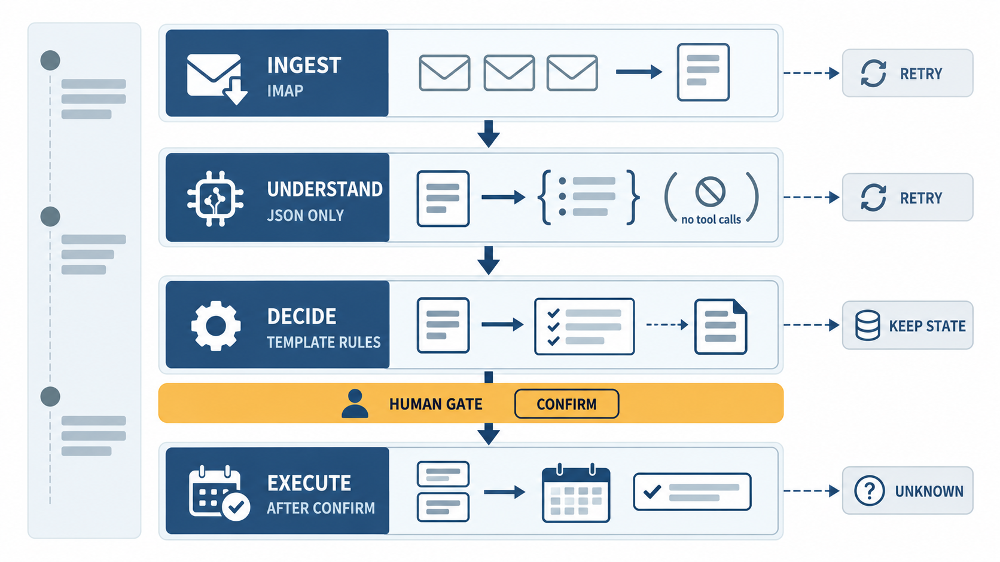

1. **读取与归属**：用户邮箱权限内读取邮件/附件，或登记外部来源，关联到事项。
2. **理解与建议**：模板规则和模型结合上下文，形成阶段、材料、截止待办、安排和草稿建议。
3. **核验与执行**：检查对象、时间、冲突和前置回执；用户确认后提交工作台动作。
4. **追踪与恢复**：保存来源、状态、工具结果和费用，处理后续通知、错误与重试。

邮件内容作为数据处理。已读、已准备、已发送、已提交、对方确认分别管理。工作台建议确认后写入，基础邮件同步可按提取结果直接创建日程/待办；实际发信经过独立审核。模型无效输出、工具错误和歧义需在界面与记录中体现。

<a id="deploy"></a>

## 一键部署：Docker Compose（推荐）

### 1. 准备环境

| 依赖 | 要求 |
| --- | --- |
| 系统 | Linux；macOS Docker Desktop；Windows 使用 Docker Desktop + WSL2，在 WSL Bash 中执行命令 |
| 工具 | Git、Docker Engine / Docker Desktop、Compose v2 插件、`sh`、`openssl`、`curl` |
| 资源 | 建议 4 vCPU / 8 GiB 起步试运行；当前公网 2 vCPU / 3499 MiB 已完成逐项业务演示验证，需串行处理重任务并关注堆内存；均不是容量承诺 |
| 网络 | 能访问所需镜像仓库、npm 和系统包源；实际业务还需访问邮箱/模型服务；通用镜像的扫描 OCR 首次可能下载语言包，当前公网镜像已预置中英文缓存 |

Docker 路径不要求宿主安装 Node.js、PostgreSQL、Redis 或 RabbitMQ。先启动 Docker，再确认：

```bash
docker info
docker compose version
openssl version
curl --version
```

### 2. 获取项目并启动

先解压已校验的本次交付包，或检出所选发布版本，在项目根目录运行：

```bash
sh deploy/up.sh
```

如果已安装 Node.js，也可以使用等价命令 `npm run deploy:up`。脚本会：

- 首次生成 `deploy/compose.env`，用独立随机密码和 JWT secret，文件权限设为 `600`；已有文件直接复用。
- 校验 Compose 配置，构建前端与运行镜像，启动 PG、Redis、RabbitMQ、MinIO。
- 执行 `migrate` 和 `minio-init`，再启动 API、Worker、Scheduler。
- 等待服务健康，并检查 `/health/live`、`/health/ready`，成功后输出访问入口。

预期访问 **[http://localhost:3000](http://localhost:3000)**。`migrate`、`minio-init` 显示 **Exited (0)** 属于正常完成；其余 7 个服务应为 healthy。一键部署完成基础环境，账号、邮箱和模型按下节初始化。

<details>
<summary>查看启动顺序说明图</summary>

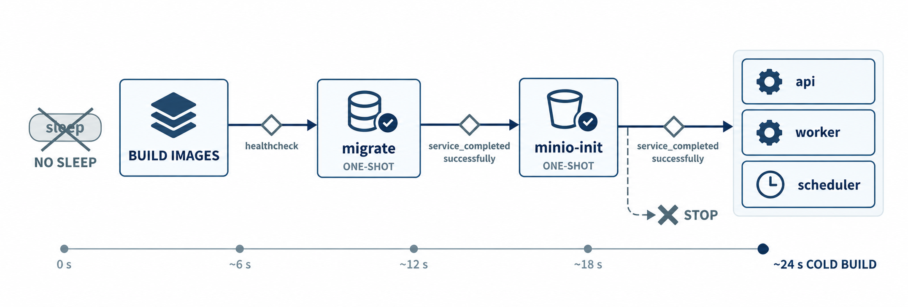

</details>

<a id="admin-setup"></a>

### 3. 创建首个管理员

没有默认账号或密码。以下命令进入正在运行的 API 容器，**提示输入自己设置的至少 8 位密码**；输入期间终端不显示字符：

```bash
docker compose --env-file deploy/compose.env -p daylight exec \
  -e DAYLIGHT_ADMIN_EMAIL=admin@example.com \
  -e DAYLIGHT_ADMIN_USERNAME=admin api sh -ec '
  trap "stty echo 2>/dev/null || true" EXIT
  printf "Set administrator password (at least 8 characters): "
  stty -echo
  IFS= read -r DAYLIGHT_ADMIN_PASSWORD
  stty echo
  printf "\n"
  export DAYLIGHT_ADMIN_PASSWORD
  node scripts/bootstrap-admin.js
'
```

将 `admin@example.com` 换成自己的邮箱。成功后访问 `/login` 或 `/admin/login`，用该邮箱或 `admin` 和刚才的密码登录。重复执行会更新同邮箱账号的密码并提升为管理员。生产模式只更新数据库账号，不写本地 infra 配置；Docker 环境配置继续由 `deploy/compose.env` 管理。

<a id="system-mail"></a>

### 4. 配置注册验证码与找回密码

首个管理员可直接登录，无须先注册。普通用户自助注册需要**系统 SMTP**：修改 `deploy/compose.env` 中以下项，然后重新运行 `sh deploy/up.sh` 使服务重建生效。

```dotenv
DAYLIGHT_SYSTEM_MAIL_ENABLED=1
DAYLIGHT_SYSTEM_MAIL_HOST=smtp.example.com
DAYLIGHT_SYSTEM_MAIL_PORT=465
DAYLIGHT_SYSTEM_MAIL_SECURE=1
DAYLIGHT_SYSTEM_MAIL_USER=your-system-mailbox@example.com
DAYLIGHT_SYSTEM_MAIL_PASS=
DAYLIGHT_SYSTEM_MAIL_FROM=your-system-mailbox@example.com
DAYLIGHT_PUBLIC_BASE_URL=https://daylight.example.com
```

替换为实际服务商信息；465 通常为直接 TLS，587/STARTTLS 通常使用 `SECURE=0`。`DAYLIGHT_SYSTEM_MAIL_PASS` 填**邮箱服务商给出的 SMTP 授权码**（不是邮箱登录密码），示例里留空以免示例看起来像已配置。系统发信服务发送注册/找回邮件；用户工作邮箱的 IMAP/SMTP 在登录后的设置里配置，两者相互独立。生产环境的服务配置以环境变量为准。

### 5. 自定义端口、项目与远程访问

自建公网 HTTPS 入口可使用 `sh deploy/public/up.sh`，脚本在 Compose 栈前加入 Caddy；域名解析、预算、管理员与备份恢复见 [公网部署方案](docs/public-access.md)。生成自己的入口二维码可使用 [脚本索引](#脚本索引) 中的 `share:qr` 命令。


**第一次生成环境文件时**可这样指定：

```bash
DAYLIGHT_PORT=3080 DAYLIGHT_PROJECT=daylight-demo sh deploy/up.sh
```

已有 `deploy/compose.env` 时，应编辑文件修改 `DAYLIGHT_PORT`，仅设置首启生成变量不会改写旧文件。自定义 `DAYLIGHT_PROJECT` 后，后续运维命令都使用相同 `-p` 项目名，避免新建另一套数据卷。多个项目共存还要在各自环境文件里改成不同的依赖宿主端口。

| 配置 | 默认 | 用途 |
| --- | --- | --- |
| `DAYLIGHT_BIND_ADDRESS` / `DAYLIGHT_PORT` | `127.0.0.1` / `3000` | API 发布地址；远程临时试运行可配置 `0.0.0.0`，并控制防火墙 |
| `DAYLIGHT_PUBLIC_BASE_URL` | `http://localhost:3000` | 外部访问地址、邮件链接；正式域名需实际配置反向代理/TLS |
| `DAYLIGHT_ENV_FILE` | `deploy/compose.env` | `up.sh` 的配置文件路径；自定义目录需预先创建 |
| `DAYLIGHT_PROJECT` | `daylight` | `up.sh` 的 Compose 项目名；数据卷与网络按项目隔离 |
| `DAYLIGHT_WAIT_TIMEOUT` | `600` 秒 | `up.sh` 等待服务健康的时限 |
| `DEBIAN_MIRROR` | 首启脚本为 `deb.debian.org` | 镜像构建时 Debian 包源；不改变 Docker 镜像仓库 |
| `DAYLIGHT_JOB_TIMEOUT_MS` | Compose 模板为 `900000` | 单个后台任务预算；慢模型批量同步时需结合日志调优 |
| `DAYLIGHT_METRICS` | 关闭 | 在环境文件设为 `1` 开启指标，之后重建服务 |

受限网络首次部署可执行 `DEBIAN_MIRROR=mirrors.aliyun.com sh deploy/up.sh`；已有环境文件时直接编辑其中的 `DEBIAN_MIRROR`。该选项仅更换 Debian 包源，镜像仓库仍需可达。

完整变量见 [配置示例](deploy/compose.env.example)、[Compose](docker-compose.yml) 和 [DEPLOY](DEPLOY.md)。默认依赖宿主端口为 PG `15432`、Redis `16379`、MQ `15673`、MQ 管理 `15674`、MinIO `19000` / 控制台 `19001`，**都仅绑定回环地址**；冲突时修改对应 `DAYLIGHT_*_HOST_PORT` / 控制台端口配置。公开部署建议反向代理终止 HTTPS，并支持 SSE 流式响应；设置 URL 本身不会自动申请证书。

<a id="operations"></a>

## 日常运维与更新

### 当前公网服务器

现有 `daylight.yunforis.com` 部署在 `/opt/daylight`，使用固定三份配置：`docker-compose.yml`、`compose.lowmem.yml`、`compose.https.yml`，以及 `deploy/compose.env`。通过服务器已有的入口管理，保留当前恢复数据库卷与私有附件卷：

```bash
sudo /opt/daylight/manage.sh ps -a
sudo /opt/daylight/manage.sh logs --tail 80 api worker scheduler
sudo /opt/daylight/manage.sh stop
sudo /opt/daylight/manage.sh up -d --no-build --pull never --wait
```

上述停止/启动命令用于维护窗口。更新时先核对三份配置、镜像和备份；沿用 `manage.sh` 的配置组合。最新镜像、堆限制、迁移前备份位置及运行问题见 [11 月 2 日迁移记录](docs/public-data-migration-2026-11-02.md)。

### 通用 Compose 部署

下列命令适用于默认模板，使用默认配置文件与项目名；自定义部署需带齐自己的覆盖配置及参数。现有公网服务器使用上方的专用入口。

```bash
# 服务与初始化任务状态
docker compose --env-file deploy/compose.env -p daylight ps -a

# 最近的应用日志
docker compose --env-file deploy/compose.env -p daylight logs --tail 100 api worker scheduler

# 存活与就绪（自定义端口时同步修改）
curl --fail http://127.0.0.1:3000/health/live
curl --fail http://127.0.0.1:3000/health/ready

# 扩展 Worker：同邮箱仍有序，跨邮箱才有更多并行机会
docker compose --env-file deploy/compose.env -p daylight up -d --scale worker=3

# 停止 / 再次启动，保留数据卷
docker compose --env-file deploy/compose.env -p daylight stop
docker compose --env-file deploy/compose.env -p daylight start
```

`deploy/compose.env` 与命名数据卷都需要保留。**不要通过删除环境文件重新生成旧卷的密码，也不要对有保留数据的环境执行 `down --volumes`。** 常规更新应先备份、获取并核对新版本，再运行 `sh deploy/up.sh`；默认会重新构建并执行显式迁移。它不是自动回滚工具，旧代码与新 schema 的兼容性需提前验证。

新环境的迁移不会自动导入宿主 `data/`。已有本地用户/附件迁移要使用经过备份核对的专门流程，见 [迁移脚本](scripts/migrate-production-data.mjs) 和 [生产运行说明](docs/submission/cloud-native-execution.md)，不要把局部 `import-storage.js` 当作所有数据的完整迁移。

<details>
<summary>查看故障恢复说明图</summary>

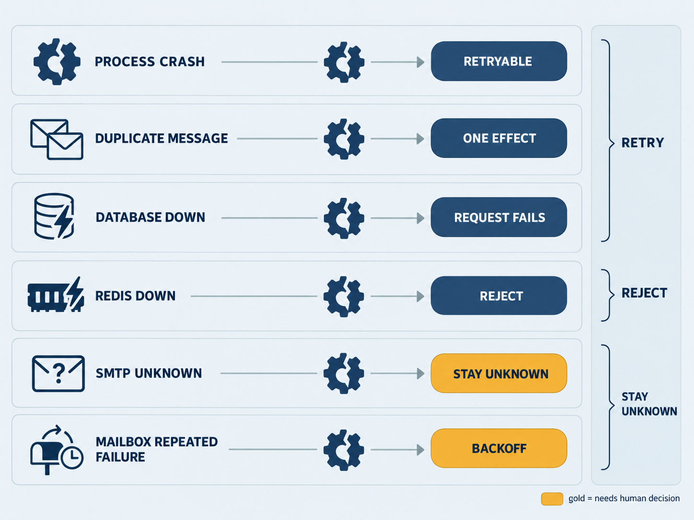

</details>

### 指标与排障

启用 `DAYLIGHT_METRICS=1` 后，用容器内脚本查看共享指标卷：

```bash
docker compose --env-file deploy/compose.env -p daylight exec -T api node scripts/metrics-report.mjs /var/lib/daylight-metrics
```

| 现象 | 优先检查 |
| --- | --- |
| 无法连接 Docker / 找不到 Compose | Docker 服务、用户权限、Compose v2；Windows 命令在 WSL 中执行 |
| 拉镜像或构建失败 | 镜像仓库、npm/apt 出网；`DEBIAN_MIRROR` 只调整 apt；先看日志，不假定设置镜像源能解决全部网络问题 |
| 端口已占用 | API 3000 与各依赖回环端口；在环境文件中改端口再启动 |
| `migrate` / `minio-init` 非 0 | 查看这两个任务日志，核对数据库/存储凭据及旧卷；应用会等待成功初始化 |
| 没有注册验证码 | 系统 SMTP 默认关闭，先创建管理员；配置系统 SMTP 并重建服务后验证 |
| 登录成功但邮箱空 | 登录账号不是收信邮箱；在设置中另加 IMAP 邮箱，确认归属与同步范围 |
| 模型/向量调用失败 | Base URL、Key、模型名、JSON/Embedding 兼容性、额度与出网；查任务和 trace |
| 检索显示关键词模式 | 查看 RAG 开关、Embedding 配置与 `embeddedCount`；配置后重建索引，检查限流记录 |
| 修改配置没有生效 | 生产环境变量需重建容器；`restart` 不会加载新环境变量；`up.sh` 不覆盖旧 env |
| 回复结果为 `unknown` | 先核对发件/收件结果，再按恢复入口处理，避免重复发送 |

更多见 [部署说明](DEPLOY.md)、[外部日历人工恢复 API](docs/calendar-recovery-api.md) 及 [验证状态](STATUS.md)。

<a id="usage"></a>

## 开始使用

从首页「登录体验账号」进入登录页后，可在表单上方的浅金色提示卡查看体验账号用户名与密码，再填写账号、密码及当次图形验证码登录。

邮件自动同步默认间隔为 **600 秒（10 分钟）**。在「设置 → 邮箱」的「轮询间隔（秒）」中调整并保存；后台按每个邮箱保存的间隔执行，手动同步可随时触发。IDLE 模式还会在收到新邮件通知时同步，如只需每 10 分钟检查请选择「定时轮询」。

1. **连接邮箱**：在设置中添加收信邮箱，填写 IMAP/TLS 与客户端授权码；需要发送时确认 SMTP 配置。QQ 示例为 `imap.qq.com:993` 与 `smtp.qq.com:465`。其他账号是否可用取决于供应商权限与网络。
2. **配置模型**：填写 OpenAI 兼容 Chat Completions 的 Base URL、Key 与模型名，要求支持 `response_format: { type: 'json_object' }`。向量检索还需可用 Embedding；没有向量时可走关键词检索，状态页应核对实际模式。
   ModelVerse 配置：Base URL 填 `https://api.modelverse.cn/v1`，邮件解析、小 D 与知识问答的模型填 `deepseek-v4.1-flash`；在「知识检索（RAG）」开启入库与向量检索，Embedding 模型填 `qwen3-embedding-8b`，复用该服务的 API Key。保存后执行模型连通测试；更换 Embedding 模型后重建已有知识索引，避免混用不同模型的向量。该 Embedding 实测返回 4096 维，当前生产检索使用数据库 JSONB 向量和应用层相似度计算。API Key 不写入仓库；Token 单价按平台实际报价填写。
3. **同步与检索**：打开邮件页同步，查看分类摘要、提取结果及失败原因；从问答引用返回原邮件与命中段落。最近 N 封范围之外的信息不会自动获得全量扫描保证。
4. **添加工作台**：选择预置模板、绑定自己的邮箱、建立机会/事项；关联通知或粘贴外部来源，查看材料、阶段建议及行动。
5. **确认行动**：核对期限、时区、目标与冲突，采用阶段建议，确认写入待办/日历；提交、发送、对方确认分别登记。前置行动仅添加待办还不能解锁后续，需完成相应回执。
6. **审核回复**：小 D 可查询、规划与起草回复；执行记录中的真实邮件可点击“准备回复审核”。核对发件邮箱、收件人、主题与完整正文，按需编辑保存，再确认发送。审核卡保存当前版本和回执，刷新后可继续核对。
7. **跟进变更**：后续补充、取消和改期保留来源及历史；新旧日程可追溯。后台任务页 `/app/jobs` 查看运行状态、允许的重试和取消，执行证据中核对耗时与费用。

模板是声明式 JSON，不执行任意代码。删除工作台保留已写入邮箱的日程/待办/招聘资料；隐藏入口也不删除数据。外部日历失败或结果未知应按恢复契约处理；对方日历、报名平台、付款或投稿系统未接入的操作不能自动判定成功。

<a id="templates"></a>

## 自己制作工作台

### 六类预置工作台

| 场景 | 管理对象与关键流程 | 业务边界 |
| --- | --- | --- |
| **智能招聘** | 候选人、简历 PDF/OCR、筛选、知识检索、面试邀约及沟通 | 实际发信审核确认；飞书需另行配置与授权 |
| **发票助手** | 附件票据、字段核对、原件回查与报销准备 | 提取结果对照原件核验，不据此自动改日程/待办 |
| **保研申请** | 夏令营、预推免、导师联系；多校机会、材料、限时确认、面试及改期 | 优秀营员、欢迎报考不等于正式录取；外部报名需回执 |
| **申博 / 海外研究 / RA** | 联系人上下文、研究计划版本、跨时区面谈、后续跟进 | 礼貌回复不代表名额承诺；保留原时区、UTC 与北京时间 |
| **校招求职** | 公司与岗位、测评笔试、材料补交、面试和投递进度 | 补材料不自动晋级；平台/短信/微信信息需补充 |
| **科研投稿与参会** | 修订、共同作者前置行动、终稿、注册缴费与报告安排 | 投稿与缴费状态需要外部证据 |

一个账号可添加多个工作台，不按普通用户或 HR 类型限制功能。模板中心当前将招聘、发票列为官方入口，其余预置模板位于社区分类；该分类不表示已有开放的第三方社区发布市场。

在「我的工作台」使用「制作模板」，或先从已有工作台导出定义再修改。个人模板可以保存不同的字段、业务阶段、通知识别规则、材料清单、页面块及允许的功能。多个工作台实例可以使用同一模板，但事项和业务数据分别保存。

1. 设定这类事情要记录什么，例如学校、岗位或主办单位。
2. 设定阶段，例如待整理、跟进中、已办完；关键阶段可要求回执。
3. 配置关键词、处理规则与材料，选择读信、待办、日历等允许的功能。
4. 用模板样例回放检查建议，再创建工作台并绑定邮箱。
5. 导出 JSON 定义供自己复用，导入后作为个人模板保存。

可直接查看并下载 [校园事务模板示例](docs/examples/campus-followup.template.json)。该文件不含用户数据，适合从「我的工作台」导入并试用。样例回放是规则预览，不会真实发信或调用付费模型。

| 模板内容 | 说明 |
| --- | --- |
| `format` / `schemaVersion` | 导入包为 `daylight-scenario-template`，当前 schema 版本为 `1` |
| `fields` / `stages` | 定义记录字段和业务阶段；字段支持 text、email、url、number、date、timezone |
| `signals` / `rules` | 声明关键词命中后的建议，以及模型分析时使用的处理规则 |
| `capabilities` / `views` | 只能从平台支持的功能和页面白名单选择，不附带可执行代码 |
| `materials` / `samples` | 材料清单与不含真实隐私的样例 |

个人模板不能通过导入包启用内置招聘/发票专用引擎，也不能绕过用户权限。导出前仍需自行检查文字和样例：结构过滤不代表自动识别所有隐私。模板字段契约以 [共享定义](shared/scenario-templates.js) 为准。

**社区方向：** 将来支持发现、分享和更新场景模板，采用版本、审核与权限控制。当前“社区”分类中的保研等模板是预置内容，尚无公开第三方模板发布市场，也不支持任意代码插件。

<a id="development"></a>

## 本地开发与其他部署方式

本地开发需要 **Node.js ≥22.19、npm**：

```bash
npm ci
npm run dev
```

访问 `http://127.0.0.1:3000`，工作区 `/app`。**停止开发服务：在运行 `npm run dev` 的终端按 Ctrl+C。** 开发默认 `DAYLIGHT_RUNTIME=local`；有写入的演示可设置独立 `DAYLIGHT_DATA_DIR`。本地管理员使用同一初始化脚本（密码可用前述环境变量传入），运行 `node scripts/bootstrap-admin.js --email admin@example.com --username admin`。本地模式会保存认证配置，生产模式以环境变量为准。

```bash
# 构建静态前端并使用构建产物启动
npm run build
npm start

# 独立数据目录中的测试（POSIX shell）
DAYLIGHT_DATA_DIR="$PWD/work/readme-test" npm test
```

`npm start` 中的 `--production` 选择前端构建产物；**严格生产运行模式还需 `DAYLIGHT_RUNTIME=production` 及共享依赖环境变量**。独立角色分别为 `npm run start:worker`、`npm run start:scheduler`，不会由 `npm start` 自动启动。

| 方式 | 入口 | 适用条件 |
| --- | --- | --- |
| **Compose** | `sh deploy/up.sh` | 推荐的完整单节点部署与演示；包含依赖、迁移和存储初始化 |
| **Kubernetes** | [清单与执行顺序](deploy/README.md#kubernetes-with-external-managed-dependencies) | 自备集群、受控 Secret、PG/Redis/MQ/存储和镜像仓库；迁移 Job 先于应用，集群验收仍需另做 |
| **原生 systemd** | [单元与配置](deploy/systemd/README.md) | 不使用容器的 Linux 运维方式；需自行准备相同共享依赖 |
| **已有 Windows 运行环境** | [PowerShell 启停工具](scripts/production.ps1) | 面向已有本地运行配置的专项路径，非全新机器的一键安装替代 |

### 脚本索引

| 命令 / 脚本 | 用途与前置条件 |
| --- | --- |
| `npm run up` / `npm run down` / `npm run status` | Windows 已配置环境的全栈启动 / 停止并保留数据 / 状态查询；详见 [Windows 生产运行说明](docs/windows-production.md) |
| `npm run demo` / `npm run demo:check` | 新目录中的隔离预置演示 / HTTP 自动自检，默认回环 3180 |
| `npm run verify` / `npm run release:bundle` | 当前源码回归、构建和交付检查 / 带校验和的交付包 |
| `npm run deploy:check` | 部署资产及可选真实配置字段预检，不连接业务服务 |
| `sh deploy/backup.sh` / `sh deploy/restore.sh` | 单节点停写一致性备份 / 只向新项目恢复；参数见云端部署方案 |
| `sh deploy/up.sh` / `npm run deploy:up` | 生成/复用环境文件，构建、启动并健康检查 |
| `sh deploy/public/up.sh` / `npm run deploy:public` | 新建或按通用配置接入 Caddy HTTPS 公网入口；已部署服务器沿用其专用配置 |
| `npm run share:qr -- --url https://你的域名/ --output work/daylight-home-qr.png` | 验证 HTTPS、readiness 与匿名权限边界后生成官网二维码 |
| `npm run campus:import:shanghaitech -- --check` | 离线校验仓库内学校地图资产；抓取刷新与参数见校园 Demo 资料清单 |
| `npm run campus:apply:shanghaitech` | 预览向选定存储增量导入学校目录；显式 `--apply` 后才备份并写入 |
| `scripts/bootstrap-admin.js` | 创建或提升管理员；至少 8 位密码；重复运行可更新密码 |
| `scripts/migrate.js` | 显式 schema 迁移与空设置初始化；Compose 自动执行 |
| `scripts/bootstrap-settings.js` | 单独初始化空设置，不读取本地邮件数据 |
| `scripts/migrate-production-data.mjs` | 已有用户/业务/附件迁移；按脚本契约先核对备份及计划 |
| `sh deploy/verify-compose.sh` | 临时项目中验证部署、健康与模块加载，结束清理自己的卷；需要 Docker、openssl、Python 3 |
| `sh deploy/verify-migrations.sh` | 独立迁移与幂等检查，使用隔离项目 |
| `scripts/verify-jobs.mjs` / `verify-production.mjs` | 专用真实 PG/MQ 下验证任务及业务提交；依赖与门控见可靠性文档 |
| `scripts/verify-concurrency.mjs` | 并发、租约、隔离、CAS 等专项检查；使用隔离依赖 |
| `scripts/verify-oss.mjs` / `verify-real-mail.mjs` | 真实存储/邮箱验证；需受控账号与授权，可能触发外部调用 |
| `scripts/verify-redis-restart.mjs` | 自建临时 Redis 并验证断连恢复，需 `redis-server` |
| `scripts/load-test.mjs` / `benchmark-jobs.mjs` | 合成任务负载，不代表真实模型业务吞吐 |
| `npm run metrics:report -- <dir>` | 从指标文件重新统计分位数与开销，目录需存在且已采集数据 |
| `node scripts/evaluate-mail.js --validate` | 零网络校验评测语料结构；`--live` 模式需配置与明确预算 |

<a id="evidence"></a>

## 验证、性能与比赛交付

已有记录包括 Compose 全栈云端部署、真实 IMAP/模型/SMTP 流程、对象存储、混合检索、真实依赖测试，以及独立 k3s 集群的容量与故障实测。**历史通过数量只对应记录的版本与环境**，不自动代表当前源码或所有外部集成。公网业务验证见 [数据与附件迁移](docs/public-data-migration-2026-11-02.md) 和最新的 [校园与手机更新](docs/campus-mobile-public-2026-11-02.md)，历史验证与具体版本见 [STATUS](STATUS.md)。

| 验证环境 | 已有证据 | 使用结论的范围 |
| --- | --- | --- |
| **隔离 Demo / 本地回归** | 预置邮件、候选人、票据、引用与校园流程；[交付检查](docs/delivery/verification.md) | 用于复现和演示，预置结果不作为真实模型、OCR 或邮件调用证据 |
| **当前公网单节点** | 原账号登录、整库/附件迁移、邮箱与模型实连、OCR、自动同步；校园菜单/助手/导航入口、本人学校安排读取、390px 月历验证 | 2 vCPU / 3499 MiB 环境的代表性功能验证；微信真实定位、并发与长稳尚未验收 |
| **历史 k3s 集群** | 7 节点、3 可用区，多副本、故障矩阵与入口优化对照；主读路径成功 QPS 589.0 → 1018.1 | 合成请求下的读路径实测，受压测源资源限制，只能作为已测下界；3k 成功 QPS 仍是目标 |

成本按实际 usage 与调用时单价快照估算，报告已知累计、均价与覆盖率；缺失部分为未知，不能把部分已计价记录当作全部账单。性能矩阵使用真实 PG/MQ 和合成 handler，不能直接换算为每秒处理多少封真实邮件。用户调查占位图没有作为真实收益证据使用。

| 赛道 B 交付物 | 仓库入口 |
| --- | --- |
| 场景价值、架构、Agent、异常、验证、成本、部署七章报告 | [LaTeX 与编译说明](docs/hackathon-report/README.md) · [报告源码](docs/hackathon-report/daylight-report.tex) |
| 部署与复现 | [部署资产](deploy/README.md) · [依赖配置](DEPLOY.md) · [云端验收记录](docs/submission/deployment/README.md) |
| 架构与可靠性证据 | [架构](docs/submission/architecture.md) · [故障矩阵](docs/submission/reliability/README.md) |
| 成本性能与可观测性 | [原始测量](docs/submission/performance/README.md) · [埋点说明](docs/submission/observability/README.md) |
| PPT、实演与备用视频 | [逐页讲稿与演示脚本](docs/submission/defense.md)；最终文件/视频按发布清单补齐 |
| 最终版本与代码快照 | [提交清单](docs/submission/README.md) · [发布冻结](docs/submission/release.md) |

当前公网 HTTPS 与手机登录已有验证；本地独立项目备份恢复及公网迁移也已有记录。后续仍需按最终发布版本复验故障修复、跨节点完整高可用、备份恢复演练、回滚、并发/长稳与真实用户收益。历史 k3s 集群的 HTTPS、唯一公网入口及部分故障分支仍有独立缺口。支持某项接口不等于所有供应商实连通过；飞书和外部日历验收范围分别记录。

<a id="structure"></a>

## 项目结构

```text
Daylight/
├── src/                        # 页面、组件、工作区状态与交互
├── server/
│   ├── index.js                # API / Web 入口
│   ├── worker.js               # 后台任务执行入口
│   ├── scheduler.js            # 调度入口
│   ├── jobs/                   # 持久任务、租约、outbox 与通知
│   ├── scenarios/              # 工作台、来源、材料、行动与回执
│   ├── storage/                # 共享状态与事务提交
│   ├── rag/                    # 分块、索引、检索与问答
│   └── infra/                  # PostgreSQL / Redis / MQ / OSS
├── shared/                     # 跨端模板与公共定义
├── scripts/                    # 初始化、迁移、验证与测量
├── deploy/                     # Compose、Kubernetes、systemd
├── docs/assets/readme/         # README 说明图与官网入口二维码
├── docs/submission/            # 比赛交付与验证证据
├── docs/hackathon-report/      # LaTeX 报告
├── Dockerfile
└── docker-compose.yml
```

<a id="roadmap"></a>

## 产品进展与后续计划

| 方向 | 当前范围 | 下一步 |
| --- | --- | --- |
| **校园生活与学习站** | 公开 `/campus`、上科大地图、步行导航入口、本人校园邮箱安排、周菜单、校园小 D 与交流；学习站 `/app/campus` | 真机定位与道路核验，持续更新菜单和活动资料；改善服务器侧学校数据接入 |
| **邮件与多邮箱** | 分类、混合视图、通知检索、日历待办、邮件收发；公网两邮箱实连与同步 | 更多真实通知样本，记录漏项、纠错与使用时间 |
| **招聘与发票** | 两个内置工作台，复用附件、模型、检索和审核功能；迁移资料与 PDF 可在公网查看 | 改善复杂附件、失败重试及连续往来体验，扩充真实票据核验 |
| **自定义工作台** | 声明式定义、个人导入导出、字段/阶段/规则 | 社区分享、模板版本管理与审核 |
| **Web / iOS / Desktop** | Web 为本仓库主客户端；iOS 已对接，Desktop 有初步版本，独立端仍在迭代 | 安装包和各端支持范围按正式发布说明提供 |
| **Android / HarmonyOS** | 后续计划 | 复用共享 API，逐步实现客户端 |
| **公网与手机体验** | 单节点 HTTPS、原账号/业务/附件迁移、真实手机登录与微信图片查看；月历、弹窗及窄屏控件优化 | 微信定位与导航、真机 PDF、注册/找回密码全流程及更多设备交互验证 |
| **云端运维与容量** | 单节点 Compose 业务验证；独立 k3s 多副本、入口优化及故障实测 | 优化历史快照内存成本，复验故障修复、完整 HA、恢复回滚与并发长稳 |

路线图表达建设方向，不是交付日期或已完成验收。iOS/Desktop 独立工程和安装包不随本仓库 Docker 镜像生成；Web 可以直接部署访问。

<a id="contributing"></a>

## 参与项目

欢迎报告问题、改进部署说明、补充邮件格式用例、制作无隐私的场景模板、完善翻译与界面。开始前阅读 [贡献说明](CONTRIBUTING.md)。

- **使用问题和 Bug**：[Issues](https://github.com/why121368/Daylight/issues)。提供版本、运行方式、复现步骤、预期/实际结果和脱敏日志。
- **代码修改**：[Pull requests](https://github.com/why121368/Daylight/pulls)。说明解决的问题和验证方式；新增行为使用隔离数据测试。
- **模板与场景建议**：描述目标用户、实际流程、外部依赖和用户需要确认的操作，不附私人邮件。
- **敏感问题**：不要在公开 Issue 上传凭据或可利用细节，先通过维护者提供的私下渠道联系。

## 数据、许可与反馈

邮箱正文、附件和凭据只应保存在受控环境；模型分析会把相关上下文发送给所配置服务商。不要提交 `data/`、`deploy/compose.env`、私密 ICS 链接或未经授权的日志/截图。MinIO 当前 Compose 使用根凭据供单节点隔离部署，公开运营时应配置最小权限应用凭据并完成密钥与备份管理。

截图与说明图的来源/替换约定见 [素材目录](docs/assets/readme/README.md)。问题与场景建议可通过 [Issues](https://github.com/why121368/Daylight/issues) 提交。仓库当前未提供 LICENSE，使用与分发许可由维护者另行明确。

<div align="center">
  <br />
  <strong>Daylight · Turn messages into next steps.</strong>
  <p>邮件更好找，事情更好管理。</p>
</div>


开源前隐私审计与历史重写说明见 [审计记录](docs/security/opensource-audit-2026-11-05.md)。
