# Daylight 竞赛体验与工程优化记录

记录日期：**2026-11-03，北京时间**。交付日期：**11 月 6 日**。本轮新增模型调用与云资源预算合计 **¥500**，复用已有服务器。

入口：[三分钟体验](https://daylight.yunforis.com/experience) · [技术与实测](https://daylight.yunforis.com/evidence) · [三分钟字幕讲解](https://daylight.yunforis.com/competition/demo.mp4) · [操作讲稿](demo-script.md) · [发布记录](deployment.md) · [实施计划](plan.md)

**11 月 4 日新增：** [成本与运行观测图文记录](../competition-2026-11-04/README.md) 查验 ModelVerse 官网价格，18 次已有真实调用估算 ¥0.201514；新增有界采集、文件轮转和独立摘要，记录云端持久卷开销与发布结果。

## 1. 本轮解决什么问题

Daylight 已有真实邮箱、模型、附件、日历与任务链路，也已有 Compose 公网部署和独立 k3s 容量实测。本轮把这些能力组织成一条评委可以直接操作、可以核对证据的主线。

目标用户是同时跟进多个申请、面试和材料截止的同学。关键问题是信息散落：邀请藏在一封邮件，材料在另一封，改期后原安排还在日历里。演示主线采用“收到通知 → 冲突 → 改期 → 重复 → 失败 → 重试 → 取消”，每一步都能看见日历、待办、原文和工具结果。

| 考核点 | 本轮优化 | 可核对结果 |
| --- | --- | --- |
| 场景价值 | 首页优先进入 Web 体验；一条申请者邮件变化主线；材料截止与面试分开管理 | 七步交互、原邮件、日程来源、取消历史、[用户价值对照表](value-study.md) |
| 云原生 | 公开体验使用有界输入和请求内独立状态，复用现有生产工具；实际业务仍走共享持久化与后台任务 | 实际架构图、数据流、生产模式隔离验证、候选镜像验证 |
| Agent | 展示结构化提取、上下文、校验、工具、去重与恢复；补测当前模型 | 真实模型固定回归 15/15，生产工具七种状态，原始 usage 与断言 |
| 工程与 Demo | 免登录入口、路由懒加载、手机首屏操作、自动定位结果、失败重试、二维码 | 回归、构建、浏览器截图、HTTPS 和实际业务检查 |
| 成本性能 | 提取样例与实时模型分别计量；成本计算器；精确性能图；公开接口有界采样 | Token 原始值、计算公式、公开接口逐样本耗时、已有性能前后对照 |

## 2. 首页与手机体验

### 改前

首页首要操作是下载安装。评委若选择工作区，会先进入登录；想直接理解邮件主线，需要配置、账号或现场讲解。校园入口已支持公开浏览，但没有免登录的邮件变化主线。

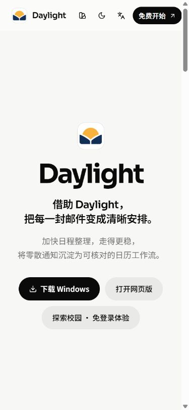

### 设计选择

- 保留原产品首页，把首要操作调整为「三分钟体验 · 免登录」，增加「技术与实测」。下载继续放在下载区。
- `/experience` 和 `/evidence` 使用独立懒加载页面，继续使用 shadcn 的 Button、Card、Input、Label 与现有主题。
- 320px 手机首屏放置开始按钮；步骤目录折叠，执行成功后自动定位到结果卡。按钮高至少 44px，主要操作高 48px。
- 用户可以回看已完成步骤、展开原文和工具记录、重新开始。加载失败保留上一结果，提供重试。
- 两个公开页面的阅读与执行各自进行，体验接口不依赖工作区全量快照。

### 改后

截图和逐尺寸检查保存在本目录 images 与 evidence。320px 的开始按钮位于首屏约 **381–429px**；布局宽度未超过视口。

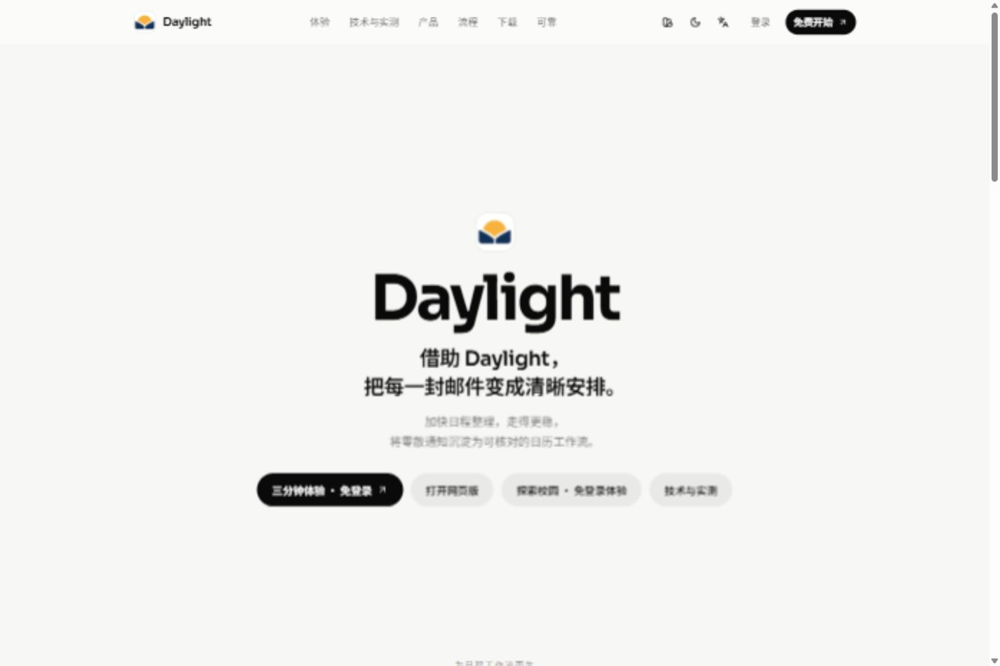

<p> 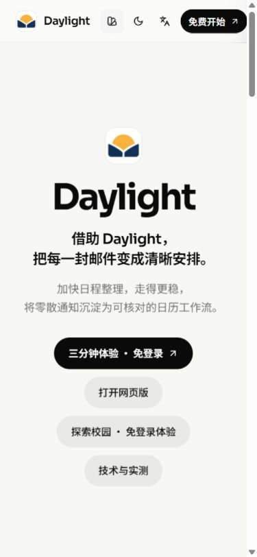</p>

首页改前与改后：首要操作调整为免登录体验，并直接提供技术页。两张手机截图均来自浏览器实际页面。

| 前后变化 | 改前 | 改后 |
| --- | --- | --- |
| 评委开始体验 | 下载或进入登录工作区 | 首页与登录页可直接进入七步体验 |
| 手机主要操作 | 需要理解多个产品入口 | 首屏开始按钮、折叠步骤目录、执行后定位结果 |
| 执行依据 | 需要进入工作区查看 | 每步直接展开原文、实际工具与参数 |
| 设计与实测 | 分散在工程文档 | 独立技术页按五项考核连到原始记录 |

<p>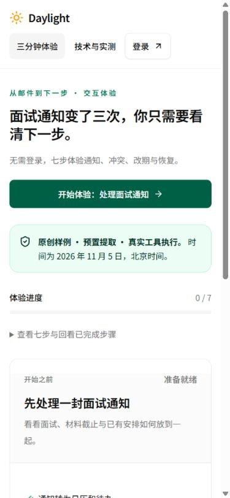 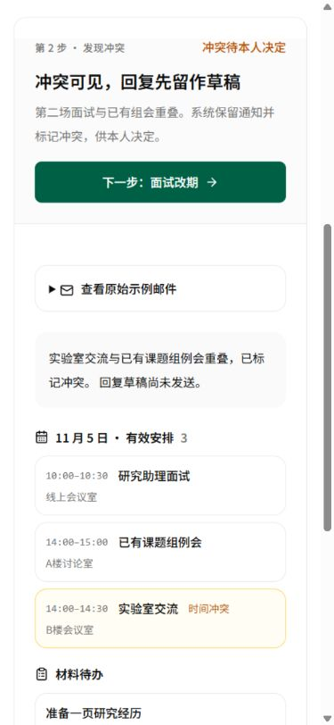</p>

左图为改后首屏；右图显示已有组会与实验室交流的重叠，操作按钮和结果在同一条阅读路径上。

## 3. 云原生架构与技术选型

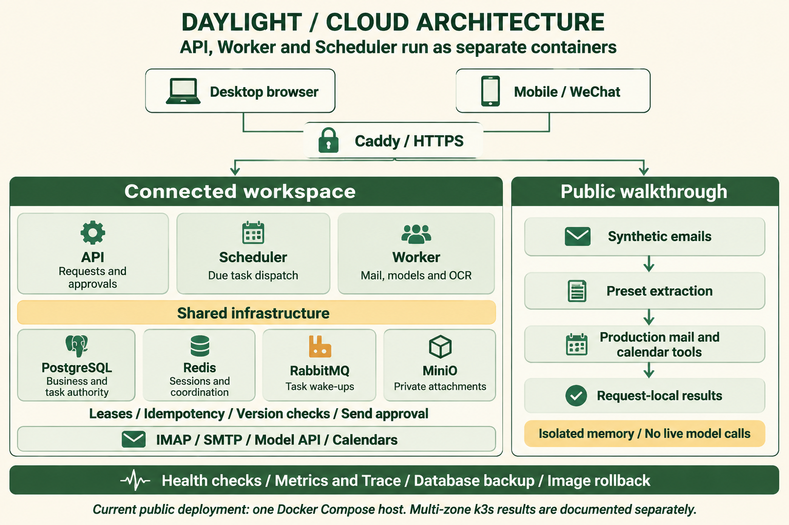

图使用 **gpt-image-2.5**、全英文标签生成；中文设计逻辑如下。可编辑的关系图源见 [Mermaid](architecture.mmd)，最终提示词见 [architecture-en-prompt.txt](architecture-en-prompt.txt)。

| 选择 | 原因与设计逻辑 | 代价与运行方式 |
| --- | --- | --- |
| API / Worker / Scheduler 分离 | HTTP 交互与邮箱、模型、OCR 的耗时特征不同；到期检查单独负责派发 | 当前公网在一台主机运行三个角色；扩容时分别确定负载和资源请求 |
| PostgreSQL 保存权威状态 | 邮箱业务和任务需要共享、版本校验及一致的恢复依据 | 数据库可用性直接影响真实业务；版本冲突显式处理 |
| RabbitMQ 唤醒，数据库任务留痕 | 消息负责及时唤起 Worker，任务状态、租约和幂等键负责可恢复执行 | 任务恢复依据数据库；保留过期租约与重复投递验证 |
| Redis 临时协调与会话 | 将短期状态与权威业务数据区分，支持跨应用角色协调 | 认证、会话和限额的故障语义依具体路径定义 |
| 私有 MinIO 附件 | 附件独立于应用容器生命周期，访问按归属鉴权 | 需备份对象与元数据；PDF/OCR 资源需单独限制 |
| 公开体验使用请求内内存 | 评委只需原创样例的七步工具结果；每次请求最多七步，重新执行可恢复相同语义 | 增加少量 API CPU；每步均重新计算至当前节点，最多四个并行请求，忙时 429 |
| 前端只发送步骤编号 | 收敛公开执行面，服务端固定输入、固定工具和有限工作量 | 体验不接收自由邮件和模型配置；真实业务由登录工作区承接 |

真实业务仍使用原有持久化架构。公开体验通过 `runStorageSnapshot` 建立只读合成快照，让 `readSettings()` 取得公开演示设置；`processEmails()`、`parseExtraction()`、冲突检测、任务生成和 Trace 在该作用域执行。每次请求新建 store 和 recorder，返回白名单 DTO，不执行数据库提交。

公网主机为 **2 vCPU / 3499 MiB**，8 个常驻服务：Caddy、API、Worker、Scheduler、PostgreSQL、Redis、RabbitMQ、MinIO。历史多区 k3s 结果见 [容量与容错设计](../distributed-ha-and-capacity.md)。两种环境分别记录。

## 4. Agent 数据流与异常恢复

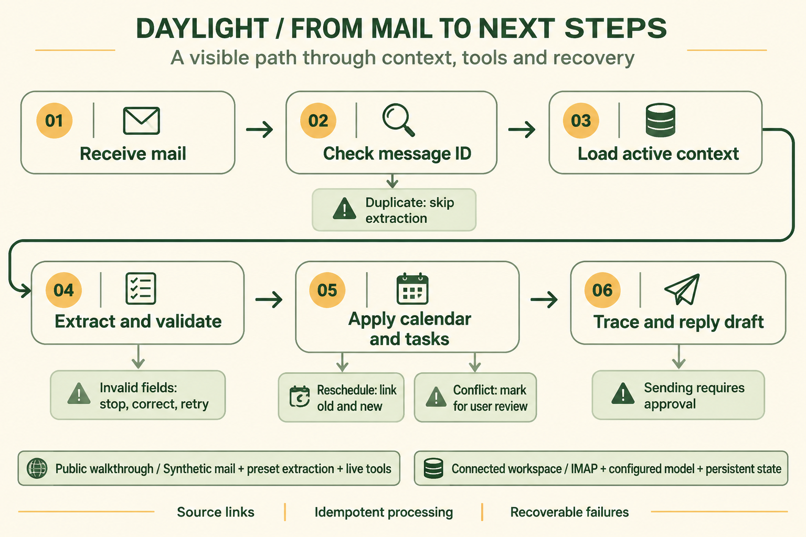

图使用 **gpt-image-2.5**、全英文标签生成。中文关系与可编辑图源见 [Mermaid](dataflow.mmd)，提示词见 [dataflow-en-prompt.txt](dataflow-en-prompt.txt)。

### 七步实际结果

| 步骤 | 输入变化 | 工具实际行为 |
| --- | --- | --- |
| 收到面试 | 11 月 5 日 10:00–10:30，材料 11 月 4 日 18:00 截止 | 新建日程与独立待办，保留原文，生成未发送草稿 |
| 发现冲突 | 实验室交流 14:00–14:30 与已有组会 14:00–15:00 重叠 | 安排入历并标记冲突，保留候选协调与回复草稿 |
| 面试改期 | 10:00 调至 15:00 | 原安排标 cancelled，新旧通过 previousEventId / replacementEventId 关联 |
| 重复收信 | 再处理第一封邮件 ID | 重复计数 1，跳过提取，日程与待办数量相同 |
| 异常阻断 | 一份预置提取含无效时间 | 校验报错，整封没有部分应用，失败步骤留下记录 |
| 修正重试 | 同一封邮件改为有效时间 | 新增补充交流；先前失败尝试仍可回查 |
| 取消留痕 | 收到面试取消 | 15:00 安排标 cancelled，保存原因；材料待办保持待本人处理 |

公开体验的模型提取是预置，工具是实时执行。基础邮件链使用结构化 JSON；小 D 工具规划和资料检索仍按原路径运行。Trace 中的说明为执行摘要，界面展示实际工具名称与参数。

### 逐步页面证据

下列为正式 HTTPS 站点 390×844 浏览器的实际页面截图，按七步分别保存。每个步骤在状态更新后独立核对再截图。

| 1 · 通知与材料 | 2 · 时间冲突 | 3 · 新旧改期 |
| --- | --- | --- |
| 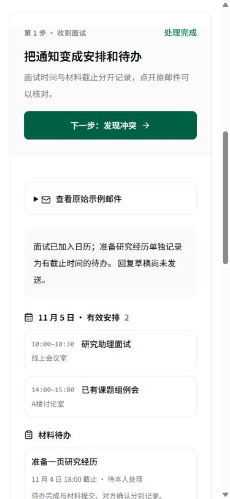 |  | 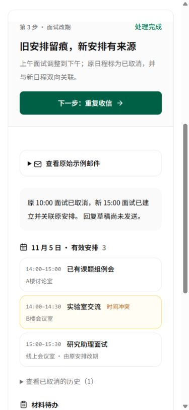 |

| 4 · 邮件去重 | 5 · 整封失败 | 6 · 修正重试 |
| --- | --- | --- |
| 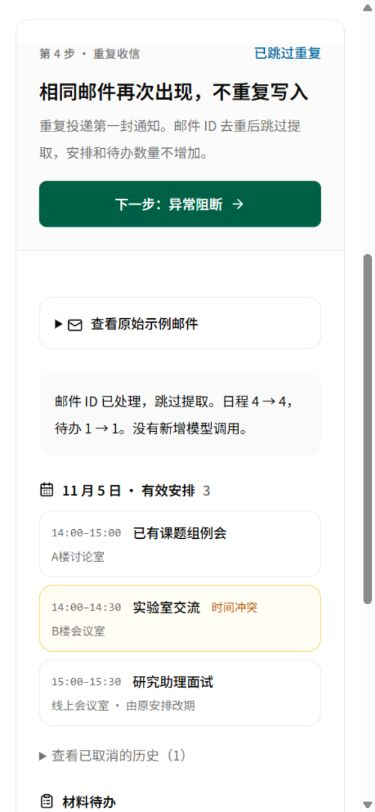 | 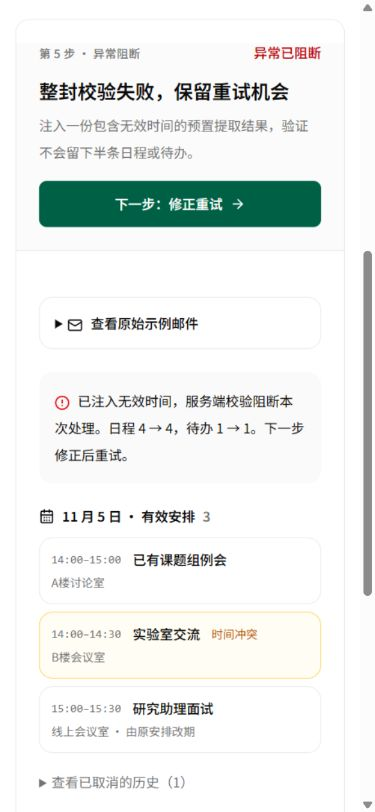 | 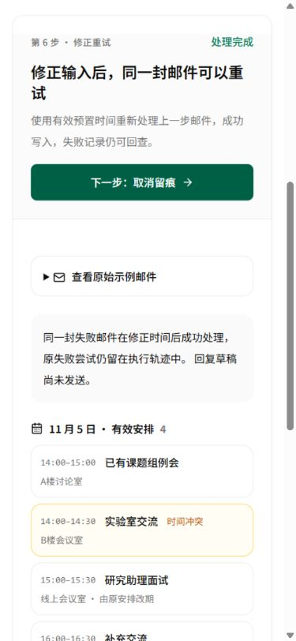 |

<p>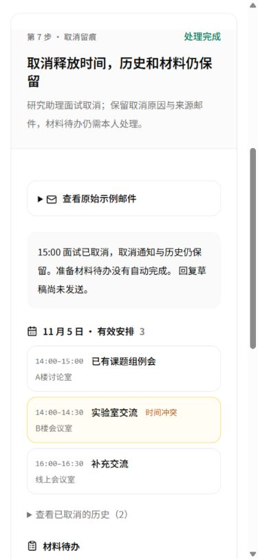 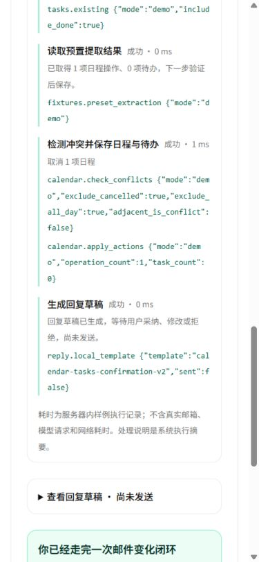</p>

第七步保留取消记录与材料待办；展开工具记录后可核对 `calendar.active_events`、`tasks.existing`、`calendar.apply_actions` 等执行参数。

### 前端加载错误与恢复

本地隔离服务第一次请求返回 503，界面显示「重试加载」；点击后读取成功，开始按钮恢复可用，已有组会出现。这组图片来自本地故障注入服务。

<p>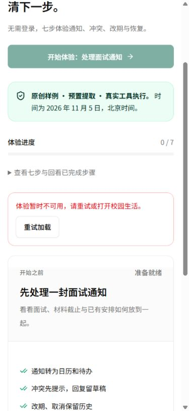 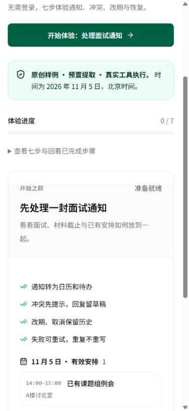</p>

### 演示视频

[三分钟中文字幕讲解 MP4](../../public/competition/demo.mp4)，1920×1080、约 1.4 MB、无音轨。视频由以上实际页面截图、英文架构与数据流图、精确性能图组成；片头和讲稿标明样例来源。12 个镜头的源文件和字幕见 [视频清单](evidence/video-manifest.json)，复现脚本为 [competition-walkthrough.py](../../scripts/competition-walkthrough.py)。

## 真实模型回归

2026-11-03 使用当前账号配置的 API：`https://api.modelverse.cn`，请求模型名 `deepseek-v4.1-flash`。先运行 3 个预检样本，再运行固定 15 例，每例一次请求、无自动重试。输入为公开合成邮件；人工答案不传入模型。

| 项目 | 结果 |
| --- | ---: |
| 预检 | 3 / 3 通过 |
| 完整固定回归 | 15 / 15 通过 |
| 完整集 p50 / p95 | 7.299 / 15.795 秒 |
| 输入 Token | 41,863 |
| 其中缓存输入 Token | 33,920 |
| 输出 Token | 10,169 |
| 单价配置 | 未配置，费用字段保留 null |

耗时包含生产 `extractEvents` 的真实请求、解析和内存 `importEmail` 应用。该组测量在本地评测客户端运行；真实公网邮箱与 IMAP 验证沿用各自已有记录。底层服务使用请求中的模型名称登记。

逐例结果：[完整 JSONL](evidence/model-full/results.jsonl) · [运行条件与源码摘要](evidence/model-full/manifest.json) · [汇总](evidence/model-full/summary.json) · [预检](evidence/model-preflight/summary.json)。数据集为 [固定合成邮件](../submission/evaluation-cases.json)。

复现：

```powershell
node scripts/evaluate-mail.js --validate
node scripts/evaluate-mail.js --live --settings data/settings.json --limit 15 --settings-user <本人用户ID>
```

## 5. 成本与性能

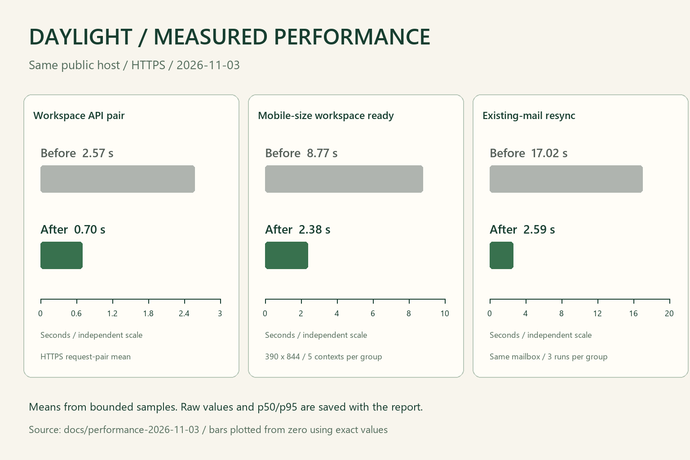

这张图先调用 **gpt-image-2.5** 生成视觉方案，检查发现柱长与刻度未完全对齐，最终用 [绘图脚本](../../scripts/competition-figures.py) 按零起点精确落图。三组数据来自 [同日已发布报告](../performance-2026-11-03/README.md)，没有与新体验接口的耗时混合。

| 同口径平均耗时 | 优化前 | 优化后 | 样本条件 |
| --- | ---: | ---: | --- |
| 工作区接口组合 | 2.57 s | 0.70 s | 同公网主机 HTTPS 小样本，p50/p95 与逐样本见原报告 |
| 手机尺寸工作区可用 | 8.77 s | 2.38 s | 390×844，每组 5 个新 context |
| 已有邮件重复同步 | 17.02 s | 2.59 s | 同一真实邮箱各 3 次，测去重路径 |

### 成本计算器

技术页的计算器允许修改新邮件数、输入/输出 Token、缓存比例、三种单价和月基础设施费用。公式：

```text
单封模型费用 = ((输入 - 缓存输入) × 输入单价
             + 缓存输入 × 缓存单价
             + 输出 × 输出单价) / 1,000,000
月合计估算 = 单封模型费用 × 月新邮件数 + 月基础设施费用
```

默认演算为 1000 封、4000 输入、500 输出、0% 缓存、输入/输出/缓存单价 1 / 4 / 0.02 元每百万 Token、基础设施假设 ¥100/月，得出模型 ¥6、合计 ¥106/月。用户可替换为实际供应商和账单数据。OCR、Embedding、流量、存储增长、重试与运维另计。

公开体验每次最多执行七个样例步骤，模型调用 0 次。真实模型已记录 usage，待填供应商实际单价后可直接重算；当前未知费用字段保持 null。现有主机复用，本轮没有新增云采购。调用登记见 [预算与生成记录](generation-and-budget.md)。

### 新公开接口的有界公网测量

Windows 客户端通过 HTTPS 请求完整七步 `GET /api/experience?step=7`，先顺序 20 次，再进行 5 批各 4 并发；记录客户端墙钟耗时，失败响应也计入采样。结果与原始样本见 [public-benchmark.json](evidence/public-benchmark.json)。该接口执行预置提取与实时工具。

| 负载 | 成功 | 平均 | p50 | p95 | 最大响应 |
| --- | ---: | ---: | ---: | ---: | ---: |
| 顺序 | 20/20 | 63.27 ms | 49.32 ms | 88.78 ms | 16,523 B |
| 4 并发，5 批 | 20/20 | 76.99 ms | 68.56 ms | 122.95 ms | 16,523 B |

## 6. 验证与发布

- 完整本地回归：**967 项，938 通过、29 条件跳过、0 失败**。[日志](evidence/regression.txt)
- 新链路与接口面定向：**11/11**。[日志](evidence/targeted.txt)
- `DAYLIGHT_RUNTIME=production` 下新链路：**6/6**，无网络与数据库连接。[日志](evidence/production-tests.txt)
- 前端构建通过，已有大 chunk 提示保留。[构建记录](evidence/build.txt)
- 桌面与手机浏览器、公网业务检查、发布镜像、源码摘要、备份路径及逐样本数据见 [发布记录](deployment.md)。

### 代码入口

- [公开隔离执行与路由](../../server/experience.js)
- [原创样例](../../shared/experience-fixtures.js)
- [七步交互页面](../../src/pages/experience-page.jsx)
- [技术与成本页面](../../src/pages/evidence-page.jsx)
- [成本公式](../../shared/cost-estimate.js)
- [业务与权限验证](../../server/experience.test.js)
- [公开接口有界测量](../../scripts/benchmark-experience.mjs)

## 7. 交付前继续补齐的现场材料

1. 按 [用户对照方案](value-study.md) 记录真人处理耗时、遗漏和修正。
2. 在手机微信中检查二维码、七步、原文折叠、技术图片与返回操作；校园定位与外部导航另验。
3. 采用 [三分钟讲稿](demo-script.md) 排练，把现场镜像与提交源码摘要保持一致。
4. 填入实际模型单价、图片账单与服务器月账单，完成费用复算；继续在 ¥500 新增预算内执行。

## 8. 评审材料公开阅读补充（2026-11-04）

发布后检查发现，GitHub 匿名访问接口返回404，技术页原有仓库证据链接需要访问权限。本轮把经过检查的图文和合成评测证据另存为官网静态资料，技术页的主要证据链接直接进入站内页面。源码仓库保留现有访问设置，评委源码访问方式已向参赛者征询。

| 资料 | 官网入口 | 设计选择 |
| --- | --- | --- |
| 五项图文记录 | [报告](https://daylight.yunforis.com/competition/report.html) | 由受控 Markdown 生成静态 HTML；图像、逐例模型结果和原始测量随资料复制 |
| 性能前后与资源 | [性能报告](https://daylight.yunforis.com/competition/performance-report.html) | 保留同口径时间、样本条件和原有图源 |
| 容量设计与实测 | [设计](https://daylight.yunforis.com/competition/capacity-design.html) · [历史 k3s 实测](https://daylight.yunforis.com/competition/k8s-measurements.html) | 独立环境、日期与版本分开记录；公开副本省略一行凭据相关操作说明，统计保留 |
| 启动与部署 | [复现步骤](https://daylight.yunforis.com/competition/reproduce.html) | 先展示在线入口、隔离 Demo、Compose 与复查命令，再指向源码获取 |

实现使用已有 Python-Markdown 生成 HTML，数据和媒体按白名单复制；源码入口继续遵守仓库权限。静态资料随应用镜像交付，访问走 HTTPS 与现有静态资源路径，不读取用户邮箱。生成器为 [competition-public-report.py](../../scripts/competition-public-report.py)。复现依赖 `Markdown`，执行 `python scripts/competition-public-report.py` 后再构建。

手机检查时，原先展开的长目录把标题推到视口约1069px。改为标题先出现、目录点击展开，标题约287px即可看见；长表格在自身范围内横向滚动，图片随屏幕缩放。改前与改后画面随 images 保存；官网快照保留生成当时的正文与发布归档，后续发布证据继续写入本目录。

公开页面、模型 JSON/JSONL 的 HTTP 状态及逐文件哈希一并加入 `verify-competition.mjs`，可直接核对线上与交付文件。

<p>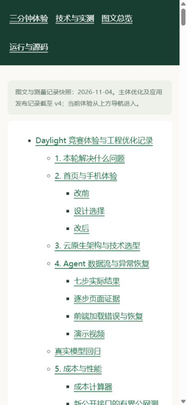 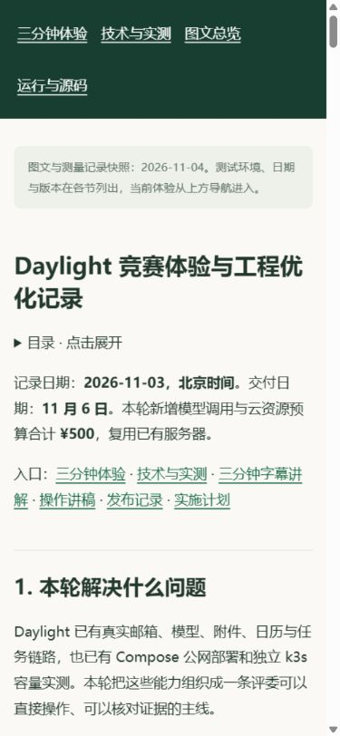</p>
