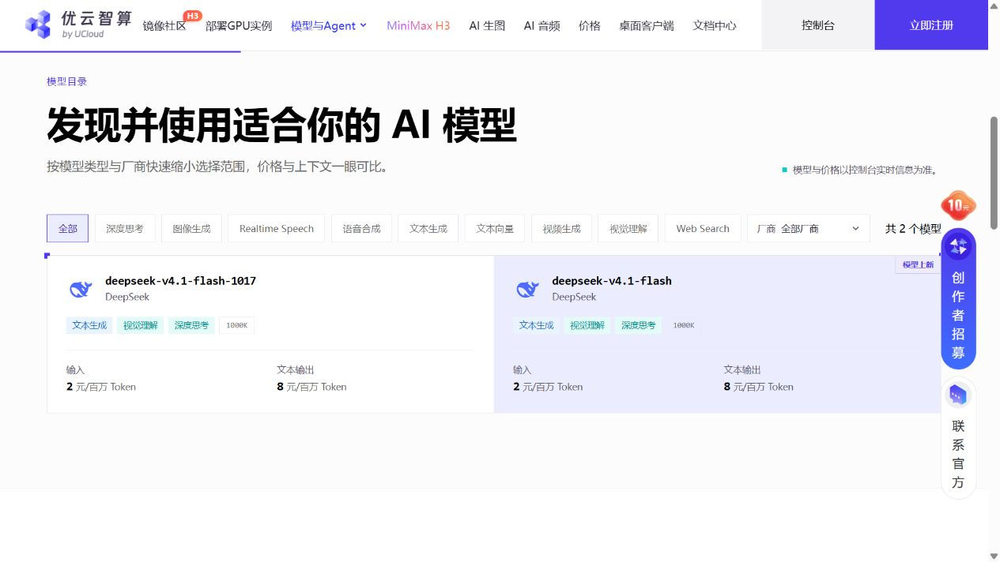
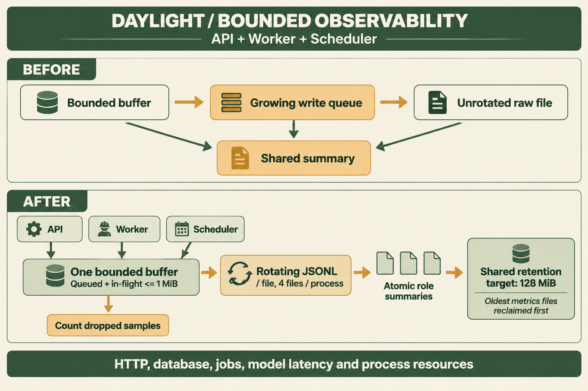
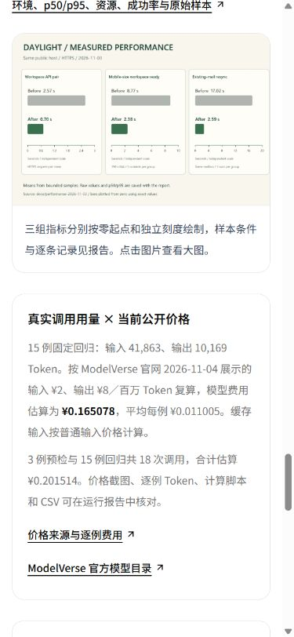

# Daylight 成本与运行观测优化

记录日期：**2026-11-04，北京时间**。继续使用现有 2 vCPU / 3499 MiB 公网主机，新增模型与云资源预算合计 ¥500。

[在线体验](https://daylight.yunforis.com/experience) · [技术与实测](https://daylight.yunforis.com/evidence) · [本轮图文报告](https://daylight.yunforis.com/competition/operations-report.html) · [上一轮完整交付](../competition-2026-11-03/README.md)

**最新资料发布：**图文与原始证据已随 v8 上线，33 项公网检查及 320 份运行文件 SHA-256 核对通过。[v8 发布、备份与验证](deployment-v8.md)。下文保存 v7 应用改动及其实测窗口。

## 本轮改进

| 考核点 | 改动 | 证据 |
| --- | --- | --- |
| 场景价值 | 以单次邮件提取的实测用量估算使用成本，方便评委判断服务负载与商业化空间 | 逐例费用、每千次提取估算、可编辑计算器 |
| 云原生 | API、Worker、Scheduler 各自保存指标，使用同一个持久卷与共享保留策略 | 三服务摘要、轮转、退出刷新与部署配置 |
| Agent 链路 | 继续记录模型、任务、数据库与工具延迟，定位长任务中的主要耗时 | 指标目录、原始 JSONL、原有 Trace |
| 工程交付 | 处理慢磁盘、采集内存、文件增长、摘要覆盖与退出时序 | 故障注入测试、候选镜像验证、公网采集检查 |
| 成本性能 | 查验 ModelVerse 公开价格；对现有真实 usage 复算；测量实际采集开销 | 官方截图、CSV、计算脚本、同主机 off/on 数据 |

## 模型成本

### 改前与依据

上一轮固定 15 例回归及 3 例预检已保存真实 API usage，采样时未配置单价。2026-11-04 访问 [ModelVerse 官方模型目录](https://www.compshare.cn/model-api)，搜索 `deepseek-v4.1-flash`，对应模型卡片展示：

| 字段 | 当前展示 |
| --- | --- |
| 模型 | deepseek-v4.1-flash |
| 控制台模型标识 | umodel-1789039387 |
| 输入 | ¥2 / 百万 Token |
| 输出 | ¥8 / 百万 Token |
| 缓存输入单价 | 卡片未单列；本报告按普通输入 ¥2 计算 |
| 官方价格提示 | 模型与价格以控制台实时信息为准 |



图中包含两个相邻模型，右侧为本项目使用的 `deepseek-v4.1-flash`。价格观察的 URL、时间、模型链接与可见文字保存在 [来源记录](evidence/official-model-price.json)。

### 计算方法与结果

公式：`（总输入 Token × 2 + 输出 Token × 8）/ 1,000,000`。总输入包含缓存输入，缓存部分只计入一次。

| 调用组 | 次数 | 输入 Token | 缓存输入 Token | 输出 Token | 公开价估算 |
| --- | ---: | ---: | ---: | ---: | ---: |
| 预检 | 3 | 8,446 | 4,096 | 2,443 | ¥0.036436 |
| 完整固定回归 | 15 | 41,863 | 33,920 | 10,169 | ¥0.165078 |
| 合计 | 18 | 50,309 | 38,016 | 12,612 | **¥0.201514** |

15 例平均每次输入 **2,790.87**、输出 **677.93** Token，费用估算 **¥0.0110052 / 次**。按同样平均用量，每月 1,000 次提取的模型费用估算 **¥11.0052**；计算器初始基础设施 ¥100 为演算输入，对应合计 **¥111.0052**。实际运营应计入主机、磁盘、网络、附件存储、备份，以及 OCR、Embedding、重试和问答调用。

成本优化选择：同一封已处理邮件用 ID 去重，重复同步跳过模型；结构化提取控制上下文；公开七步体验复用预置提取与真实工具执行。需要进一步优化时，优先对输出长度、上下文和缓存定价逐项测量，再比较模型质量与时延。

本次为**按当前公开价估算**。原始采样文件保持当时的 `cost: null`，新增估算用 SHA-256 关联原文件。供应商账单按出账记录登记。

- [逐例费用 JSON](evidence/cost-estimate.json) · [CSV](evidence/cost-estimate.csv)
- [计算脚本](../../scripts/competition-cost-report.mjs)：`node scripts/competition-cost-report.mjs`
- 完整固定回归的输入、断言、时延与 usage：[上一轮模型评测](../competition-2026-11-03/README.md#真实模型回归)

## 运行观测

### 发现的问题

服务器原版本 `public-competition-20261103-v6` 的三个服务采集开关为 0，指标持久卷可写、目录为空。代码已有 HTTP、PostgreSQL、Redis、任务、模型、IMAP、对象存储和进程指标。

复查发现：样本 buffer 限制了条数，但异步写盘进行时，后续 text 会累积到另一个队列；原始 JSONL 持续追加；三个角色写同一个 `metrics-summary.json`；退出先生成摘要、异步写盘随后完成。

### 设计与技术选型



图由 **gpt-image-2.5** 生成，英文标签已检查。[完整提示词](observability-prompt.txt)。下方链路表示每个进程的采集器，API、Worker、Scheduler 分别运行，各自保存 1 MiB 有界缓冲与独立摘要。

| 项目 | 原实现 | 本轮实现 |
| --- | --- | --- |
| 内存 | buffer 限制条数，后续写队列继续增长 | 待写与在途合计最多 10,000 条 / 1 MiB；先到者生效 |
| 慢磁盘 | 等待块不断入队 | 仅有一个写操作，缓冲满计 dropped |
| 聚合内存 | 每个指标有 reservoir | 同时限制指标名称、数值、128 个指标、每项 4,000 个值 |
| 原始文件 | 持续追加 | 单文件 8 MiB，每进程最多 4 份 |
| 重建后的历史 | 按新容器名继续创建 | 共享目录按最旧文件回收，保留目标 128 MiB |
| 摘要 | 三角色覆盖同一文件 | `metrics-summary-<host>-<pid>.json`，临时文件写完后原子替换 |
| 停止 | 摘要早于最后一次写盘完成 | 等待异步 flush 完成，再写最后摘要，服务 shutdown 等待该 Promise |
| 汇总 CLI | 只读取一个摘要 | 读取全部角色摘要，报告损坏摘要；支持带空格的筛选参数 |

继续使用 Node 内置 fs、JSONL 与现有持久卷，减少 2 核主机的常驻组件。原始样本可直接重算分位数，Trace 负责业务来源与步骤。采集失败通过 `dropped`、`sinkError` 显示，应用继续处理请求。目录阈值由各写进程检查，三个服务并发写入时可短暂增加在途批次与临时摘要的字节数。

代码入口：[metrics.js](../../server/metrics.js)、[metrics-sink.js](../../server/metrics-sink.js)、[生命周期](../../server/service-health.js)、[汇总 CLI](../../scripts/metrics-report.mjs)、[Compose](../../docker-compose.yml)。

### 验证

新增 6 项验证：慢写时内存与在途限制、ENOSPC 最后计数、文件轮转、历次实例文件回收、三进程并发摘要与 CLI 汇总、指标基数限制。连同已有采集与服务生命周期共 **23/23**，在现有服务器候选镜像内通过。

测试通过真实临时文件和可控慢写／失败注入执行，各自使用独立目录。[云端测试记录](evidence/metrics-cloud-tests.txt)。

完整隔离交付验证同时通过：**973 项，944 通过、29 条件跳过、0 失败**；构建、评测语料、隔离 Demo、部署配置五阶段通过。[验证摘要与源码摘要](evidence/release-verification.json)。技术页与报告在 320、390、1440px 共六项布局检查通过，费用从 1,000 改为 2,000 次时即时算出 ¥122.0104，缓存占比 101% 显示输入提示。[浏览器记录](evidence/browser-verification.json)。

## 采集开销实测

同一公网主机、Linux x64 / Node v22.23.3，容器限制 **1 CPU / 256 MiB**，无网络访问。使用独立 Docker 持久卷，关闭与开启各 1 轮预热、5 轮测量，交替顺序；每轮 20,000 条，100% 采样，每批 1,000 条后等待写盘。结果是各轮中位数。

| 指标 | 关闭采集 | 开启采集 |
| --- | ---: | ---: |
| 每条记录阶段耗时 | 0.92 μs | 26.50 μs |
| 20,000 条完整处理 | 22.97 ms | 978.74 ms |
| 后台 flush 合计 | 0.93 ms | 414.15 ms |
| CPU 时间 | 21.46 ms | 620.14 ms |
| 采样 RSS 峰值 | 55.00 MiB | 66.32 MiB |
| 原始文件及摘要 | 0 | 约 5.08 MiB |
| 丢样 / 写错误 | 0 / 0 | 0 / 0 |

这是采集器与持久卷文件 I/O 的隔离测量，应用版本、样本和顺序固定。测试结束后清理其专用空卷。先前 `/tmp` tmpfs 的探索测量另存 [JSON](evidence/metrics-cloud-tmpfs-overhead.json)，本表采用持久卷结果。线上 HTTP 与业务负载通过发布后的实际请求另行检查。

[全部轮次 JSON 与源码摘要](evidence/metrics-cloud-overhead.json) · [测量脚本](../../scripts/benchmark-metrics.mjs)

```sh
node scripts/benchmark-metrics.mjs --runs=5 --samples=20000 --out=work/metrics-overhead.json
node --test server/metrics.test.js server/metrics-bounds.test.js server/service-health.test.js
```

## 发布与公网检查

### v7 发布与版本追踪

2026-11-04 已将成本计算器和采集器发布到公网。发布前保存 PostgreSQL custom dump、配置、前端和原镜像，候选验证通过后更新 API、Worker、Scheduler。

| 项目 | 结果 |
| --- | --- |
| 应用镜像 | `daylight:public-competition-20261104-v7` |
| 镜像 ID | `sha256:7cd01b30ebfc137b4ea16b8a17afbe67f76c4078d2fa93f27fca3cba0a66d41d` |
| 运行代码提交 | `a5183f62dd917ad4218414154c21c5a75c80241c` |
| 候选文件 | 309 份，逐文件 SHA-256 校验通过 |
| 候选包 SHA-256 | `8d3f25ca16ae65c26ec3f425964242fe5d9621c9653bc958ee28a62c56d6cd32` |
| 发布前备份 | `/opt/daylight-backups/before-observability-20261104004754` |
| 候选镜像内测试 | 29/29，生产模式、关闭网络，覆盖采集、生命周期及七步工具链 |
| 运行健康 | 8 个服务 healthy；三个应用 restart=0、OOM=false |
| 公网复查 | 25 项通过，包含业务、权限、费用 JSON、报告、图像哈希和视频 206 |

[文件清单](evidence/release-v7-manifest.json) · [候选测试](evidence/candidate-tests-v7.txt) · [发布日志](evidence/deploy-v7.txt) · [公网逐项结果](evidence/public-verification-v7.json)

本节保存 v7 的发布与实测快照，图文、截图及原始证据继续随静态资料版本交付。

### 三角色实际采集

采样窗口为 **00:48:37.113–00:49:29.543，UTC+08:00**，包含发布启动、公开验证和正常依赖活动。读取 readiness 时，三个进程均启用采集并成功写入：

| 角色 | 已写入 | 丢样 | 写入错误 |
| --- | ---: | ---: | --- |
| API | 414 | 0 | 无 |
| Worker | 801 | 0 | 无 |
| Scheduler | 158 | 0 | 无 |

共享卷当时共有 **6 个文件、384,818 字节**；汇总读取 **1,409 条样本、16 个指标**，格式错误为 0。三个角色各有独立摘要，源码提交均为 `a5183f6`。摘要每 15 秒刷新，readiness、原始文件与摘要分别记录各自读取时刻的计数。

| 指标 | 样本数 | p50 | p95 | 最大值 |
| --- | ---: | ---: | ---: | ---: |
| HTTP 服务端处理 | 75 | 17.368 ms | 44.431 ms | 1,262.527 ms |
| PostgreSQL 查询 | 844 | 0.890 ms | 4.507 ms | 351.386 ms |
| Redis 命令 | 11 | 8.459 ms | 15.762 ms | 15.762 ms |
| 业务快照读取 | 3 | 27.592 ms | 663.336 ms | 663.336 ms |

这里汇总的是启动及验证窗口中的混合操作。后续定位瓶颈时，按接口、任务和 Trace 进一步拆分，再根据相同业务负载比较。原始记录包含窗口、进程、配置上限、资源和指标：[线上采集 JSON](evidence/metrics-live-v7.json)。

### 七步业务与手机页面复查

公开七步路径每个窗口执行 20 次顺序请求与 5 批 4 并发请求，均 **40/40 成功**，最大响应 16,523 字节。该路径使用预置提取与实时日历、待办和 Trace 工具。

| 发布窗口 | 顺序 p50 / p95 | 4 并发 p50 / p95 | 成功数 |
| --- | ---: | ---: | ---: |
| 开启采集前 | 59.594 / 141.712 ms | 87.041 / 646.339 ms | 40/40 |
| 开启采集后 | 40.843 / 81.657 ms | 100.453 / 346.226 ms | 40/40 |

两组用于发布后的业务复查；网络、启动和后台活动随现场窗口变化。采集本身的开销采用上节固定容器、固定样本与交替轮次的持久卷测量。

[开启前原始样本](evidence/public-metrics-off.json) · [开启后原始样本](evidence/public-metrics-on.json)

公网技术页在 **390×844** 视口中显示完整价格、Token、费用与来源链接。此前 320、390、1440px 技术页和报告共六项布局检查通过；费用输入、边界提示和报告锚点检查结果保存在 [浏览器记录](evidence/browser-verification.json)。



## 预算登记

- 18 次文本模型调用：按当前公开价估算 **¥0.201514**。
- 本轮新增图片 1 次 `gpt-image-2.5`，连同上一轮共 7 次；图片费用按供应商出账记录登记。
- 新增云资源采购 0 项，复用现有主机；服务器月成本按账单进入运营成本。
- 新增预算上限继续为 **¥500**。
