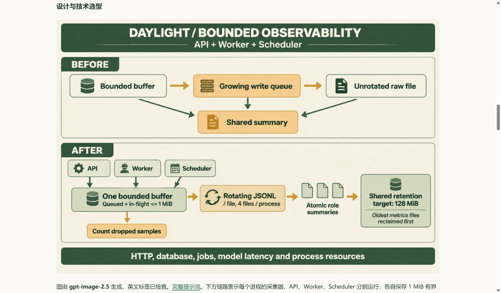

# v8 静态证据发布与最终复查

日期：**2026-11-04，北京时间**。本次将 v7 的发布、指标实测、费用来源、手机截图和原始证据一同交付到公网。

[三分钟体验](https://daylight.yunforis.com/experience) · [技术与实测](https://daylight.yunforis.com/evidence) · [在线图文报告](https://daylight.yunforis.com/competition/operations-report.html) · [本轮设计与测量](README.md)

## 版本与交付内容

| 项目 | 记录 |
| --- | --- |
| 当前镜像 | `daylight:public-competition-20261104-v8` |
| 镜像 ID | `sha256:c8bbb6c23a59646bdce179e638d33a526408b2210a644bda8b4f7a7eb0b9fe1f` |
| 基础镜像 | `daylight:public-competition-20261104-v7`，ID 前缀 `7cd01b30ebfc` |
| 应用代码提交 | `a5183f62dd917ad4218414154c21c5a75c80241c` |
| 静态资料提交 | `94376e7c3ff7dd9a9c37902323b3c9f78081b764` |
| 更新文件 | 13 份，均位于 `dist/competition/` |
| 上传压缩包 | 100,346 字节 |
| 压缩包 SHA-256 | `14487f4e8846bd75460b4fc8c3998f1fdd8aee3e2816bb0126f77c727bf64100` |
| 发布前备份 | `/opt/daylight-backups/before-evidence-20261104005834` |
| 候选测试 | 29/29，生产模式、关闭网络 |
| 公网检查 | 33 项通过 |
| 运行文件核对 | 311 份 dist 文件与 9 份 v7 后端／脚本文件，320 份 SHA-256 一致 |

## 设计选择与执行

1. 生成公开 HTML，检查站内证据链接，重新构建前端。
2. 将完整 dist 与 v7 文件清单逐文件比较；全部改动都属于报告及相关证据。采用基于 v7 镜像 ID 的静态增量层，压缩上传约 98 KiB，复用已验证的应用与运行依赖。
3. 发布脚本获取部署锁，校验三个应用的基础镜像 ID；保存数据库 custom dump、可读 TOC、配置、原前端与镜像 ID。
4. 校验压缩包目录与文件 SHA-256，构建独立 v8 镜像标签，运行 29 项候选测试及费用／报告检查。
5. 更新 API、Worker、Scheduler，等待健康，执行七步业务、匿名权限、费用和资料检查。采集配置继续启用。
6. 从 Windows 客户端通过正式 HTTPS 校验 33 项路径与字节摘要；服务内核对完整 dist 与 v7 更新代码的 320 份文件。
7. 在公网报告的 320、390、1440px 视口检查布局，三张图片均成功加载，整页无横向溢出。

在线图文保存 **v7 实测快照**；本文件记录随后 v8 的资料发布结果。两个记录分别标明日期、版本与采样来源。

## 公网页面实图

1440px 视口中的观测设计图，图内采用英文，中文选型逻辑在正文说明：



手机技术页的 Token、费用和来源入口见[390px 页面截图](images/cost-mobile.jpg)。

## 当前三角色采集

2026-11-04 **01:00:26，UTC+08:00** 读取各进程 readiness：

| 角色 | 已写入 | 丢样 | 写入错误 | 应用状态 |
| --- | ---: | ---: | --- | --- |
| API | 325 | 0 | 无 | healthy，restart=0，OOM=false |
| Worker | 1,043 | 0 | 无 | healthy，restart=0，OOM=false |
| Scheduler | 187 | 0 | 无 | healthy，restart=0，OOM=false |

Caddy、PostgreSQL、Redis、RabbitMQ、MinIO 同时 healthy，总计 8 个服务。采集来源仍标记应用代码提交 `a5183f6`，静态资料提交由发布清单单独保存。

## 验证与原始文件

- [完整发布清单与 dist 摘要](evidence/release-v8-manifest.json)
- [候选测试](evidence/candidate-tests-v8.txt) · [部署输出](evidence/deploy-v8.txt)
- [公网 33 项与逐文件哈希](evidence/public-verification-v8.json)
- [实际角色、readiness、320 文件核对](evidence/runtime-verification-v8.json)
- [三种视口与图片加载结果](evidence/public-report-layout-v8.json)

费用、采集机制、云端故障注入与持久卷开销见[图文报告](README.md)。本次新增文本模型调用与云资源采购均为 0。

## 应用回滚

发布脚本在应用更新后的检查失败时恢复原环境文件及三个应用镜像。手动回退到 v7 使用本次备份：

```sh
cd /opt/daylight
cp /opt/daylight-backups/before-evidence-20261104005834/compose.env deploy/compose.env
./manage.sh up -d --no-deps --no-build --pull never --wait --wait-timeout 180 api worker scheduler
curl -fsS https://daylight.yunforis.com/health/ready
```

该流程恢复应用版本。数据库和附件继续使用现有持久卷。
