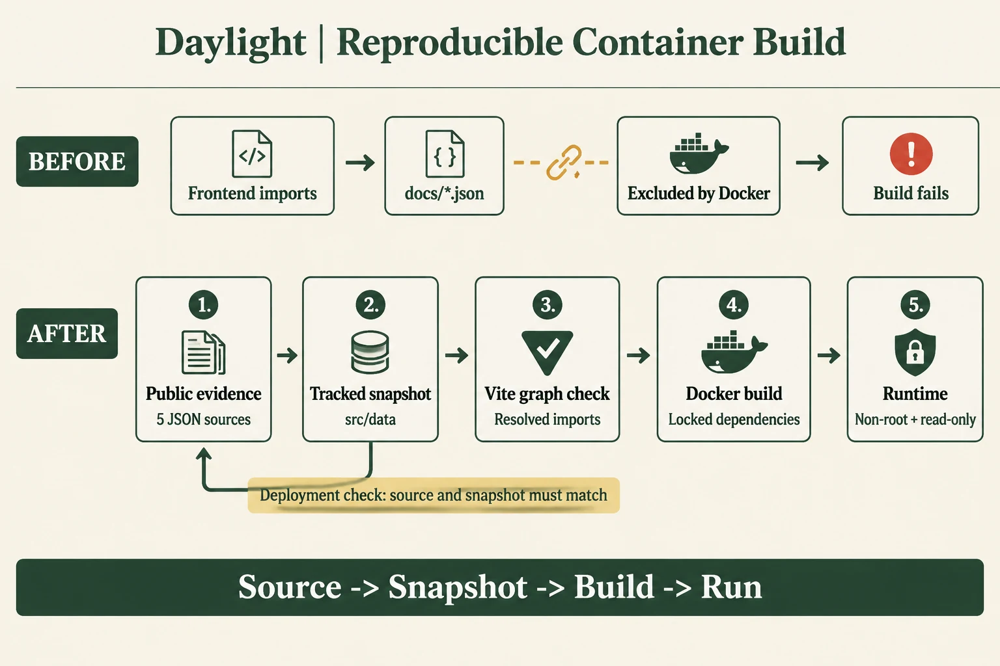
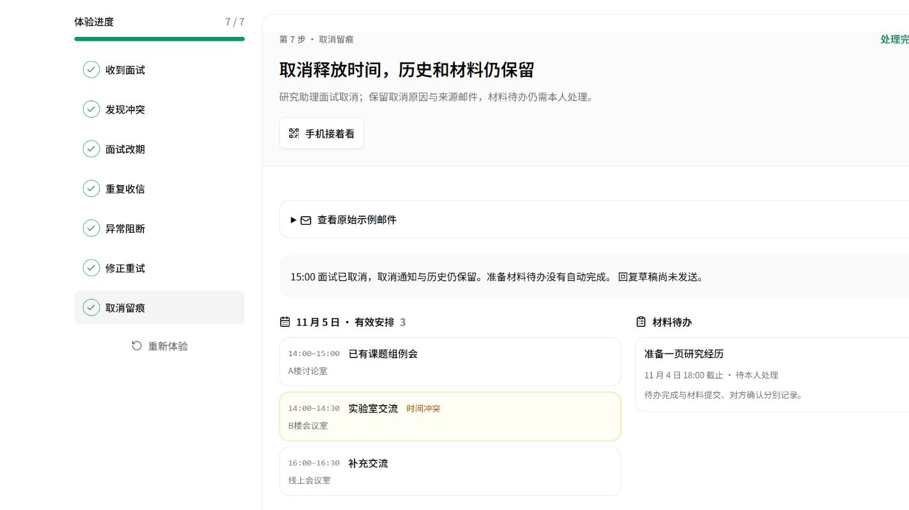
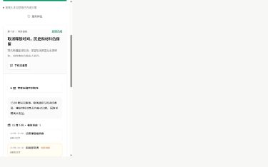

# 从源码构建容器、真实依赖与只读运行

日期：2026-11-04，北京时间。本轮对应云原生架构、工程可复现性与交付成本。基线源码为 `30903e6`；以下先记录发现、修复与首个候选，最终发布另保存固定版本回执。

## 1. 从实际构建发现问题

评委取得源码后，应能按仓库 Dockerfile 得到可启动镜像。首轮默认仓库构建在取得 Docker Hub 匿名令牌时连接超时，24.343 秒退出 1；改用已核验的同版本 Node 官方 ECR 镜像后，构建进入 Vite，在 48.519 秒退出 1。错误为技术页无法找到 `docs/competition-2026-11-04/evidence/cost-estimate.json`。

技术页共直接导入 5 份文档 JSON，Docker 构建阶段只复制 `src`、`public`、`shared`，`.dockerignore` 排除了 `docs`。本机完整工作目录可以构建，容器上下文缺少输入。[默认仓库输出](evidence/before-build.txt) · [同版本官方镜像下的缺文件输出](evidence/before-ecr-build.txt) · [原 Dockerfile](evidence/Dockerfile.before) · [原排除规则](evidence/dockerignore.before)。



核心图使用 gpt-image-2.5 生成，图内英文，正文中文。[完整提示词](container-prompt.txt) · [图片调用与摘要](image-generation.json)。

## 2. 技术选型与设计逻辑

### 将公开展示数据放入前端构建源

新增 `src/data/competition-evidence.json`，内容来自 5 份已经用于公开技术页的 JSON。同步命令保存完整数据、来源路径和规范 JSON 的 SHA-256。快照受 Git 管理，容器直接从 `src` 复制。`docs` 继续保存原始证据和解释，修改后执行 `npm run evidence:sync`，再运行部署检查。

选择快照的原因：前端构建只需几十 KB 的公开统计，完整文档还包含原始图片、历史记录和测量文件；明确区分原始材料与构建输入，方便源码包、容器和技术页保持对应。规范 JSON 哈希统一 Windows／Linux 换行和缩进，数据变化仍会改变摘要。

同步由开发者执行，构建不隐式生成统计结果。`deploy:check` 比较快照的来源与数据，原始证据变化后会报错，重新同步后才通过。快照进入源码摘要，交付验证能够识别它的修改。

### 用 Vite 的实际解析结果检查导入链

新增 Vite 插件检查解析后的真实文件路径，允许 `src`、`shared`、`public`、依赖及入口 HTML。静态导入、动态导入和符号链接都经过同一边界；发现超出 Docker 构建目录的输入时，构建立即说明具体路径。插件随 Docker 构建阶段复制。

采用实际构建图可以覆盖间接导入与动态页面；只搜索技术页固定路径无法覆盖未来新增页面。验证用例真实调用 Vite，在临时工程中分别构建允许路径、间接动态导入和指向文档的链接。

### 复用生产运行约定

镜像保留 Debian glibc，支持 PDF 的原生 canvas；中文字体和 LibreOffice 支持文档预览。API、Worker、Scheduler 使用同一镜像，以 `node` 用户运行；根目录只读、`/tmp` 可写、移除 capabilities、启用 no-new-privileges。数据库、缓存、消息队列和私有附件各自使用持久卷。

本轮复用 Docker Desktop 与已有官方基础镜像。PostgreSQL 17.6、Redis 7.4.5、RabbitMQ 4.1.4 和预载 MinIO 副本在独立 Compose 项目中实连；新建随机凭据和全新卷。预载 MinIO 为 `RELEASE.2025-04-22T22-12-26Z`，它包含 Bash、没有 curl，首次启动的默认探针因此失败。局部覆盖改用 Bash 请求同一个 `/minio/health/live`，要求 HTTP 200；修改后健康等待通过。[原探针错误](evidence/minio-probe-before.json) · [本地验证覆盖文件](evidence/compose.check.yml) · [首次失败](evidence/compose-up.txt) · [适配后输出](evidence/compose-up-adapted.txt)。

## 3. 优化前后对照

| 项目 | 优化前 | 优化后首个候选 |
| --- | --- | --- |
| 前端从排除文档目录直接导入 | 5 份 JSON | 0；读取受版本管理快照 |
| 源证据与构建数据一致性门禁 | 无 | 部署检查中逐源比较 |
| 间接导入与动态导入边界 | 缺少统一检查 | Vite 真实解析文件检查 |
| 同版本官方基础镜像下构建 | 缺文件退出 1 | 完整 runtime 镜像退出 0 |
| 实际源码 Linux 验证 | 本轮问题尚未覆盖 | 8/8，无跳过 |
| 独立真实 Compose 依赖 | 本轮尚未启动 | 7 常驻服务健康、2 初始化退出 0 |
| 任务持久化／租约／队列恢复 | 本轮尚未在该镜像运行 | 实际 PostgreSQL／RabbitMQ 8/8 |
| 附件读写与隔离 | 本轮尚未在该镜像运行 | 实际 MinIO 14/14 |

基线构建 48.519 秒为失败流程，完整镜像 159.027 秒为成功流程；两者用于说明交付结果，不计算速度提升。后者包含约 187 MB Debian 包下载、字体与 LibreOffice 安装；后续缓存构建另记实际耗时。[结构化前后汇总](evidence/summary.json) · [完整构建输出](evidence/after-build.txt) · [构建时间回执](evidence/after-build.json)。

## 4. 运行与业务验证

首个完整源码候选镜像为 `daylight:source-candidate-20261104`，ID `sha256:29d4d31ac8808ce910d883101499389b1c44e3b74e36756207c6cee73c1a1059`，Linux amd64，镜像解包大小 1,144,230,020 bytes。候选保存修改工作区的首版公开快照；后续发布按固定提交另记。

- Linux 定向 8/8：来源变动、快照改写、无效／缺失 JSON、跨平台格式一致、实际 Vite 动态导入及符号链接。[输出](evidence/linux-source-tests.txt)。Windows 同组 7 通过、1 文件链接权限跳过；Linux补齐该用例。
- 独立 Compose 适配探针后启动 20.778 秒；7 常驻服务健康，迁移与桶初始化退出 0，三个应用角色 restart=0、OOM=false。[运行结构化记录](evidence/candidate-runtime.json)。
- 公共 HTTP 115 项：七步、匿名权限、图片、资料、PDF／视频 Range 与本地发布字节一致。[原始记录](evidence/candidate-public-checks.json)。
- 实际 PostgreSQL／RabbitMQ 8/8：并发幂等、租约围栏、事务回滚、重试预算、历史退避、outbox、重连与 checkpoint 恢复。[输出](evidence/real-jobs.txt)。
- 实际 MinIO 14/14：上传、回读相同字节、归属路径、缺失对象、错误凭据与清理；put=1、get=3、delete=1、head=2、probe=1。[输出](evidence/real-oss.txt)。
- 运行用户 UID 1000；写 `/app` 得到 EROFS，写 `/tmp` 成功；原生 canvas 输出 PNG、LibreOffice 版本命令成功，Asia/Shanghai 生效。镜像无 `/app/docs` 和用户 `/app/data`。[运行检查](evidence/candidate-runtime.json)。
- 浏览器走完七步，1440／390／320px 均在对应视口内、图片成功、进度为 7；console error 0。[浏览器记录](evidence/candidate-browser.json)。

## 5. 电脑与手机尺寸截图





截图设备为 Windows IAB，手机尺寸390px；微信真机扫码由现场设备采集。

## 6. 复现步骤

准备 Node.js ≥22.19、npm 与 Linux Docker 引擎，在取得私有仓库源码或交付包后执行：

```sh
npm ci
npm run evidence:sync -- --check
npm run deploy:check
npm run verify
docker build --build-arg NODE_IMAGE=public.ecr.aws/docker/library/node:22.23.3-bookworm-slim -t daylight:release .
```

源证据需要更新时，先执行 `npm run evidence:sync`，审阅快照再走验证。固定镜像版本、CPU 架构、Node 来源和构建日志；完整 Compose 配置及生产初始化见仓库 `docs/delivery/cloud-deployment.md`。目标网络分别检查镜像仓库、npm 与 Debian 源。

## 7. 费用登记

本轮文本模型 0 次，gpt-image-2.5 英文图 1 次，新增云采购 ¥0。累计文字调用 84 次、104,267 输入／38,445 输出 Token，按已有公开价估算 ¥0.516094；图片累计16次，图片金额按供应商账单结算。新增模型与云资源预算总额 ¥500。[累计用量](evidence/budget-total.json)。

容器解包大小约1.14GB。字体与文档预览占主要运行依赖；同一镜像便于三个角色统一发布，后续可按真实 Worker 占用决定是否拆出文档转换镜像。本轮实连后即时资源快照中，API约102MiB、Worker约79.65MiB、Scheduler约76.24MiB；这是单时点读数。[完整原始快照](evidence/stats-snapshot.txt)。

## 8. 完整门禁中的兼容修复

固定提交`79dbfec`首次完整门禁运行1050项，1019通过、30条件跳过、1失败。新增Vite动态导入用例先遇到离线验证封装未保留`fs.realpathSync.native`的问题；补齐原生方法后，同一用例又发现预算来源更新后仍引用旧夹具路径。前者为Windows验证兼容问题，后者为测试输入错误。

离线封装现保留`realpath.native`和`realpathSync.native`，同时应用原有用户数据目录检查；增加独立子进程验证，确认临时路径可解析、用户数据路径仍被拒绝。动态导入夹具直接引用当前来源清单，避免再复制路径。最终带离线保护的定向9项中8通过、1 Windows链接权限跳过，Linux链接用例已在前面实际通过。

[首次完整门禁回执](evidence/final-gate-first-failure.json) · [失败片段](evidence/final-gate-first-failure.txt) · [修复后定向输出](evidence/guarded-source-tests-fixed.txt)。

## 9. 固定源码最终发布与交接

固定`8ff41a1`的五阶段全部通过，1051项中1021通过、30条件跳过、0失败。最终完整源码镜像Linux9/9、真实任务8/8和MinIO14/14；私有包全新解压后实际安装541包60.184秒。正式v22的HTTPS120项、关联资料330份、9组布局与11项行为通过，8服务healthy。

[最终镜像、包SHA、发布备份与正式电脑／手机尺寸截图](deployment-v22.md) · [原始证据总索引](evidence/final-publication-summary.json) · [一小时收尾交接与尚未完成的计划](../../HANDOFF-2026-11-04.md)。本节及发布回执在部署后加入仓库；官网本轮图文保存发布时快照。
