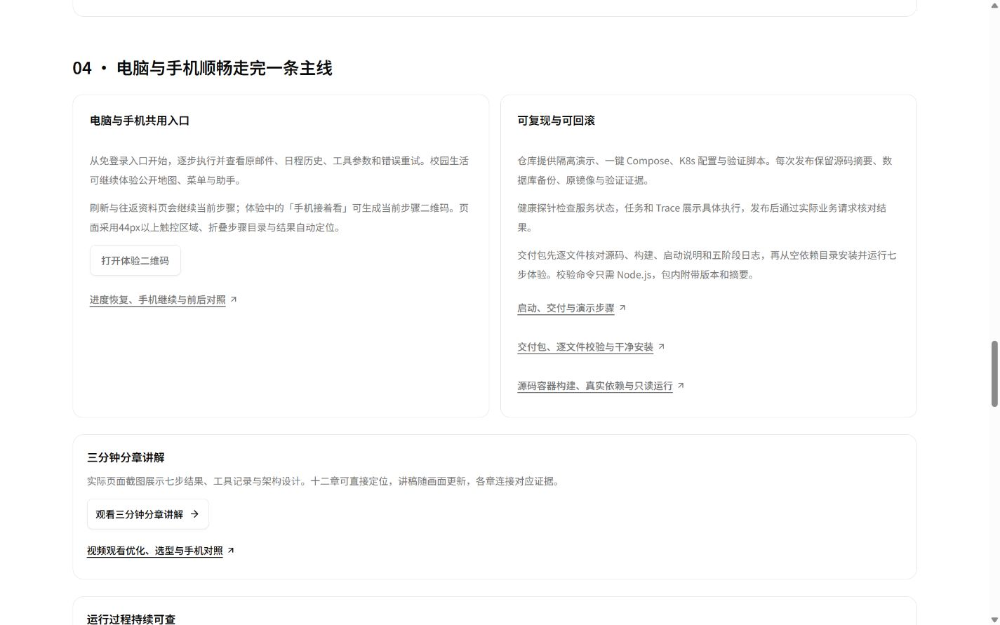
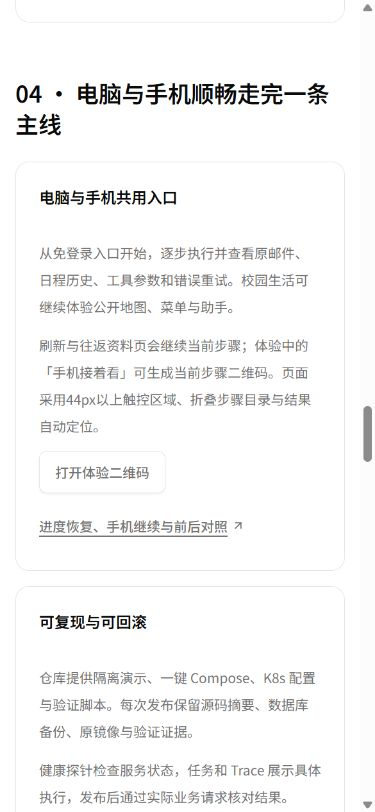
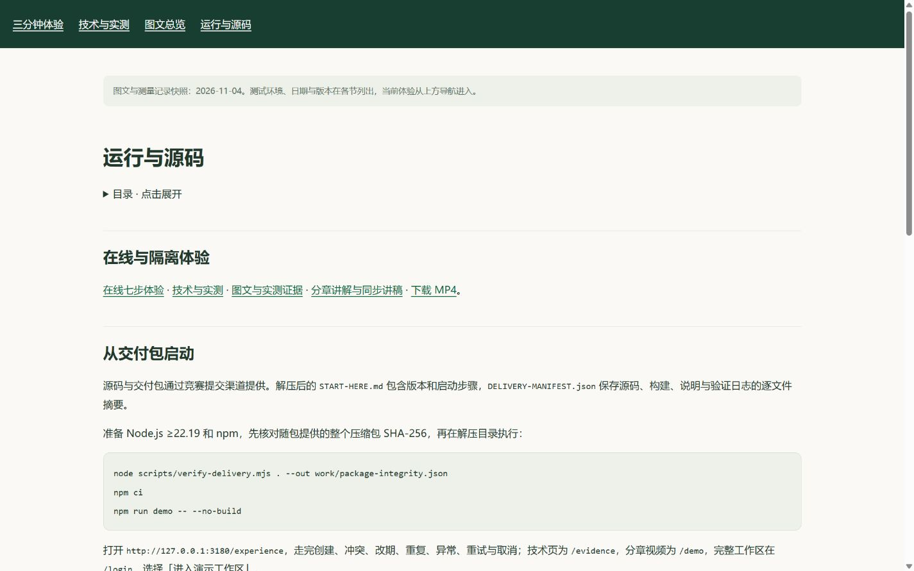
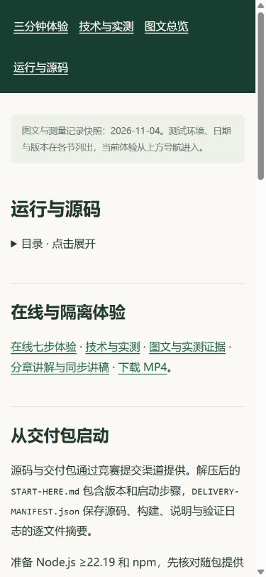
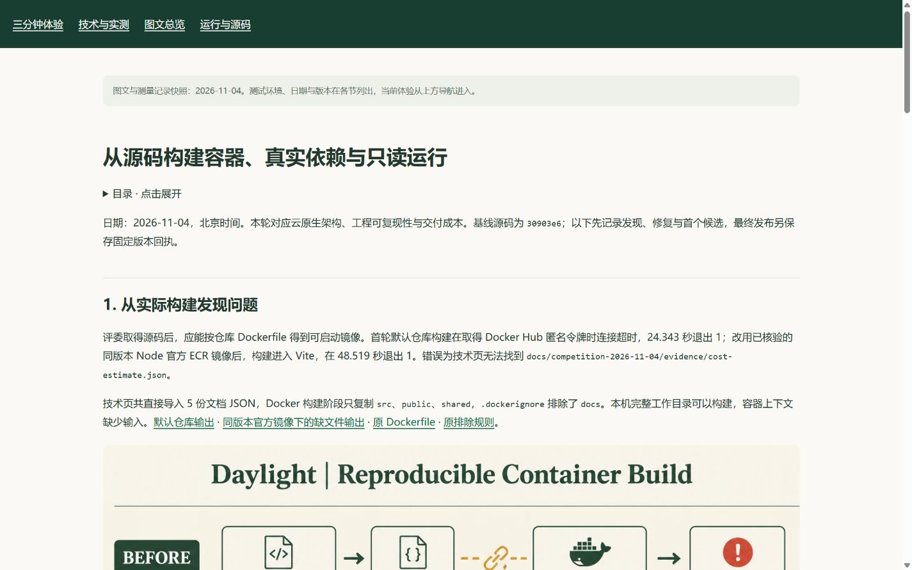
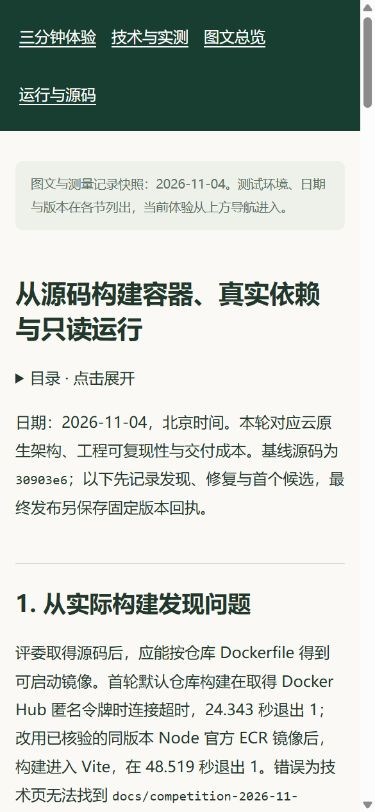

# v22：固定源码、完整容器与公网发布回执

日期：2026-11-04，北京时间。正式发布及运行文件核对于 08:40 完成；本页在发布后归档。当前交接入口为 [收尾交接文档](../../HANDOFF-2026-11-04.md)。

[本轮问题、技术选型、英文流程图与前后对照](README.md) · [正式体验](https://daylight.yunforis.com/experience) · [技术与实测](https://daylight.yunforis.com/evidence#delivery) · [官网本轮图文](https://daylight.yunforis.com/competition/container-report.html) · [复现指引](https://daylight.yunforis.com/competition/reproduce.html)。

## 1. 发布版本与交付物

| 项目 | 固定值 |
| --- | --- |
| 本轮前端、公开资料及交付验证源码 | `8ff41a1ba28576dd8bfa9fa3a109a96ffa00606a` |
| 分支 | `feat/competition-experience-20261103` |
| 正式运行镜像 | `daylight:public-competition-20261104-v22` |
| 正式镜像 ID | `sha256:11b018846e30ed419440c812d4e5e8d99f2f37e75ba1a94a481e5fd74e9b97af` |
| 独立完整源码镜像 | `daylight:source-release-20261104-v22-final` |
| 完整源码镜像 ID | `sha256:551cf718c2f5198fe5c6b57c20ff0218e287e20d74c480a245cf1b0b81737fcd` |
| 完整源码镜像平台／解包大小 | Linux amd64／1,144,592,376 bytes |
| 服务器发布目录 | `/opt/daylight-container-release-v22` |
| 发布前备份 | `/opt/daylight-backups/before-container-build-20261104083753` |
| 私有便携包 | `output/delivery/daylight-demo-20261104T003718.tar.gz` |
| 包大小／清单文件数 | 116,057,471 bytes／2,558 文件，另有清单自身 |
| 包 SHA-256 | `8495c32bb81f65696f30a77dacee2b59bb21027a0adac32134786d981f9c0d0e` |

正式镜像从固定 v21 镜像增量构建，替换完整前端与本轮交付验证文件，沿用服务器已有的 OCR 资源和业务后端。业务后端继承 v16 `a8daafc1bf88c747fb1e6104a89c56a6f90ff06b`、v13 `9354287b56e670a4a3f1376a68f325df2beadcf9` 和基线 `db3ee897a696bf5f70365f8c901237f020cf8691`。清单记录各轮实际变化的文件并逐字节核对。

完整源码镜像由固定 `8ff41a1` 在本地 Linux Docker 引擎构建，缓存重建 39.812 秒，并在独立 Compose 全新卷实连验证。首个完整候选 159.027 秒的记录保留在本轮图文中；本页保存最终固定提交的结果。两个镜像的构建方式、ID 和验收环境分别记录。

[发布清单](evidence/release-v22-manifest.json) · [发布包回执](evidence/release-v22-archive.json) · [完整源码镜像构建](evidence/final-fixed-build.json) · [构建输出](evidence/final-fixed-build.txt) · [私有便携包元数据](evidence/final-portable-package.json)。

## 2. 完整交付门禁与空依赖复现

固定源码五阶段全部通过：

| 阶段 | 结果 | 实际耗时 |
| --- | --- | --- |
| Node 测试 | 1,051 项；1,021 通过、30 条件跳过、0 失败 | 84.598 秒 |
| Vite 构建 | 成功，实际解析导入边界检查启用 | 56.736 秒 |
| 固定业务语料 | 通过 | 0.157 秒 |
| 隔离 Demo | 通过 | 6.751 秒 |
| 部署材料与源码检查 | 通过 | 0.122 秒 |

源码摘要为 `d7ff283e9d9050fc63f49c556c711f9461f55be36d8490791135f2b14155b4d2`；构建摘要为 `8226713c441ee46cd61f4946e5371169bdc52e21d0ea316abf182b80d204f8f6`。首次门禁的失败及修复位于 [本轮第 8 节](README.md#8-完整门禁中的兼容修复)。

私有包解压到全新目录，确认没有 `node_modules` 后，使用 Node v24.14.0／npm 11.9.0 实际安装 541 包，用时 60.184 秒。首次完整性读取进程 21.888 秒；安装后完整性检查 1.837 秒、源码预检 0.130 秒、Demo 自检 7.318 秒，全部退出 0。Demo 实际检查 24 次 HTTP，模式为隔离预置样例，外部服务调用 0。

[完整五阶段回执](evidence/final-verification-summary.json) · [测试日志](evidence/final-gate-tests.txt) · [空依赖安装](evidence/final-package-install.txt) · [复现计时](evidence/final-package-reproduction.json) · [完整性核对](evidence/final-package-integrity.json) · [包内 Demo 回执](evidence/final-package-demo-verification.json)。

## 3. 完整源码镜像与真实依赖

- 最终 Linux 源码／原生路径检查 **9/9**，无跳过。
- 实际 PostgreSQL／RabbitMQ **8/8**，覆盖并发幂等、租约、事务、重试、outbox、重新连接和 checkpoint。
- 实际 MinIO **14/14**，覆盖上传、回读、归属、缺失对象、错误凭据和清理。
- 独立 Compose 7 常驻服务 healthy、2 个初始化退出 0；最终镜像切换健康等待 15.997 秒。
- HTTP **120 项**；镜像内 UID 1000、根目录只读返回 EROFS、`/tmp` 可写、native canvas／LibreOffice 可用。

[最终运行检查](evidence/final-candidate-runtime.json) · [Linux 输出](evidence/final-linux-source-tests.txt) · [真实任务](evidence/final-real-jobs.txt) · [真实对象存储](evidence/final-real-oss.txt) · [完整源码候选 HTTP](evidence/final-candidate-public-checks.json)。

## 4. 正式发布过程与验收

发布脚本先确认三个运行角色都是固定 v21 镜像及 ID；保存配置、数据库 dump、完整前端和验证文件，检查解包路径与逐文件哈希。候选检查通过后切换 API／Worker／Scheduler，检查 HTTPS、七步、匿名权限、视频 Range 和角色指标；失败处理函数恢复旧配置、镜像、前端和脚本。此次最终输出 `REMOTE_EXIT 0`。

| 核对范围 | 结果 |
| --- | --- |
| Linux 正式候选业务／指标／进度 | 38/38 |
| Linux 候选交付完整性 | 6/6 |
| Linux 候选构建／原生路径 | 9/9 |
| 正式 HTTPS | 120 项通过 |
| 正式关联资料 | 330 份 HTTP、MIME、完整字节摘要通过；PDF／视频 Range 通过 |
| 三页 × 三尺寸 | 9 组通过：1440／390／320px；章节定位约 24px |
| 正式手机尺寸行为 | 11 项通过：七步、分享／刷新、资料入口 |
| 浏览器 console error | 0 |
| 三角色运行文件 | 每角色 741 文件一致；完整前端 690 文件一致 |
| 服务健康 | 8/8 healthy；三个应用角色 restart=0、OOM=false |

08:40 的 API／Worker／Scheduler 已写指标分别为 497／684／154，dropped 均 0，sinkError 均为空。布局及行为的检查方法与个别首次尝试的复核过程保存在原始 JSON。

[部署脚本](evidence/deploy-v22.sh) · [完整部署输出](evidence/deploy-v22-output.txt) · [运行文件与健康](evidence/runtime-verification-v22.json) · [HTTPS](evidence/public-checks-v22.json) · [资源](evidence/public-resources-v22.json) · [布局](evidence/public-layouts-v22.json) · [交互](evidence/public-behavior-v22.json) · [汇总及各源摘要](evidence/final-publication-summary.json)。

## 5. 正式电脑与手机尺寸截图

### 技术页：工程交付章节

### 运行指引

### 源码构建图文

### 手机尺寸七步结果与接续二维码

截图来自 Windows IAB；微信真机的最终扫码、播放和下载清单位于 [交接待办](../../HANDOFF-2026-11-04.md)。

## 6. 回滚与本地收尾

当前回滚目标为 `daylight:public-competition-20261104-v21`，ID `sha256:55f7a1780e8e8766e2b9a449b8804b333d93c578621cc0a573c9736044bc9dc2`。具体停写／恢复步骤和服务器凭据入口见 [交接文档运行章节](../../HANDOFF-2026-11-04.md#运行发布与回滚)。本轮发布无数据库结构变更，回滚恢复应用与前端；数据库及附件恢复另按已验证的恢复流程执行。

08:47 已停止独立验证项目 `daylight-container-20261104`：9 个容器和 5 个测试卷移除完成，项目容器／卷剩余 0。其余 20 个容器 ID 保持一致；完整源码镜像、日志、私有包和参与者工具保留。[本地清理回执](evidence/local-cleanup.json)。

08:52收尾复查仍为8服务healthy、三角色restart=0／OOM=false，指标写入4267／12500／1819、丢样0；正式readiness和七步通过，磁盘可用10,322,907,136 bytes。[最后健康回执](evidence/closeout-health.json)。

本页与交接文件属于发布后仓库记录。正式官网本轮图文保存 `8ff41a1` 发布快照；后续报告更新按交接清单执行。
