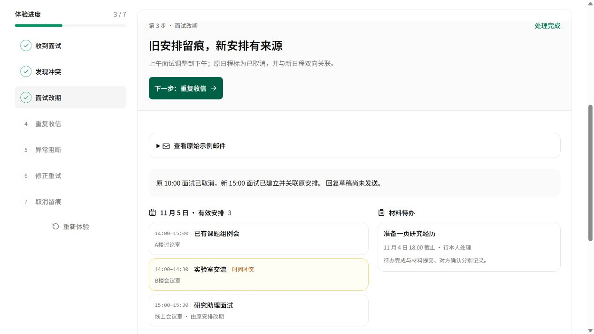
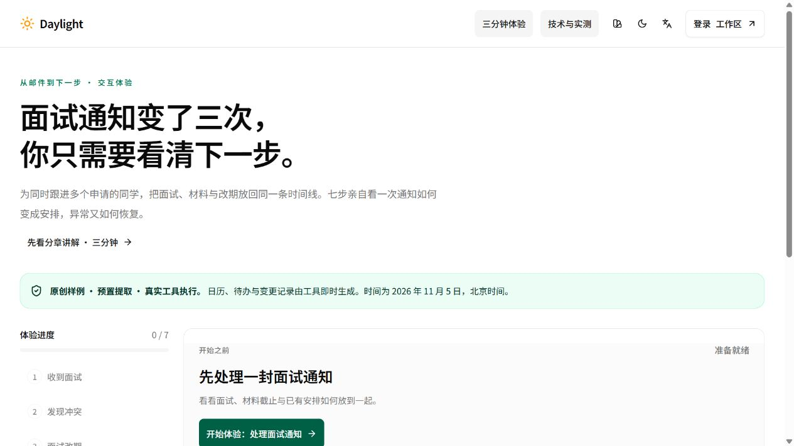
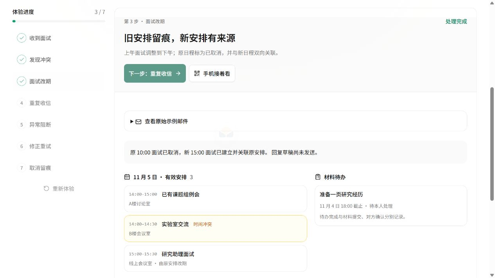
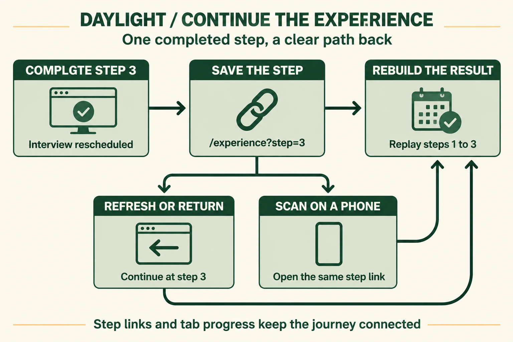
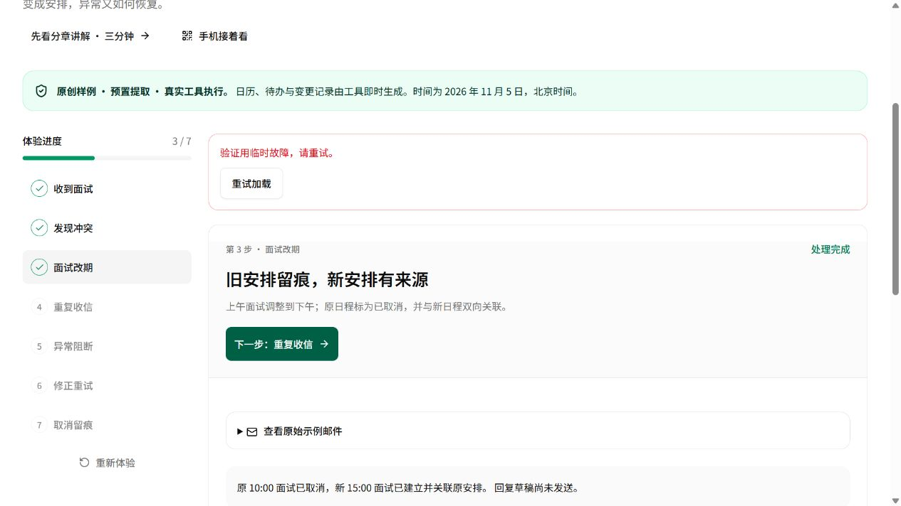
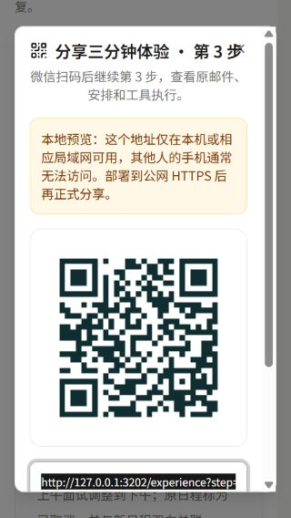

# 体验进度恢复与手机继续

日期：**2026-11-04，北京时间**。入口：[七步体验](https://daylight.yunforis.com/experience) · [直接查看第三步](https://daylight.yunforis.com/experience?step=3) · [完整技术页](https://daylight.yunforis.com/evidence#delivery)。

最终发布 **v20**，标准下载链接的普通点击、实际PNG和解码通过。[发布、运行核对与正式截图](deployment-v20.md)。

## 1. 从实际评审路径发现问题

在正式 v18 页面依次完成面试通知、时间冲突、面试改期三步，然后打开「技术与实测」，使用浏览器返回。体验页重新挂载后固定请求第零步，已经完成的第三步和回看范围一起丢失。刷新也会重新开始。技术资料与业务体验之间的往返因此需要重复操作。

本轮让每个成功步骤有可直接打开的地址，并在同一标签页保存回看范围。电脑上点「手机接着看」，二维码直接对应当前步骤。

| 操作 | 优化前 v18 | 本轮实现与浏览器观察 |
| --- | --- | --- |
| 第三步 → 技术页 → 浏览器返回 | 进度 3 → 0 | 返回后仍为第 3 步 |
| 第三步刷新 | 初始化固定请求第 0 步 | 从地址恢复第 3 步，并定位到结果 |
| 点击导航里的「三分钟体验」 | 新建页面，从第 0 步开始 | 当前标签页恢复最后选中的步骤 |
| 电脑转手机 | 固定二维码进入体验首页 | 当前步骤链接和二维码进入相同步骤 |
| 走到第七步后回看第二步，再刷新 | 回看范围随页面消失 | 保留第二步选择及第七步回看资格 |
| 请求下一步遇到 503 | 原结果可保留 | 原结果、已保存进度和地址一起保留；重试成功后再更新 |
| 保存当前步骤二维码 | 临时创建data URL下载入口 | 标准下载链接读取站内PNG；手机可长按图片保存 |

[优化前实际观察](evidence/before-behavior.json) · [本轮15项浏览器行为记录](evidence/local-behavior.json)。

### 返回技术页前后







前两张来自正式 v18 HTTPS；第三张来自使用独立样例数据的本地浏览器。每张截图保存原始字节，正式发布截图另列在发布记录。

## 2. 进度如何跨页面和设备衔接



本图使用 **gpt-image-2.5**，英文标注；中文选型与状态语义在下面展开。[原始提示词](continuity-prompt.txt) · [生成记录与图片摘要](image-generation.json)。

成功完成第三步后，地址变为 `/experience?step=3`。刷新、浏览器返回和手机打开该地址，都请求已有的有界公开体验接口，从固定样例重新执行至第三步，重新取得日历、待办、历史和执行记录。当前步骤地址与同标签页进度负责定位，业务结果仍由工具执行取得。

## 3. 技术选型与设计逻辑

| 选择 | 原因 | 具体语义与代价 |
| --- | --- | --- |
| URL 的 `step` 参数 | 支持刷新、返回、复制链接和手机扫码，其他设备也能定位 | 只接受一个0–7的整数；重复、越界和格式错误都归零；成功后规范化地址 |
| `sessionStorage` 保存同标签页进度 | 从不带步骤的导航入口返回时，继续刚才的选择；同时保留已完成步骤的回看范围 | 保存样例版本、当前步骤、最远步骤三个字段；关闭标签页后由链接继续 |
| 显式步骤优先 | 收到一个第三步链接时，应打开第三步 | URL与标签页记录同时存在时，按URL选中当前步骤；0表示重新开始 |
| 请求成功后提交进度 | 网络失败时，用户仍能核对原结果并继续重试 | 503不推进步骤、地址和持久记录；成功重试才一起更新 |
| 服务端重新执行公开样例 | 复用现有真实日历、待办、去重和Trace工具，步骤跨设备含义一致 | 每个请求最多七步、四个并发；公开体验实时模型调用0 |
| 复用现有分享弹窗，点击时动态导入 | 二维码、复制、PNG下载和手机分享沿用成熟入口，首屏不必加载二维码库 | 首次点击需要加载分享模块；失败提供重试文案 |
| 为0–7步生成静态PNG下载文件 | 各步骤链接固定，文件可随前端发布；标准下载链接适配浏览器下载流程 | 八张PNG合计45,470 bytes，按点击读取；更换域名时重新生成 |
| 44px操作和90svh内滚动弹窗 | 320px窄屏与短屏也能完成复制和下载 | 长内容在弹窗内滚动，页面保持视口宽度 |

浏览器禁止存储时仍通过URL定位。链接构建只保留站点origin、公开路径和步骤参数。样例版本变化后忽略旧标签页记录。重新体验成功后将当前和最远步骤一并归零。

代码入口：`shared/experience-progress.js`、`src/pages/experience-page.jsx`、`src/components/campus-guide/share-dialog.jsx`。

## 4. 行为、手机布局与二维码核对

本地进度和公开业务测试 **15/15**：九项进度策略、六项已有公开业务验证。浏览器行为 **15项通过**：新设备步骤链接、资料页返回、刷新、导航恢复、503保留、重试提交、后四步继续、回看范围、重新体验及刷新。

[定向测试原始输出](evidence/local-tests.txt) · [验证时源码摘要](evidence/source-hashes.json)。

使用本轮[本地503验证入口](evidence/failure-preview.mjs)只对第四步首次请求返回503。浏览器仍显示第三步，地址仍为第三步；点击「重试加载」后显示第四步，地址更新为第四步。



分享弹窗分别在 **1440×900、390×844、320×568** 检查：三组无整页横向溢出，复制、下载和手机分享按钮高44px；320×568采用弹窗内滚动。生成的PNG为768×768，用 **zxing-cpp 3.1.1** 完整解码，结果为当前站点的 `/experience?step=3`。

| 390px弹窗 | 320px短屏弹窗 |
| --- | --- |
|  |  |

[布局原始记录](evidence/local-layouts.json) · [二维码解码记录](evidence/local-qr-verification.json) · [实际生成PNG](assets/local-step3-qr.png)。本节设备为Windows IAB浏览器；正式手机微信扫码按设备记录采集。

最终构建再次核对三尺寸弹窗，并将恢复定位放到当前结果：第三步返回后结果距视口顶部20px，焦点进入「当前体验结果」。[最终构建记录](evidence/final-build-behavior.json)。

### 二维码下载兼容处理

v19正式浏览器中，点击临时data URL下载入口后未捕获下载事件，在指定下载位置也未找到预期PNG。随后将按钮改为标准`a download`链接，公开体验读取随版本发布的站内PNG，同时增加长按保存说明。八个步骤文件使用qrcode算法生成，每张768×768，逐文件摘要与解码URL一起核对。

[v19下载观察](evidence/download-observation-v19.json) · [八张静态二维码解码](evidence/static-qr-verification.json) · [最终标准下载链接与三尺寸弹窗](evidence/local-layouts-v20.json)。最终构建在1440/390/320px核对，下载入口为真实链接，复制、下载与手机分享均为44px，弹窗完整位于视口内。生成入口为`scripts/experience-qr-assets.mjs`，核验入口为`scripts/verify-experience-qr.py`。这些二维码由确定性编码生成，AI图片调用数保持14次。

## 5. 首屏加载与费用影响

分享组件使用动态导入，二维码依赖在点击分享时加载。构建报告对首屏静态依赖集合与分享入口分别核对，并保留文件完整摘要。

| 最终构建项目 | 实际值 |
| --- | ---: |
| 体验首屏静态JavaScript，逐文件gzip | 167,601 bytes |
| 相比v17已发布首屏基线新增JavaScript gzip | 1,614 bytes |
| 点击分享后新增的独立JavaScript，逐文件gzip | 17,091 bytes |
| 初始体验静态依赖中的二维码库 | 0 |

这组体积由最终Vite文件按默认gzip参数逐文件计算。进度和分享按钮带来的首屏增加量为1,614 bytes；二维码、弹窗和相关控件的17,091 bytes推迟到点击分享后加载。

[构建依赖与体积摘要](evidence/bundle-summary.json) · [完整构建清单](evidence/bundle-inventory.json)。精确体积以摘要中的实际构建结果为准，公网响应编码字节另随发布记录保存。

## 6. 复现

```sh
node --test server/experience-progress.test.js server/experience.test.js
npm run build
npm run demo -- --no-build --port 3202
```

更换公开部署域名时，在构建前运行`node scripts/experience-qr-assets.mjs https://你的域名`，让下载PNG与新站点步骤链接一致。

打开 `http://127.0.0.1:3202/experience?step=3`，点击技术页、返回、刷新，再点击「手机接着看」检查地址和二维码。点击「重新体验」，刷新后应保持第零步。

另开终端执行：

```sh
node docs/competition-continuity-2026-11-04/evidence/failure-preview.mjs
```

打开 `http://127.0.0.1:3203/experience?step=3`，点击下一步，再点击重试。该入口固定绑定本机3203，代理独立样例服务的公开体验接口。

二维码验证需要Python、Pillow和`zxing-cpp==3.1.1`，打开保存后的PNG，使用`zxingcpp.read_barcodes`核对结果。最终英文图的压缩和累计用量复算入口为`scripts/competition-continuity-figure.py`。

## 7. 费用登记

本轮文本模型调用0、新增云采购0；新增 **gpt-image-2.5英文图1次**。图片累计14次，费用按供应商账单汇总。文本累计84次，输入104,267、输出38,445 Token，按当前公开价格估算 **¥0.516094**。总预算 **¥500**。

[本轮累计清单](evidence/budget-total.json)通过上一份清单完整SHA-256连接历史记录。原有固定评测快照保持原始口径。
