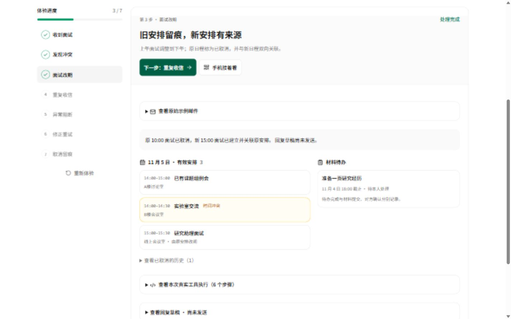
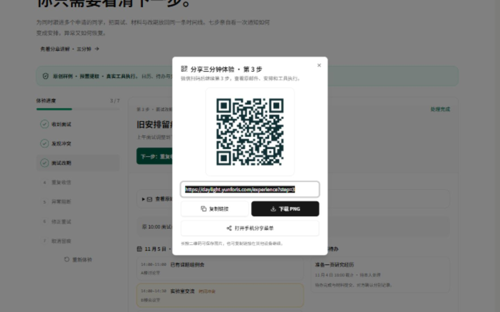
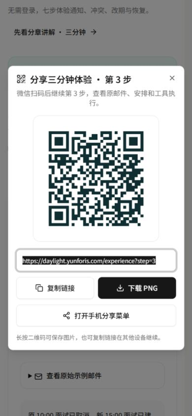
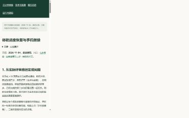
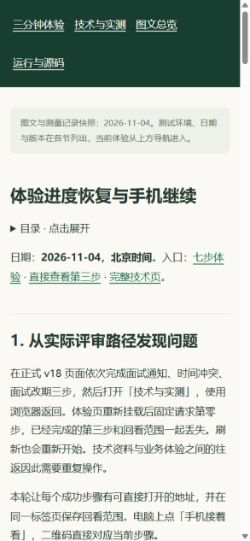

# v19 → v20 公网发布与二维码下载验收

日期：2026-11-04，北京时间。状态：**v20 已部署，正式下载与页面验收通过**。

[正式七步体验](https://daylight.yunforis.com/experience) · [直接查看第三步](https://daylight.yunforis.com/experience?step=3) · [公开图文](https://daylight.yunforis.com/competition/continuity-report.html) · [设计、流程图与前后对照](README.md)

## 1. 发布版本

| 项目 | 实际值 |
| --- | --- |
| 当前镜像 | `daylight:public-competition-20261104-v20` |
| 镜像 ID | `sha256:512a096ec1d021b77a27143b0deb67d7e8d354063cd26922ab23572a41dc6add` |
| 前端、静态二维码、资料与验证源码 | `87c1b1bf9417a3a545ccfa417d0ce3d0cd733ec4` |
| 业务后端 | 继承 v16 `a8daafc1bf88c747fb1e6104a89c56a6f90ff06b`，之前为 v13 `9354287` 与基线 `db3ee89` |
| 基础镜像 | v19，固定 ID `sha256:2689195d2f2d4c7e346c590a9834784c6e332a9568e18658b573f7cba6ecd982` |
| 发布包 | 32,517,441 bytes；638 文件，其中完整前端 634 文件、验证与共享源码 4 文件 |
| 发布包 SHA-256 | `fe8bd3561cf9dd11594e8a13a395fcb077dcad48c90805a07ce5624607f43429` |
| 发布备份 | `/opt/daylight-backups/before-experience-download-20261104070836` |
| 构建目录 | `/opt/daylight-continuity-release-v20` |

[v20 文件清单](evidence/release-v20-manifest.json) · [v20 归档摘要](evidence/release-v20-archive.json) · [发布脚本](evidence/deploy-v20.sh) · [发布完整输出](evidence/deploy-v20.txt)

## 2. 从 v19 观察到 v20 修复

v19 首次发布了步骤 URL、同标签页进度恢复、回看范围和当前步骤二维码。源码为 `332b714`，镜像 ID 为上表的 v19 基础镜像；候选 38/38、正式 HTTPS 98 项和 261 份关联资源通过，三个角色各 657 文件、完整前端 622 文件一致。

在正式分享弹窗中，显示的二维码可以完整解码，点击旧下载按钮后未捕获下载事件，指定位置也未找到预期文件。v20 将下载操作改为页面中的标准 `a download` 链接，并为 0–7 步提供站内 PNG 文件。

| 操作 | v19 观察 | v20 正式结果 |
| --- | --- | --- |
| 点击下载 PNG | 未取得下载回执和预期文件 | 普通点击触发下载事件，保存 `daylight-experience-step-3.png` |
| 下载文件内容 | 已保存的是弹窗显示图像 | 实际下载 PNG 为 5,613 bytes、768×768，完整摘要与发布清单一致 |
| 二维码目标 | 显示图像解码为当前步骤 | 下载文件解码为 `https://daylight.yunforis.com/experience?step=3`，新标签页进入第三步 |
| 手机保存入口 | PNG 按钮 | 标准下载链接与长按图片保存说明 |

八张静态 PNG 共 **45,470 bytes**。各步骤地址固定，文件可随前端发布，浏览器采用标准下载流程。域名发生变化时，构建前重新运行 `scripts/experience-qr-assets.mjs`。二维码使用确定性编码，图文流程图使用 **gpt-image-2.5 英文生成**。

[v19 下载观察](evidence/download-observation-v19.json) · [八张静态二维码解码](evidence/static-qr-verification.json) · [v20 实际下载、普通点击与解码记录](evidence/download-verification-v20.json) · [实际下载 PNG](assets/public-step3-downloaded.png)

v19 备份为 `/opt/daylight-backups/before-experience-continuity-20261104065155`。[v19 清单](evidence/release-v19-manifest.json)、[发布输出](evidence/deploy-v19.txt)、[候选检查](evidence/candidate-production-tests-v19.txt)、[正式 HTTPS](evidence/public-verification-v19.json)、[关联资源](evidence/resources-public-v19.json)与[实际运行记录](evidence/runtime-v19.json)一并保留。

## 3. 发布过程与候选检查

1. 取得部署锁，核对三个应用角色均运行固定 v19 镜像 ID。
2. 保存 Compose 配置、旧镜像与前端，生成数据库备份并以 `pg_restore --list` 读取备份目录。
3. 验证压缩包 SHA-256、路径和 638 个文件的完整摘要，以 v19 固定 ID 构建 v20。
4. 候选容器按 1 CPU / 512 MiB 运行，**38/38** 通过，覆盖采集边界、生命周期、七步业务和进度策略。
5. 核对 133 份构建资源、二维码库加载边界、八张 PNG、最终三尺寸下载链接、英文图、累计费用与原 21 页 PDF 摘要。
6. 切换 API、Worker、Scheduler，等待健康，检查七步结果、匿名接口权限、视频范围读取和三个角色的指标写入。
7. 完成正式 HTTPS、完整关联资源、实际下载与浏览器操作验收，归档结果。

发布脚本在切换后失败时恢复旧镜像和前端。[候选 38 项](evidence/candidate-production-tests-v20.txt) · [候选资料核对](evidence/candidate-continuity-checks-v20.json) · [本地定向 15 项](evidence/local-tests-v20.txt)

## 4. 实际运行核对

2026-11-04 **07:10:46 +08:00** 采样：

| 角色 | 核对文件 | 完整 dist | 指标已写入 | 丢样 | 写入错误 | restart / OOM |
| --- | ---: | ---: | ---: | ---: | --- | --- |
| API | 669 | 634 | 601 | 0 | null | 0 / false |
| Worker | 669 | 634 | 520 | 0 | null | 0 / false |
| Scheduler | 669 | 634 | 99 | 0 | null | 0 / false |

三个角色镜像 ID、源码标签与环境变量一致。运行核对合并 v7、v9、v13、v16、v18、v19 的后端与脚本覆盖，再应用本轮清单，逐文件验证字节并检查完整前端文件集合。API、Worker、Scheduler、PostgreSQL、Redis、RabbitMQ、MinIO、Caddy 共 **8 服务均 running / healthy**。

[运行原始记录](evidence/runtime-v20.json) · [运行核对脚本](evidence/verify-runtime-v20.py)

## 5. 正式 HTTPS、浏览器与设备

- **107 项 HTTPS 检查通过**：七步状态、权限、参数、资料、八张步骤 PNG 与清单、视频和 PDF Range。
- **273 份关联资料通过**：HTTP、MIME、完整 SHA-256；PDF 的 `bytes=0-31` 返回 206 和实际 32 字节。
- **7 项最终浏览器检查通过**：第三步直达、技术页返回、刷新、新标签页打开解码地址、无步骤导航恢复、桌面结果定位和复制完成后的剪贴板回读。
- **6 组布局通过**：正式分享弹窗与本轮图文各测 1440/390/320px，无整页横向溢出；分享操作与资料导航均为 44px，短屏弹窗内滚动。
- **普通下载点击通过**：取得浏览器下载事件和实际文件；另用标准媒体下载入口取得同一 PNG，两份完整字节与解码内容一致。

复制核对先等待页面「链接已复制」回执，再读取剪贴板。最初未等待回执的即时读数及内容就绪、结果定位两个时点，均保留在原始采样中。

| 验收设备或环境 | 本轮记录 |
| --- | --- |
| Windows IAB 浏览器 | 正式 HTTPS 操作、下载、文件核对与三种视口完成 |
| 手机微信真机 | 扫码、长按保存与系统分享的真机记录待采集 |

[107 项 HTTPS](evidence/public-verification-v20.json) · [273 份关联资源](evidence/resources-public-v20.json) · [最终浏览器摘要](evidence/public-browser-summary-v20.json) · [完整浏览器采样](evidence/public-behavior-v20.json) · [六组布局](evidence/public-layouts-v20.json) · [控制台记录](evidence/public-console-v20.json)

### 正式页面截图





| 390px 分享弹窗 | 320px 短屏弹窗 |
| --- | --- |
|  |  |

| 390px 图文 | 320px 图文 |
| --- | --- |
|  |  |

## 6. 体积与费用

| 构建或传输口径 | v19 | v20 |
| --- | ---: | ---: |
| 首屏静态 JavaScript，逐文件 gzip | 167,519 bytes | 167,601 bytes |
| 点击分享新增 JavaScript，逐文件 gzip | 17,067 bytes | 17,091 bytes |
| 公网 JavaScript 实际响应体 | 173,501 bytes | 173,575 bytes |
| 公网 CSS 实际响应体 | 29,814 bytes | 29,835 bytes |
| 公网启动图实际响应体 | 8,278 bytes | 8,278 bytes |
| 公网上述三项合计 | **211,593 bytes** | **211,688 bytes** |

本地默认 gzip 计算与 Caddy 实际响应体分别记录；公网合计覆盖体验页静态 JavaScript、CSS 和启动图的实际编码字节，HTML 另列于原始记录。v20 比 v17 首屏 JavaScript 基线增加 **1,614 bytes gzip**，分享相关 **17,091 bytes gzip** 在点击后加载，初始静态依赖中的二维码库为 0。

[v19 构建摘要](evidence/bundle-summary-v19.json) · [v20 构建摘要](evidence/bundle-summary.json) · [公网逐项前后对照](evidence/wire-comparison-v19-v20.json)

本轮进度与分享优化使用 gpt-image-2.5 英文流程图 1 次，v20 下载修复的新增文字模型、AI 图片与云采购均为 0。累计文字 84 次、公开价估算 **¥0.516094**，AI 图片 14 次，图片费用按供应商账单登记，总预算 **¥500**。[费用清单](evidence/budget-total.json)

## 7. 复现

```sh
node --test server/experience-progress.test.js server/experience.test.js
node scripts/experience-qr-assets.mjs https://daylight.yunforis.com
npm run build
node scripts/verify-competition.mjs https://daylight.yunforis.com work/public-check.json
python scripts/verify-competition-resources.py https://daylight.yunforis.com work/public-resources.json --direct
```

二维码核验需 Pillow 与 `zxing-cpp==3.1.1`。运行 `python scripts/verify-experience-qr.py work/qr-check.json` 核对八张 PNG；正式页面点击「手机接着看 → 下载 PNG」，再解码实际保存的文件，地址应与当前步骤一致。
