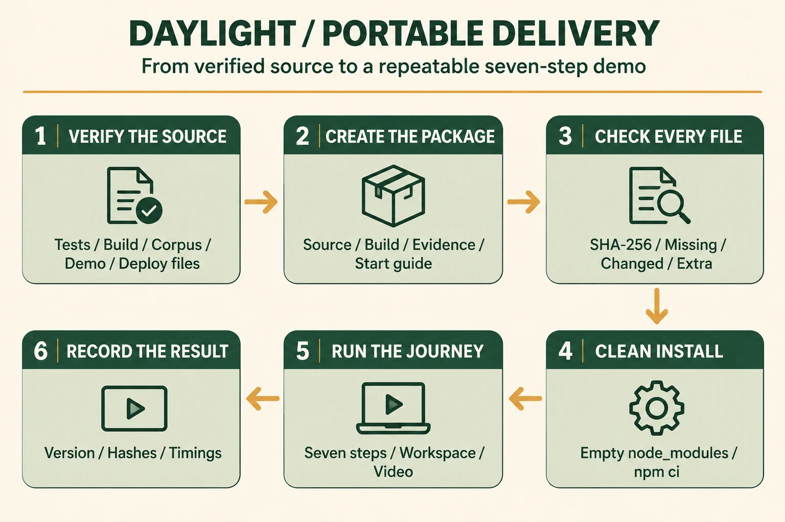
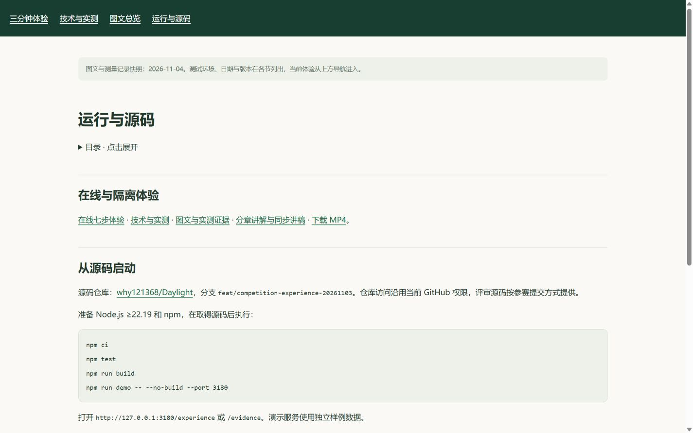
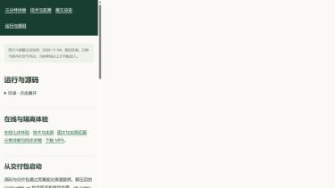
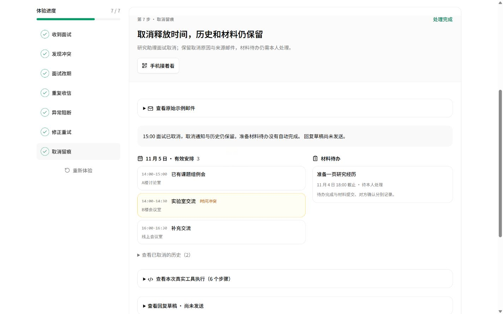
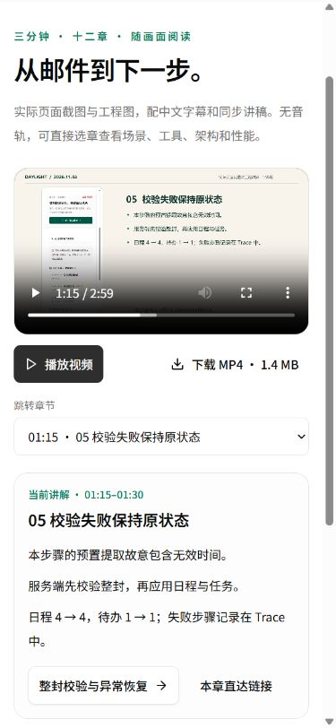
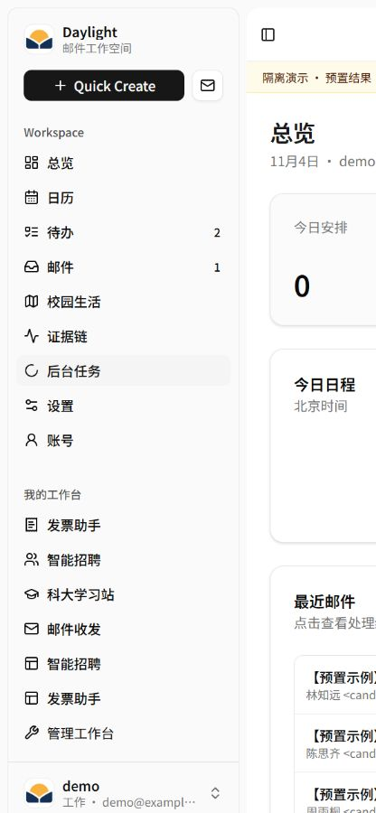
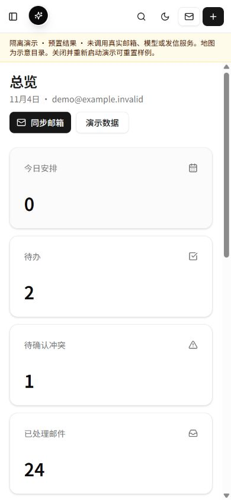

# 最新交付包、逐文件校验与干净安装

日期：2026-11-04，北京时间。本轮对应竞赛的工程完成度、Demo 可复现性和交付成本。

## 1. 发现与目标

公网已发布 v20，旧 `output/delivery/latest.json` 仍指向 10 月 28 日的交付包。后来新增的七步体验、分章视频、RAG 引用、回复审核、数据恢复与手机继续，需要进入可搬迁版本。

本轮将最新源码、构建与五阶段验证记录封装成固定版本，并从压缩包重新解压，在空依赖目录中安装和启动。包内第一份说明直接引导评委进入七步体验，继续访问技术页、分章视频和完整工作区。



核心图由 gpt-image-2.5 生成，使用英文。中文设计说明、原图、提示词和完整文件摘要随记录保存：[提示词](delivery-prompt.txt) · [图片调用记录](image-generation.json)。

## 2. 技术选型与设计逻辑

### 固定源码、构建与验证记录

沿用现有五阶段门禁：回归测试、前端构建、邮件语料、隔离 Demo 和部署资产。打包器将当前源码与构建摘要和成功记录比较，版本一致才打包。源码提交、源码摘要、构建摘要与各阶段日志一起保留，支持复现和定位版本。

第一次实际打包发现，原门禁把干净工作区的空 `git status` 当成命令失败，报告中修改标记恒为真。现改为按 Git 退出码判断，保留空输出表示干净工作区，再固定提交重跑五阶段。

### 标准 tar.gz 与逐文件 SHA-256

包使用 Node 内置文件系统、crypto 和系统 tar，校验命令无需先安装 npm 依赖。压缩包旁保存整个包的 SHA-256，包内清单为源码、构建、启动说明和五阶段日志记录每份文件的字节数与 SHA-256。`START-HERE.md` 也进入清单。

解压后执行 `node scripts/verify-delivery.mjs .`。检查器同时检查缺失、改写、额外文件、路径越界、重复条目、目录链接和验证记录对应关系；回执可写入 `work/`。安装与运行生成的 `node_modules`、`work`、`data`、`output` 根目录单独处理，源码与构建仍逐文件核对。

### 从包重新安装并运行

复现目录位于 `work/` 下的新目录，先确认没有 `node_modules`，再执行锁文件安装。随后使用包内构建启动隔离演示，检查公开体验、技术、视频及邮件、日历、待办、招聘、发票和权限行为。浏览器继续检查七步交互、工作区和手机尺寸布局。

### 对应七步的启动自检

原 Demo 自检覆盖工作区，新增 `/experience`、第三步直达、`/evidence` 和 `/demo`。七步 API 核对完成、冲突、改期、重复、失败、重试与取消的结果顺序；同时核对预置提取、即时工具执行与独立状态的模式信息。

## 3. 复现命令

取得交付包与旁边的 `.sha256` 后核对整个压缩包，解压并进入目录：

```sh
node scripts/verify-delivery.mjs . --out work/package-integrity.json
npm ci
npm run demo -- --no-build
```

首入口：`http://127.0.0.1:3180/experience`。完整工作区在 `/login`，选择「进入演示工作区」。自检使用 `npm run demo -- --check --no-build`；从源码重走五阶段使用 `npm run verify`。

## 4. 优化前后对照

比较对象是本机原有 10 月 28 日正式交付包和本轮从固定提交生成的压缩包，均完整核对整个包的 SHA-256。[原始包对照](evidence/package-comparison.json)。

| 项目 | 优化前：10 月 28 日 | 优化后：11 月 4 日 |
| --- | --- | --- |
| 源码版本 | `c36cae6` | `fc3ae1d` |
| 清单内文件数 | 808 | 2,345 |
| 构建文件数 | 130 | 633 |
| 压缩包体积 | 25,525,525 bytes | 112,500,706 bytes |
| 启动说明进入摘要清单 | 否 | 是 |
| 解压后逐文件检查命令 | 无 | Node 直接执行 |
| 七步入口写入启动说明 | 否 | 是 |
| 七步体验、分章视频、步骤二维码 | 旧包未包含 | 全部包含 |

清单内文件数不含 `DELIVERY-MANIFEST.json` 自身。本轮压缩包实际 2,346 个文件，清单覆盖文件合计 148,346,154 bytes。新包同时收录新增功能、视频、图文及原始图片；源码与文档 1,706 份、构建 633 份、验证记录 6 份。[按目录的原始大小](evidence/package-size-breakdown.json)可用于后续将工程源码包与展示资料分开发放时估算传输量。

## 5. 完整验证与实际安装

**固定提交：**`fc3ae1de6002bc56d1b4ca2038097862e62e40fe`，Git 工作区干净；源码摘要 `99e52b04c54b8cb6c8b0ce4bca90bddbdb6e79224215d99c38d7bc7644a5cd62`，构建摘要 `f156f96fd51b2f4d1d3b109cfc073242016f208ae0ac23fbbbe7ffc4c07c69ec`。本包保存 v20 的公开业务体验与本轮交付脚本，后续图文发布使用各自提交记录。

完整五阶段全部通过：

| 阶段 | 结果 | 耗时 |
| --- | --- | --- |
| 回归测试 | 1,042 项：1,013 通过，29 条件跳过，0 失败 | 74.957 秒 |
| 前端构建 | 通过 | 36.675 秒 |
| 邮件语料校验 | 通过 | 0.124 秒 |
| 隔离 Demo | 通过 | 6.569 秒 |
| 部署资产 | 通过 | 0.111 秒 |

从实际 `daylight-demo-20261103T233654.tar.gz` 解压到全新目录，安装前确认 `node_modules` 不存在。环境为 Windows、Node v24.14.0、npm 11.9.0；命令为 `npm ci --no-audit --no-fund`，允许使用本机 npm 下载缓存。实际结果：

| 操作 | 结果 | 耗时 |
| --- | --- | --- |
| 解压 | 2,346 文件 | 9.107 秒 |
| 首次逐文件校验进程 | 2,345 文件、源码与构建摘要一致 | 21.912 秒 |
| 空依赖安装 | 安装 541 个包，退出码 0 | 61.135 秒 |
| 安装后再次校验进程 | 全部一致 | 1.685 秒 |
| 包内 Demo 自检 | 24 次 HTTP 检查通过 | 7.020 秒 |
| 文件故障恢复后的校验 | 全部一致 | 1.376 秒 |

这是同一台机器、同一目录的顺序实测，保留首次和后续校验耗时。安装占该次复现主要等待时间；已有依赖时可直接复用包内构建启动，避免现场再构建。

在解压副本分别改写同长度源码、移除构建图片、改写启动说明、添加额外执行文件，四种情况均退出 1 并指出文件；每次恢复原字节后继续下一项，最后完整校验退出 0。[实际复现与错误原文](evidence/reproduction.json) · [安装输出](evidence/clean-install.txt) · [安装前回执](evidence/integrity-before.json) · [安装后回执](evidence/integrity-after.json) · [恢复后回执](evidence/integrity-restored.json)。

整个压缩包 SHA-256：

```text
46a5570589a94a35fa3542173bedb66d401180b91fec60e267f8b7c3a27dad24
```

## 6. 实际页面与原始记录

解压包内启动演示，Windows IAB 浏览器完成 12 项检查：七步、刷新恢复、分章定位与播放、一键登录工作区、390px 工作区布局和五项技术页面。浏览器错误记录为空。视频实际时长 179.917 秒，01:15 章节定位后实际播放成功；保留最初严格等于 180 秒的检查读数，并按 179–181 秒范围核对时长。[完整浏览器回执](evidence/package-browser.json) · [24 次 HTTP 记录](evidence/extracted-demo-verification.json)。

### 运行指引前后

改前为正式 v20 页面，改后为本轮本地候选页面，均使用 390×844：




### 从包内实际走完七步

电脑 1440×900，手机尺寸 390×844：





### 包内完整工作区




五阶段报告和日志在包内 `delivery-evidence/`；本轮文档提供同字节副本与摘要映射：[验证报告](evidence/verification-summary.json) · [回归](evidence/gate-tests.txt) · [构建](evidence/gate-build.txt) · [语料](evidence/gate-evaluation-corpus.txt) · [Demo](evidence/gate-demo.txt) · [部署资产](evidence/gate-deployment-assets.txt) · [各原始文件摘要](evidence/source-records.json) · [汇总](evidence/package-summary.json)。

## 7. 费用登记

本轮文本模型调用 0、gpt-image-2.5 图片调用 1、新增云资源采购 0。累计文本调用 84 次，按公开 Token 价格估算 ¥0.516094，图片累计 15 次，图片费用按供应商账单登记。总预算 ¥500。[逐批累计](evidence/budget-total.json)。
