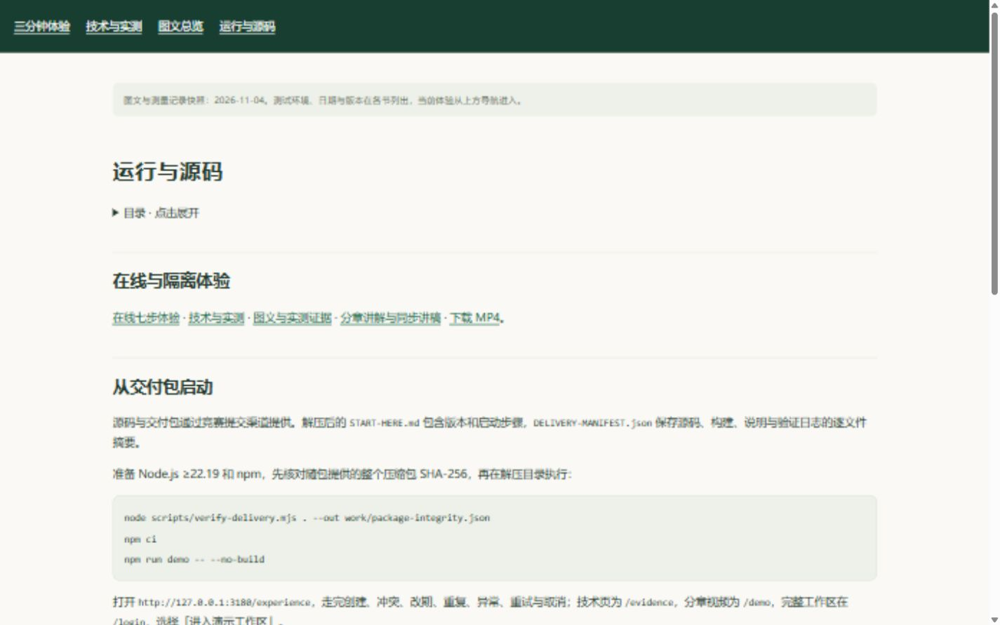
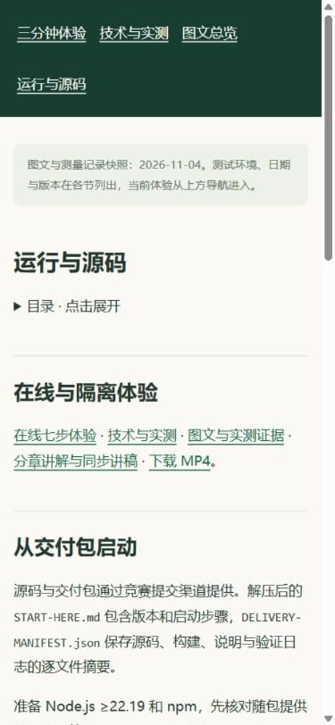
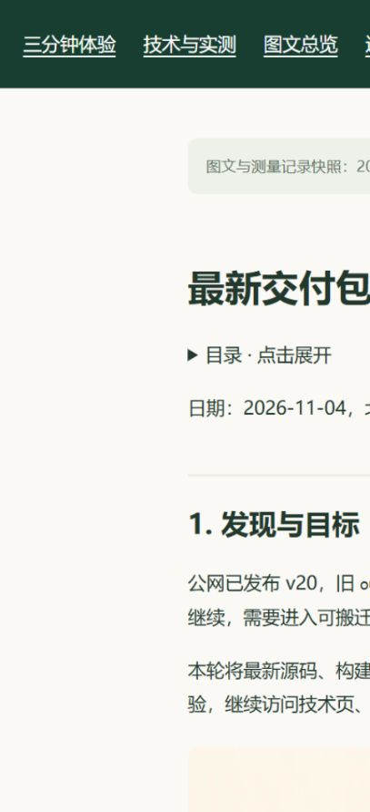
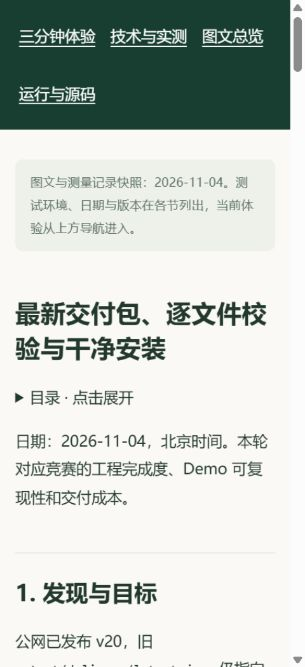

# v21 发布、运行文件核对与正式页面

日期：2026-11-04，北京时间。正式入口：[最新交付图文](https://daylight.yunforis.com/competition/delivery-report.html) · [运行与源码](https://daylight.yunforis.com/competition/reproduce.html) · [技术页工程章节](https://daylight.yunforis.com/evidence#delivery)。

## 1. 版本与交付对象

| 对象 | 版本 |
| --- | --- |
| 正式运行镜像 | `daylight:public-competition-20261104-v21` |
| 镜像 ID | `sha256:55f7a1780e8e8766e2b9a449b8804b333d93c578621cc0a573c9736044bc9dc2` |
| 前端、资料与本轮验证脚本源码 | `054f9cf8a50f10e600732efe559c763ea4a72dd7` |
| 业务后端继承 | v16 `a8daafc1bf88c747fb1e6104a89c56a6f90ff06b`，v13 `9354287b56e670a4a3f1376a68f325df2beadcf9`，基线 `db3ee897a696bf5f70365f8c901237f020cf8691` |
| 可搬迁源码与构建包 | 固定提交 `fc3ae1de6002bc56d1b4ca2038097862e62e40fe` |
| 服务端发布目录 | `/opt/daylight-delivery-release-v21` |

可搬迁包保存固定源码、构建与五阶段日志，体积 112,500,706 bytes；本次公网增量发布包为 32,953,267 bytes，673 文件，其中完整前端 663 文件。公网包以 v20 的固定镜像 ID 为基础，替换完整前端并加入交付检查脚本和 package.json 的命令入口。业务后端沿用上表版本。

公网包 SHA-256：`e8d9e198ed4f2369d21b57345ebc35bdd704880a7b1aec7a431aaf186889862a`。[发布清单](evidence/release-v21-manifest.json) · [压缩包记录](evidence/release-v21-archive.json)。

## 2. 备份与切换

发布前确认 API、Worker、Scheduler 均运行在固定 v20 镜像，保存数据库 custom dump 及目录清单、环境与 Compose、旧前端、原脚本和镜像 ID。备份目录：

```text
/opt/daylight-backups/before-portable-delivery-20261104074910
```

解包前核对整个压缩包、成员路径与普通文件类型，随后逐文件比较摘要，并核对全部构建文件集合。候选镜像先执行检查，再切换三个角色、等待健康、请求七步与视频并核对指标。事务保留失败时恢复原镜像和文件的回滚分支。

[实际部署输出](evidence/deploy-output.txt) · [实际部署脚本](evidence/deploy-v21.sh) · [发布打包脚本](evidence/package-public-v21.py) · [累计运行文件核验脚本](evidence/verify-runtime-v21.py)。

## 3. 候选与正式验收

| 检查 | 实际结果 |
| --- | --- |
| Linux 候选业务、指标与进度行为 | 38/38，0 跳过 |
| Linux 候选交付完整性 | 6/6，0 跳过 |
| 候选资料与包版本对应 | 通过；源码、包 SHA、2,345 文件、安装及浏览器结果一致 |
| 正式 HTTPS | 115 项通过，包含七步、匿名权限、资源摘要、视频/PDF Range |
| 关联资料完整字节及 MIME | 302 份通过，PDF Range 206 |
| 正式三页三尺寸 | 9 组通过：技术页工程章节、运行指引、交付图文；1440/390/320px |
| 正式入口跳转 | 2/2：技术页与运行指引均可点击进入交付图文 |
| 正式浏览器错误 | 0 |
| 三角色运行文件 | 各 707 文件及完整前端 663 文件一致 |
| 服务 | 8/8 healthy；三个应用角色 restart=0、OOM=false |

07:51 的 API / Worker / Scheduler 指标写入数为 741 / 549 / 143，丢样均 0，sinkError 均为空。[运行核对](evidence/runtime-verification.json)。

本地 Python 静态预览用于页面截图，完整资源检查在该预览上读到 WebP 的 `application/octet-stream` 后停止。正式应用的 302 份资源均通过类型与字节检查，原始正式记录如下。

[候选38项](evidence/candidate-production-tests.txt) · [候选6项](evidence/candidate-delivery-tests.txt) · [候选资料](evidence/candidate-delivery-checks.json) · [HTTPS115项](evidence/public-checks.json) · [资源302份](evidence/public-resources.json) · [布局9组](evidence/public-layouts.json) · [入口行为](evidence/public-behavior.json) · [浏览器日志](evidence/public-console.json) · [汇总与原文件摘要](evidence/publication-summary.json)。

## 4. 正式电脑与手机尺寸截图

### 技术页的交付入口


### 解压校验与运行指引




### 本轮图文




本页保存发布完成后的回执；公网交付图文保存该次发布前已完成的固定包验收、方法、前后对照与图片记录。
