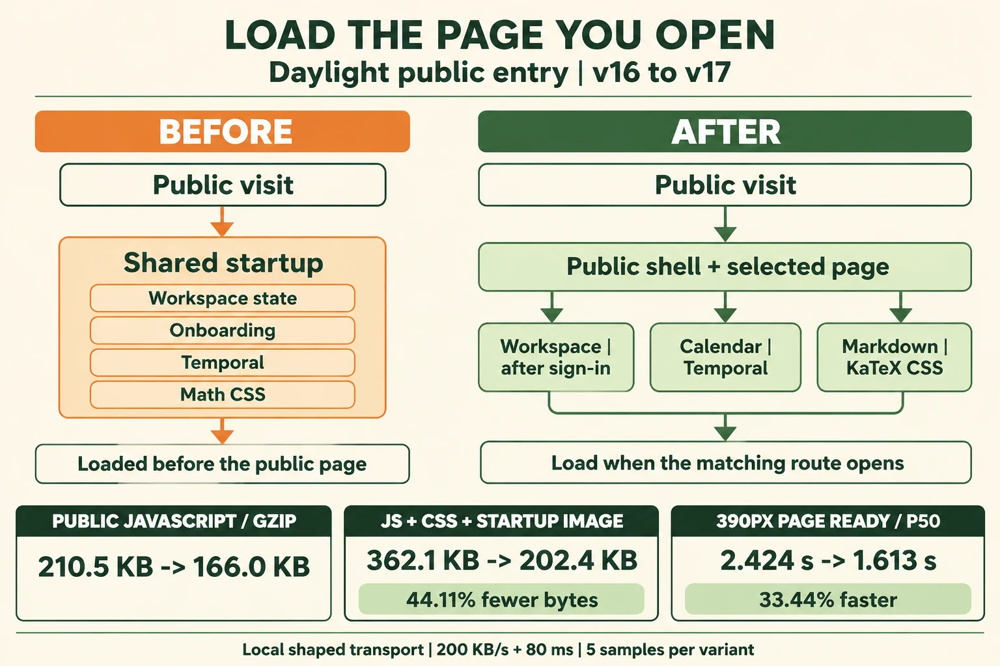
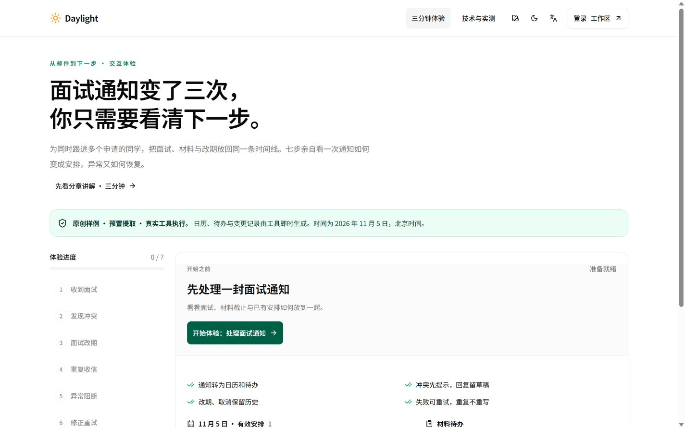
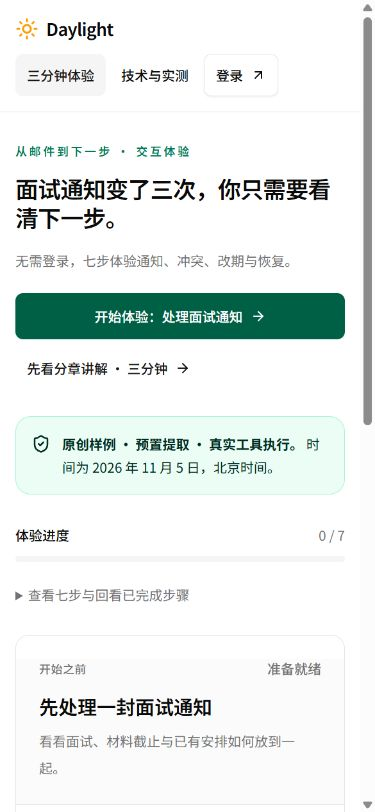
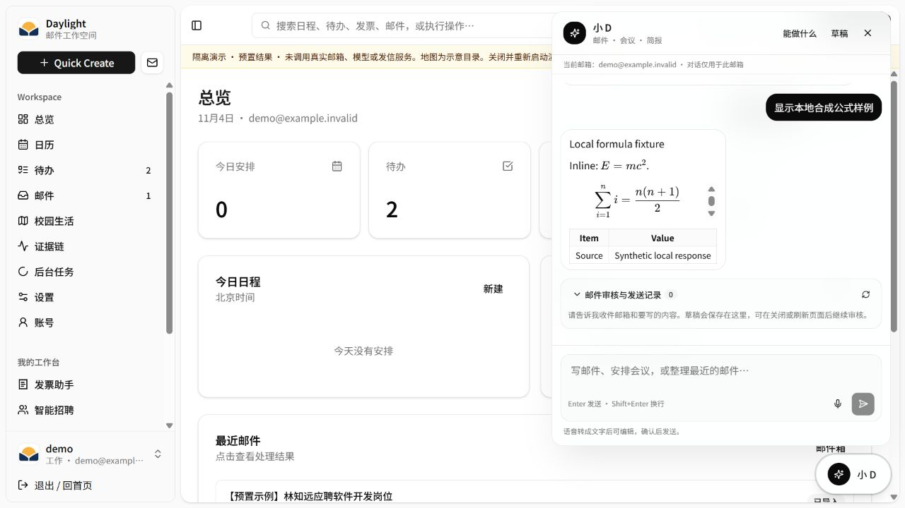

# 公开页面首屏加载优化

日期：2026-11-04，北京时间。场景是评委在电脑打开官网，或用手机扫码进入三分钟体验。本文记录依赖定位、选型、前后测量、实际页面与发布过程。

[在线体验](https://daylight.yunforis.com/experience) · [技术与实测](https://daylight.yunforis.com/evidence) · [本轮图文](https://daylight.yunforis.com/competition/entry-report.html)

## 1. 目标与结果

评委首先要能点下“开始体验”。本轮减少公开页首次下载的工作区代码、日历时间库、公式样式和启动图片，同时保留登录、工作区和各业务页的完整操作。



| 指标 | 优化前 | 优化后 | 变化 |
| --- | ---: | ---: | ---: |
| 体验页 JavaScript，最终文件 | 636,188 bytes | 501,402 bytes | 减少 21.19% |
| 体验页 JavaScript，逐文件 gzip | 210,510 bytes | 165,987 bytes | 减少 21.15% |
| 首屏 CSS，逐文件 gzip | 36,430 bytes | 28,119 bytes | 减少 22.81% |
| 启动标记图片 | 115,160 bytes | 8,278 bytes | 512px PNG → 128px WebP |
| 上述 JS、CSS、启动图合计 | 362,100 bytes | 202,384 bytes | 减少 44.11% |
| 1440px 页面可操作 p50 | 2.424 秒 | 1.641 秒 | 缩短 32.29% |
| 390px 页面可操作 p50 | 2.424 秒 | 1.613 秒 | 缩短 33.44% |

体积采用十进制 bytes / KB。表中合计覆盖体验路由的静态 JS 依赖、CSS 与启动标记；HTML、favicon、接口和外部字体单独保存在浏览器原始资源记录中。页面耗时来自第 4 节的本地受控传输，共 20 次导航；公网交付记录在发布节。

## 2. 怎样找到等待来源

入口 `src/main.jsx` 原先直接加载 `temporal-polyfill/global` 和 KaTeX CSS；`src/App.jsx` 直接导入工作区状态、新手引导、官网与认证页面。这些导入位于路由判断之前，打开 `/experience` 也会下载相应代码。

新增分析脚本读取 Rollup 模块归属，再从最终 `dist/.vite/manifest.json` 递归追踪静态 `imports` 和 CSS。Vite 会在 `generateBundle` 后继续添加预加载映射，因此字节、gzip 和 SHA-256 在构建落盘后计算。数据保存在[优化前清单](evidence/bundle-before.json)和[优化后清单](evidence/bundle-after.json)。

优化前入口本身为 613,700 bytes，gzip 201,269 bytes；体验页及其共享依赖加入后为 636,188 bytes，gzip 210,510 bytes。实际浏览器采样中的 JS、CSS 压缩体积逐次与清单相等，每项都有正数网络传输字节。

## 3. 技术选型与设计逻辑

| 修改 | 设计原因 | 代价与验证 |
| --- | --- | --- |
| 独立懒加载 `WorkspaceEntry` | 认证通过后才加载工作区 Provider、新手引导与全局日程弹窗；公开访问的依赖与业务状态分开 | 首次进入工作区增加一个异步边界；统一启动画面承接，演示登录与日历实际打开验证 |
| 官网、登录、注册、密码和法律页按路由加载 | 每个入口只下载当前页面正文及表单 | 站内跳转首次访问会请求对应 chunk；构建清单与页面跳转检查共同验证 |
| Temporal 放入 `studio-calendar.jsx` 的首个导入 | 时间补丁与 FullCalendar 同时进入日历依赖图，确保模块求值前初始化 | 实际月历、切月与日程北京时间字段验证 |
| KaTeX CSS 放入 `rich-markdown.jsx` | 公式字体与渲染器一起加载；公开体验与技术说明不使用该渲染器 | 实际构建的小 D 中渲染行内公式、块公式和 GFM 表格，检查字体和样式文件 |
| 128px 透明 WebP 启动标记 | 40–44px 展示使用双倍以上像素密度，减少首屏图片传输 | Lanczos 缩放后使用无损 WebP，保留原标记与透明度；原 PNG 继续作为品牌源图 |

优化后的体验路由静态依赖清单中，`workspace`、`workbenches`、`onboarding`、官网正文、Temporal 和 KaTeX 均已移出。对应模块随实际页面加载；业务 API、Agent 执行与服务拓扑继续复用现有实现。

## 4. 前后测量方法

### 4.1 构建和传输条件

- 优化前源码：`435c7c7`，正式 v16 客户端；优化后文件摘要见[源码清单](evidence/source-hashes.json)。两份构建使用同一 Node.js、Vite 7.3.7 和依赖安装。
- 浏览器：Windows 上的 IAB Chromium，16 个逻辑处理器。视口分别为 1440×900、390×844；设备和完整 UA 随[采样记录](evidence/browser-samples.json)保存。
- 本地服务为每个版本提供共享 **200,000 bytes/s** 字节预算，所有在途响应轮换写出，每次响应前增加 **80ms** 延迟；文本资源使用 gzip，第一方响应统一 `Cache-Control: no-store`。
- 两份页面共用独立演示 API；外部 Google Fonts 使用当前浏览器已有缓存，位于本地传输控制范围之外。CPU 使用本机执行环境。
- 每个视口、每个版本 5 次。配对顺序 AB / BA 交替，保留全部 20 个样本。最初 1280px 探索导航单独保存，正式统计使用上述固定尺寸。

这是可复现的本地传输模型，页面导航、资源加载、JavaScript 执行、体验 API、启动画面退出均包含在计时中。手机设备与微信真机验收沿用独立记录。

### 4.2 “可操作”的定义

从导航开始，到可见的“开始体验：处理面试通知”按钮启用、`daylight-boot` 已移除，再等待两次动画帧。探针由本地对照服务在 HTML 头部加入，结果写入 DOM；正式产品 HTML 使用原有入口。

| 视口 | 版本 | n | 平均 | p50 | p95 |
| --- | --- | ---: | ---: | ---: | ---: |
| 1440×900 | 前 | 5 | 2.421 秒 | 2.424 秒 | 2.447 秒 |
| 1440×900 | 后 | 5 | 1.639 秒 | 1.641 秒 | 1.696 秒 |
| 390×844 | 前 | 5 | 2.417 秒 | 2.424 秒 | 2.432 秒 |
| 390×844 | 后 | 5 | 1.613 秒 | 1.613 秒 | 1.620 秒 |

分位数用 nearest-rank，n=5 的 p95 取该组最大值。20/20 就绪；每次记录资源起止、编码字节、解码字节、传输字节、页面绘制和导航时间。[完整汇总](evidence/summary.json) · [逐次 CSV](evidence/samples.csv) · [浏览器原始资源](evidence/browser-samples.json)。

## 5. 页面和业务检查

### 5.1 首屏前后

| 1440px 优化前 | 1440px 优化后 |
| --- | --- |
|  |  |

| 390px 优化前 | 390px 优化后 |
| --- | --- |
|  |  |

### 5.2 延后加载的功能

本地实际构建已完成七步体验、未登录工作区跳转、演示账号登录、月历显示、下一月/上一月及日程详情。月历沿用北京时间；资料渲染在小 D 对话中通过本地合成响应检查，两条公式使用 `KaTeX_Main`，块公式与表格均正常。




[20项操作与页面状态](evidence/ui-checks.json)。公式检查使用 `entry-server.mjs --math-fixture` 的独立合成响应，模型与 SMTP 调用均为 0。图文报告在1440/390/320px无整页横向溢出，7张图片按需加载；[三尺寸记录](evidence/report-layouts.json)。正式发布构建的132份JS/CSS均与受测构建摘要相等，[最终文件核对](evidence/final-build-check.json)。

## 6. 复现步骤

在优化前源码快照和本轮源码中分别安装锁定依赖；将本轮分析脚本放入两份快照的 `scripts/`。各自执行以下命令，保留生成的 `dist` 和 `inventory.json`：

```sh
node scripts/analyze-client-bundle.mjs work/entry-v17/before
node scripts/analyze-client-bundle.mjs work/entry-v17/after
```

将两个结果放在同一源码目录下的对应位置，启动独立演示和本地对照服务：

```sh
npm run demo -- --port 3196 --no-build
node scripts/performance/entry-server.mjs --before work/entry-v17/before/dist --after work/entry-v17/after/dist --api http://127.0.0.1:3196
```

浏览器在 1440×900、390×844 下交替打开 `http://127.0.0.1:3197/experience?entry-bench=编号` 与 `http://127.0.0.1:3198/experience?entry-bench=编号`。读取 HTML 元素的 `data-entry-benchmark`，按原始格式保存为 `work/entry-v17/browser/samples.json`，再执行：

```sh
node scripts/performance/summarize-entry.mjs work/entry-v17
```

脚本复算分位数、传输体积，并校验每次第一方 JS/CSS 的实际传输与构建清单一致。图片可执行 `python scripts/build-entry-brand.py` 重建，需要 Pillow 的 WebP 支持。

## 7. 图片、费用和竞赛考核

- 本轮图像使用 imagegen 技能附带 CLI，明确指定 `gpt-image-2.5`、1536×1024、high；[完整提示词](entry-prompt.txt)、[生成参数与摘要](image-generation.json)、[生成原图](assets/entry-loading-generated.png)均保留。图内英文；正文中文说明。
- 本轮新增文字模型 0 次、图像生成 1 次、云采购 ¥0。累计文字模型 84 次，输入 104,267 / 输出 38,445 Token，按公开价估算 ¥0.516094；图像累计 12 次，费用按供应商账单登记。[累计清单](evidence/budget-total.json)。总预算 ¥500。
- 场景价值：扫码后更快进入可操作的邮件变化主线；工程与 Demo：公开页与工作区按路径加载，日历和公式功能实际验证；成本与性能：下载量和页面等待采用相同条件前后测量。云端服务与 Agent 的既有证据通过[统一技术报告](https://daylight.yunforis.com/competition/technical-report.html)关联。

## 8. 发布记录

v17以v16固定镜像摘要为基础，完整替换前端目录。发布脚本先备份数据库、当前前端与配置，核对包内文件摘要，再运行生产候选和测量资料检查；随后更新API、Worker、Scheduler，检查三个角色的健康、指标写入与七步业务。完整运行记录、正式HTTPS和手机尺寸截图随本轮部署归档保存。

**已部署v17：**候选29/29、正式HTTPS80项、180份关联资源与三页三尺寸布局通过。三角色各564文件、完整dist539文件一致，8服务healthy，应用restart=0 / OOM=false；公网相同资源范围响应体371,241→210,068 bytes，减少43.41%。[精确镜像、备份、原始输出与正式截图](deployment-v17.md)。
