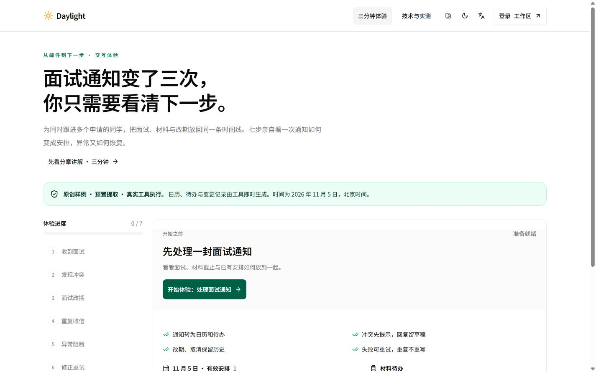
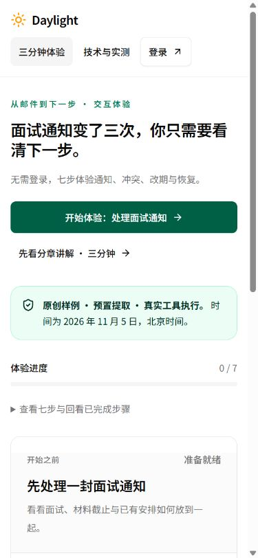
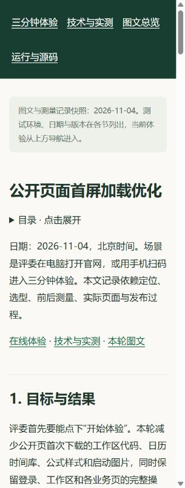

# v17 公网发布与首屏验收

日期：2026-11-04，北京时间。状态：**部署验证通过**。

[正式体验](https://daylight.yunforis.com/experience) · [公开图文](https://daylight.yunforis.com/competition/entry-report.html) · [技术与实测](https://daylight.yunforis.com/evidence)

## 1. 发布版本

| 项目 | 实际值 |
| --- | --- |
| 镜像 | `daylight:public-competition-20261104-v17` |
| 镜像ID | `sha256:9df78bb6e5c3906422be3475ba4f3c061760348f8ed393fcb1c3c6af33f678a5` |
| 本轮前端、资料、验证脚本 | `a6e0c83a86b2b0c5bd2f929be236f809dcddeb24` |
| 后端继承 | v16，`a8daafc1bf88c747fb1e6104a89c56a6f90ff06b`；之前为v13 `9354287`与基线`db3ee89` |
| 基础镜像 | v16，固定摘要`sha256:0bca96d41fe1ef666cc1c3f26eb1200854f3ca473463653960357067876a46b3` |
| 发布包 | 31,317,724 bytes，540文件；完整前端539文件、验证脚本1文件 |
| 发布包SHA-256 | `edfaa5c0d3e4f6f3b892af1b996cfc4680cbba854638a106b23b87bb3d63e0f8` |
| 发布备份 | `/opt/daylight-backups/before-public-entry-20261104054630` |
| 服务器构建目录 | `/opt/daylight-entry-release-v17` |

本轮完整替换`dist`，后端沿用固定v16镜像。发布包附[文件摘要](evidence/release-v17-manifest.json)与[归档摘要](evidence/release-v17-archive.json)。

## 2. 发布步骤与门禁

1. 固定部署锁，核对API、Worker、Scheduler三个角色均运行目标v16摘要；检查可用磁盘与内存。
2. 备份Compose配置、镜像记录、完整前端和数据库。`pg_dump -Fc`完成，`pg_restore --list`成功读取目录。
3. 校验发布包SHA、540份文件摘要及路径；以v16摘要构建v17镜像。
4. 候选容器以1 CPU / 512 MiB运行生产检查，**29/29通过**，涵盖采集边界、服务生命周期和七步体验。模型与SMTP调用为0。
5. 候选资料检查核对20次采样、132份JS/CSS实际摘要、公开路由依赖移出结果、图片模型与费用清单，以及原21页PDF的完整SHA。
6. 更新镜像和源码版本，启动三个应用角色并等待健康。随后核对七步状态、匿名接口权限、视频/PDF范围读取和三个角色指标写入。
7. 正式HTTPS与浏览器验收完成后归档实际运行结果。

[发布脚本](evidence/deploy-v17.sh) · [发布完整输出](evidence/deploy-v17.txt) · [候选29项](evidence/candidate-production-tests-v17.txt) · [候选资料核对](evidence/candidate-entry-checks-v17.json)。

## 3. 正式运行核对

2026-11-04 **05:49:23 +08:00**采样：

| 角色 | 核对文件 | 完整dist | 指标已写入 | 丢样 | 写入错误 | restart / OOM |
| --- | ---: | ---: | ---: | ---: | --- | --- |
| API | 564 | 539 | 1,139 | 0 | null | 0 / false |
| Worker | 564 | 539 | 1,432 | 0 | null | 0 / false |
| Scheduler | 564 | 539 | 272 | 0 | null | 0 / false |

三个角色镜像ID一致，标签与环境中的源码版本均为`a6e0c83`。累计后端文件摘要合并v7、v9、v13、v16覆盖，再应用本轮前端与脚本；逐文件核对同时检查前端文件集合。API、Worker、Scheduler、PostgreSQL、Redis、RabbitMQ、MinIO、Caddy共8服务均为running / healthy。

[运行原始记录](evidence/runtime-v17.json) · [复核脚本](evidence/verify-runtime-v17.py)。

## 4. 公网传输体积实测

从同一Windows环境，使用Node直接HTTPS请求，标准TLS校验，接受gzip。读取体验路由的完整静态JS依赖、CSS和启动标记，记录响应体在线编码字节，并解码核对本地完整SHA。

| 类别 | v16响应体 | v17响应体 |
| --- | ---: | ---: |
| JavaScript | 218,078 bytes，10资源 | 171,985 bytes，13资源 |
| CSS | 38,003 bytes | 29,805 bytes |
| 启动图片 | 115,160 bytes | 8,278 bytes |
| 合计 | **371,241 bytes** | **210,068 bytes** |

相同资源范围的实际响应体减少**43.41%**。HTTPS头部、HTML、接口、favicon和外部字体位于此合计范围之外。Caddy实际编码与本地`gzipSync`分别记录：本地构建口径减少44.11%，公网响应体口径减少43.41%。

[公网前记录](evidence/public-before.json) · [公网后记录](evidence/public-after.json) · [逐类汇总与摘要](evidence/public-wire-comparison.json)。

## 5. 正式HTTPS与浏览器

- **80项HTTPS检查通过**：七步结果、权限、参数范围、核心图片、图文与原始证据、累计费用、演示视频、PDF和部分内容读取。
- **180份关联资料通过**：HTTP、MIME和完整SHA-256；PDF的`bytes=0-31`返回206和实际32字节。
- **9组布局通过**：`/experience`、`/evidence`与本轮图文，各测1440/390/320px，无整页横向溢出。体验按钮均48px，390px顶部约305px，320px约381px；报告7张图片按需加载。
- 正式浏览器完成七步，逐步等待对应结果出现；页面模块为`/assets/index-CTgyeG_T.js`，控制台错误记录为空。
- 手机设备和微信真机使用单独验收记录；本节设备为Windows浏览器的三个视口。

[80项完整记录](evidence/public-verification-v17.json) · [180份资源与PDF Range](evidence/resources-public-v17.json) · [三页三尺寸](evidence/public-layouts.json) · [正式七步页面](evidence/public-seven-steps.json)。

### 正式截图

| 正式390px体验 | 正式320px图文 |
| --- | --- |
|  |  |

[截图URL、视口、图片尺寸和SHA](evidence/screenshot-review.json)。

## 6. 恢复与费用

发布脚本在切换后发生错误时，恢复备份的镜像配置并等待三个角色健康，恢复宿主前端与本轮验证脚本。上一个v16镜像与数据库备份均保留；v17本轮业务检查成功，发布输出为`PUBLIC_ENTRY_PUBLISHED_OK`和`REMOTE_EXIT 0`。

本轮文字模型0、图像生成1、云采购0。图像使用`gpt-image-2.5`，英文图文；累计文字模型84次、公开价估算¥0.516094，图片12次按供应商账单登记。[预算清单](evidence/budget-total.json)。
