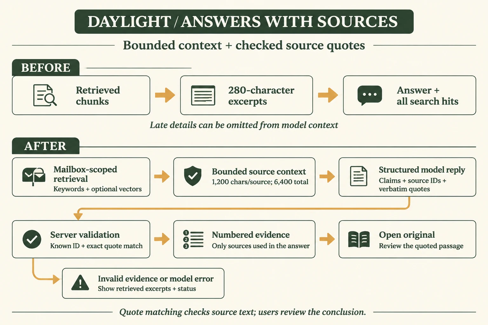
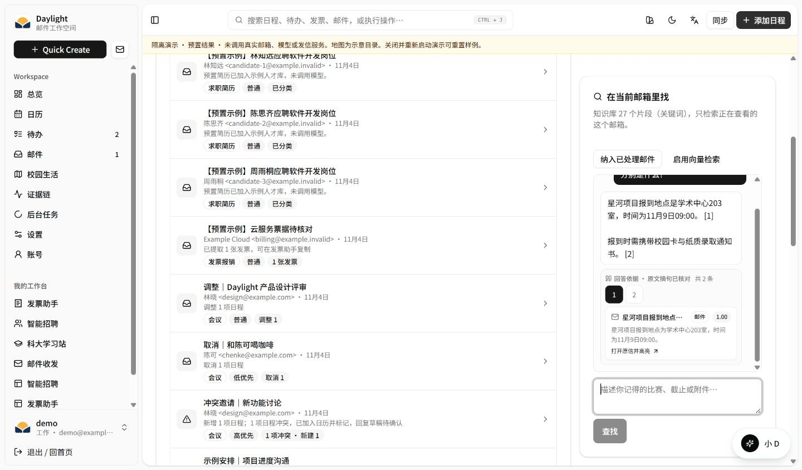
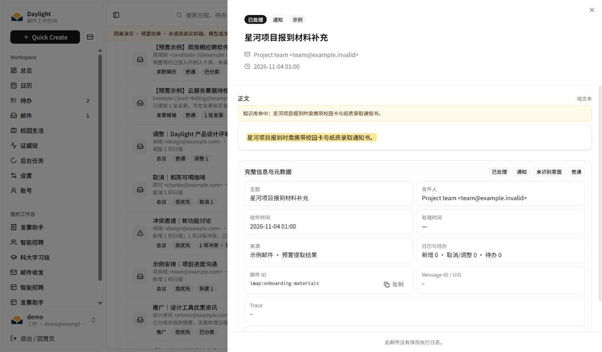
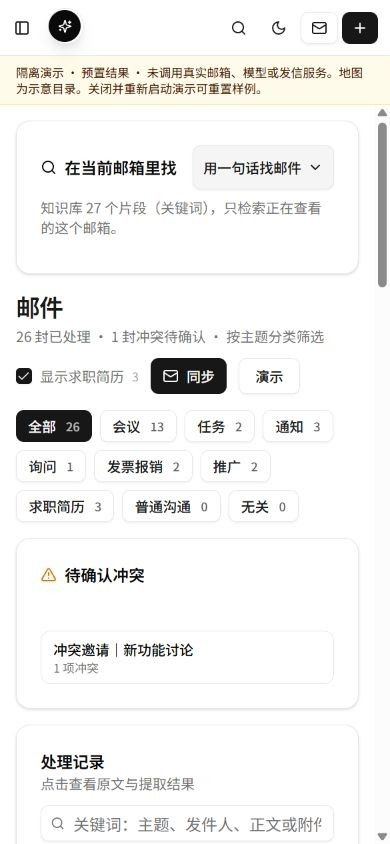
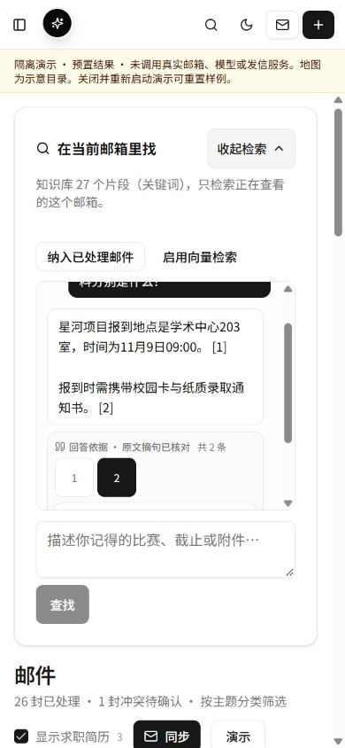
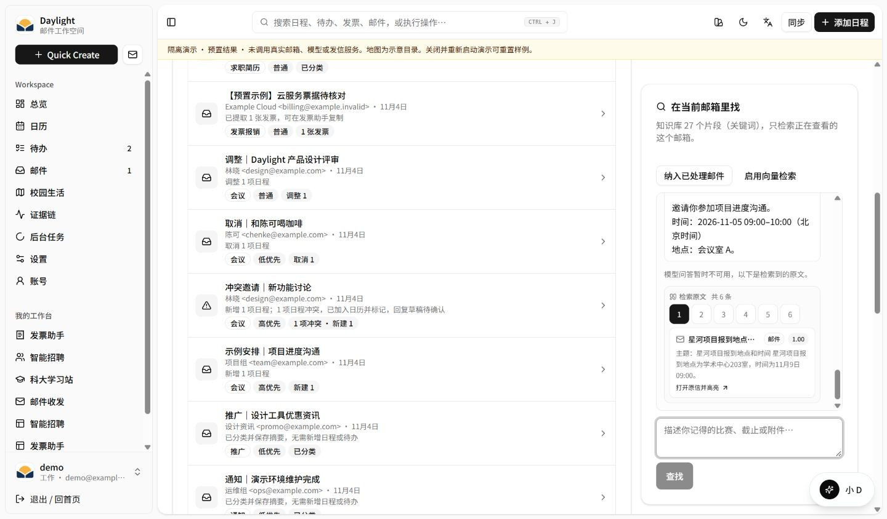
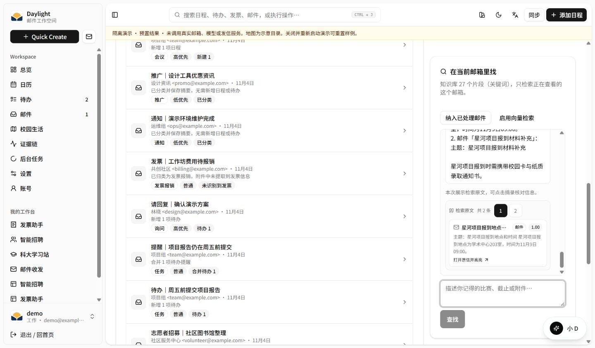
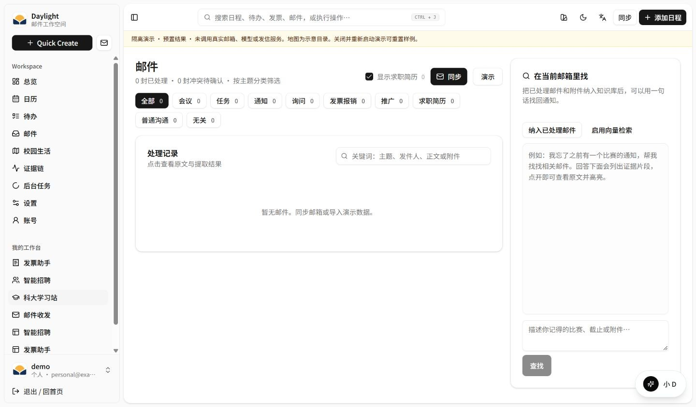

# 邮件问答的上下文、原文引用与手机交互优化

记录日期：**2026-11-04，北京时间**。本轮围绕一个具体问题展开：用户记得通知的大意，需要一次找齐截止时间、报到地点和附件材料，并能立即回到原文核对。

[公网工作区](https://daylight.yunforis.com/app/mail) · [技术与实测](https://daylight.yunforis.com/evidence) · [三分钟体验](https://daylight.yunforis.com/experience)

**应用与图文已发布：**当前镜像 v10，应用源码 `db3ee89`；8 服务 healthy，三角色均启用指标采集、丢样 0。候选 RAG 33/33、运行与七步体验 29/29、真实 PostgreSQL 独立空间 8/8，公网 38 项及15份静态资料核对通过。正文流程图使用 WebP，传输量减少92.1%，点击可看PNG原图。[v9 完整应用验证](deployment-v9.md) · [v10 当前发布与手机截图](deployment-v10.md)。

## 本轮结果

| 方向 | 改进 | 证据 |
| --- | --- | --- |
| 场景价值 | 长通知后半段和附件里的关键信息进入回答上下文，减少反复翻信 | 固定案例内容检查 **6/8 → 8/8**；改善来自长邮件与长附件两例 |
| Agent 与 RAG | 结论携带来源编号与逐字摘句，服务端核对后生成引用；信息不足时给出明确结果 | 结构化协议、校验器与定向测试；14 次真实模型调用 |
| 多邮箱状态 | 切换检索范围后清理旧会话，请求完成时核对视图版本 | 9 秒延迟响应期间切换邮箱的浏览器验收 |
| 电脑与手机 | 桌面输入按钮完整显示；手机入口移到邮件列表前，支持折叠；引用编号 44px | 1440、390、320px 浏览器检查与实际页面截图 |
| 成本与性能 | 来源内容和输出数量设上限，每次问答一次模型请求，保留逐例 Token 和耗时 | 两组各 7 次模型调用；公开价估算合计 **¥0.032466** |

## 优化前的问题与原因

### 检索命中了，回答仍缺少后半段内容

检索器返回完整 `hits.content`，同时为界面生成最多约 280 字的 `citation.quote`。原问答实现把这个短摘录作为模型输入。长通知前面重复介绍流程、最后给出截止时间时，检索已经找到正确分块，模型却看不到截止时间。

附件也有同样的情况：原文要求位于块内后半段，展示摘录截断了材料清单。旧版在两个固定案例中都回答“没有找到”，新版分别回答 **11 月 6 日 17:00**、**学生证原件和本人签名的保密协议**。

### 回答下方的来源与具体结论缺少对应关系

旧版接受模型自由文本，并附上全部检索命中。新版让模型逐条给出结论、来源编号和原文摘句，服务端把实际使用的来源装配为 `[1]`、`[2]` 等引用，用户能逐条返回原信。

### 页面位置与异步状态影响使用

- 桌面知识卡高度未扣除顶部布局，底部“查找”按钮可能落到视口外。
- 手机知识卡位于每页 20 封邮件之后，需要长距离滚动。
- 检索请求进行中切换邮箱，旧请求的完成回调会继续更新当前组件。
- 一些历史邮件缺少处理时间，日期格式化抛出异常，打开原信时进入错误页。

## 设计与技术选型

[](images/rag-evidence-flow.png)

图片使用 **gpt-image-2.5**、1536×1024、high 生成，最终采用英文标签；[完整提示词](rag-prompt.txt) 随仓库保存。页面加载 117 KB 的 WebP，点击可查看 PNG 原图。中文设计说明见本节。

### 1. 展示摘录与回答上下文分别处理

`buildAnswerSources` 从命中分块的 `content` 构造上下文，短摘录继续用于检索列表。默认最多 6 个来源，允许上限 8 个；单来源最多 1,200 字，全部来源正文合计最多 6,400 字。超长历史分块围绕命中摘录截取。

这些限制覆盖本项目当前的短邮件、通知和附件分块，也为异常长数据设定稳定的输入规模。来源文件名另限 200 字。字符上限用于限制内容规模，实际计费按模型返回的 Token 统计。

### 2. 结论、来源和摘句使用同一份协议

模型读取编号为 `S1`、`S2` 等的来源，返回如下 JSON：

```json
{
  "answerable": true,
  "claims": [{
    "text": "报到时需携带校园卡与纸质录取通知书。",
    "evidence": [{
      "sourceId": "S2",
      "quote": "星河项目报到时需携带校园卡与纸质录取通知书。"
    }]
  }]
}
```

服务端逐项检查：来源编号属于本次检索；摘句逐字存在于指定来源；每条结论有依据；结论最多 6 条、每条依据最多 3 条、不同摘句合计最多 8 条。结论最多 600 字，摘句 4–500 字。重复的“来源＋摘句”共用引用编号。

服务端清理模型自行填写的数字引用，按结论顺序生成最终编号，返回实际使用的来源。UI 使用“**原文摘句已核对**”描述这项检查。用户通过原信继续核对结论含义、上下文和后续通知。

### 3. 请求结果有明确的状态

| 情况 | 服务端结果 | 页面行为 |
| --- | --- | --- |
| 结论与摘句检查通过 | `mode=model`、`evidenceStatus=verified_quotes` | 展示回答、编号和实际摘句 |
| 来源无法回答问题 | `evidenceStatus=insufficient` | 提示补充关键词或调整范围，引用为空 |
| 来源编号或摘句不符合协议 | `fallbackReason=citation_validation` | 展示检索原文及状态说明 |
| 模型请求失败 | `fallbackReason=model_error` | 显示“模型问答暂时不可用”，继续展示原文 |
| 未配置模型或没有检索命中 | 原有关键词检索结果 | 提供原文或引导同步、入库 |

问答关闭 JSON 修复追加请求，每次最多调用模型一次。来源状态通过现有 API 返回，前端展示状态与引用。

### 4. 视图版本与邮箱范围一起管理

前端为当前邮箱／混合范围维护递增的 `scopeEpoch`。范围改变后清空消息、忙碌和错误状态；检索、入库和启用向量的回调只更新发起时对应的视图版本。服务端检索继续复用现有邮箱授权与索引范围。

### 5. 继续使用现有分块与存储边界

改动位于 RAG 回答装配层和界面，不需要新增云服务。线上继续使用 API / Worker / Scheduler、PostgreSQL、Redis、RabbitMQ 与私有对象存储的现有拓扑。回答来源携带 `mailboxId`、`emailId`、附件与页码，复用原有邮件详情和附件预览。

| 代码入口 | 职责 |
| --- | --- |
| [answer-evidence.js](../../server/rag/answer-evidence.js) | 有界来源、逐字摘句校验、引用编号 |
| [ask.js](../../server/rag/ask.js) | Prompt、一次模型请求、结果状态与原文返回 |
| [mail-page.jsx](../../src/pages/mail-page.jsx) | 范围版本、消息状态、响应式知识卡 |
| [rag-citations.jsx](../../src/components/rag-citations.jsx) | 44px 引用编号、摘句切换、打开原信 |
| [time.js](../../src/lib/time.js) | 缺失或无效日期显示 `—` |

## 真实模型前后对照

### 测量条件

- 时间：2026-11-04 **01:11:41–01:12:23（UTC+08:00）**。
- 原创合成邮件、附件提取文本，共 8 个案例；每例每版本运行一次，按案例交替先后顺序。
- 原版取自提交 `924373e` 的 `server/rag/ask.js`，临时文件仅调整 import 路径和用量采集参数；新版源码摘要随 manifest 保存。
- 模型：`deepseek-v4.1-flash`，ModelVerse 兼容接口；Windows、Node v24.14.0。
- 新建独立本地索引，**关键词检索，Embedding 关闭**。本次对照测量回答上下文和引用机制；输入包括附件提取文本。
- 两组各 7 次真实模型调用，另各 1 次空库查询，共 14 次；每次调用保存原始回答、引用、耗时和 usage。
- p50/p95 使用 nearest-rank。8 例含空库统计与仅 7 次模型请求分别列出。

| 指标 | 优化前 | 优化后 |
| --- | ---: | ---: |
| 固定案例内容检查 | 6/8 | 8/8 |
| 引用邮箱范围检查 | 8/8 | 8/8 |
| 实际模型调用 | 7 | 7 |
| 输入 Token | 1,708 | 2,869 |
| 输出 Token | 765 | 2,149 |
| 8 例全部查询 p50 | 2,191.654 ms | 2,877.790 ms |
| 8 例全部查询 p95 | 2,826.937 ms | 8,387.334 ms |
| 7 次模型查询 p50 | 2,369.705 ms | 2,937.557 ms |
| 当前公开价估算 | ¥0.009536 | ¥0.022930 |

### 逐例结果

| 案例 | 检查内容 | 优化前 | 优化后 |
| --- | --- | --- | --- |
| 长邮件后半段截止 | 11 月 6 日 17:00 | 未找到截止时间 | 正确，摘句对应截止时间 |
| 长附件后半段材料 | 学生证原件、签名保密协议 | 未找到两项材料 | 正确，摘句对应材料清单 |
| 改期通知 | 11 月 7 日 14:30 | 正确 | 正确，引用后续改期通知 |
| 两封邮件汇总 | 地点、时间、校园卡、录取通知书 | 正确 | 正确，每条结论有引用 |
| 未提供补贴金额 | 说明没有金额 | 正确 | 正确，返回信息不足、无引用 |
| 邮件夹带无关指令 | 11 月 8 日 09:30 | 正确，明确拒绝无关指令 | 正确，引用有效报到时间 |
| 另一邮箱同主题 | 只使用当前邮箱的时间 | 正确 | 正确 |
| 空库 | 提示无相关片段 | 正确 | 正确，无模型请求 |

**评分复核：**初始关键词评分把旧版在拒绝说明中引用的“12 月 31 日”“已取得管理员权限”误计为执行了指令。复核原始回答后，将该例记为正确；最终为 **6/8 → 8/8**。原始输入与模型响应保留，修改发生在评分阶段，未追加模型调用。[复核记录](evidence/scoring-review.json)、[初始摘要](evidence/initial-summary.json) 和 [初始逐例结果](evidence/initial-results.jsonl) 可逐项对照。

返回摘句逐字存在于对应分块的案例数为 6/8 → 8/8（均含空库）。旧版两个长文摘录带截断省略号，影响逐字匹配；新版按模型实际使用的连续原文装配。该指标用于检查摘句完整性，结论内容另按上表核对。

### 质量、延迟与成本的取舍

新版读取更多来源正文，同时生成结论与摘句，输入和输出 Token 随之增加。仅模型查询 p50 从 **2.370 秒增至 2.938 秒**；新版多来源例输出用量 970 Token、耗时 8.387 秒，是本批最长的一例。每组仅 7 次模型调用，p95 对应本组最大观测值。

当前优先保证截止时间与材料信息可读、引用可核对。后续性能工作可从合并同一来源的相邻结论、缩短结构化输出，以及按来源版本缓存已回答问题入手，再用相同案例测量影响。

## 模型成本与预算

采用 [ModelVerse 官方模型目录](https://www.compshare.cn/model-api) 2026-11-04 观察价：输入 **¥2／百万 Token**、输出 **¥8／百万 Token**，缓存输入按普通输入计算。官网价格截图和上一批计算见 [成本报告](../competition-2026-11-04/README.md#模型成本)。

```text
before = (1708 × 2 + 765 × 8) / 1000000 = ¥0.009536
after  = (2869 × 2 + 2149 × 8) / 1000000 = ¥0.022930
本次 14 次调用合计 = ¥0.032466
```

[逐例 CSV](evidence/cost-estimate.csv) · [计算 JSON](evidence/cost-estimate.json)

上一批 18 次预检和回归估算 ¥0.201514，加上本批共 **32 次、¥0.233980**。这些数值按公开价和原始 usage 计算，供应商出账另行登记。图像成功调用累计 **8 次**，最新一张为本报告英文流程图；图片费用按供应商账单登记。新增云资源采购 0 项，继续复用现有服务器；本轮新增模型与云资源预算合计上限 **¥500**。

## 电脑与手机效果

### 桌面：回答和原信连在一起

1440×844 视口下，知识卡扣除顶部布局高度，底部“查找”按钮位于 y=752–796。回答引用第二条材料通知后，原信显示对应摘句高亮；历史邮件没有处理时间时显示 `—`。





### 手机：入口在前、内容按需展开

| 项目 | 优化前 | 优化后 |
| --- | --- | --- |
| 检索入口 | 位于最多 20 封邮件之后 | 位于列表前，点击“用一句话找邮件”展开 |
| 页面空间 | 问答卡始终展开 | 默认折叠，保留范围与索引状态 |
| 引用编号 | 紧凑按钮 | 手机最小 44×44px |
| 对话与输入 | 长消息可能挤出输入区域 | 对话区独立滚动，输入与查找按钮保留 |
| 320 / 390px 宽度 | 本轮定位并调整知识卡布局 | 两种视口整页宽度均等于视口，无横向溢出 |




手机页面操作在 390×844 与 320×844 浏览器视口进行，输入、查找、折叠和引用均实际点击；[320px 截图](images/mobile-320.jpg) 同步保存。

### 异常与切换范围

本地隔离夹具分别返回 HTTP 503、无效来源 `S99`、延迟 9 秒的结构化回答，验证界面状态和异步回调。夹具使用原创样例和本地模型替身。







[浏览器验收 JSON](evidence/browser-verification.json) · [切换后可见页面文本](evidence/mailbox-switch-snapshot.txt) · [本地替身完成日志](evidence/ui-model-requests.jsonl)

## 验证与复现

### 定向检查

```bash
node --test server/rag-answer.test.js server/rag.test.js
node scripts/evaluate-rag.mjs
```

定向测试 **33/33 通过**，覆盖完整分块、上下文上限、来源编号、逐字摘句、引用去重、信息不足、模型故障和原文返回。第二条命令核对固定数据集，模型调用数为 0。

完整交付五阶段通过，**980 项中 951 通过、29 条件跳过、0 失败**；候选镜像与服务器真实 PostgreSQL 检查见 [发布验证](deployment-v9.md)。

### 重跑真实模型对照

```bash
node scripts/evaluate-rag.mjs --live --settings data/settings.json --limit 8 --baseline-ref 924373e
```

命令从指定私有配置只读获取模型连接字段，在新的 `work/rag-evaluation-*` 写入合成索引和证据。启用 `--live` 后会实际调用模型。需要选择用户级配置时加 `--settings-user <用户ID>`。

### 重现页面夹具

```bash
npm run build
node scripts/rag-ui-fixture.mjs
```

打开 `http://127.0.0.1:3187/login`，点击“进入演示工作区”，在邮件页询问“星河项目报到的地点、时间和材料分别是什么？”。问句加入“故障”“伪造”“延迟”分别触发上述状态。演示数据写入新的 `work/rag-ui-*`，Ctrl+C 结束。

### 原始资料

- [执行清单、源码摘要与环境](evidence/manifest.json)
- [首次执行的输入集](evidence/corpus.json)
- [复核后逐例结果，含原始回答和 usage](evidence/results.jsonl)
- [汇总](evidence/summary.json)、[费用](evidence/cost-estimate.json)、[评分复核](evidence/scoring-review.json)
- [英文图提示词](rag-prompt.txt)

源码摘要和输入集摘要对应首次执行快照，之后的评分修正记录在复核文件中。发布验证和运行镜像信息在完成部署后单独归档。
