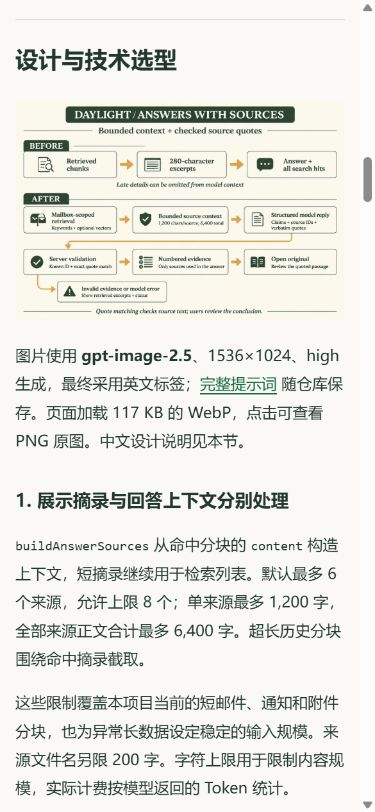
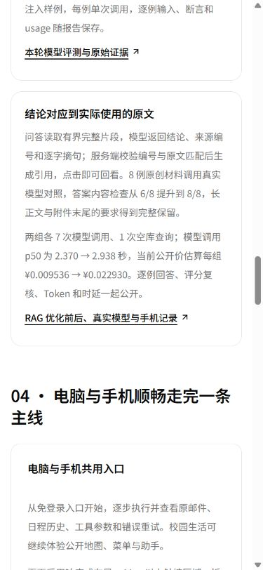

# RAG 图文与实测证据 v10 发布记录

日期：**2026-11-04，北京时间**。[RAG 设计与前后对照](README.md) · [v9 应用与 PostgreSQL 验证](deployment-v9.md) · [官网图文](https://daylight.yunforis.com/competition/rag-report.html)。

## 发布结果

v10 基于 v9 应用镜像发布 15 份静态资料，将数据库实连、完整交付检查和 v9 发布记录放进官网，并为手机提供轻量流程图和 PNG 原图入口。

| 项目 | 结果 |
| --- | --- |
| 当前镜像 | `daylight:public-competition-20261104-v10` |
| 镜像 ID | `sha256:7d40e303985212a070b47cd2126a22c05e1043a592ca55d28210db8c38423886` |
| 应用源码 | `db3ee897a696bf5f70365f8c901237f020cf8691` |
| 静态资料源码 | `653fbd4edd75d68c653a5fe6f13b4ff77bd9d626` |
| 基础镜像 | v9，`sha256:6fd765cedc96333c12d895634f695a1df4229beacf4a25a257667a90d610e91c` |
| 更新包 | 15 份静态文件，285,994 bytes |
| 更新包 SHA-256 | `da728eccf12e6d94804fc4e8d6cdc89d93b787d7e4bcb3826edc12bde42be66f` |
| 发布前备份 | `/opt/daylight-backups/before-rag-evidence-20261104014854` |
| 候选镜像检查 | production 运行、观测与七步工具链 29/29 |
| 服务健康 | 8 服务 healthy；三个应用容器 restart=0、OOM=false |
| 公网复查 | 38 项业务、权限、资源与视频检查；15 份更新资料均 HTTP 200 且 SHA-256 一致 |
| 运行文件核对 | API / Worker / Scheduler 各 366 份文件；完整 dist 文件集合及摘要均为 349 份 |

[候选包清单](evidence/release-v10-manifest.json) · [候选测试](evidence/candidate-production-tests-v10.txt) · [发布日志](evidence/deploy-v10.txt)。

## 手机图片与证据阅读

流程图由 **gpt-image-2.5** 生成，全英文标注，中文选型与设计逻辑放在正文。页面显示 WebP，点击打开 PNG 原图。

| 图像 | 文件大小 | 用途 |
| --- | ---: | --- |
| PNG 原图，1536×1024 | 1,485,094 bytes | 点击放大与归档 |
| WebP，1536×1024 | 117,338 bytes | 手机与桌面正文显示 |
| 正文图片传输量变化 | **减少 92.1%** | 保持原图尺寸，降低打开报告的传输量 |

新增 `/competition/rag-deployment.html` 集中展示 v9 的完整交付、候选镜像、真实 PostgreSQL 和发布结果；对应原始文件位于 `/competition/rag-assets/evidence/`，从报告即可打开。公开报告已完成 320、390、1440px 布局检查，8 张内嵌图片均正常加载。

390×844 浏览器实际打开公网 v10：WebP 正常加载、链接指向 PNG，技术页的 RAG 卡片显示内容检查、耗时、价格与图文入口。

## 发布与恢复步骤

1. 持有部署锁，核对三个应用角色的基础镜像均为指定 v9 ID。
2. 保存 Compose 环境、镜像信息、前端目录与 PostgreSQL custom dump，检查备份可读取。
3. 核对更新包 SHA-256、路径及 15 份静态文件摘要，以完整 v9 镜像 ID 构建候选。
4. 在 production 模式、关闭网络的候选容器中运行 29 项检查。
5. 切换三个应用角色，等待健康探针通过；检查业务结果、公开报告和三个角色的指标采集。
6. 对公网 15 份更新资料逐一核对状态和字节摘要，再核对三个运行容器的完整前端集合、文件摘要及镜像 ID。

发布脚本包含切换后的恢复处理，可从保存的环境文件与 v9 镜像恢复。首次上传的脚本使用 CRLF，在执行 `set -eu` 时退出；转换为 LF 后完成上述流程，最终 `REMOTE_EXIT 0`。

## 发布后实际采集

运行复查时间为 **2026-11-04 01:50:05，北京时间**：

| 角色 | 已写入样本 | 丢样 | 写入错误 | 已核对文件 |
| --- | ---: | ---: | --- | ---: |
| API | 266 | 0 | 无 | 366 |
| Worker | 473 | 0 | 无 | 366 |
| Scheduler | 110 | 0 | 无 | 366 |

三角色 readiness 均为 `ok=true`，运行镜像与前端文件逐项一致。PostgreSQL、Redis、RabbitMQ、MinIO 和 Caddy 均 healthy。

[38 项公网结果](evidence/public-verification-v10.json) · [15 份资料 HTTP 与摘要](evidence/static-verification-v10.json) · [运行镜像、文件与 readiness](evidence/runtime-verification-v10.json)。

## 归档与复现

仓库保存 v10 发布记录与最终核对结果；官网的 `/competition/rag-deployment.html` 保存 v9 应用发布快照。原始评测与日志通过 Git 属性保持字节原样，Windows 与 Linux 检出后可按清单复核 SHA-256。

本轮业务源码的完整交付为 **980 项、951 通过、29 条件跳过、0 失败**；v9 候选 RAG **33/33**、production **29/29**、真实 PostgreSQL 独立空间 **8/8**。这三组验证和 14 次真实模型前后对照均随 [v9 记录](deployment-v9.md) 和 [主报告](README.md) 保存。
