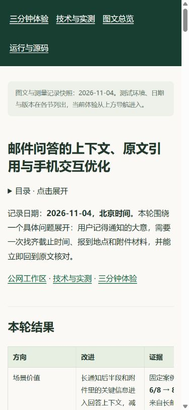
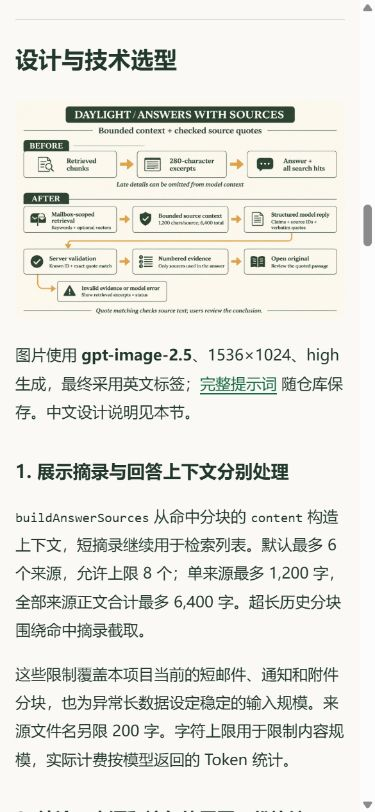

# RAG 与手机交互 v9 发布验证

日期：**2026-11-04，北京时间**。[设计与前后对照](README.md) · [官网技术页](https://daylight.yunforis.com/evidence)。

## 发布结果

| 项目 | 结果 |
| --- | --- |
| 应用镜像 | `daylight:public-competition-20261104-v9` |
| 镜像 ID | `sha256:6fd765cedc96333c12d895634f695a1df4229beacf4a25a257667a90d610e91c` |
| 应用源码提交 | `db3ee897a696bf5f70365f8c901237f020cf8691` |
| 上一版本 | v8，`sha256:c8bbb6c23a59646bdce179e638d33a526408b2210a644bda8b4f7a7eb0b9fe1f` |
| 候选包 | 343 份文件，19,325,055 bytes |
| 候选包 SHA-256 | `12eeece55c05ce087960e3d5a14347d3e448e70ca6955b5a8575db22c613b93f` |
| 发布前备份 | `/opt/daylight-backups/before-rag-20261104013944` |
| 运行健康 | 8 服务 healthy；API / Worker / Scheduler 的 restart=0、OOM=false |
| 公网复查 | 38 项通过，包含七步、权限、图文、原始评测、图片及视频 Range |
| 文件核对 | 三个运行容器各核对 352 份文件；dist 完整 335 份，无旧构建遗留文件 |

当前主机为 2 vCPU / 3499 MiB 内存、4 GiB swap，继续使用已有 Compose 拓扑。更新应用角色后，PostgreSQL、Redis、RabbitMQ、MinIO 与 HTTPS 入口保持健康。

## 本地完整交付验证

固定源码快照执行 `npm run verify`，五阶段依次通过：

| 阶段 | 结果 |
| --- | --- |
| 测试 | 980 项，951 通过、29 条件跳过、0 失败 |
| 前端构建 | 通过，约 31 秒 |
| 基础邮件数据集 | 通过 |
| 隔离 Demo | 通过 |
| 部署资源 | 通过 |

最终检查时源码摘要保持一致。验证发生在提交前，summary 记录基线 HEAD `924373e` 和 `dirty=true`，已测应用文件随后提交为 `db3ee89`，发布包保存同一来源摘要和构建摘要。隔离器记录 3 次已拦截外连尝试（Google OAuth 与两个合成模型端点）；测试进程按离线规则运行。

前一次执行期间修改了评分与页面，因此该次稳定性检查失败；正式交付采用后一次固定快照的完整结果。[正式摘要](evidence/offline-verification.json) · [构建记录](evidence/build.txt)。

## 候选镜像内验证

使用 v8 的完整镜像 ID 作为基础，替换 RAG 回答模块、相关验证脚本与完整前端目录。镜像标签记录应用提交；安装依赖沿用基础镜像。

| 检查 | 环境 | 结果 |
| --- | --- | --- |
| RAG 上下文与来源协议 | 关闭网络，显式本地数据模式，独立测试目录 | 33/33 |
| 指标采集、生命周期与七步工具链 | 关闭网络，production 模式 | 29/29 |
| PostgreSQL 读写与回答装配 | 真实服务器 PostgreSQL，新建独立 schema，本地模型替身 | 8/8 |

[RAG 测试](evidence/candidate-rag-tests.txt) · [运行与体验测试](evidence/candidate-production-tests.txt) · [候选包文件清单](evidence/release-v9-manifest.json)。

## 真实 PostgreSQL 检查

检查使用服务器同一 PostgreSQL 服务，在随机命名的独立 schema 中创建所需表、写入原创样例，连接的 `search_path` 仅指向该空间。候选容器使用只读根文件系统和临时 `/tmp`；其他服务连接字段为合成值。

| 检查 | 结果 |
| --- | --- |
| 完整长正文、附件与来源元数据回读 | 通过 |
| 回答读取 280 字之后的截止时间 | 通过 |
| 回答读取附件材料、保留附件定位 | 通过 |
| 直接检索另一账号邮箱 | 返回 403 |
| 信息不足 | 返回明确结果、引用为空 |
| 无效来源编号 | 显示检索原文 |
| 模型 HTTP 503 | 显示检索原文和状态 |
| 重新建立连接池、5 并发读取 | 回答与邮箱归属正确，持久化行数保持一致 |

本次模型响应由候选容器内的 HTTP 替身提供，共 10 次本地请求，真实模型调用 0 次。8 项完成后删除测试 schema，并查询确认已不存在。真实模型 14 次对照的输入和调用结果见 [主报告](README.md#真实模型前后对照)。

复现入口：[verify-rag-postgres.mjs](../../scripts/verify-rag-postgres.mjs)。在已提供生产依赖环境变量的候选容器中执行：

```sh
node scripts/verify-rag-postgres.mjs
```

[完整 PostgreSQL 结果](evidence/postgres-verification.json)。

## 发布顺序与恢复方式

1. 持有部署锁，核对三个应用角色均运行指定 v8 镜像 ID。
2. 保存 Compose 配置、PostgreSQL custom dump、原问答模块、镜像 ID 和前端目录；使用 `pg_restore --list` 检查备份可读取。
3. 校验压缩包路径和逐文件 SHA-256，离线构建候选镜像。
4. 完成上述三组候选检查，再次确认线上基础镜像未变化。
5. 更新镜像名与 `DAYLIGHT_GIT_SHA`，切换 API / Worker / Scheduler，等待健康检查。
6. 复查七步、私有接口拒绝匿名访问、RAG 报告与各角色指标，最后同步宿主机前端副本。

发布脚本在镜像切换后注册恢复处理，检查失败时恢复之前的环境配置和镜像。此次检查全部成功。备份保留在上表所列路径，可据前一镜像继续恢复。

[发布日志](evidence/deploy-v9.txt)。

## 公网与运行文件核对

`verify-competition.mjs` 的 38 项检查全部通过。新增报告、英文流程图、评测摘要、逐例 JSONL 与费用文件同时检查 HTTP 和本地文件 SHA-256；七步状态、取消历史、任务数、匿名权限及 MP4 206 响应均正确。

运行文件核对对三个应用角色分别执行，包含 v7 延续的运行模块与本次包内文件。前端目录比较完整文件名集合和每份摘要，335 份一致。每个容器共校验 352 份文件，镜像 ID 和源码标签一致。

读取 readiness 时三个角色都在实际写入：

| 角色 | 已写入样本 | 丢样 | 写入错误 |
| --- | ---: | ---: | --- |
| API | 304 | 0 | 无 |
| Worker | 944 | 0 | 无 |
| Scheduler | 180 | 0 | 无 |

[公网逐项结果](evidence/public-verification-v9.json) · [运行镜像、文件与 readiness](evidence/runtime-verification-v9.json)。

## 手机阅读

图文报告在 320、390、1440px 视口均无整页横向溢出，8 张内嵌图片全部加载。390×844 公网直接打开报告，并通过目录定位英文流程图。主报告使用 WebP 展示并链接 PNG 原图，便于手机打开大图。




[本地三种尺寸检查](evidence/report-layouts.json)。手机工作区的输入、引用和异步切换截图见 [主报告](README.md#电脑与手机效果)。

本页保存 v9 应用发布快照，图文与发布证据作为后续静态资料版本交付。
