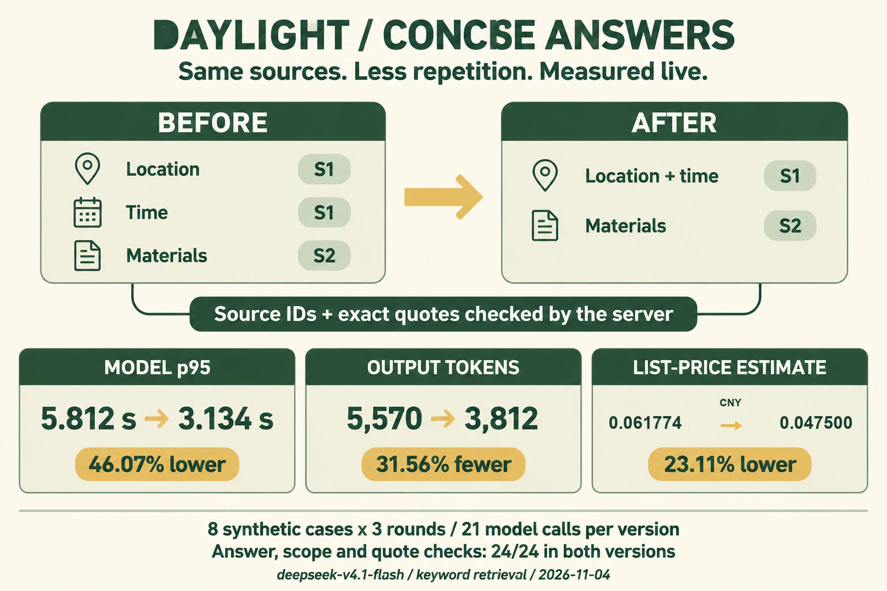
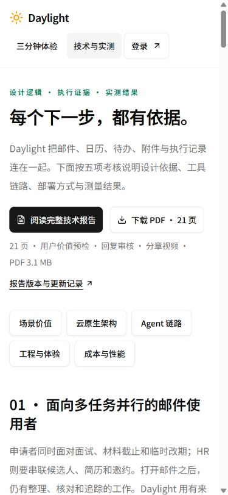
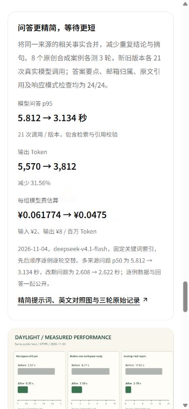

# 邮件问答精简与真实延迟优化

2026-11-04，北京时间。对应考核：Agent 链路质量、工程可复现性、成本与性能。[在线体验](/experience) · [技术与实测](/evidence#rag-latency) · [统一技术报告](../competition-submission-2026-11-04/technical-report.md)。

## 1. 从逐例结果定位等待时间

上一轮 RAG 改造将长正文与附件末尾的要求纳入问答上下文，答案内容检查由 6/8 提升至 8/8。随后查看逐例响应发现：模型倾向于把同一邮件的地点与时间拆成不同结论，重复写出邮件主题，并多次返回相似摘句。多来源问题的 JSON 输出随之增大。

本轮将相关事实合并表达。用户仍可从引用卡片查看邮件主题与原文，回答正文直接呈现时间、地点和材料要求。



上图由 **gpt-image-2.5** 生成，1536×1024、high、英文标签。货币行经过精确排字；[原始 PNG](assets/concise-answers-generated.png)、[图像登记](image-generation.json)和[完整提示词](latency-prompt.txt)随报告保存。数值均来自下方原始调用记录。

## 2. 提示词如何调整，为什么这样选

| 环节 | 优化前 | 优化后 | 设计依据 |
| --- | --- | --- | --- |
| 结论组织 | 每条结论点出主题或附件名 | 同一来源的时间、地点、材料合并；跨来源结论附各自依据 | 引用卡片已展示来源名称，正文聚焦用户所问 |
| 原文摘句 | 每条结论分别取依据 | 选择能覆盖事实的连续短句，减少重复摘句 | JSON 输出中的每段原文都占输出 Token，连续摘句便于服务端核对 |
| 输入信息 | 每来源最多 1,200 字、总计 6,400 字 | 沿用相同范围与来源编号 | 保留上一轮对长正文和附件末尾事实的覆盖 |
| 结果校验 | 来源 ID、连续原文匹配、邮箱归属检查 | 沿用相同服务端校验与引用生成 | 精简后的每条结论仍携带可回查依据 |
| 调用次数 | 每次问答最多一次模型请求 | 每次问答最多一次模型请求 | 通过输出组织减少生成量，保持链路长度可控 |

本轮运行代码变更位于 `server/rag/ask.js` 的 system prompt。JSON 结构、检索逻辑、来源边界和引用验证使用同一套实现。新增验证覆盖一句话包含两份来源的情形，核对引用编号、邮件 ID 与原文校验标记。

## 3. 如何完成同口径测量

- 材料：8 个既有原创合成案例，包含长正文截止、附件材料、后续改期、两来源整合、信息不足、提示注入、邮箱范围和空库。
- 模型：当前配置的 `deepseek-v4.1-flash`，接口 origin 为 `https://api.modelverse.cn`。仅使用所需模型连接字段。
- 检索：独立本地关键词索引，Embeddings 关闭；两组使用同一套片段与原文校验。
- 基线：`ec793b8` 中的问答提示词。评测加载器只适配模块路径及已有 usage 上下文。
- 顺序：每个案例重复 3 轮，旧版与新版先后顺序逐例、逐轮交替。每版 24 个样本，其中 21 次真实模型调用、3 次空库查询。
- 时间：北京时间 **04:44:23—04:46:14**。每次计时包括检索、模型请求、JSON 处理与引用验证；索引建立在计时开始前完成。21 次模型问答单独统计 p50/p95，空库另列。
- 分位数：nearest-rank。三轮用于观察同一案例的波动；逐条响应和实际 Token 与时延共同保存。

检查包括：答案包含预设关键事实、所需来源已返回、引用归属当前邮箱、摘句逐字存在于对应片段、响应属于预期模式。信息不足与空库各自检查其模式。查看逐例回答与对应原文，可复核每一项结论。

## 4. 总体结果

| 指标 | 优化前 | 优化后 | 变化 |
| --- | ---: | ---: | ---: |
| 答案要点检查 | 24/24 | 24/24 | 全部通过 |
| 邮箱范围检查 | 24/24 | 24/24 | 全部通过 |
| 原文摘句检查 | 24/24 | 24/24 | 全部通过 |
| 预期响应模式 | 24/24 | 24/24 | 全部通过 |
| 模型问答 p50，21 次/版 | 2.589 秒 | 2.325 秒 | 降低 10.21% |
| 模型问答 p95，21 次/版 | 5.812 秒 | 3.134 秒 | 降低 46.07% |
| 输入 Token | 8,607 | 8,502 | 减少 1.22% |
| 输出 Token | 5,570 | 3,812 | 减少 31.56% |
| 21 次模型费公开价估算 | ¥0.061774 | ¥0.047500 | 减少 23.11% |
| 最终回答总字符数，含空库与信息不足 | 1,305 | 855 | 减少 450 字符 |
| 模型错误 / 引用校验回退 | 0 / 0 | 0 / 0 | 逐例记录完整 |

每次模型费用按 `(输入Token × 2 + 输出Token × 8) ÷ 1,000,000` 元复算，缓存输入按普通输入价格。价格来源为 [ModelVerse 公开模型目录](https://www.compshare.cn/model-api)，本轮 42 次合计估算 **¥0.109274**。供应商账单决定实际支出。

这组延迟来自上述接口、索引和案例组合。模型输出量、供应商响应与问题复杂度共同影响等待时间，后续比较沿用相同口径。

## 5. 逐案例对照，收益集中在哪里

每格为同一案例 3 次的中位数。完整样本见 [calls.csv](evidence/calls.csv)。

| 案例 | 优化前 p50 | 优化后 p50 | 前→后输出 Token，3 次合计 |
| --- | ---: | ---: | ---: |
| 长正文末尾截止 | 2.787 秒 | 2.254 秒 | 722 → 453 |
| 附件材料要求 | 2.979 秒 | 2.520 秒 | 697 → 571 |
| 后续改期 | 2.608 秒 | 2.622 秒 | 668 → 690 |
| 两来源报到要求 | 5.812 秒 | 3.134 秒 | 2,127 → 897 |
| 片段信息不足 | 1.690 秒 | 1.710 秒 | 135 → 189 |
| 提示注入样例 | 2.451 秒 | 2.123 秒 | 510 → 345 |
| 当前邮箱范围 | 2.476 秒 | 2.440 秒 | 711 → 667 |
| 空库，模型调用 0 | 0.115 毫秒 | 0.126 毫秒 | 0 → 0 |

多来源问题的生成量下降最明显。改期与信息不足案例的时延基本持平，输出 Token 略增；因此将分组结果和总体结果同时展示。

## 6. 一次真实模型回答的前后效果

以下选取第 1 轮同一原创合成案例的完整回答。问题同时询问星河项目的报到地点、时间和携带材料，答案来自两封合成通知。

### 优化前：3 段结论，分别说明地点、时间和材料

> 邮件《星河项目报到地点和时间》说明，星河项目报到地点为学术中心203室。 [1]
>
> 同一邮件还说明，星河项目报到时间为11月9日09:00。 [2]
>
> 邮件《星河项目报到材料补充》说明，星河项目报到时需携带校园卡与纸质录取通知书。 [3]

引用 [1] 与 [2] 来自同一邮件，分别摘取地点与时间。

### 优化后：地点与时间合并，2 份来源可回查

> 星河项目报到地点为学术中心203室，时间为11月9日09:00。 [1]
>
> 星河项目报到需携带校园卡与纸质录取通知书。 [2]

原文依据分别为：

1. “星河项目报到地点为学术中心203室，时间为11月9日09:00。”
2. “星河项目报到时需携带校园卡与纸质录取通知书。”

第 2、3 轮的新提示词将三个要点合为一句，并附两份来源。三轮输出和引用见[原始结果](evidence/results.jsonl)。这些回答由真实模型产生，合成通知内容与评测步骤可复现。

## 7. 原始记录与预算

- [运行 manifest 与源码/材料 SHA-256](evidence/manifest.json)
- [48 份前后响应、引用、Token 与时延](evidence/results.jsonl)
- [三轮汇总及逐案例数据](evidence/summary.json)
- [逐次调用 CSV](evidence/calls.csv)
- [原创合成材料](evidence/corpus.json)
- [累计调用与价格复算](evidence/budget-total.json)
- [全量测试日志](evidence/full-tests.txt)

累计文本调用 **84 次**，输入 **104,267**、输出 **38,445** Token，公开价估算 **¥0.516094**。本轮图片调用 **1 次**，图片累计 **11 次**；图片费用按供应商账单登记。新增云采购 **0**，使用现有服务器。新增模型与云资源总预算 **¥500**。

## 8. 复现步骤与工程验证

在独立材料目录运行评测，`--settings` 指向自己的模型配置。前后对照会发起 42 次实际模型请求。

```sh
node --test server/rag-answer.test.js server/rag.test.js
npm test
node scripts/evaluate-rag.mjs --live --settings <private-settings.json> --limit 8 --baseline-ref ec793b8 --rounds 3
node scripts/competition-rag-latency-evidence.mjs work/<new-run-directory>
python scripts/competition-public-report.py --only rag-latency-report.html
npm run build
```

本轮定向 **34/34**；全量 **1,018 项，989 通过、29 条件跳过、0 失败**。条件集成项使用其独立服务验证入口。全量日志、真实模型证据与发布记录分别归档。

统一 21 页报告保存 v14 运行快照；本页记录后续问答优化与最新累计费用，技术页直接展示本轮数据。

## 9. 手机阅读与章节直达

页面检查发现，直接打开 `/evidence#rag-latency` 时，公开布局的路由滚动复位会把页面带回顶部。已将复位改为：DOM 提交后先查找 URL 的章节 ID，存在时定位该节；进入普通页面时回到顶部。使用现有 React `useLayoutEffect` 与浏览器滚动能力，章节链接可直接分享与刷新。

技术页的前后数值由同一份评测汇总生成；最新累计费用读取单独的预算清单，历史报告保留其发布快照。手机将三项指标依次排列，完整报告中的宽表在表格范围内横向滚动。

下图为同一链接在 390×844 浏览器中的前后位置：左侧定位修正前、右侧定位修正后。

<p></p>

1440、390、320px 下，技术页与完整报告共 6 组布局检查通过，整页横向溢出为 0，报告图片全部加载。章节首开与刷新定位距视口顶部约 24px；目录点击与浏览器返回定位正确，进入体验页时滚动复位为 0。[浏览器逐项记录](evidence/ui-layout.json) · [桌面结果卡](assets/local-evidence-desktop.png) · [手机报告](assets/local-report-mobile.png)。本节记录浏览器尺寸测试，微信真机检查单独登记。
