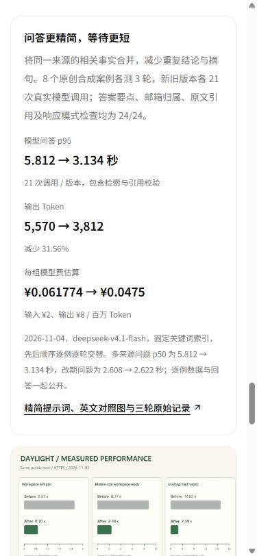
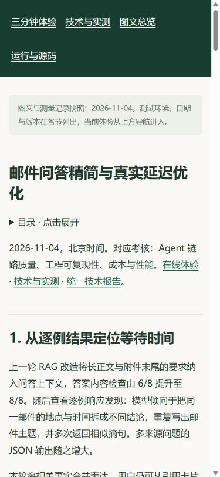

# v16 问答精简与真实延迟：公网发布和验证

2026-11-04，北京时间。问答提示词、三轮实测报告、最新用量及章节直达已部署。

## 版本和备份

| 项目 | 实际值 |
| --- | --- |
| 运行镜像 | `daylight:public-competition-20261104-v16` |
| 镜像 ID | `sha256:0bca96d41fe1ef666cc1c3f26eb1200854f3ca473463653960357067876a46b3` |
| 本轮运行及前端源码 | `a8daafc1bf88c747fb1e6104a89c56a6f90ff06b` |
| 继承后端 | v13 `9354287b56e670a4a3f1376a68f325df2beadcf9`，此前基线 `db3ee897a696bf5f70365f8c901237f020cf8691` |
| 发布前镜像 | v15，精确 ID `sha256:5140e8c84c3cc5c6bc536a3c825910d255a47a2d071801aa60d9a1fc6448a81e` |
| 备份位置 | `/opt/daylight-backups/before-rag-latency-20261104050256` |
| 发布包 | 492 文件；完整 dist 488 文件；29,474,656 bytes |
| 发布包 SHA-256 | `6a3fa176af80c96ed5089764050ce7093eb56792b02d415d50939fc0d7487eed` |

本轮后端覆盖 `server/rag/ask.js` 与对应测试，沿用已部署的检索、引用校验、共享存储及任务基础设施。资料发布完整替换 dist；镜像与环境的源码标记指向上述提交。

[发布清单](evidence/release-v16-manifest.json) · [发布包摘要](evidence/release-v16-archive.json) · [部署脚本](evidence/deploy-v16.sh) · [部署输出](evidence/deploy-v16.txt)。

## 发布步骤与一次预检修正

1. 核对三角色均运行预期 v15 镜像 ID。
2. 保存 Compose、环境、当前镜像、完整前端和相关源码；数据库执行自定义格式 dump，并检查备份目录。
3. 检查 tar 路径、文件集合和 492 份摘要，从精确 v15 镜像构建 v16。
4. 运行候选 production 29/29、RAG 34/34、实际 PostgreSQL 独立 schema 8/8，以及评测、源文件、图像和 PDF 摘要检查。
5. 切换 API、Worker、Scheduler，等待三角色 healthy，检查七步业务与资料入口。
6. 从正式 HTTPS 检查资源、完整运行字节和桌面/手机尺寸浏览器。

首次执行在备份阶段发现主机缺少 `server/rag-answer.test.js`，脚本停在服务切换前。修正后，主机已有文件按原样备份，缺失文件从当前运行镜像保存，同时登记主机原先的存在状态。回滚据此还原原文件或移除本次新建文件；随后重跑完成发布。

## 候选镜像与真实 PostgreSQL

| 验证 | 结果 | 记录 |
| --- | --- | --- |
| production 运行模式 | 29/29 | [测试日志](evidence/candidate-production-tests-v16.txt) |
| RAG 与来源验证 | 34/34 | [测试日志](evidence/candidate-rag-tests-v16.txt) |
| 实际 PostgreSQL | 8/8 | [集成结果](evidence/postgres-verification-v16.json) |
| 发布资料与源码绑定 | 通过 | [候选资料摘要](evidence/candidate-rag-evidence-checks-v16.json) |

PostgreSQL 验证在随机独立 schema 内写入原创合成材料，模型由本地 stub 返回结构化结果。覆盖长正文与附件事实、邮箱权限、信息不足、错误来源 ID、503 返回原文、连接重建与 5 个并发读取。共 10 次本地模型请求，真实模型调用 0；验证后 schema 清理完成。

候选直接计算 `/app/server/rag/ask.js` 的 SHA-256，与真实模型运行 manifest 中的源码摘要核对；同时核对 48 份响应、输出 Token、费用累计、英文图和原 PDF 的文件摘要。

## 正式运行核对

北京时间 **05:05:08**，8 服务 running / healthy，API、Worker、Scheduler 均 restart=0、OOM=false。每个角色核对 **513 文件**，其中完整 dist **488 文件**，文件集合与逐份 SHA-256 一致。

| 角色 | 指标已写入 | 丢样 | 写入错误 |
| --- | ---: | ---: | --- |
| API | 425 | 0 | null |
| Worker | 637 | 0 | null |
| Scheduler | 150 | 0 | null |

核对覆盖历次运行变更的累计文件与本次完整前端。[运行文件与健康结果](evidence/runtime-verification-v16.json)。

正式 HTTPS **74 项**通过，覆盖七步结果、去重和失败状态、私有接口、报告、最新 RAG 数据与累计费用，以及 PDF/MP4 分段读取。[正式 HTTPS 结果](evidence/public-verification-v16.json)。

从报告与关联记录抽取 **159 份资源**，逐份 HTTP、MIME 和完整 SHA-256 核对通过，PDF Range 返回 206 与对应的 32 字节内容。[关联资源结果](evidence/static-verification-v16.json)。

Windows 系统代理使本次资源核验持续等待，直连同一 HTTPS 文件实测 0.123 秒返回。核验工具增加 `--direct` 选项，通过标准 TLS 连接直接访问服务器；本次 159 份核验用时约 8.8 秒，结果记录 `transport: direct-https`。

```sh
node scripts/verify-competition.mjs https://daylight.yunforis.com work/public-check.json
python scripts/verify-competition-resources.py https://daylight.yunforis.com work/resources-check.json --direct
```

## 正式电脑与手机尺寸页面

1440、390、320px 下分别核对技术页与问答报告，共 6 组无整页横向溢出。报告 3 张图全部加载；章节首开和刷新定位约 24px。统一报告的“最新补充”入口指向本轮公开报告。




[正式布局与导航记录](evidence/public-ui-layout.json) · [桌面结果卡](assets/public-evidence-desktop.png)。这里记录桌面与手机尺寸浏览器，微信真机检查另行登记。

三张正式截图均在页面完成加载后复核最终画面，[截图核对与 SHA-256](evidence/screenshot-review.json)保存文件、来源地址、尺寸和摘要。

## 本轮用量

真实文字模型 **42 次**、输入 **17,109**、输出 **9,382** Token，公开价估算 **¥0.109274**。累计文本 **84 次、¥0.516094**，输入 **104,267**、输出 **38,445** Token。

新增 **gpt-image-2.5 英文图 1 次**，图片累计 **11 次**。新增云采购 **0**；图片和服务器费用按供应商账单登记，新增总预算上限 **¥500**。

[优化方法与逐例结果](README.md) · [在线结果卡](https://daylight.yunforis.com/evidence#rag-latency) · [公开图文报告](https://daylight.yunforis.com/competition/rag-latency-report.html)。
