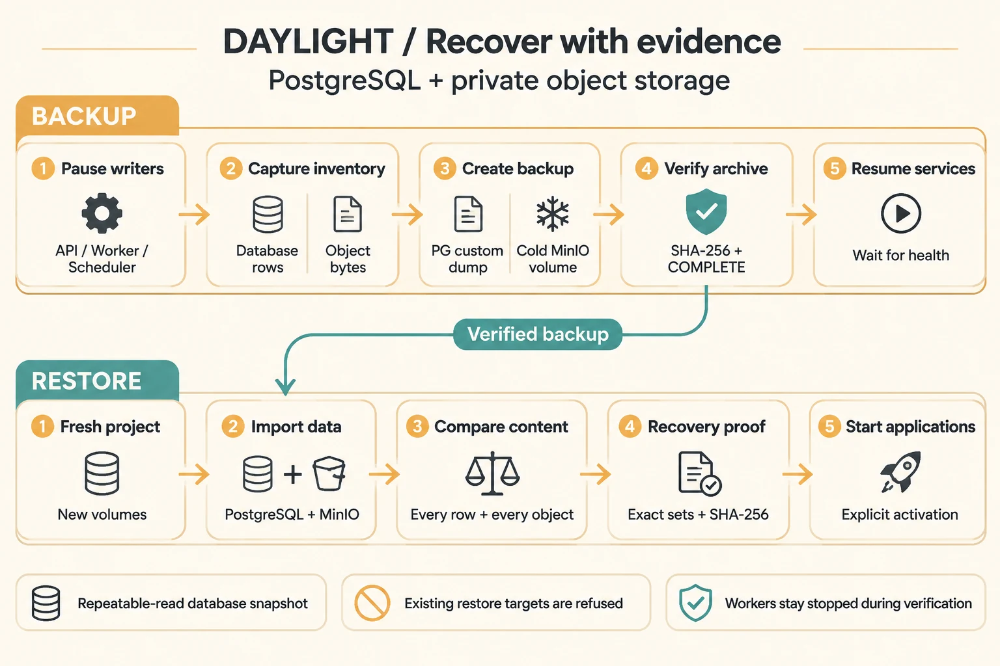
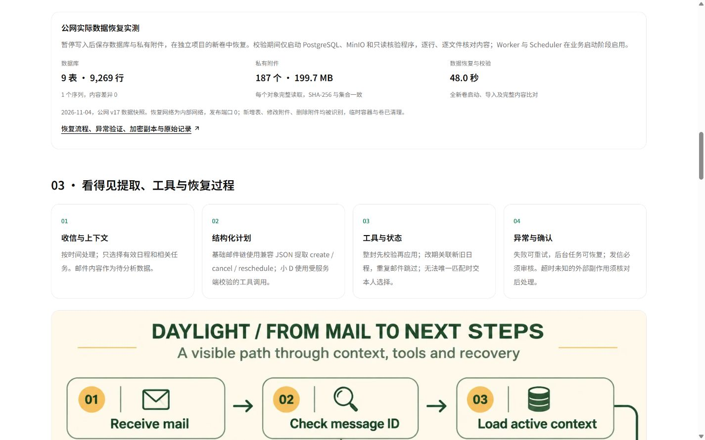
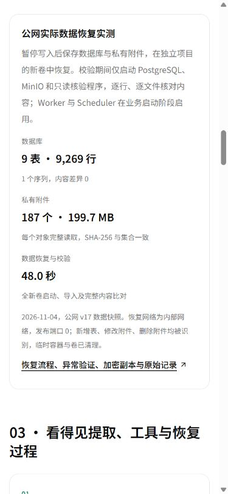
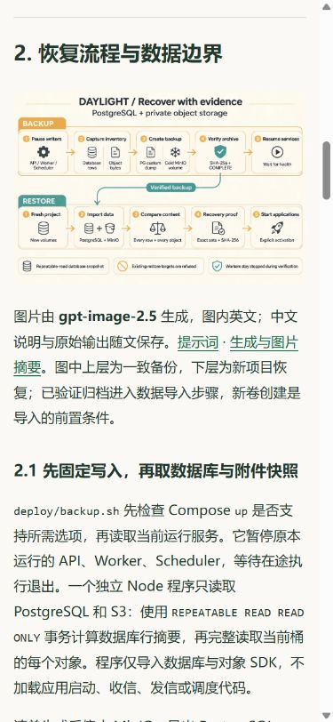

# 公网数据恢复、分阶段启动与异机加密副本

日期：2026-11-04，北京时间。状态：**代码、实际数据恢复、故障注入、加密副本与图文完成**。

**已部署v18：**候选运行29/29、恢复14/14、正式HTTPS88项、222份关联资料和6组布局全部通过；三角色各613文件、完整前端581文件一致，8服务healthy。[发布、备份与正式截图](deployment-v18.md)。

[技术与实测](https://daylight.yunforis.com/evidence#recovery) · [公开阅读](https://daylight.yunforis.com/competition/recovery-report.html) · [完整数据摘要](evidence/recovery-summary.json)

## 1. 本轮解决的问题

日历、回复草稿、任务进度和附件共同组成一条邮件事务。恢复数据库之后，还要能读取原附件、保留账号归属和改期关联，才能继续工作。本轮把已有的数据库与 MinIO 备份，推进到公网实际数据的逐项恢复验证，并补上分阶段启动与服务器之外的加密副本。

优化前后的操作及证据：

| 环节 | 优化前 | 优化后 |
| --- | --- | --- |
| 备份格式 | v1，数据库、冷对象卷、镜像和元信息四份负载 | v2，增加数据库与对象内容清单，五份负载逐一校验 |
| 数据验证 | 发布时读取数据库归档目录；既有容器恢复使用小型合成数据 | 公网快照 9 表 / 9,269 行、1 序列和 187 个对象全部一致 |
| 恢复启动 | 导入后启动整个应用栈 | 默认恢复并校验数据，业务进程通过 `--activate` 或后续启动命令启用 |
| 内容差错 | 归档 SHA-256 检查文件完整性 | 增加表/对象集合、逐行及逐对象内容校验，识别缺失、额外和改动 |
| 异机副本 | 发布备份位于服务器私有目录 | 当前 Windows 私有目录保存 AES-256-GCM 副本，密钥由 DPAPI 保存 |
| Compose 兼容 | 运行备份时使用恢复命令 | 停服务前检查所需选项，使用已实测的 `up --no-deps --no-recreate --wait` |
| 跨平台脚本 | Windows 工作文件可使用 CRLF | `.sh` 固定 LF，发布包同时核对实际脚本摘要 |

## 2. 恢复流程与数据边界

[](assets/recovery-flow.webp)

图片由 **gpt-image-2.5** 生成，图内英文；中文说明与原始输出随文保存。[提示词](recovery-prompt.txt) · [生成与图片摘要](image-generation.json)。图中上层为一致备份，下层为新项目恢复；已验证归档进入数据导入步骤，新卷创建是导入的前置条件。

### 2.1 先固定写入，再取数据库与附件快照

`deploy/backup.sh` 先检查 Compose `up` 是否支持所需选项，再读取当前运行服务。它暂停原本运行的 API、Worker、Scheduler，等待在途执行退出。一个独立 Node 程序只读取 PostgreSQL 和 S3：使用 `REPEATABLE READ READ ONLY` 事务计算数据库行摘要，再完整读取当前桶的每个对象。程序仅导入数据库与对象 SDK，不加载应用启动、收信、发信或调度代码。

清单生成后停止 MinIO，导出 PostgreSQL custom dump，并复制停止状态下的对象卷。这样，数据库引用与对象内容处于同一个停止写入的检查点。`SHA256SUMS` 包含五份负载，最后写入 `COMPLETE`。退出清理流程启动原服务，等待对象存储和原应用角色健康。

### 2.2 恢复时核对逻辑内容

`scripts/recovery-manifest.mjs` 将每个数据库行转为 PostgreSQL JSONB 的稳定文本，计算 SHA-256，将行摘要排序后再计算表摘要。物理行顺序变化不会改变结果；表名集合、行数、表摘要，以及序列的 `last_value` / `is_called` 共同参与比对。数据库时间区固定为 UTC，使时间字段的文本表示一致。

对象逐个流式读取，累计字节数并计算完整 SHA-256；校验当前桶可见对象的完整集合。缺少对象、出现额外对象，或字节内容发生改变，都会返回失败。输出公开摘要时，附件键仅以 SHA-256 表示；包含原键的清单保留在私有备份中。

### 2.3 数据恢复完成后启用业务

`deploy/restore.sh` 支持既有 v1 和本轮 v2 备份。它验证负载校验和、检查目标项目为空、核对 MinIO 镜像，然后创建全新卷。PostgreSQL 导入使用 `pg_restore --exit-on-error`，MinIO 使用冷卷恢复；v2 随后运行完整内容核对。

默认只留下 PostgreSQL 与 MinIO，API、Worker、Scheduler 保持停止。业务启动与数据验证分开，便于核对恢复环境的域名、邮箱、网络和任务状态。`--activate` 会在校验成功后启动应用栈；恢复后的任务依据 PostgreSQL 的持久状态和租约恢复执行。

## 3. 技术选型与取舍

| 选择 | 设计逻辑 | 本轮验证 |
| --- | --- | --- |
| PostgreSQL custom dump | 同时保存账号、设置、日历、RAG、任务步骤与 outbox；按原结构导入新库 | 9 表、9,269 行与序列摘要一致 |
| MinIO 冷卷 | 与当前部署相同的对象存储格式，保留对象及内部数据；停写后与数据库一起备份 | 同版本镜像恢复，187 对象逐个完整回读 |
| 内容清单 + 归档 SHA-256 | 分别检查归档文件传输完整性与恢复后的逻辑内容 | 三种实际副本差错被识别；全部复原后再次通过 |
| 新项目、新卷、内部网络 | 数据恢复与正式业务隔离；复核后再进入应用阶段 | 恢复项目发布端口 0，仅两个数据服务运行 |
| Redis / RabbitMQ 按新环境建立 | 会话和唤醒消息在运行环境重建，权威任务与 outbox 在 PostgreSQL 中恢复 | 数据恢复阶段保持业务进程停止；后续启动沿用部署流程 |
| AES-256-GCM 流式加密 | 为异机副本同时提供加密与认证；每次使用随机 IV，数据分块处理 | 完整解密、SHA-256 与保存后的 DPAPI 密钥回读通过 |

本轮沿用服务器已有镜像和协议，使用临时容器、独立网络及新卷。恢复 PostgreSQL / MinIO 各限制 **256 MiB、0.5 CPU**，只读核验进程限制 **512 MiB、1 CPU**。对象流式处理；数据库查询按表读取，本次最大表的资源规模由实际快照决定。

## 4. 公网实际数据与耗时

来源：`daylight:public-competition-20261104-v17`。检查点：**2026-11-04 06:05:50.204 +08:00**；API、Worker、Scheduler 已停止写入。

| 指标 | 实际结果 |
| --- | ---: |
| 数据库表 | 9 / 9 一致 |
| 数据库行 | 9,269，逐行摘要参与比对 |
| 序列 | 1 / 1 一致 |
| 附件对象 | 187 / 187 一致 |
| 对象内容 | 199,654,466 bytes |
| 数据导入与完整校验 | **48.000 秒** |
| 其中内容核对程序 | 18.280 秒 |
| 表、序列、对象差异 | 0 |
| 临时项目公开端口 | 0 |
| 临时资源清理 | 完成 |

48 秒从新项目开始恢复计时，包含新卷、数据服务启动、数据库和冷对象卷导入、完整清单比对。业务启用和流量切换是后续独立阶段。恢复点对应上述已提交数据检查点。

[每表行数及摘要](evidence/recovery-proof.json) · [恢复完整输出](evidence/restore.txt) · [阶段计时和实际服务状态](evidence/drill-summary.json)。

## 5. 异常与修复记录

### 5.1 对恢复副本注入差错

在内部网络、临时卷中执行以下操作：

| 操作 | 校验结果 | 完成处理 |
| --- | --- | --- |
| 新增一个合成表 | 检测到 1 个额外表 | 删除该表 |
| 修改一个附件的字节 | 检测到 1 个内容差异 | 写回保存的原字节 |
| 删除该附件 | 检测到 1 个缺失对象 | 写回原对象 |
| 全部恢复后再次比对 | 9 表、187 对象一致 | 清理临时项目和卷 |
| 再次使用已有项目作为恢复目标 | 创建或写入前拒绝 | 保留当前数据 |

[差错与最终复核](evidence/failure-probes.txt) · [已有项目拒绝输出](evidence/existing-target.txt) · [清理输出](evidence/cleanup.txt)。

### 5.2 Compose 版本兼容修复

首次执行已完成数据库、对象卷和清单文件，但服务恢复命令使用了服务器 Compose 不支持的 `start --wait`，退出码为 1。随后启动原容器，正式 readiness 恢复；再以 `up --no-deps --no-recreate --wait` 核验原服务健康，三个角色镜像继续为 v17。

公网每次请求完成后间隔 1 秒采样，共 163 次，其中 144 次为 502 / 503。第一次失败在 **06:05:09.162**，首次恢复 200 在 **06:07:36.550**，二者相隔 **147.388 秒**；之后连续五次 200。此项保存维护期间的实际网站可用性，与上节独立数据恢复计时分别登记。[原始请求采样](evidence/public-availability.json) · [首次备份输出](evidence/backup.txt)。

修复包括：

1. 暂停服务前检查 Compose 所需选项。
2. 以 `up --no-deps --no-recreate --wait` 启动原有容器并等待健康。
3. shell 文件固定 LF；发布包核对脚本实际字节。
4. 在独立合成项目实连 PostgreSQL、MinIO 和 HTTP 占位服务，执行修复后的完整暂停、备份、恢复健康与内容核对。该合成项目的备份及恢复健康耗时 **14.991 秒**，命令退出 0，三个容器健康，随后清理。

[兼容修复后的实际容器流程](evidence/backup-smoke.json) · [完整备份输出](evidence/smoke-consistent-backup.txt)。Windows 原始上传的 CRLF 在合成项目中被识别并修正，过程保存在同一记录。

## 6. 服务器之外的加密副本

将一致快照的数据库、MinIO 冷卷、清单与校验和组成 tar，通过已核对主机密钥的 SSH 下载。`scripts/recovery-encrypted-copy.py` 每次最多读取 1 MiB，在本机流式执行 AES-256-GCM；认证头包含格式版本和随机 IV。只有完整解密和源归档 SHA-256 均成功后，才发布最终密文文件。

| 项目 | 实际值 |
| --- | --- |
| 明文归档 | 227,635,200 bytes，保留于服务器私有目录 |
| 本机密文 | 227,635,247 bytes，保留于 Windows 私有目录 |
| 明文 SHA-256 | `d5055b6231353e63895fa897b911ee4ef3f90e086f4dc41d1ce90f775c1b46e2` |
| 密文 SHA-256 | `5ce65e733bf04acf898fe3c2b95cd12f4e07304db5f4ad5209b62cc11346028d` |
| 下载、加密与完整复核 | 159.343 秒 |
| 保存密钥回读 | Windows DPAPI 凭据重新载入，完整认证与摘要通过 |

密钥经标准输入进入工具，由当前 Windows 用户的 DPAPI 凭据保存。私有恢复说明记录密文和密钥位置。公开资料只包含计数、大小、摘要和脱敏结果。

[异机副本回执](evidence/encrypted-copy.json) · [保存密钥重新读取后的全量校验](evidence/encrypted-copy-key-verification.json)。

## 7. 复现、验证与费用

### 页面与尺寸核对

技术页与图文分别核对 1440、390、320px，共 6 组；页面均保持在视口内，恢复记录链接 44px。图文图片按需加载，点击流程图打开完整图。以下为本地构建的实际页面，数据来自本轮公网恢复记录。



| 本地390px结果卡 | 本地390px图文 |
| --- | --- |
|  |  |

[6组布局原始记录](evidence/local-layouts.json)。

### 复现命令

准备当前源码、Docker Compose、与备份相同的 MinIO 镜像和兼容 PostgreSQL 主版本。

```sh
# 使用原部署配置和覆盖文件生成备份。
DAYLIGHT_ENV_FILE=/secure/compose.env DAYLIGHT_PROJECT=daylight \
sh deploy/backup.sh /secure/backups

# 使用独立恢复配置，默认恢复数据并完成 v2 内容核对。
DAYLIGHT_ENV_FILE=/secure/restore.env DAYLIGHT_PROJECT=daylight-restore-check \
sh deploy/restore.sh /secure/backups/ACTUAL_BACKUP

# 同一恢复环境核对完成后启用业务。
DAYLIGHT_ENV_FILE=/secure/restore.env DAYLIGHT_PROJECT=daylight-restore-check \
sh deploy/stack.sh up -d --wait
```

原部署有附加覆盖文件时，以 `DAYLIGHT_COMPOSE_OVERRIDE` 和 `DAYLIGHT_COMPOSE_OVERRIDE_2` 按原顺序传入；恢复配置使用新端口和卷。保持这些环境变量应用于后续同一项目的命令。

```sh
node --test server/deployment-backup.test.js server/recovery-manifest.test.js
python server/recovery_encrypted_copy_test.py
```

本地 **14 项 Node 检查、4 项加密检查**通过。加密检查包含完整分块数据、认证标签改动、校验失败时清理临时明文，以及保留既有输出。Python 加密工具使用 `paramiko` / `cryptography`，图片和公开图文构建使用 `Pillow` / `Markdown`。

本轮文本模型调用 **0**、新增云采购 **0**、图像生成 **1**。复用已有服务器，临时恢复容器与卷已清理；异机副本使用本机私有磁盘。累计文本模型 **84 次**，按公开价格估算 **¥0.516094**；图片累计 **13 次**，按供应商账单登记，预算总上限 **¥500**。[逐批预算](evidence/budget-total.json)。

本轮分别补充云原生状态恢复、Agent 任务和来源持久性、可复现运维、恢复耗时与资源约束四类证据。用户价值、问答质量与电脑手机体验继续对应各自的流程和测量记录。
