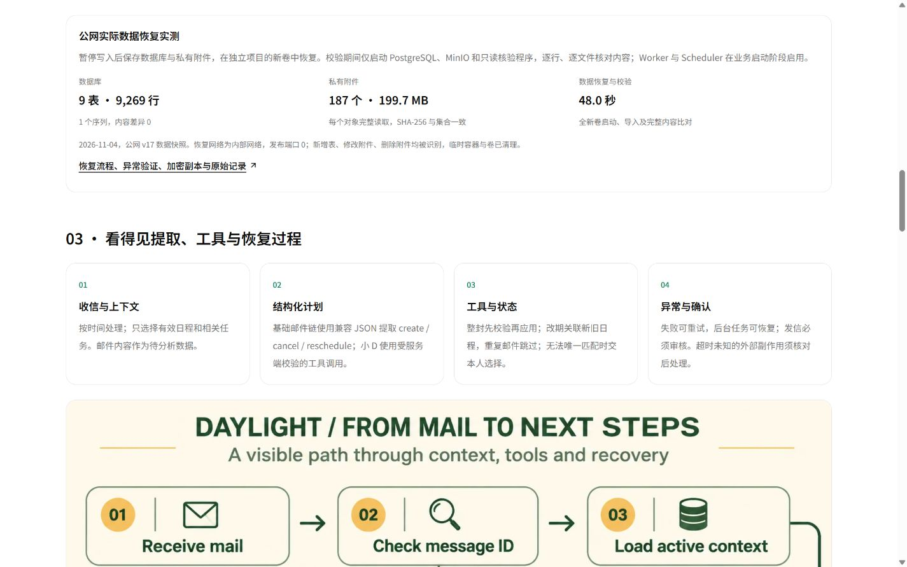
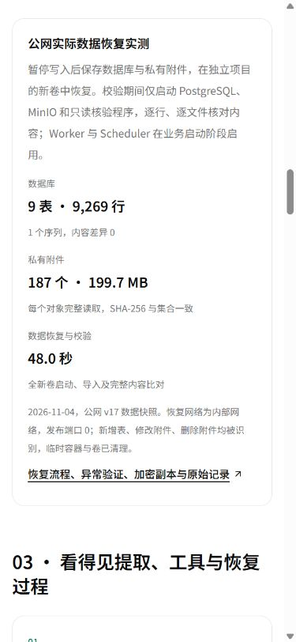
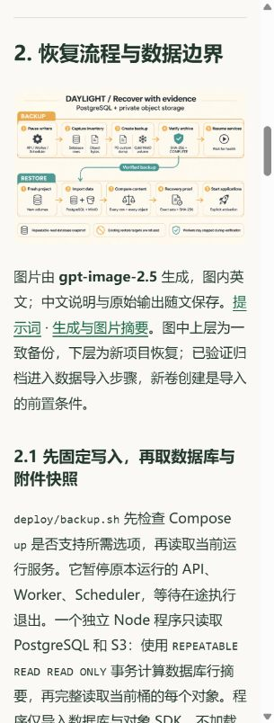

# v18 公网发布与恢复资料验收

日期：2026-11-04，北京时间。状态：**正式部署及电脑、手机尺寸浏览器验证通过**。

[正式恢复结果](https://daylight.yunforis.com/evidence#recovery) · [公开图文](https://daylight.yunforis.com/competition/recovery-report.html) · [三分钟体验](https://daylight.yunforis.com/experience)

## 1. 版本、内容与备份

| 项目 | 实际值 |
| --- | --- |
| 镜像 | `daylight:public-competition-20261104-v18` |
| 镜像 ID | `sha256:fd6d5eb07f80e325426e804a78693f31ec244d19e366ffef86a910405f17bab5` |
| 本轮前端、恢复脚本、资料与检查 | `363477c43e5848b23b07d9ff117246f5f1da2460` |
| 业务后端继承 | v16 `a8daafc1bf88c747fb1e6104a89c56a6f90ff06b`，此前 v13 `9354287`及基线 `db3ee89` |
| 基础镜像 | v17 固定 ID `sha256:9df78bb6e5c3906422be3475ba4f3c061760348f8ed393fcb1c3c6af33f678a5` |
| 发布包 | 31,875,809 bytes，589 文件；完整前端 581 文件 |
| 发布包 SHA-256 | `56c1691b84242ac54bea9532be538d2d762954b7b384bc6bd4160634bbc56360` |
| 发布前备份 | `/opt/daylight-backups/before-data-recovery-20261104062547` |
| 发布构建目录 | `/opt/daylight-recovery-release-v18` |

更新完整前端，并加入逐行/逐对象清单、v2备份与分阶段恢复、异机加密工具及相应检查文件。宿主与应用镜像保存相同恢复脚本。技术页连接恢复图文，统一报告增加补充入口，预算展示累计13次图片调用。v17首屏发布过程与正式截图也进入公开归档。

[文件清单](evidence/release-v18-manifest.json) · [发布包摘要](evidence/release-v18-archive.json)。

## 2. 发布与候选检查

1. 固定发布锁，核对三个角色均为v17目标镜像，备份数据库、配置、完整前端及原脚本。
2. 核对发布包和589份文件SHA-256；以固定v17镜像构建v18。
3. 候选容器运行公开体验、指标采集与生命周期检查，**29/29通过**。
4. 候选恢复与备份检查，**14/14通过**；临时目录允许执行检查替身，镜像保持只读、外部网络关闭。
5. 核对实际恢复摘要、9表/9,269行/187对象、加密回执、英文图片、预算与原21页PDF的完整摘要；三个shell脚本均为LF。
6. 更新三个应用角色，等待健康，检查七步业务、匿名权限、视频范围读取及三个角色的指标写入。
7. 正式HTTPS与浏览器完成后归档运行结果。发布输出为 `PUBLIC_RECOVERY_PUBLISHED_OK`、`REMOTE_EXIT 0`。

[完整发布输出](evidence/deploy-v18.txt) · [发布脚本](evidence/deploy-v18.sh) · [候选29项](evidence/candidate-production-tests-v18.txt) · [候选14项](evidence/candidate-recovery-tests-v18.txt) · [恢复证据候选核对](evidence/candidate-recovery-evidence-v18.json)。

## 3. 实际运行文件与观测

**2026-11-04 06:28:02 +08:00**核对：

| 角色 | 文件摘要 | 完整前端 | 指标已写入 | 丢样 / 写入错误 | restart / OOM |
| --- | ---: | ---: | ---: | --- | --- |
| API | 613 | 581 | 667 | 0 / null | 0 / false |
| Worker | 613 | 581 | 548 | 0 / null | 0 / false |
| Scheduler | 613 | 581 | 133 | 0 / null | 0 / false |

三个角色镜像ID、版本标签和环境中的源码摘要相同。累积后端覆盖合并后逐文件检查，并核对前端完整文件集合。API、Worker、Scheduler、PostgreSQL、Redis、RabbitMQ、MinIO、Caddy共8服务均为running / healthy。

[运行原始结果](evidence/runtime-v18.json) · [复核脚本](evidence/verify-runtime-v18.py)。

## 4. 正式HTTPS与页面

- **88项正式HTTPS检查**：七步状态、匿名权限、图文及原始记录、恢复摘要、累计费用、MP4和PDF范围读取。
- **222份关联资源**：完整字节、SHA-256与MIME全部匹配。PDF `bytes=0-31`返回206和准确32字节。
- **6组正式布局**：恢复技术卡和图文各测1440/390/320px，整页保持在视口内；恢复记录入口44px。
- 正式320px图文点击流程图，打开1536×1024完整图片，再返回原章节；浏览器错误记录为空。
- 本节设备为Windows IAB浏览器的三种视口，截图关联正式HTTPS地址。

[88项HTTPS结果](evidence/public-verification-v18.json) · [222份资源](evidence/resources-public-v18.json) · [正式页面布局](evidence/public-layouts.json)。

### 正式截图

| 正式390px技术卡 | 正式320px图文 |
| --- | --- |
|  |  |

[截图地址、视口、实际尺寸与SHA-256](evidence/screenshot-review.json)。

## 5. 恢复和费用

发布脚本在切换失败时恢复原镜像配置与原文件，并等待三个角色健康。v17原镜像、发布前数据库备份及本轮实际数据一致快照保留于服务器私有目录；Windows异机副本和DPAPI密钥保存在本机私有目录。[备份恢复过程与故障注入](README.md)。

本轮文本模型0、实际SMTP0、新增云采购0，gpt-image-2.5英文图1次。累计文本84次、公开价估算¥0.516094，图片累计13次。[预算记录](evidence/budget-total.json)。
