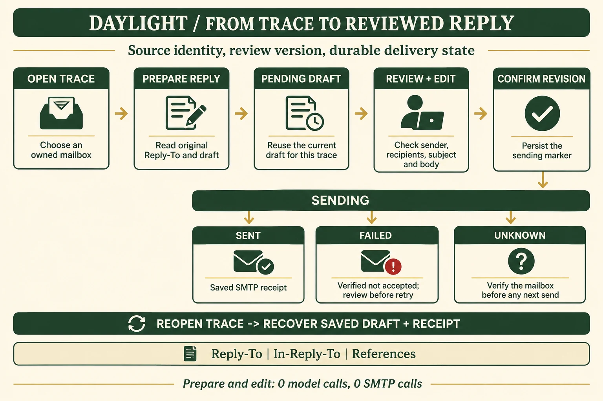
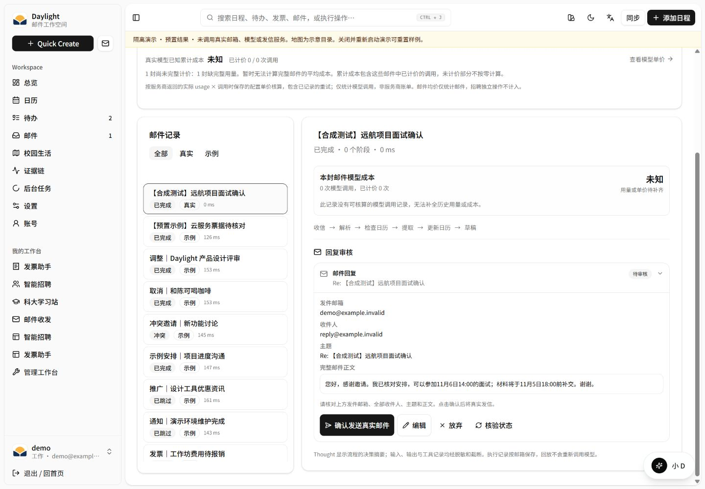
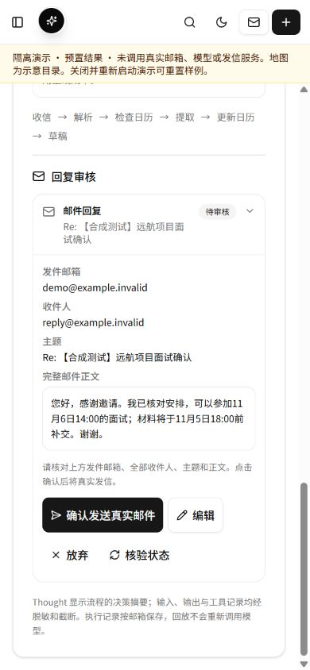
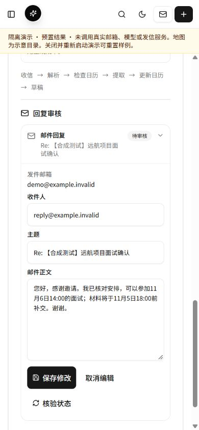

# 从执行记录到可审核回复：邮件闭环优化

2026 年 11 月 4 日，北京时间。对应竞赛的场景价值、Agent 链路、共享状态、工程体验与调用成本。

## 本轮解决的问题

用户读完面试通知、确认日程后，下一步通常是回复对方。此前执行记录的“采纳并发送”仍请求旧 `/api/traces/:id/send`，生产流程中间件返回 503；草稿审核、发信与结果恢复在这条入口断开。

本轮将执行记录接入已持久化的邮件审核能力：选择原邮件，准备审核卡，核对发件邮箱、收件人、主题和完整正文，编辑保存后确认发送。重新打开同一记录会取回已保存的草稿或回执。

| 使用环节 | 优化前 | 优化后 |
| --- | --- | --- |
| 生产入口 | 旧 Trace 发信接口返回 503 | 复用 `/api/assistant/drafts` 的持久化审核接口 |
| 审核正文 | 浏览器确认框最多预览 280 字 | 审核卡展示完整正文，支持编辑和保存 |
| 来源 | 当前活动邮箱与 Trace 操作绑定 | 草稿固定关联来源邮箱、Trace 与原邮件 ID |
| 准备并发 | 缺少 Trace 到审核草稿的统一关系 | 同一来源的并发准备返回同一份草稿 |
| 发送确认 | Trace 发信依赖进程内发送集合 | 版本检查、数据库 `sending` 标记和保存回执 |
| 重新打开 | 在不同页面核对原草稿与发送结果 | 在原执行记录中恢复当前审核版本与回执 |
| 手机操作 | 原有小号操作按钮 | 主要按钮及手机输入框至少 44px，高度实测见下文 |
| 准备与编辑成本 | 原草稿已生成 | 继续使用已生成草稿，模型调用 0、SMTP 调用 0 |

## 数据流与状态

图由 **gpt-image-2.5** 生成，1536×1024、high、全英文；中文说明保存在正文。PNG 1,492,272 bytes，网页使用 123,762 bytes 的 WebP，体积减少 **91.7%**。[提示词](reply-prompt.txt)与[生成参数、文件摘要](image-generation.json)随版本保存。

1. **读取来源。** 服务端从当前用户对应邮箱的已保存邮件和 Trace 读取原始 `Reply-To`、主题和当前草稿，并要求唯一匹配原邮件。客户端提交来源编号。
2. **准备草稿。** `kind: trace_reply` 进入现有草稿存储事务。同一 Trace 已有当前草稿时返回该版本；用户放弃后，可显式重新准备。
3. **审核和编辑。** 用户阅读发件邮箱、全部收件人、主题与完整正文。保存修改递增 `revision`，旧版本确认返回 409，页面重新读取当前状态。
4. **确认发送。** 服务端核对当前版本和邮箱配置，先提交 `sending` 状态，再调用 SMTP；原邮件 `Message-ID` 和 `References` 转为回复线程头。
5. **保存结果。** 全部收件人被 SMTP 接受时保存 `sent` 和回执；明确未接受的失败保存 `failed` 并提供审核后重试；超时或部分接受保存 `unknown`，页面展示回执与核验入口。
6. **重新打开。** 从来源 Trace 找回草稿 ID、已审核正文、当前版本与回执；已发送记录的重复确认直接返回保存结果。

## 技术选择与设计逻辑

### 复用一个审核状态机

小 D 邮件和会议邀约已有审核卡及持久化状态。本轮新增 `trace_reply` 类型，复用同一套编辑、确认、回执与失败处理。这样三个入口共享版本检查与发送语义，组件调整也能同时改善手机操作。

新增 `server/trace-reply.js` 专门解析原邮件关系；`server/assistant-actions.js` 承接准备和发送。原 Trace 继续保存处理证据，发送过程保存在草稿记录中。原日历与 Trace 在本轮 PostgreSQL 验证前后保持相同 JSON 值。

### PostgreSQL 保存状态，事务内处理并发

公网 API、Worker、Scheduler 使用共享 PostgreSQL。审核状态沿用按用户与邮箱定位的 `app_settings` 记录，事务中通过行锁读取、修改和提交；同一 Trace 的查重在该事务中完成。新增类型复用现有表结构，部署包含三个运行模块和完整前端。

当前每个邮箱的草稿集合保存在一条 JSONB 记录，适合现有数据规模，代价是同邮箱的审核写入会依次提交。随着草稿量增长，可拆为独立行，并为用户、邮箱、来源 Trace 建立唯一约束；届时结合写入等待时间和记录大小确定迁移时机。

### 混合视图固定来源邮箱

用户在全部邮箱或同类邮箱视图中，可能打开非活动邮箱的执行记录。审核接口支持显式选择本人邮箱，服务端检查 `X-Mailbox-Id` 与创建请求中的邮箱一致。草稿读取、编辑、放弃和发送持续使用来源邮箱；用户与邮箱归属同时检查。

### 保留原回复线程

收件人优先来自原邮件 `Reply-To`，其后才是发件人。主题已有 `Re:` 时沿用；`In-Reply-To` 使用原 `Message-ID`，`References` 保留有效线程 ID、去重并限制为 50 个。审核后最终发送的是持久化正文和线程信息。

## 电脑与手机效果

以下截图使用独立 `work/demo-*` 中的原创合成邮件。标题、地址和正文均为合成内容；验收操作为准备、编辑、保存、刷新恢复和布局检查。

| 尺寸与状态 | 整页横向溢出 | 操作按钮高度 | 收件人与主题输入高度 |
| --- | --- | --- | --- |
| 1440×1000，审核 | 0px | 44px | 桌面阅读态 |
| 390×844，审核 | 0px | 44px | 手机阅读态 |
| 390×844，编辑 | 0px | 44px | 44px |
| 320×760，审核 | 0px | 44px | 手机阅读态 |
| 320×760，编辑 | 0px | 44px | 44px |

正文输入区 160px，可滚动和编辑；按钮按可用宽度换行。刷新页面后，核对后的“我已核对安排”正文仍在相同审核草稿中。[320px 截图](assets/reply-review-320.png) · [操作与 DOM 测量](evidence/ui-layout.json)。

## 验证结果

### 全量与 HTTP 链路

`npm test`：**1,010 项、981 通过、29 条件跳过、0 失败**，耗时 61.10 秒。[完整结果](evidence/full-tests.txt)。最终`npm run build`通过，33.78秒；[构建结果](evidence/build.txt)保存输出。公开图文页1440/390/320px的四张内嵌图片均加载成功，整页横向溢出0，[布局记录](evidence/publication-layout.json)可复核。

新增解析、动作与 HTTP 检查覆盖原 Reply-To、草稿优先级、线程头、旧发送记录、并发准备、本人多邮箱、跨用户请求、邮箱参数冲突、编辑版本、显式确认、重复确认、合成 SMTP 一次调用及进程重启后的回执恢复。HTTP 链路使用原创合成邮件和注入的 SMTP transport。

### 服务器真实 PostgreSQL

在当前服务器 PostgreSQL 新建独立 schema，使用生产存储代码与合成通知，完成以下 **8/8** 检查，随后删除该 schema。运行环境 Node.js v22.23.3，1 CPU / 384 MiB 候选容器。[原始结果](evidence/postgres-verification.json)。

| 检查 | 结果 | 耗时 |
| --- | --- | ---: |
| 8 个并发准备只保存同一份草稿 | 通过 | 231.48ms |
| 用户和邮箱归属、原来源访问 | 通过 | 45.45ms |
| 编辑递增版本、旧确认在传输前返回 409 | 通过 | 41.86ms |
| 连接池重连恢复正文、线程和来源 | 通过 | 65.37ms |
| `sending` 先提交，重复确认只调用一次传输 | 通过 | 46.23ms |
| 二次重连及重新打开恢复 `sent` 回执 | 通过 | 47.31ms |
| `unknown` 持久保存，后续确认保持当前状态 | 通过 | 90.34ms |
| 原日历和 Trace 保持相同 JSON 值 | 通过 | 2.93ms |

这组验证的真实模型调用 0、真实 SMTP 调用 0，注入传输 2 次：成功回执一次、超时一次。各项耗时对应这次具体检查的操作组合。源码：`scripts/verify-trace-reply-postgres.mjs`。

## 成本与交付

本轮新增文字模型调用 0、图片调用 1、云采购 0；继续复用已有服务器。文本模型累计 42 次，按保存的公开价格估算 **¥0.406820**；图片调用累计 10 次，按供应商出账登记。新增模型与云资源总预算 **¥500**。[预算明细](../competition-2026-11-03/generation-and-budget.md)。

本轮已部署 **v13**，候选回复24/24、production29/29、实际PostgreSQL8/8、正式HTTPS57项与关联资料85份通过；三角色各438份运行文件、完整前端413份一致。[发布版本、备份与正式手机截图](deployment-v13.md)已归档。使用入口为登录工作区的“证据链 → 真实邮件 → 准备回复审核”；公开[技术与实测](/evidence)提供本报告入口。
