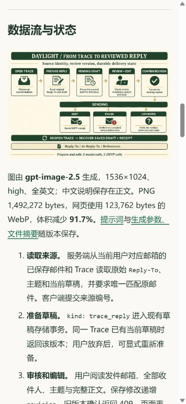

# 回复审核闭环 v13 发布记录

2026 年 11 月 4 日，北京时间。[官网图文报告](https://daylight.yunforis.com/competition/reply-review-report.html) · [技术与实测](https://daylight.yunforis.com/evidence) · [设计与前后对照](README.md)。

## 发布结果

执行记录中的真实邮件已接入持久化回复审核，官网技术页提供本轮图文入口，用户价值工具的 v12 发布与自动回滚记录也已公开。

| 项目 | 结果 |
| --- | --- |
| 当前镜像 | `daylight:public-competition-20261104-v13` |
| 镜像 ID | `sha256:369fe6cdf3a537df7eae07759272fb6434df218214c4ff9afd5e23c9dbf5c222` |
| 本轮应用、前端与资料源码 | `9354287b56e670a4a3f1376a68f325df2beadcf9` |
| 基础镜像 | v12-r1，`sha256:2d12d546999aebcabef12606f3dbb2f10881505a2b939685d90447d8b9cade15` |
| 后端继承基线 | `db3ee897a696bf5f70365f8c901237f020cf8691`，本轮覆盖 3 个运行模块 |
| 发布包 | 421 份文件：完整前端 413 份，运行模块 3 份，验证文件 5 份 |
| 包大小 | 25,130,485 bytes |
| 包 SHA-256 | `8cd4738ea2734fd83bbf5dd9426d2ba9262e1fb106d4ae70e4b0150fd415da86` |
| 发布前备份 | `/opt/daylight-backups/before-trace-reply-20261104034034` |
| 候选回复链路 | 24/24，通过实际 Express / 认证 / 草稿 / 合成 SMTP 链路 |
| 候选 production 运行与观测 | 29/29，通过 |
| 候选真实 PostgreSQL | 独立 schema 8/8，通过并完成清理 |
| 正式 HTTPS 综合 | 57 项，通过 |
| 站内关联资料 | 85 份，HTTP、MIME 和完整 SHA-256 一致 |
| 已有账号草稿读取 | 7 项，通过；临时 Redis 会话已清理 |
| 三角色运行文件 | 每个容器 438 份逐文件摘要一致，完整前端集合 413 份一致 |
| 服务 | 8 个 healthy；API / Worker / Scheduler restart=0、OOM=false |

[发布清单](evidence/release-v13-manifest.json) · [包摘要](evidence/release-v13-archive.json) · [候选回复检查](evidence/candidate-reply-tests-v13.txt) · [候选 production 检查](evidence/candidate-production-tests-v13.txt) · [候选 PostgreSQL](evidence/candidate-postgres-v13.json) · [发布日志](evidence/deploy-v13.txt)。

## 版本切换过程

1. 取得服务器发布锁，逐角色核对 v12-r1 的镜像名和完整 ID。
2. 备份 Compose 配置、现有运行文件、数据库 custom dump、可读取的 dump 目录、原前端与原镜像 ID。
3. 核对发布包的 421 份文件摘要和完整前端集合，以指定基础镜像 ID 构建 v13。
4. 候选容器在关闭外网的环境运行回复 24 项和 production 29 项；随后用独立 schema 验证实际 PostgreSQL。注入传输成功和超时各一次。
5. 核对报告 PDF 与英文流程图摘要，以及新增后端模块和页面内容；更新应用 revision 和 `DAYLIGHT_GIT_SHA`。
6. 切换三个应用角色，等待 healthy，验证七步业务、匿名状态和草稿读取 401、公开报告和 PostgreSQL 结果可读。
7. 核对三个角色的指标已写入且丢样为 0，再同步宿主机参考源码与完整前端。
8. 从正式 HTTPS 复查 57 项及 85 份关联资料，逐容器核对 438 份累计文件与 413 份完整前端。

本次发布直接通过全部切换检查。发布脚本保留原镜像与配置恢复流程，数据库备份留在上述服务器目录。

## 正式生产读取

使用已有两个账号各自的临时会话，请求运行中的 `/api/assistant/drafts`，完成 7 项检查：匿名 401；两个账号默认邮箱 200；已配置账号两个本人邮箱分别返回 200；两个账号选择他人邮箱均返回 409。结果仅保存状态、耗时与条数，验证会话在结束时撤销。

本组运行请求为草稿读取，模型调用 0、SMTP 调用 0。[读取结果](evidence/production-read-v13.json)。创建、编辑、版本确认和发送状态转换的证据见候选 HTTP 与实际 PostgreSQL 记录。

## 正式页面与手机

390×844 手机尺寸浏览器中，技术页的“回复闭环、状态设计与电脑手机截图”可进入本轮报告。报告四张内嵌图片均加载成功；点击目录的“数据流与状态”，标题定位至顶部约 20.10px；点击流程图可打开 1536×1024 PNG，返回后仍可阅读报告。

手机报告与技术页均无整页横向溢出；1440px 桌面报告同样通过，四张图片完整加载。[浏览器记录](evidence/public-browser-verification-v13.json)。

[手机报告首屏](assets/public-report-mobile.png)。公开资料页包括 [v12 发布与回滚记录](https://daylight.yunforis.com/competition/value-release-v12.html)、[回复审核报告](https://daylight.yunforis.com/competition/reply-review-report.html)和[累计预算](https://daylight.yunforis.com/competition/budget.html)。

## 运行指标快照

2026-11-04 **03:43:32，北京时间**：

| 角色 | 已写样本 | 丢样 | 写入错误 | 核对文件 |
| --- | ---: | ---: | --- | ---: |
| API | 382 | 0 | 无 | 438 |
| Worker | 886 | 0 | 无 | 438 |
| Scheduler | 167 | 0 | 无 | 438 |

[实际运行镜像、文件摘要与 readiness](evidence/runtime-verification-v13.json) · [正式 HTTPS 57 项](evidence/public-verification-v13.json) · [关联资料 85 项](evidence/static-verification-v13.json)。

本轮整体新增文字模型调用 0、真实 SMTP 调用 0、gpt-image-2.5 图片 1 次、云采购 0。文字模型累计 42 次，公开价估算 ¥0.406820；图片累计 10 次，按供应商出账登记。
