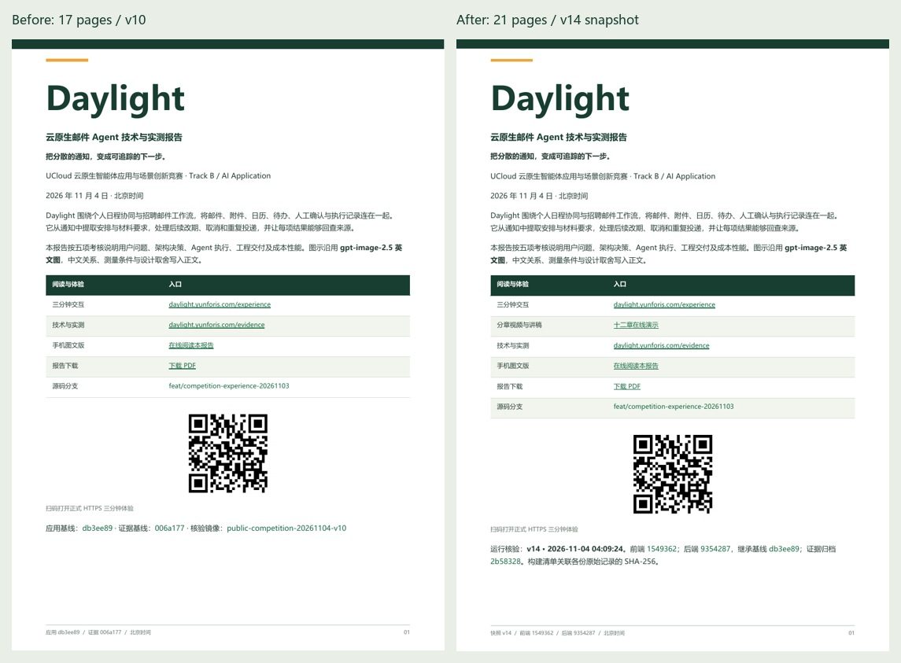
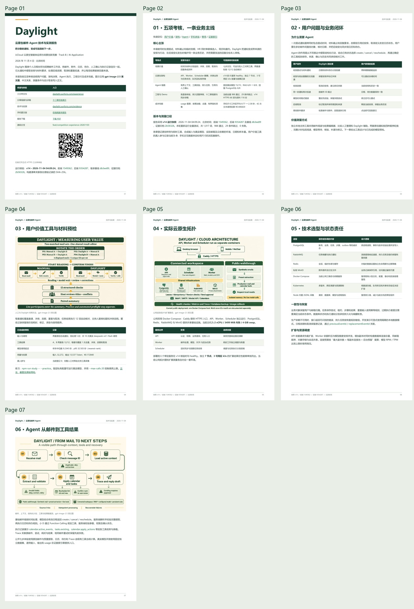
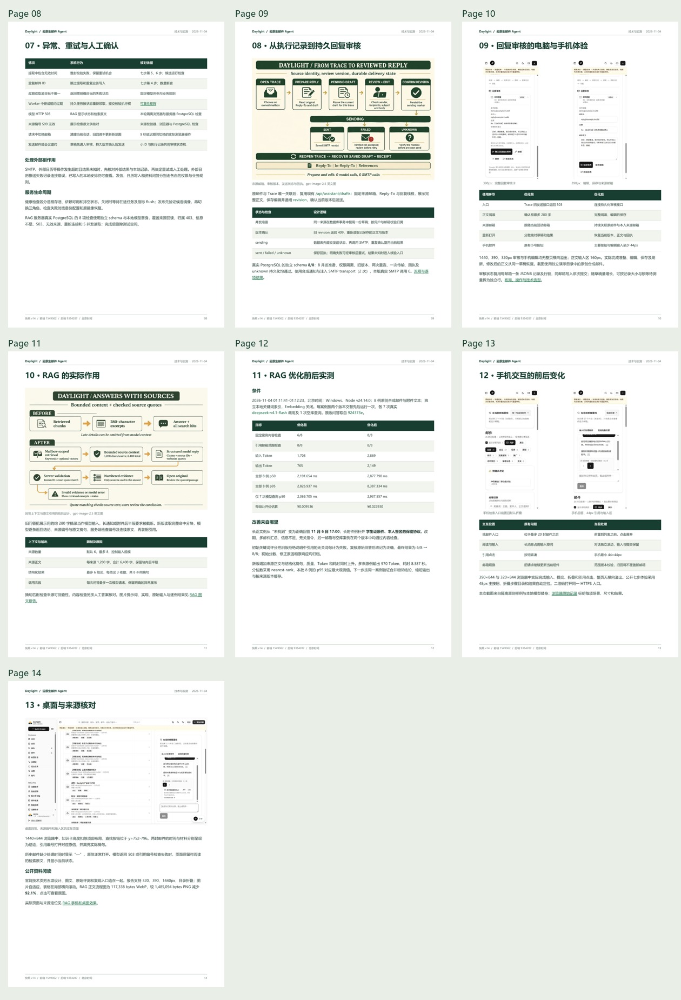
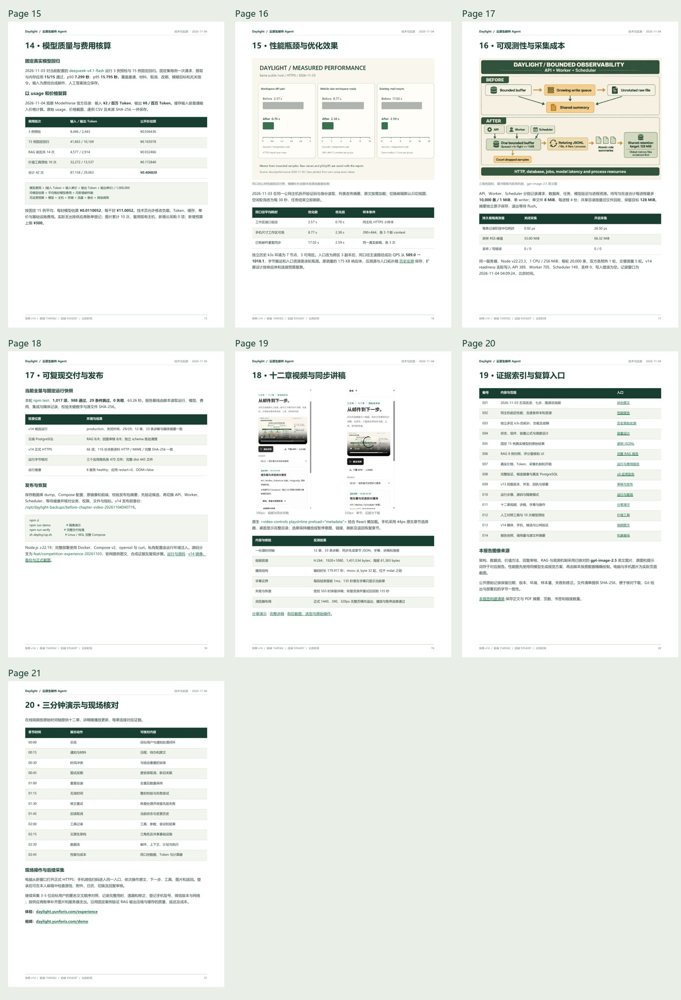
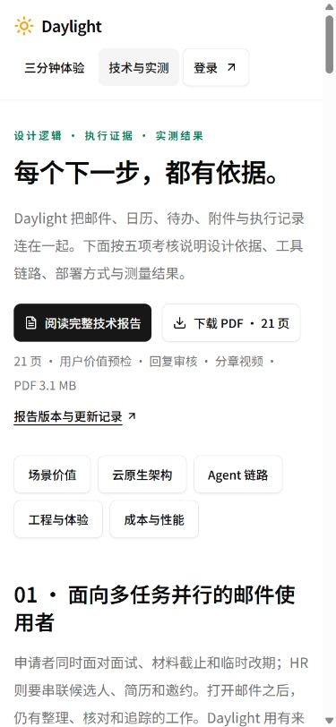
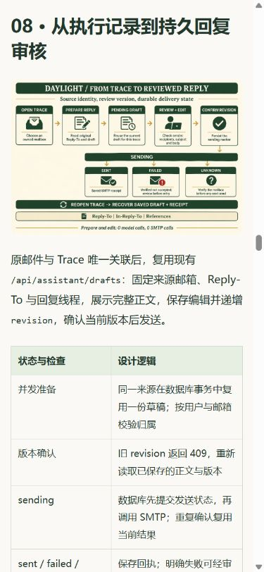

# 技术报告与当前交付证据同步

2026-11-04，北京时间。对应竞赛五项考核的统一阅读入口。

[完整技术报告](https://daylight.yunforis.com/competition/technical-report.html) · [21 页 PDF](../../public/competition/technical-report.pdf) · [技术与实测](https://daylight.yunforis.com/evidence) · [十二章视频](https://daylight.yunforis.com/demo)。

**v15已部署并验证：**候选production29/29、正式HTTPS69项及142份资源核对通过；8服务healthy，三角色各496文件和完整dist471文件一致。正式1440/390/320px六组布局、15张图片和实际PDF下载摘要通过。[发布、备份、运行指标与正式手机截图](deployment-v15.md)。

## 改前观察与目标

官网首屏下载报告仍采用 v10 快照，后续 v12 用户价值工具、v13 回复审核、v14 分章视频分散在各自记录里。报告封面、页脚、累计调用量及工程验证需要一起更新，让评委从同一份材料查阅设计、页面和原始证据。



| 项目 | 优化前 | 优化后 |
| --- | --- | --- |
| 报告结构 | 17 页、16 节 | 21 页、20 节；增加价值工具、回复链路、审核界面和分章视频 |
| 运行快照 | v10；应用 db3ee89、证据006a177 | v14；前端1549362、后端9354287、基线db3ee89、证据归档2b58328 |
| 工程验证 | 951 通过；v10 HTTPS 38 项、更新资源15份 | 本轮全量988通过、29条件跳过；v14 HTTPS 66项、关联资料116份 |
| 用户价值 | 对照方法与记录表 | 可运行主持工具；10次真实模型预检；两套各12/12；真人参与0 |
| 回复闭环 | 草稿与人工确认说明 | 来源邮箱、revision、sending、回执及unknown；真实PostgreSQL 8/8 |
| 演示阅读 | MP4 与现场脚本 | 十二章播放器、33条讲解、同步讲稿、字幕与失败恢复 |
| 累计文本调用 | 32次、输入54,886／输出15,526 | 42次、输入87,158／输出29,063 |
| 累计模型估算 | ¥0.233980 | ¥0.406820；按输入¥2、输出¥8／百万Token复算 |
| 阅读定位 | 17书签、6内部跳转、28外链 | 21书签、6内部跳转、39外链 |

前后运行检查数分别对应各自版本和资源集合；模型累计量覆盖各批实际调用。数据来源登记在[报告机器基线](../competition-submission-2026-11-04/evidence/report-baseline.json)。

## 技术选型与设计逻辑

### 一份正文，PDF 和手机 HTML 两种阅读方式

继续使用既有 Markdown 正文及 ReportLab 构建器。PDF 按主题分节并嵌入中文字体，支持复制、书签与内部跳转；HTML 从同一份正文生成，提供折叠目录、自适应图片与局部滚动表格。技术页的页数和文件大小直接读取构建清单。

本轮沿用已核对的 **gpt-image-2.5 英文工程图**，中文解释放在正文；电脑与手机效果采用实际页面截图。图片以网页 WebP、PDF 内 JPEG 发布。

### 快照与源记录绑定

新增 `scripts/competition_report_baseline.py`，读取 v14 运行、HTTPS、静态资源和媒体记录，以及 RAG、价值材料、回复 PostgreSQL、价格、预算登记和本轮全量测试。每个来源保存 SHA-256，校验服务健康、运行文件集合、模型预检、参与人数与调用费用。

构建器首先复算并核对机器基线，再生成 PDF；构建清单保存正文与基线摘要。页脚同时写出前后端版本，发布时可以追溯静态资料和继承的服务代码。内部章节跳转根据章节标题生成，新增章节后仍指向对应内容。

### 从实际 usage 复算费用

预检、固定回归、RAG 前后及价值材料预检分别计入调用总数。各批费用按原始输入和输出 Token 重算，使用 Decimal 校验到六位小数，汇总后供技术页和报告共同读取。15例提取任务的平均用量继续作为可编辑计算器的初值。

## 排版与内容核验

21页全部渲染检查，正文位于安全边界内；21个书签逐一对应实际页码，6个内部目标有效，39个HTTPS外链可提取，所有实际文字字体嵌入。原始结果见[PDF验证](../competition-submission-2026-11-04/evidence/pdf-verification.json)与[构建清单](../competition-submission-2026-11-04/evidence/report-manifest.json)。







本轮[全量测试](evidence/full-tests.txt)：1,017项，988通过、29条件跳过、0失败，63.26秒。正文清楚登记真人参与0、合成输入与真实模型调用，以及真实PostgreSQL加注入SMTP的检查环境。

## 电脑与手机阅读

本地1440、390、320px分别核对完整报告和技术页，六组均无整页横向溢出；报告15张图片全部加载成功。报告下载入口56px、技术页下载入口44px。390px展开目录并选择回复审核章后，标题位于视口顶部19.99px。




[浏览器布局与章节操作](evidence/browser-verification.json)保留实际innerWidth、clientWidth、scrollWidth、图片加载状态和累计费用正文。

## 复现

准备 Node.js ≥22.19 与 Python 3.11+，安装原有[报告依赖](../competition-submission-2026-11-04/report-requirements.txt)。

```sh
npm test > docs/competition-report-refresh-2026-11-04/evidence/full-tests.txt
python scripts/competition_report_baseline.py
python scripts/build-competition-report.py
python scripts/verify-competition-report.py
python scripts/competition-public-report.py --only technical-report.html --only report-refresh.html
npm run build
python scripts/verify-competition-resources.py https://daylight.yunforis.com work/report-resources.json
```

Windows 默认使用 Microsoft YaHei；其他主机通过 `--font` 和 `--font-bold` 提供中文字体。用 Poppler 渲染 PDF 复核后，按已归档版本核对摘要。

## 调用与预算

本轮新增文字模型、图片生成、SMTP与云资源采购均为 **0**。文本累计42次、公开价估算¥0.406820；图片累计10次，费用按供应商账单登记；新增总预算上限¥500。

优化前报告摘要和结构保存在[改前清单](evidence/before-manifest.json)，排版验证保存在[改前验证](evidence/before-pdf-verification.json)。
