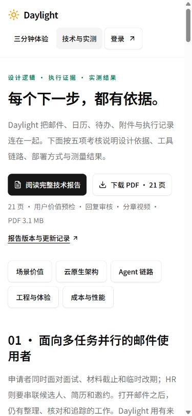
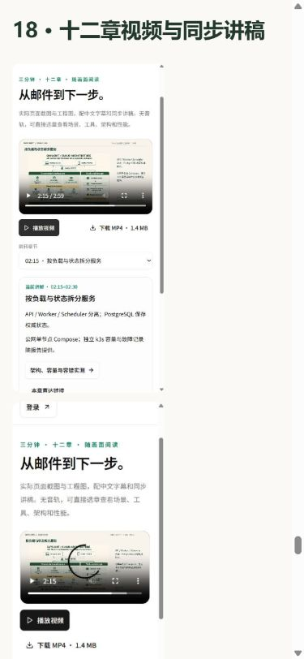

# v15 统一技术报告：公网发布与验证

2026-11-04，北京时间。完整技术报告、累计费用、源记录基线及公开发布资料已部署。

## 版本与备份

| 项目 | 实际值 |
| --- | --- |
| 运行镜像 | `daylight:public-competition-20261104-v15` |
| 镜像 ID | `sha256:5140e8c84c3cc5c6bc536a3c825910d255a47a2d071801aa60d9a1fc6448a81e` |
| 前端、资料、验证脚本源码 | `ec793b8a8591827a49938f23f8522e7fbfb0017b` |
| 继承后端 | v13 `9354287b56e670a4a3f1376a68f325df2beadcf9`；此前基线 `db3ee897a696bf5f70365f8c901237f020cf8691` |
| 发布前镜像 | v14，精确 ID `sha256:9d634d54c28c105207d1ca9af368b23c4c44aa50f7bb7005e0d596c94e6fcbdf` |
| 备份位置 | `/opt/daylight-backups/before-unified-report-20261104043410` |
| 发布包 | 472 文件；完整 dist 471 文件；27,768,825 bytes |
| 发布包 SHA-256 | `6f38e65b50667d732ebbf132cac66a4519c0b11197ce0ea7437451c09d7292b8` |

技术报告标明其引用的 **v14 运行快照**，包含v12价值工具、v13回复审核和v14视频结果；当前资料由v15发布。后续归档提交保存这次部署的结果。

## 发布顺序

1. 核对三角色均为预期v14镜像及ID，检查磁盘和内存。
2. 保存数据库自定义格式dump并检查目录，备份Compose、环境、镜像信息与完整前端。
3. 校验归档路径和逐文件摘要，基于精确v14镜像构建候选，完整替换dist并同步公开核验脚本。
4. 候选production 29项通过；报告21页、21书签、39外链、3,111,267 bytes、PDF和基线SHA、13份来源、42次调用及十二章视频摘要检查通过。
5. 切换API、Worker、Scheduler，等待健康，检查七步业务、私有接口401、报告资料、视频Range与三角色指标。
6. 核对正式HTTPS、关联资料、完整运行字节及实际浏览器下载。

[部署输出](evidence/deploy-v15.txt) · [候选29项](evidence/candidate-production-tests-v15.txt) · [报告候选核验](evidence/candidate-report-checks-v15.json) · [发布清单](evidence/release-v15-manifest.json) · [包摘要](evidence/release-v15-archive.json)。

## 正式运行核对

2026-11-04 **04:36:10**，北京时间：8服务running / healthy；API、Worker、Scheduler均restart=0、OOM=false。三个角色各核对 **496文件**，完整dist **471文件**与清单集合及SHA-256一致。

| 角色 | 指标实际写入 | 丢样 | 写入错误 |
| --- | ---: | ---: | --- |
| API | 519 | 0 | null |
| Worker | 612 | 0 | null |
| Scheduler | 148 | 0 | null |

[运行与字节结果](evidence/runtime-verification-v15.json)。

正式HTTPS **69项**通过：七步状态、去重/失败时状态保持、私有接口拒绝、报告和资源MIME、完整SHA及PDF/MP4分段读取。另从当前报告与关联图文抽取 **142份资源**，逐份HTTP、MIME与完整SHA一致，PDF Range返回206及32字节内容。

[HTTPS结果](evidence/public-verification-v15.json) · [142份资源结果](evidence/static-verification-v15.json)。

## 正式电脑与手机尺寸浏览器

1440、390、320px分别核对技术页和完整报告，六组均无整页横向溢出。报告15张图片全部加载；技术页下载44px、报告下载56px。390px展开目录后，选择“十二章视频与同步讲稿”，目标标题位于顶部20.09px。

实际点击“下载 PDF · 21 页”，浏览器完成文件下载，页面保持在技术页。下载 **3,111,267 bytes**，SHA-256为 `2e393c182bc0f86dba63d1e01aa124dedaf621af442abd88a8dd1942d84fcdad`，与发布PDF一致。

[布局与操作](evidence/public-browser-verification-v15.json) · [下载摘要](evidence/browser-download-v15.json)。

## 预算

本轮新增文字模型、图片生成、SMTP与云采购0。累计文本42次、输入87,158、输出29,063 Token，按公开价格估算¥0.406820；图片累计10次，供应商出账费用另登记。总预算上限¥500。

[当前图文更新说明](README.md) · [正式完整报告](https://daylight.yunforis.com/competition/technical-report.html) · [技术与实测](https://daylight.yunforis.com/evidence)。
