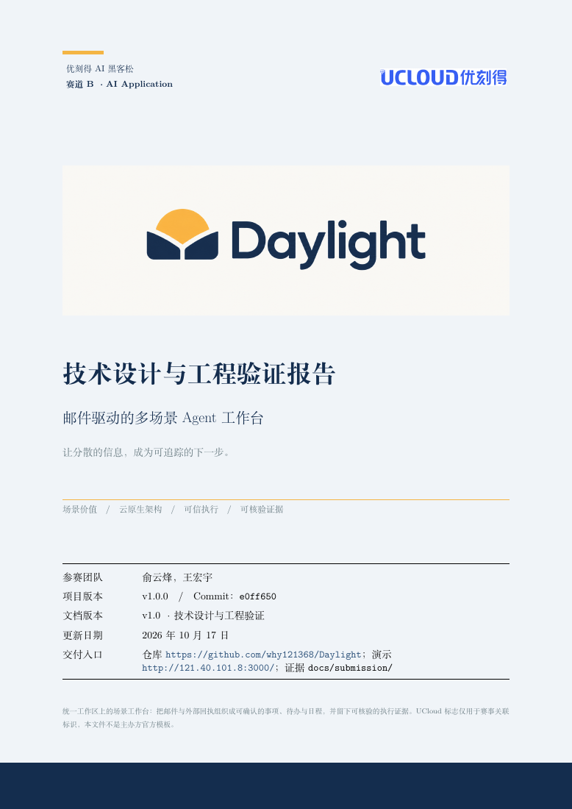
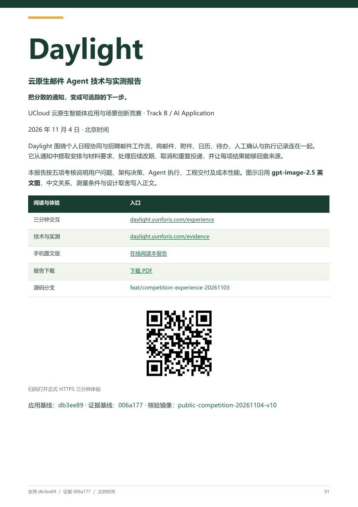
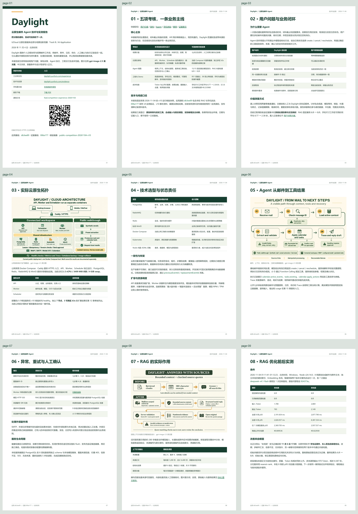
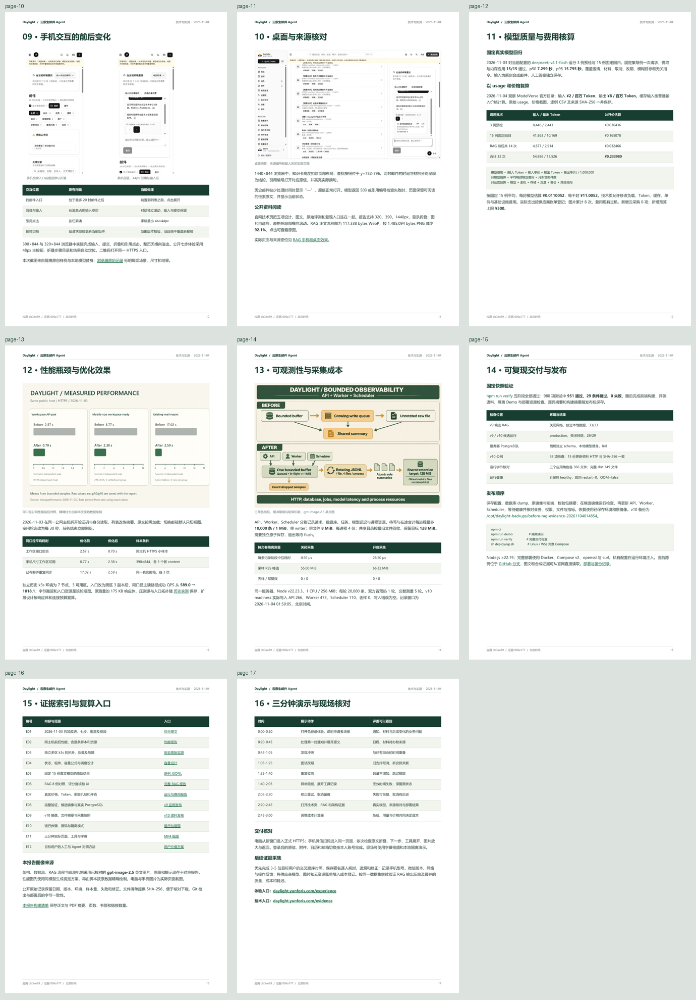
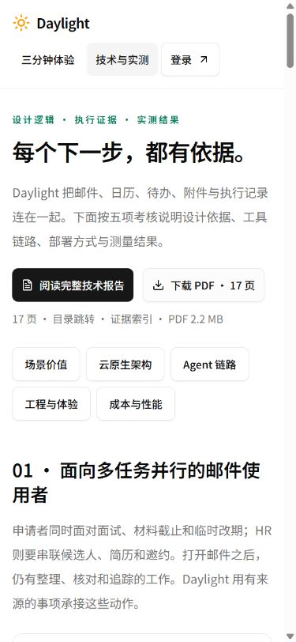
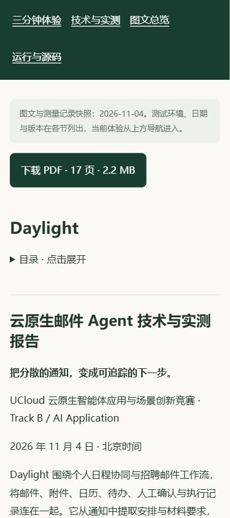
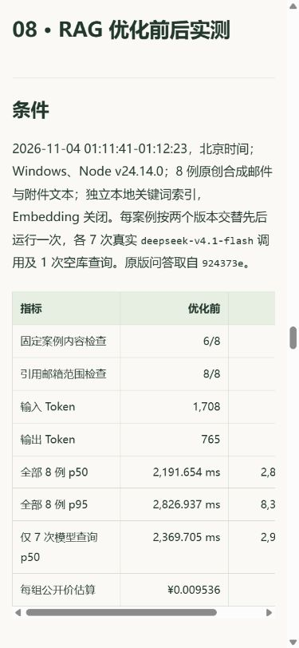

# 11 月 6 日竞赛：统一技术报告与评审入口

记录日期：**2026-11-04，北京时间**。

[完整技术报告正文](technical-report.md) · [21 页 PDF](../../public/competition/technical-report.pdf) · [官网图文版](https://daylight.yunforis.com/competition/technical-report.html) · [技术与实测](https://daylight.yunforis.com/evidence)。

## 当前版本：v14 运行快照

报告已扩展至21页，加入用户价值对照工具及10次模型预检、回复审核的状态与手机截图、十二章视频与同步讲稿。21个书签、6个内部跳转、39个外链及中文字体核验通过；累计42次文本调用、公开价估算¥0.406820。本轮全量1,017项中988通过、29条件跳过、0失败。

[更新原因、设计逻辑、前后图与复现](../competition-report-refresh-2026-11-04/README.md) · [机器基线](evidence/report-baseline.json)。下文保留v11初版的制作与发布记录。

## v11 初版制作归档

## 本轮改进

审查提交材料时发现，原技术报告 PDF 保存了 2026-10-17 的 10 页快照，当前导航仍指向七章框架；11 月的 RAG、手机交互、成本观测和公网验证分散在多份图文记录。新报告按五项考核串起同一条业务主线，并提供从设计结论到原始证据的入口。

| 项目 | 优化前 | 优化后 |
| --- | --- | --- |
| 独立技术报告 | 10 月 17 日、10 页历史 PDF | 11 月 4 日基线、17 页图文 PDF |
| 五项考核 | 分散在不同日期的报告 | 首章映射，16 节逐项展开 |
| 阅读定位 | 各份文档单独查找 | 17 个 PDF 书签、首章内部跳转、12 项证据索引 |
| 官网入口 | 新 PDF 地址返回 SPA 首页 HTML | 技术页首屏在线阅读、下载 PDF |
| PDF 大小 | 首次高质量 PNG 版 8,210,903 bytes | 约 2.2 MB，中文字体嵌入、图片独立压缩 |
| 核验版本 | 历史应用与结果 | 应用 db3ee89、证据006a177、v10运行快照 |

历史 PDF 封面与本轮封面对照：




原报告保留在原目录，新材料从提交导航和技术页进入。基线数据与截图均来自已有实际记录；本轮新增模型调用、图片调用和云资源采购均为 0。

## 文档结构与设计逻辑

1. 封面提供正式 HTTPS、二维码和版本，评委可以直接开始体验。
2. 五项考核表连接用户问题、架构、Agent、工程和成本，正文沿同一主线展开。
3. 架构与数据流图沿用已核对的 gpt-image-2.5 英文图，中文解释说明状态责任与恢复。
4. RAG 章节同时保留内容检查、逐例改善、评分修正、Token 与延迟；手机和桌面以实际页面截图展示。
5. 成本按原始 usage 和公开价格复算；公网、历史 k3s 与采集器隔离测量分别列出条件。
6. 独立证据索引提供12个入口，末章给出三分钟脚本和现场核对顺序。

## 排版与压缩

正文采用绿色标题、浅色表格、A4 页面与中文嵌入字体。ReportLab 输出可复制文本、链接与书签，图片按显示尺寸编码为高质量 JPEG；官网版复用 WebP，浏览器按手机宽度排版。

PDF 由同一 Markdown 正文构建，脚本核对内容检查、运行文件数和完整验证等关键数字与原始 JSON 一致。固定 PDF 元数据，使用同样字体和依赖重建时可以核对字节摘要。

## 复现

安装 Python 3.11 或更新版本及 [依赖清单](report-requirements.txt)：

```sh
python -m pip install -r docs/competition-submission-2026-11-04/report-requirements.txt
python scripts/build-competition-report.py
python scripts/verify-competition-report.py
python scripts/competition-public-report.py --only technical-report.html --only rag-release-v10.html
npm run build
```

Windows 默认读取系统 Microsoft YaHei；其他系统通过 `--font`、`--font-bold` 或 `DAYLIGHT_REPORT_FONT`、`DAYLIGHT_REPORT_FONT_BOLD` 提供中文 TrueType 字体。部署网站使用已构建的 PDF 和 HTML。

构建输出为 `output/pdf/daylight-technical-report-20261104.pdf`，同一文件复制到 `public/competition/technical-report.pdf`；[构建清单](evidence/report-manifest.json) 保存正文、PDF摘要、页数、书签及链接数量。`competition-public-report.py --only` 只更新选定页面，历史报告保留各自的快照。

## 验证记录

17页已逐页渲染审查，文字超出安全边界为0，实际使用的中文与英文文字字体均嵌入；17个书签、6个内部链接目标和28个HTTPS外链检查通过。相同字体与依赖重建后，PDF摘要仍为 `c45ec46e0293933099f4d02f88302945ed4c4dd7d71406d03d80924330223da5`。[PDF检查](evidence/pdf-verification.json)保存各页文字量与结果。




本地320/390/1440px浏览器分别检查技术页与图文页，六项均无整页横向溢出，九张报告图片全部正常；入口44px，目录跳转后RAG标题位于视口顶部约20px。手机在线阅读与独立PDF下载分别提供入口，PDF下载使用明确文件名。浏览器尺寸在设置后读取实际 `innerWidth` 核对。[浏览器记录](evidence/browser-verification.json)。

实际点击下载后产生下载事件，页面仍停留在技术页；下载文件SHA-256与发布PDF一致。两份报告引用的33份站内资源本地HTTP与完整字节核对通过，PDF分段读取返回206和32字节文件头。[资源核对](evidence/local-static-verification.json) · [前端构建](evidence/frontend-build.txt)。





公网检查同时核对 MIME、PDF文件头、完整字节摘要及206分段读取；发布前新PDF与HTML路径均返回3,426 bytes的SPA首页，记录在[改前HTTP证据](evidence/before-public.json)。

## v11 公网发布

**当次部署验证完成。** 镜像 `daylight:public-competition-20261104-v11`，当次源码`159f434`；8服务healthy，应用restart=0、OOM=false。候选29/29、公网43项、报告引用33份资源的HTTP及SHA-256均通过；每个应用角色核对379文件，完整前端361文件一致。

正式390×844浏览器实际完成在线阅读、目录定位和PDF下载；下载文件与发布PDF摘要相同。镜像、备份、执行顺序、运行指标与手机截图见 [v11 发布记录](deployment-v11.md)。
