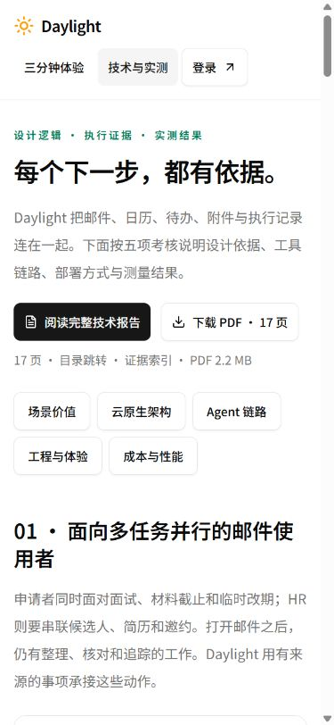
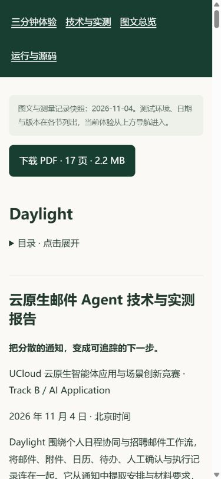
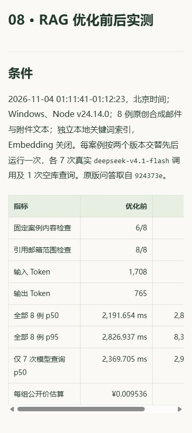

# 统一技术报告与评审入口 v11 发布记录

日期：**2026-11-04，北京时间**。[本轮图文与复现](README.md) · [官网完整技术报告](https://daylight.yunforis.com/competition/technical-report.html) · [技术与实测](https://daylight.yunforis.com/evidence)。

## 发布结果

v11 发布17页技术报告、响应式图文、技术页首屏阅读与下载入口，以及v10的公开核验资料。前端采用完整目录替换，确保浏览器加载同一版入口与资源。

| 项目 | 结果 |
| --- | --- |
| 当前镜像 | `daylight:public-competition-20261104-v11` |
| 镜像 ID | `sha256:03f52e88c185088d6261753c0a25c9fca60d699b96fca8e9a3e19c6344632026` |
| 本轮前端及资料源码 | `159f434ab4541c3abf0d2e22169e7ef3fd320463` |
| 后端业务基线 | `db3ee897a696bf5f70365f8c901237f020cf8691` |
| 基础镜像 | v10，`sha256:7d40e303985212a070b47cd2126a22c05e1043a592ca55d28210db8c38423886` |
| 发布包 | 完整前端361文件及验证脚本1份，21,503,024 bytes |
| 包 SHA-256 | `a7f541fdf5caec3abf0b0076b66d2aeeee8bd05b62827f78fe98dd1f67ebb8f3` |
| 发布前备份 | `/opt/daylight-backups/before-technical-report-20261104022530` |
| 候选运行验证 | production模式、关闭网络，29/29通过 |
| 公网综合检查 | 43项，含七步、匿名权限、报告与PDF/视频分段读取 |
| 报告引用资源 | 33份站内资源，HTTP、MIME及完整SHA-256一致 |
| 运行文件 | 三角色各379文件，完整前端集合361文件及每个摘要一致 |
| 服务状态 | 8服务healthy；三个应用restart=0、OOM=false |

[包清单](evidence/release-v11-manifest.json) · [包摘要](evidence/release-v11-archive.json) · [候选29项](evidence/candidate-production-tests-v11.txt) · [实际发布日志](evidence/deploy-v11.txt)。

## 阅读和下载的前后变化

| 路径或操作 | 发布前 | 发布后 |
| --- | --- | --- |
| `/competition/technical-report.pdf` | HTTP200、`text/html`、3,426 bytes，SPA首页 | HTTP200、`application/pdf`、2,187,994 bytes，17页报告 |
| `/competition/technical-report.html` | HTTP200、`text/html`、3,426 bytes，SPA首页 | HTTP200、37,507 bytes，完整图文与目录 |
| PDF分段读取 | 新文件尚未交付 | HTTP206、`bytes 0-31/2187994`、文件头`%PDF-` |
| 技术页首屏 | 五项技术导航 | 增加44px阅读与下载按钮，显示页数与文件大小 |
| 点击PDF | 进入内置阅读器 | 以明确文件名下载，保留技术页 |

官网实际点击产生下载事件，下载的2,187,994 bytes文件与发布版本摘要相同：

`c45ec46e0293933099f4d02f88302945ed4c4dd7d71406d03d80924330223da5`

[发布前HTTP](evidence/before-public.json) · [公网43项](evidence/public-verification-v11.json) · [引用资源33项](evidence/static-verification-v11.json) · [实际浏览器与下载](evidence/public-browser-verification-v11.json)。

## 手机实际效果

390×844浏览器打开正式HTTPS，技术页和完整报告均无整页横向溢出；报告九张图片加载成功。折叠目录展开后点击“08 · RAG 优化前后实测”，对应标题定位到视口顶部约20px。

本地另外完成320/390/1440px两页面的六项布局检查，记录见[本地浏览器验收](evidence/browser-verification.json)。

## 发布设计与执行顺序

1. 核对API、Worker、Scheduler均运行指定v10镜像ID，持有发布锁。
2. 保存Compose配置、数据库custom dump、可读取的目录清单、原镜像和前端。
3. 校验包、路径与362份文件摘要。Windows打包使用扩展路径，保留构建目录里文件名末尾为点的许可证文件。
4. 以完整v10镜像ID构建新镜像，移除旧`/app/dist`后复制完整新目录，避免遗留前端哈希文件；同步更新镜像revision和运行`DAYLIGHT_GIT_SHA`。
5. 在候选容器运行29项production验证，再检查PDF字节、报告内容与下载入口。
6. 更新三个角色，等待健康，检查七步业务、匿名权限、PDF分段读取和指标；切换异常按备份配置与原镜像恢复。
7. 正式HTTPS核对43项综合结果、两份报告关联的33份资源，再逐容器核对完整前端集合和后端/脚本摘要。
8. 保存实际手机截图、下载文件摘要和运行指标。本记录与原始结果归档到Git，报告正文继续保留其v10测量基线。

完整新前端与v10镜像之间的边界记录在发布清单中：本轮前端和公开资料来自`159f434`，后端业务沿用`db3ee89`；报告正文的实测快照为v10、证据`006a177`。新增发布与历史实测各有独立版本。

## 发布后指标快照

2026-11-04 **02:27:13，北京时间**，三个角色均为readiness `ok=true`：

| 角色 | 写入样本 | 丢样 | 写入错误 | 核对文件 |
| --- | ---: | ---: | --- | ---: |
| API | 375 | 0 | 无 | 379 |
| Worker | 497 | 0 | 无 | 379 |
| Scheduler | 129 | 0 | 无 | 379 |

[运行镜像、全量前端与readiness](evidence/runtime-verification-v11.json)。本轮新增模型调用、图片调用与云资源采购均为0。
