# Daylight

## 云原生邮件 Agent 技术与实测报告

**把分散的通知，变成可追踪的下一步。**

UCloud 云原生智能体应用与场景创新竞赛 · Track B / AI Application

2026 年 11 月 4 日 · 北京时间

Daylight 围绕个人日程协同与招聘邮件工作流，将邮件、附件、日历、待办、人工确认与执行记录连在一起。它从通知中提取安排与材料要求，处理后续改期、取消和重复投递，并让每项结果能够回查来源。

本报告按五项考核说明用户问题、架构决策、Agent 执行、工程交付及成本性能。图示沿用 **gpt-image-2.5 英文图**，中文关系、测量条件与设计取舍写入正文。

| 阅读与体验 | 入口 |
| --- | --- |
| 三分钟交互 | [daylight.yunforis.com/experience](https://daylight.yunforis.com/experience) |
| 分章视频与讲稿 | [十二章在线演示](https://daylight.yunforis.com/demo) |
| 技术与实测 | [daylight.yunforis.com/evidence](https://daylight.yunforis.com/evidence) |
| 手机图文版 | [在线阅读本报告](https://daylight.yunforis.com/competition/technical-report.html) |
| 报告下载 | [下载 PDF](https://daylight.yunforis.com/competition/technical-report.pdf) |
| 源码分支 | `feat/competition-experience-20261103` |


运行核验：**v14 · 2026-11-04 04:09:24**。前端 `1549362`；后端 `9354287`，继承基线 `db3ee89`；证据归档 `2b58328`。构建清单关联各份原始记录的 SHA-256。

<!-- page -->

# 01 · 五项考核，一条业务主线

## 核心主张

申请者同时处理面试、材料截止和临时改期，HR 同时串联候选人、简历和邀约。Daylight 把通知变成带来源的安排与行动，在后续变化发生时维护同一条业务历史，并把需要发送的回复交给本人审核。

| 考核点 | 实现与设计 | 可直接核对的结果 |
| --- | --- | --- |
| 场景价值 | 时间与材料分别追踪；冲突、改期、取消与回复串成闭环 | 七步交互；可运行的人工对照工具；两套通知各 12/12 自动核对 |
| 云原生架构 | API、Worker、Scheduler 解耦；共享业务与任务状态；队列及私有存储 | v14 的 8 服务 healthy；独立 7 节点、3 可用区 k3s 容量与故障记录 |
| Agent 链路 | 有界上下文、工具校验、持久任务、引用与人工确认 | 固定真实模型 15/15；RAG 6/8 → 8/8；回复 PostgreSQL 8/8 |
| 工程与 Demo | 免登录体验、持久回复审核、十二章视频与同步讲稿 | 当前全量 988 通过、29 条件跳过；v14 HTTPS 66 项与资料 116 份 |
| 成本性能 | usage 复算；按需加载；去重；有界指标采集 | 手机尺寸工作区平均 8.77 → 2.38 秒；42 次文本调用估算 ¥0.406820 |

## 版本与测量口径

报告采用 **v14 运行快照**：2026-11-04 04:09:24，北京时间；前端 `1549362`，后端 `9354287` 及基线 `db3ee89`，证据归档 `2b58328`。本轮重新运行全量测试，共 1,017 项、988 通过、29 条件跳过、0 失败。

各章登记原创样例与即时工具、合成输入与真实模型、实际邮箱及云依赖的环境、日期和样本量。用户价值工具的真人参与记录当前为 **0**；手机交互数据来自标明尺寸的浏览器操作。

<!-- page -->

# 02 · 用户问题与业务闭环

## 为什么需要 Agent

一次面试通知通常同时包含面试时间、材料截止和回复要求。改期信引用旧安排，取消信又改变日历状态。用户要在多封邮件间查找对象、核对日期，并把后续变化同步到日历和待办。

Agent 的作用是从不同表达中提取结构化行动、结合已有状态选择 create / cancel / reschedule，再通过确定的工具规则保存。来源、确认与历史共同承担核对工作。

| 用户动作 | Daylight 的处理 | 用户获得的结果 |
| --- | --- | --- |
| 收到面试与材料通知 | 日程和材料待办分别创建 | 两种期限都能追踪 |
| 收到与组会重叠的交流邀请 | 保留安排并标记冲突 | 可以据此协调时间 |
| 收到改期 | 取消旧安排，建立新旧关联 | 当前安排和历史一致 |
| 同一封通知再次投递 | 按邮件 ID 跳过 | 日程、待办数量保持一致 |
| 模型时间格式错误 | 整封先校验，保留失败尝试 | 修正后可以重试 |
| 后续取消 | 标记取消并保存原因和来源 | 释放当前安排，保留业务历史 |
| 想找附件要求 | 检索邮件与附件，回答逐条引用 | 点击即可回到原文 |

## 价值测量方式

独立本地主持工具共用邮件阅读与结果编辑器，比较人工整理和 Daylight 辅助。两套原创通知按四种顺序轮换，完整计时包括阅读、模型等待、核验、补漏与修正。下一章给出工具设计与已完成的模型预检。

<!-- page -->

# 03 · 用户价值工具与材料预检

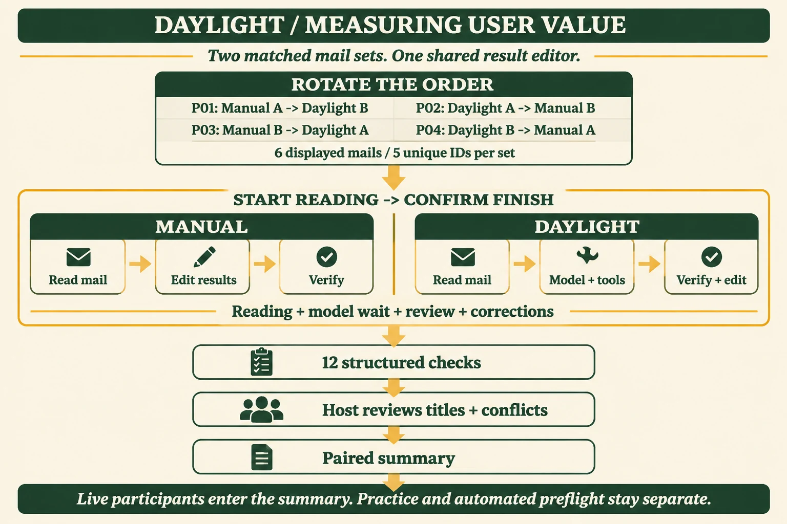

每套通知覆盖邀请、冲突、改期、重复与取消；任务结束执行 12 项自动核对，主持人复核标题和冲突说明。匿名记录保留各阶段耗时、修正、求助与使用顺序。

| 已完成的预检 | 记录 |
| --- | --- |
| 输入与调用 | 两套原创合成通知，各处理 5 封；共 10 次真实 deepseek-v4.1-flash 调用 |
| 工具结果 | A、B 两套各 12/12；每套均覆盖 1 次去重、冲突、改期和取消 |
| 模型调用延迟 | 样本中位数 9.2345 秒；p95 32.503 秒（nearest-rank） |
| 用量与估算 | 输入 32,272、输出 13,537 Token；¥0.172840 |
| 真人参与 | 当前登记 0；完整人工对照由主持工具采集 |

练习：`npm run study -- --practice`。指定私有配置可运行真实模型，并用 `--max-calls 20` 控制调用上限。[方法、截图及原始预检](https://daylight.yunforis.com/competition/value-report.html)。

<!-- page -->

# 04 · 实际云原生拓扑

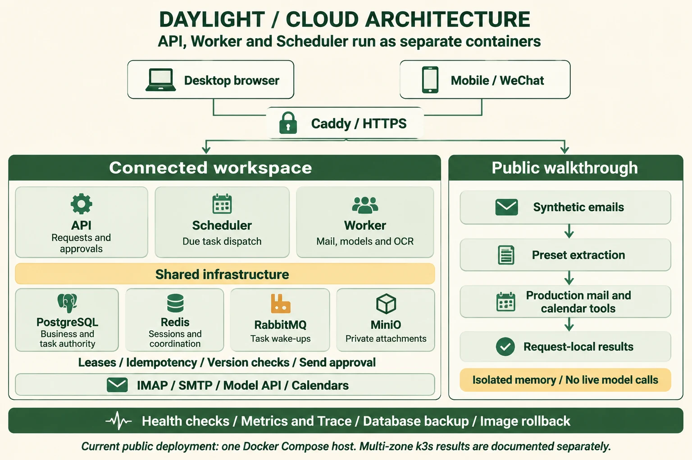

公网采用 Docker Compose：Caddy 提供 HTTPS 入口，API、Worker、Scheduler 独立运行；PostgreSQL、Redis、RabbitMQ 与 MinIO 提供共享基础设施。当前主机为 **2 vCPU / 3499 MiB 内存 / 4 GiB swap**。

| 服务边界 | 职责 | 选择依据 |
| --- | --- | --- |
| API | 认证、权限、业务查询、任务入口 | 保持页面响应路径清晰 |
| Worker | 邮件处理、模型、OCR 与后台任务 | 耗时工作独立调度与恢复 |
| Scheduler | 定时同步与到期任务安排 | 调度与任务执行分别控制 |

部署的八个常驻服务在 v14 核验时均 healthy。独立 **7 节点、3 可用区 k3s** 的扩展结果在性能章单独列出。当前公网拓扑图和扩展测量各自对应一套环境。

<!-- page -->

# 05 · 技术选型与状态责任

| 选型 | 保存或协调的内容 | 设计逻辑 |
| --- | --- | --- |
| PostgreSQL | 账号、业务、任务、步骤、outbox 等权威状态 | 跨进程读取，事务与版本校验处理并发写入 |
| RabbitMQ | 任务唤醒与执行通知 | 消息提高响应速度，持久任务及租约保留恢复依据 |
| Redis | 会话、临时协调与缓存 | 对临时数据设置独立生命周期与过期策略 |
| 私有 MinIO | 附件原件及衍生文件 | 业务记录保存引用，访问通过鉴权代理 |
| Docker Compose | 当前公网三角色与依赖服务 | 复用现有小型主机，配置、备份和回滚容易复现 |
| Kubernetes | 多副本、跨区调度与资源限制 | 根据读负载、队列积压和共享状态验证决定扩容 |
| Node 内置 JSONL 采集 | 请求、数据库、模型与进程指标 | 复用持久卷，减少当前主机的常驻组件 |

## 一致性与恢复

业务对象保留用户与邮箱归属。任务保存尝试、租约、步骤和结果；重复输入使用幂等规则，过期执行者提交需要满足当前状态条件。数据库状态和执行通知分别承担持久化与唤醒职责。

生产依赖不可用时，接口返回可识别的错误，持久任务按恢复规则继续。开发演示可显式使用隔离的本地数据模式。日程改期和取消保留原记录，通过 `previousEventId` / `replacementEventId` 关联。

## 扩容与资源调度

API 依据请求负载扩容，Worker 依据积压与模型额度安排并发。增加副本时同时检查数据库连接总量、同邮箱顺序、对象存储与会话共享。连接预算按“最大副本数 × 每副本连接池 + 后台预留”复算；模型 RPM / TPM 达到上限时使用背压。

<!-- page -->

# 06 · Agent 从邮件到工具结果

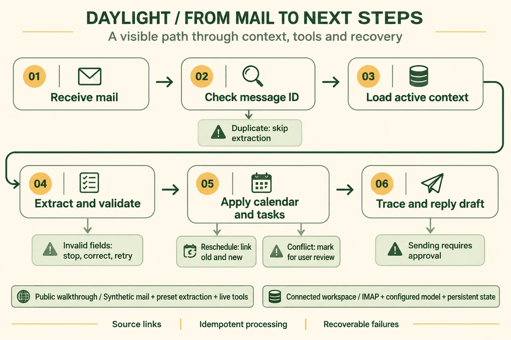

基础邮件链按时间处理，模型结合有效日程返回 create / cancel / reschedule。服务端解析并校验完整提取，再执行日历和待办规则。小 D 通过 Function Calling 规划工具，服务端校验参数、权限及确认状态。

执行记录展示 `calendar.active_events`、`tasks.existing`、`calendar.apply_actions` 等实际工具名称与参数。Trace 关联原邮件、尝试、耗时与结果；相同邮件重试时保留先前失败。

公开七步体验使用原创邮件与预置提取，日历、待办和 Trace 由现有工具当场计算。真实模型评测使用固定独立数据集，逐例输入、输出和 usage 在证据索引章提供入口。

<!-- page -->

# 07 · 异常、重试与人工确认

| 情况 | 系统行为 | 核对依据 |
| --- | --- | --- |
| 提取中包含无效时间 | 整封校验失败，保留重试机会 | 七步第 5、6 步；候选运行检查 |
| 重复邮件 ID | 跳过提取和重复业务写入 | 七步第 4 步；数量断言 |
| 改期或取消目标不唯一 | 返回需明确目标的失败状态 | 固定模型用例与业务规则 |
| Worker 中断或租约过期 | 持久任务按状态重新领取，提交校验执行权 | [可靠性矩阵](https://github.com/why121368/Daylight/blob/feat/competition-experience-20261103/docs/submission/reliability/README.md) |
| 模型 HTTP 503 | RAG 显示状态和检索原文 | 本轮隔离浏览器与服务器 PostgreSQL 检查 |
| 来源编号 S99 无效 | 展示检索原文供核对 | 来源校验器、浏览器与 PostgreSQL 检查 |
| 请求中切换邮箱 | 清理当前会话，旧回调不更新新范围 | 9 秒延迟期间切换的实际浏览器操作 |
| 发送邮件或会议邀约 | 草稿先进入审核，持久版本确认后发送 | 小 D 与执行记录共用审核状态机 |

## 处理外部副作用

SMTP、外部日历等操作发生超时且结果未知时，先核对外部结果与本地记录，再决定重试或人工处理。外部日历推送失败记录连接错误，已写入的本地安排仍可查看。发信、日历写入和资料问答分别走各自的权限与业务规则。

## 服务生命周期

健康检查区分进程存活、依赖可用和排空状态。关闭时等待在途任务及指标 flush；发布先验证候选镜像，再切换三角色，检查失败时按备份配置和原镜像恢复。

RAG 服务器真实 PostgreSQL 的 8 项检查使用独立 schema 与本地模型替身，覆盖来源回读、归属 403、信息不足、503、无效来源、重新连接和 5 并发读取；完成后删除测试空间。

<!-- page -->

# 08 · 从执行记录到持久回复审核

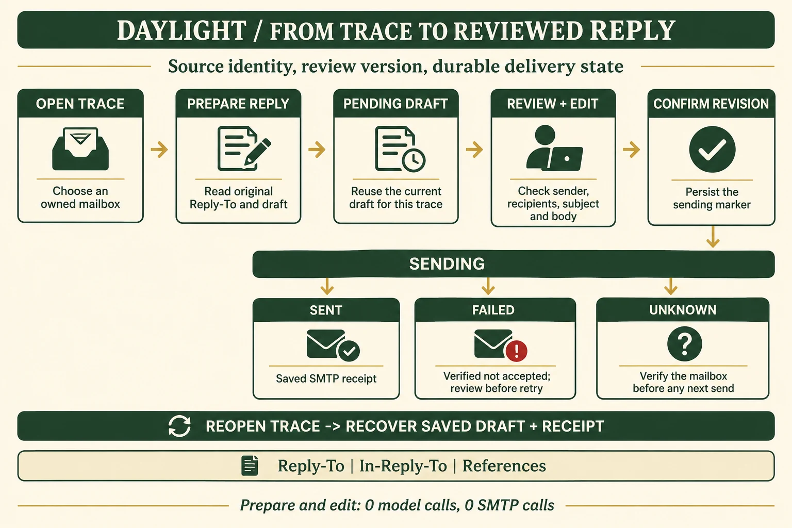

原邮件与 Trace 唯一关联后，复用现有 `/api/assistant/drafts`：固定来源邮箱、Reply-To 与回复线程，展示完整正文，保存编辑并递增 `revision`，确认当前版本后发送。

| 状态与检查 | 设计逻辑 |
| --- | --- |
| 并发准备 | 同一来源在数据库事务中复用一份草稿；按用户与邮箱校验归属 |
| 版本确认 | 旧 revision 返回 409，重新读取已保存的正文与版本 |
| sending | 数据库先提交发送状态，再调用 SMTP；重复确认复用当前结果 |
| sent / failed / unknown | 保存回执；明确失败可经审核后重试，结果未知时进入核验入口 |

真实 PostgreSQL 的独立 schema **8/8**：8 并发准备、权限隔离、旧版本、两次重连、一次传输、回执及 unknown 持久化均通过。使用合成通知与注入 SMTP transport（2 次），本组真实 SMTP 调用 0。[流程与逐项结果](https://daylight.yunforis.com/competition/reply-review-report.html)。

<!-- page -->

# 09 · 回复审核的电脑与手机体验

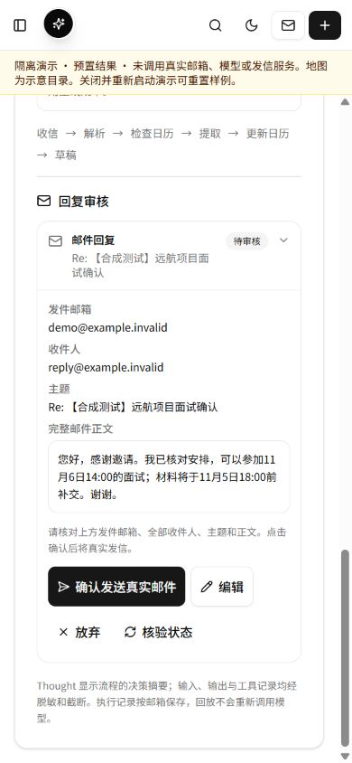 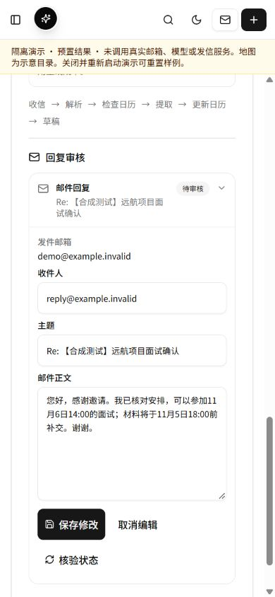

| 使用环节 | 优化前 | 优化后 |
| --- | --- | --- |
| 入口 | Trace 旧发送接口返回 503 | 连接持久化审核接口 |
| 正文阅读 | 确认框最多 280 字 | 完整阅读，编辑后保存 |
| 来源邮箱 | 跟随当前活动邮箱 | 持续关联原邮件与本人来源邮箱 |
| 重新打开 | 分散核对草稿和结果 | 恢复当前版本、正文与回执 |
| 手机控件 | 原有小号按钮 | 主要按钮与编辑输入至少 44px |

1440、390、320px 审核与手机编辑均无整页横向溢出；正文输入区 160px。实际完成准备、编辑、保存及刷新，修改后的正文从同一草稿恢复。截图使用独立演示目录中的原创合成邮件。

审核状态复用每邮箱一条 JSONB 记录及行锁，同邮箱写入依次提交；随草稿量增长，可按记录大小与锁等待测量拆为独立行。[布局、操作与技术选型](https://daylight.yunforis.com/competition/reply-review-report.html#电脑与手机效果)。

<!-- page -->

# 10 · RAG 的实际作用

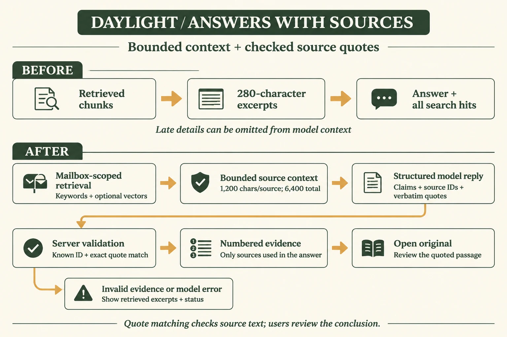

旧问答把展示用的约 280 字摘录当作模型输入，长通知或附件后半段要求被截断。新版读取完整命中分块，模型逐条返回结论、来源编号与原文摘句，服务端检查编号及连续原文，再装配引用。

| 上下文与输出 | 限制及原因 |
| --- | --- |
| 来源数量 | 默认 6，最多 8，控制输入规模 |
| 来源正文 | 每来源 1,200 字、合计 6,400 字，保留块内后半段 |
| 结构化结果 | 最多 6 结论、每结论 3 依据、共 8 不同摘句 |
| 调用次数 | 每次问答最多一次模型请求，保留明确的异常展示 |

摘句匹配检查来源可回查性，内容检查另按人工答案核对。图片提示词、实现、原始输入与逐例结果见 [RAG 图文报告](https://daylight.yunforis.com/competition/rag-report.html)。

<!-- page -->

# 11 · RAG 优化前后实测

## 条件

2026-11-04 01:11:41-01:12:23，北京时间；Windows、Node v24.14.0；8 例原创合成邮件与附件文本；独立本地关键词索引，Embedding 关闭。每案例按两个版本交替先后运行一次，各 7 次真实 `deepseek-v4.1-flash` 调用及 1 次空库查询。原版问答取自 `924373e`。

| 指标 | 优化前 | 优化后 |
| --- | ---: | ---: |
| 固定案例内容检查 | 6/8 | 8/8 |
| 引用邮箱范围检查 | 8/8 | 8/8 |
| 输入 Token | 1,708 | 2,869 |
| 输出 Token | 765 | 2,149 |
| 全部 8 例 p50 | 2,191.654 ms | 2,877.790 ms |
| 全部 8 例 p95 | 2,826.937 ms | 8,387.334 ms |
| 仅 7 次模型查询 p50 | 2,369.705 ms | 2,937.557 ms |
| 每组公开价估算 | ¥0.009536 | ¥0.022930 |

## 改善来自哪里

长正文例从“未找到”变为正确回答 **11 月 6 日 17:00**；长附件例补齐 **学生证原件、本人签名的保密协议**。改期、多邮件汇总、信息不足、无关指令、另一邮箱与空库案例在两个版本中均通过内容检查。

初始关键词评分把旧版拒绝说明中引用的无关词句计为失败。复核原始回答后改记为正确，最终结果为 6/8 → 8/8；初始分数、修正原因和原响应均归档。

新版增加来源正文与结构化摘句，质量、Token 和耗时同时上升。多来源例输出 970 Token、耗时 8.387 秒。分位数采用 nearest-rank，本批 8 例的 p95 对应最大观测值。下一步按同一案例验证合并相邻结论、缩短输出与按来源版本缓存。

<!-- page -->

# 12 · 手机交互的前后变化

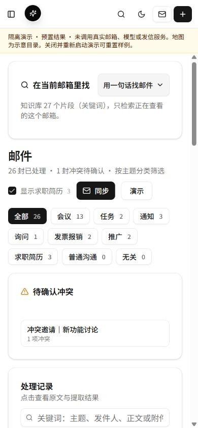 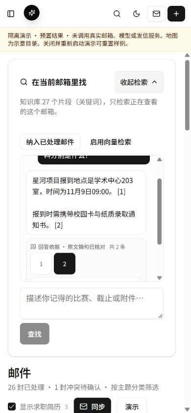

| 交互位置 | 原有问题 | 当前处理 |
| --- | --- | --- |
| 找邮件入口 | 位于最多 20 封邮件之后 | 前置到列表之前，点击展开 |
| 阅读与输入 | 长消息占用输入空间 | 对话独立滚动，输入与提交保留 |
| 引用点击 | 按钮紧凑 | 手机最小 44×44px |
| 邮箱切换 | 旧请求继续更新当前组件 | 范围版本校验，旧回调不覆盖新邮箱 |

390×844 与 320×844 浏览器中实际完成输入、提交、折叠和引用点击，整页无横向溢出。公开七步体验采用 48px 主按钮、折叠步骤目录和结果自动定位。二维码打开同一 HTTPS 入口。

本次截图来自隔离原创样例与本地模型替身；[浏览器原始记录](https://daylight.yunforis.com/competition/rag-assets/evidence/browser-verification.json) 标明每项场景、尺寸和结果。

<!-- page -->

# 13 · 桌面与来源核对

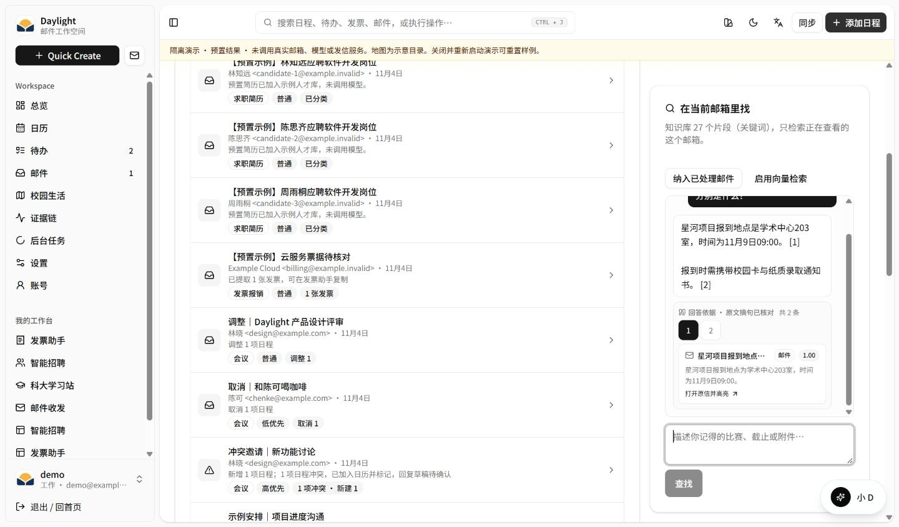

1440×844 浏览器中，知识卡高度扣除顶部布局，查找按钮位于 y=752-796。两封邮件的时间与材料分别呈现为结论，引用编号打开对应原信，并高亮实际摘句。

历史邮件缺少处理时间时显示“—”，原信正常打开。模型返回 503 或引用编号检查失败时，页面保留可阅读的检索原文，并显示当前状态。

## 公开资料阅读

官网技术页把五项设计、图文、原始评测和复现入口连在一起。报告支持 320、390、1440px，目录折叠；图片自适应，表格在局部横向滚动。RAG 正文流程图为 117,338 bytes WebP，较 1,485,094 bytes PNG 减少 **92.1%**，点击可查看原图。

实际页面与来源定位见 [RAG 手机和桌面效果](https://daylight.yunforis.com/competition/rag-report.html#电脑与手机效果)。

<!-- page -->

# 14 · 模型质量与费用核算

## 固定真实模型回归

2026-11-03 对当前配置的 `deepseek-v4.1-flash` 运行 3 例预检与 15 例固定回归。固定集每例一次请求，提取与内存应用 **15/15** 通过，p50 **7.299 秒**、p95 **15.795 秒**。覆盖邀请、材料、取消、改期、模糊目标和无关指令。输入为原创合成邮件，人工答案独立保存。

## 以 usage 和价格复算

2026-11-04 观察 ModelVerse 官方目录：输入 **¥2／百万 Token**、输出 **¥8／百万 Token**。缓存输入按普通输入价格计算。原始 usage、价格截图、逐例 CSV 及来源 SHA-256 一并保存。

| 调用批次 | 输入 / 输出 Token | 公开价估算 |
| --- | ---: | ---: |
| 3 例预检 | 8,446 / 2,443 | ¥0.036436 |
| 15 例固定回归 | 41,863 / 10,169 | ¥0.165078 |
| RAG 前后共 14 次 | 4,577 / 2,914 | ¥0.032466 |
| 价值工具预检 10 次 | 32,272 / 13,537 | ¥0.172840 |
| 合计 42 次 | 87,158 / 29,063 | **¥0.406820** |

```text
模型费用 = (输入 Token × 输入单价 + 输出 Token × 输出单价) / 1,000,000
月模型估算 = 平均每封模型费用 × 月新增邮件数
月运营预算 = 模型 + 主机 + 存储 + 流量 + 备份 + 其他调用
```

按固定 15 例平均，每封模型估算 **¥0.0110052**，每千封 **¥11.0052**。技术页允许修改负载、Token、缓存、单价与基础设施费用。实际支出按供应商账单登记；图片累计 10 次，复用现有主机，新增云采购 0 项；新增预算上限 **¥500**。

<!-- page -->

# 15 · 性能瓶颈与优化效果

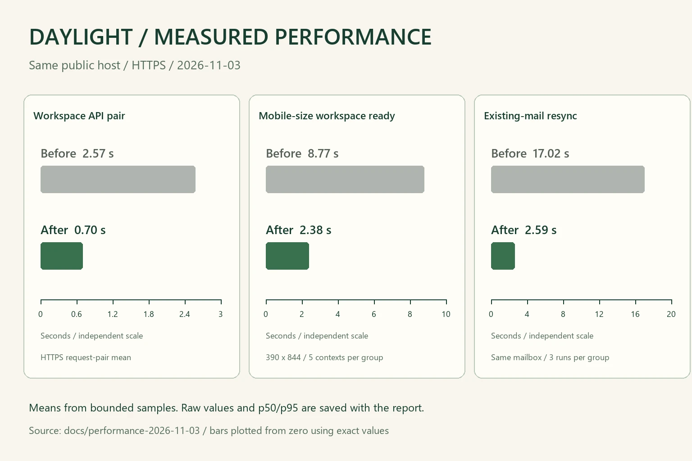

2026-11-03 在同一公网主机拆开验证码与身份读取、列表改传摘要、原文按需加载；切换邮箱默认只切视图，空闲轮询改为每 30 秒，任务结束立即刷新。

| 同口径平均耗时 | 优化前 | 优化后 | 样本条件 |
| --- | ---: | ---: | --- |
| 工作区接口组合 | 2.57 s | 0.70 s | 同主机 HTTPS 小样本 |
| 手机尺寸工作区可用 | 8.77 s | 2.38 s | 390×844，各 5 个新 context |
| 已有邮件重复同步 | 17.02 s | 2.59 s | 同一真实邮箱，各 3 次 |

独立历史 k3s 环境为 7 节点、3 可用区。入口改为跨区 3 副本后，同口径主读路径成功 QPS 从 **589.0 → 1018.1**；字节搬运和入口资源是该轮瓶颈。原测量的 175 KB 响应体、压测源与入口拓扑随 [历史实测](https://daylight.yunforis.com/competition/k8s-measurements.html) 保存，扩展设计按响应体和连接预算复算。

<!-- page -->

# 16 · 可观测性与采集成本

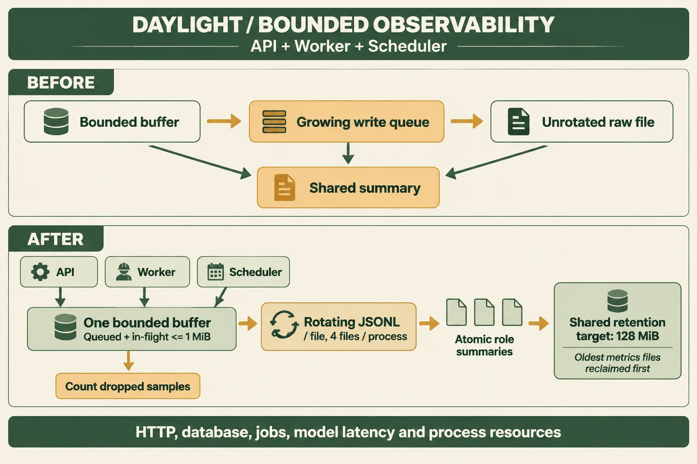

API、Worker、Scheduler 分别记录请求、数据库、任务、模型延迟与进程资源。待写与在途合计每进程最多 **10,000 条／1 MiB**，单 writer；单文件 **8 MiB**、每进程 4 份；共享目录按最旧文件回收，保留目标 **128 MiB**。摘要独立原子保存，退出等待 flush。

| 持久卷隔离测量 | 关闭采集 | 开启采集 |
| --- | ---: | ---: |
| 每条记录阶段中位耗时 | 0.92 μs | 26.50 μs |
| 采样 RSS 峰值 | 55.00 MiB | 66.32 MiB |
| 丢样 / 写错误 | 0 / 0 | 0 / 0 |

同一服务器、Node v22.23.3、1 CPU／256 MiB；每轮 20,000 条，双方各预热 1 轮、交替测量 5 轮。v14 readiness 实际写入 API 389、Worker 705、Scheduler 149，丢样 0、写入错误为空。记录窗口为 2026-11-04 04:09:24，北京时间。

<!-- page -->

# 17 · 可复现交付与发布

## 当前全量与固定运行快照

本轮 `npm test`：**1,017 项，988 通过、29 条件跳过、0 失败**，63.26 秒。报告基线由脚本读取运行、模型、费用、集成与媒体记录，校验关键数字与源文件 SHA-256。

| 检查位置 | 环境与结果 |
| --- | --- |
| v14 候选运行 | production、关闭外网，29/29；12 章、33 条讲解与媒体摘要一致 |
| 云端 PostgreSQL | RAG 8/8；回复审核 8/8；独立 schema 各自清理 |
| v14 正式 HTTPS | 66 项；116 份关联资料 HTTP / MIME / 完整 SHA-256 一致 |
| 运行字节核对 | 三个应用角色各 470 文件；完整 dist 445 文件 |
| 运行健康 | 8 服务 healthy；应用 restart=0、OOM=false |

## 发布与恢复

保存数据库 dump、Compose 配置、原镜像和前端，校验发布包摘要；先验证候选，再切换 API、Worker、Scheduler，等待健康并核对业务、权限、文件与指标。v14 发布前备份：`/opt/daylight-backups/before-chapter-video-20261104040719`。

```sh
npm ci
npm run demo                  # 隔离演示
npm run verify                # 完整交付检查
sh deploy/up.sh               # Linux / WSL 完整 Compose
```

Node.js ≥22.19；完整部署使用 Docker、Compose v2、openssl 与 curl。私有配置由运行环境注入。源码分支为 `feat/competition-experience-20261103`；官网提供图文、合成证据及复现步骤。[运行与源码](https://daylight.yunforis.com/competition/reproduce.html) · [v14 镜像、备份与正式截图](https://daylight.yunforis.com/competition/video-release-v14.html)。

<!-- page -->

# 18 · 十二章视频与同步讲稿

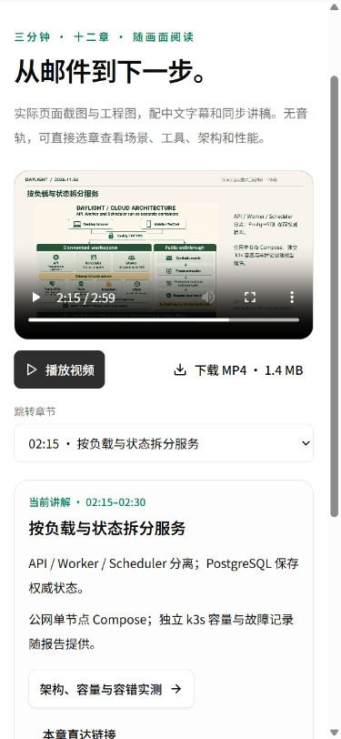 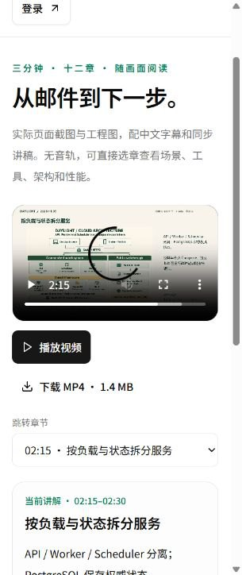

原生 `<video controls playsInline preload="metadata">` 结合 React 懒加载。手机采用 44px 原生章节选择器，桌面显示完整目录；选章保持播放或暂停意图，链接、刷新及返回恢复章节。

| 内容与核验 | 实测结果 |
| --- | --- |
| 一份源时间轴 | 12 章、33 条讲解；同步生成章节 JSON、字幕、讲稿和海报 |
| 视频资源 | H.264，1920×1080，1,431,534 bytes；海报 61,383 bytes |
| 播放结构 | 编码时长 179.917 秒；moov 从 byte 32 起，位于 mdat 之前 |
| 字幕交界 | 每段结束提前 1ms；135 秒原生字幕只显示当前章 |
| 失败与恢复 | 受控 503 时保留讲稿；恢复资源并重试后回到 135 秒 |
| 浏览器布局 | 正式 1440、390、320px 无整页横向溢出；播放与暂停选章通过 |

[分章演示](https://daylight.yunforis.com/demo) · [完整讲稿](https://daylight.yunforis.com/competition/demo-transcript.html) · [前后截图、选型与原始操作](https://daylight.yunforis.com/competition/video-report.html)。

<!-- page -->

# 19 · 证据索引与复算入口

| 编号 | 内容与范围 | 入口 |
| --- | --- | --- |
| E01 | 2026-11-03 五项改进、七步、图源及视频 | [综合图文](https://daylight.yunforis.com/competition/report.html) |
| E02 | 同主机前后性能，含逐条样本和资源 | [性能报告](https://daylight.yunforis.com/competition/performance-report.html) |
| E03 | 独立多区 k3s 的拓扑、负载及故障 | [历史原始实测](https://daylight.yunforis.com/competition/k8s-measurements.html) |
| E04 | 状态、组件、容量公式与调度设计 | [容量设计](https://daylight.yunforis.com/competition/capacity-design.html) |
| E05 | 固定 15 例真实模型的原始结果 | [逐例 JSONL](https://daylight.yunforis.com/competition/report-assets/evidence/model-full/results.jsonl) |
| E06 | RAG 8 例对照、评分复核和 UI | [完整 RAG 报告](https://daylight.yunforis.com/competition/rag-report.html) |
| E07 | 真实价格、Token、采集机制和开销 | [运行与费用报告](https://daylight.yunforis.com/competition/operations-report.html) |
| E08 | 完整验证、候选镜像与真实 PostgreSQL | [v9 应用发布](https://daylight.yunforis.com/competition/rag-deployment.html) |
| E09 | v13 回复版本、并发、回执与部署 | [审核与发布](https://daylight.yunforis.com/competition/reply-release-v13.html) |
| E10 | 运行步骤、源码与隔离模式 | [运行与复现](https://daylight.yunforis.com/competition/reproduce.html) |
| E11 | 十二章视频、讲稿、字幕与操作 | [分章演示](https://daylight.yunforis.com/demo) |
| E12 | 人工对照工具与 10 次模型预检 | [价值工具](https://daylight.yunforis.com/competition/value-report.html) |
| E13 | v14 媒体、手机、候选与公网验证 | [视频图文](https://daylight.yunforis.com/competition/video-report.html) |
| E14 | 报告快照、调用量与源文件摘要 | [机器基线](evidence/report-baseline.json) |

## 本报告图像来源

架构、数据流、价值方法、回复审核、RAG 与观测机制采用已核对的 **gpt-image-2.5** 英文图片，原图和提示词存于对应报告。性能图先使用同模型生成视觉方案，再由脚本按原数据精确绘制。电脑与手机图片为实际页面截图。

公开原始记录保留日期、版本、环境、样本量、失败和修正。文件清单提供 SHA-256，便于核对下载、Git 检出与部署后的字节一致性。

[本报告构建清单](evidence/report-manifest.json) 保存正文与 PDF 摘要、页数、书签和链接数量。

<!-- page -->

# 20 · 三分钟演示与现场核对

在线视频按原始时间轴提供十二章，讲稿随播放更新，每章连接对应证据。

| 章节时间 | 展示动作 | 可核对内容 |
| --- | --- | --- |
| 00:00 | 总览 | 目标用户与通知处理闭环 |
| 00:15 | 通知与材料 | 日程、待办和原文 |
| 00:30 | 时间冲突 | 与组会重叠的安排 |
| 00:45 | 面试改期 | 原安排取消，新旧关联 |
| 01:00 | 重复投递 | 去重后数量保持 |
| 01:15 | 无效时间 | 整封校验与失败尝试 |
| 01:30 | 修正重试 | 恢复处理并保留先前失败 |
| 01:45 | 后续取消 | 当前状态与变更历史 |
| 02:00 | 工具记录 | 工具、参数、尝试和结果 |
| 02:15 | 云原生架构 | 三角色及共享基础设施 |
| 02:30 | 数据流 | 邮件、上下文、计划与执行 |
| 02:45 | 性能与成本 | 同口径数据、Token 与计算器 |

## 现场操作与后续采集

电脑从新窗口打开正式 HTTPS；手机微信扫码进入同一入口，依次操作原文、下一步、工具、图片和返回。登录后可在本人邮箱中检查原信、附件、日历、切换及回复审核。

继续采集 3-5 位目标用户的匿名交叉顺序对照，记录完整用时、遗漏和修正；登记手机型号、微信版本与网络；按供应商账单补齐图片和服务器支出。沿用固定案例验证 RAG 输出压缩与缓存的质量、延迟及成本。

**体验：[daylight.yunforis.com/experience](https://daylight.yunforis.com/experience)**

**视频：[daylight.yunforis.com/demo](https://daylight.yunforis.com/demo)**
