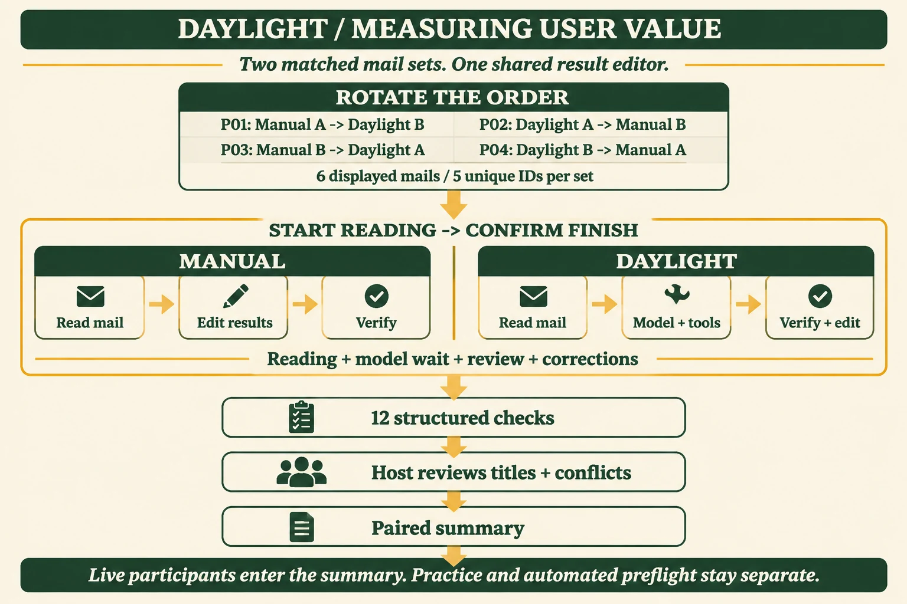
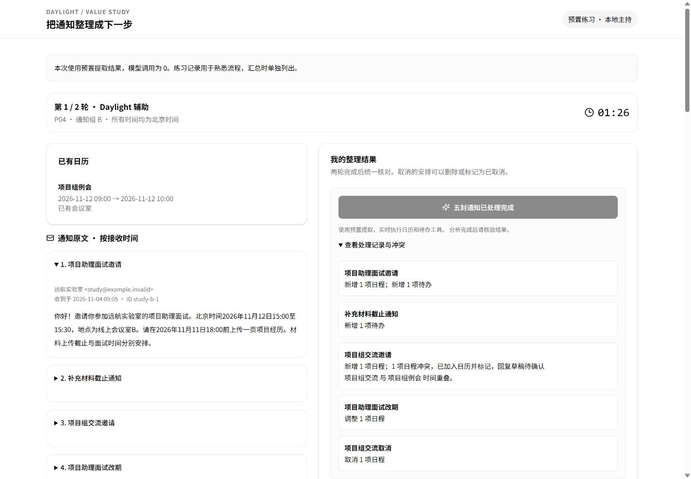
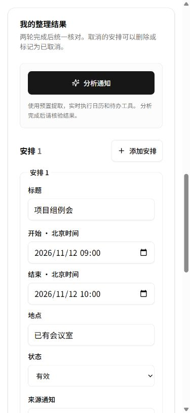
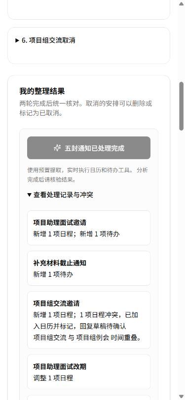

# 用户价值对照：从测量方案到可运行工具

2026 年 11 月 4 日 · 对应场景价值、Agent 链路、工程交付、成本与性能。

## 本轮目标

测量目标用户整理通知所用的完整时间和最终结果质量。两轮使用同一套阅读和编辑界面，人工轮自行整理，Daylight 轮调用现有邮件提取、日历与待办工具后核验。材料是两套原创通知，各展示六封，包含五个唯一邮件 ID；两套标题和正文合计 572 / 575 字。

[官网阅读](https://daylight.yunforis.com/competition/value-report.html) · [原始通知](evidence/study-inputs.json) · [自动预检摘要](evidence/summary.json) · [逐次调用CSV](evidence/calls.csv)。

## 优化前后

| 项目 | 优化前 | 本轮结果 |
| --- | --- | --- |
| 采集入口 | 文字方案与空白CSV表头 | 可运行的邮件阅读、结果编辑、计时、评分与JSON导出 |
| 对照材料 | A/B材料主题说明 | 两套固定原创通知，572/575字，均含邀请、独立材料截止、冲突、改期、重复与取消 |
| 顺序控制 | 由主持人手动安排 | 匿名编号轮换四种材料和工具顺序 |
| 时间口径 | 手动计时说明 | 服务端单调时钟，读取开始至本人确认完成 |
| 质量判断 | 人工统计遗漏、错时、重复 | 12项结构化检查，加标题和冲突人工复核 |
| 修正证据 | 手工填“修正次数” | 保存模型草稿、最终结果，以及增加/移除的条目数 |
| 模型与成本 | 待测量 | 10次真实调用，两套各12/12；usage与逐次延迟归档 |

本轮主要增强场景价值的采集方式，也为Agent链路质量、工程可复现和成本分析提供了固定输入。真人配对结果在采集后按相同方法追加。

## 对照流程图

[](assets/study-flow.png)

图由 **gpt-image-2.5** 通过 imagegen 自带CLI生成，1536×1024、high；英文标签经检查。[提示词](study-prompt.txt)与[文件摘要](image-generation.json)保留。网页采用130,170 bytes的WebP，点击查看PNG原图。

四种顺序轮换控制材料和工具的先后；人工与Daylight两条路径均包含阅读和核验，再进入同一评分与主持人复核流程。图底部按记录类型区分真人、练习和自动材料预检。

## 启动

3–5位参与者现场操作见[主持人操作包](facilitator-kit.md)：P01–P05顺序、统一说明、每人操作、两项人工复核和回传文件已经准备。运行`python scripts/build-value-study-kit.py`可生成本机HTML指引、启动器与现场备注表，输出到`output/participant-kit-20261104/`。

准备 Node.js ≥22.19、npm，安装依赖后在项目根目录执行：

```sh
npm run study -- --validate
npm run study -- --practice
```

打开 `http://127.0.0.1:3190`，按页面说明完成两轮。练习使用预置提取，调用模型为零。



截图为本地预置练习：左侧阅读通知，右侧显示处理记录与可编辑结果；两种条件共用编辑器。

真实模型由主持人在本机指定已有配置文件：

```sh
npm run study -- --live --settings <private-file> --max-calls 20
```

配置读取 `baseUrl`、`apiKey`、`model` 及 Token 单价；多用户设置可加 `--settings-user <id>`。结果保存在每次新建的 `work/value-study-*`。完成两轮或结束参与后可导出 JSON。Ctrl+C 保存中断状态并结束服务。

两套自动模型预检命令：

```sh
npm run study -- --live --settings <private-file> --max-calls 10 --preflight
node scripts/value-study-evidence.mjs --run-dir work/value-study-<run> --out work/value-study-<run>/evidence
```

第二条命令仅接受标为自动预检、真实模型且输入ID属于本套材料的记录。真人原始记录在主持人本地导出，公开报告使用经确认的匿名汇总。

## 对照方法

| 编号 | 第一轮 | 第二轮 |
| --- | --- | --- |
| P01 | 人工 A | Daylight B |
| P02 | Daylight A | 人工 B |
| P03 | 人工 B | Daylight A |
| P04 | Daylight B | 人工 A |

P05 起重复四种顺序。每轮点击开始后才显示通知；点击确认完成时停止计时。阅读、模型等待、核验、修正和求助都计入；两轮之间的休息不计入。两轮完成后展示评分，主持人导出也在两轮完成或结束参与后开放。

自动检查时间、地点、数量、旧时间释放与通知来源，共 12 项；标题含义和冲突识别由主持人结合原文复核。保存模型草稿与最终结果的条目差异，修改一个条目记为移除旧项、增加新项。练习、自查、中断记录均保留，在真人配对汇总中单列。

### 主持步骤

1. 招募3–5位经常处理校园申请或招聘通知的自愿参与者，使用P01起连续编号。项目成员自查选择对应用途。
2. 说明记录用途与随时结束的方式，先用预置练习熟悉按钮、来源选择及时间输入。
3. 新开真实模型场次，按编号依次完成。每位领取后只在“开始本轮”时看到输入；主持人在两轮间可安排休息。
4. 两轮均按本人判断结束，保留未填内容和错误；按实际情况填写求助次数、中断及体验反馈。
5. 两轮结束后，主持人结合原文复核标题含义，以及是否识别交流与已有例会的重叠。保留复核依据。
6. 导出原始JSON，汇报逐人耗时、配对差值、中位数、范围、检查结果、条目变化和具体反馈；中断记录保留在排除列表。

### 评分口径

| 类别 | 自动检查 |
| --- | --- |
| 当前面试 | 唯一起止、地点 |
| 日历状态 | 已有例会保留、旧面试释放、已取消交流释放、有效安排共2项 |
| 材料 | 两个独立截止、待办共2项 |
| 来源 | 当前面试及两项材料均可回查对应通知 |

标题相近、自由文本描述和冲突说明由主持人判断。自动检查与人工判断分别记录，便于查看时间正确而标题错误等情况。对照结果反映这一套共享编辑器中的处理方式；其他邮箱/日历软件的操作习惯可在访谈中补充。

## 技术选型与设计

独立 Vite 入口复用 shadcn 组件及项目主题；Express 只监听本机，模型设置只读白名单字段。生产 Agent 的 `extractEvents`、`processEmails` 和 Trace 在独立合成快照中运行，按邮件 ID 去重，保留改期关联、取消历史、冲突与通知来源。

服务器以单调时钟计时；每次草稿和结果通过临时文件、fsync、原子重命名保存后确认。单场同一时间一位参与者、一个分析；总模型额度显式指定，每封唯一通知每次分析最多调用一次，成功邮件在重试中跳过。写入失败停止本场并在页面呈现状态。Windows 使用 IPC 结束消息保存中断记录。

| 选型 | 设计原因与代价 |
| --- | --- |
| 独立本地入口 | 主持人管理模型额度及匿名记录；参与者在同一台主持设备完成，远程多人采集需另设主持和授权机制 |
| 复用现有Agent工具 | 预检能覆盖实际改期、取消、去重和Trace语义；每封仍按顺序调用，完整五封模型等待计入 |
| 两轮共用编辑器 | 减少表单和日历交互差异对结果的影响；结论范围对应本工具流程 |
| 单调时钟 | 计时不受系统时钟调整影响；刷新继续当前轮，进程退出保存为中断，新进程开启新场次 |
| JSON原子记录 | 便于现场运行和逐人审阅；每次保存同步落盘，吞吐取单主持场景所需范围 |
| 两轮后评分 | 减少第一轮答案对第二轮的提示；模型结果仍供本轮核验和编辑 |
| 原始usage与单价分离 | 可按供应商账单复算；价格快照和当前模型身份按配置值记录 |



手机提供“通知原文 / 整理结果”定位按钮，主操作48px，表单按单列排列；来源下拉使用与原文相同的通知序号。



手机截图为预置练习，用于核对交互和文字。模型自动预检的输入与输出保存在下面的原始证据中。

## 真实模型材料预检

源码 **`d895e674077b6d26b5642dbf38620bb126ca56a7`**，2026-11-04 02:52北京时间开始，Windows / Node v24.14.0；配置模型 `deepseek-v4.1-flash`，接口 `https://api.modelverse.cn`。两组各五次顺序调用，原邮件ID去重，未重试。

| 材料 | 结构化检查 | 成功处理 | 重复跳过 | 冲突 / 改期 / 取消 | 整组耗时 |
| --- | ---: | ---: | ---: | --- | ---: |
| A | 12/12 | 5封 | 1封 | 各1次 | 74.40秒 |
| B | 12/12 | 5封 | 1封 | 各1次 | 39.47秒 |

逐次模型调用p50 **9.2345秒**，p95 **32.503秒**（10次的最近秩p95取最慢一条）；两组输入共32,272、输出13,537 Token，缓存输入22,528。供应商usage中的全部输出Token纳入计价。

按[已保存的官方目录单价](../competition-2026-11-04/evidence/official-model-price.json)输入¥2、输出¥8／百万Token计算，缓存按普通输入价：

```text
(32,272 × 2 + 13,537 × 8) ÷ 1,000,000 = ¥0.172840
```

两组耗时差异和最慢调用表明，模型响应主导这条短通知链的等待。顺序处理保留前信日历与待办上下文；后续优化优先评测更紧凑的输出约束和受控模型配置，保持12项固定检查及变更历史。批量提取还需验证同一批中改期、取消和重复的先后语义。

当前真人配对数为 **0**，已完成工具、固定材料与真实模型预检；用户耗时从现场参与流程采集。

### 原始证据与复算

- [运行manifest与逐文件摘要](evidence/manifest.json)：运行时有新增截图等未提交文件，`sourceDirty:true`；运行文件字节摘要逐一保存。
- [两组完整原始结果和Trace](evidence/preflight.json)：原创合成输入、模型内容响应、usage、工具结果与历史。
- [机器可读摘要](evidence/summary.json) · [逐调用CSV](evidence/calls.csv) · [固定输入](evidence/study-inputs.json)。
- 费用统计脚本：`scripts/value-study-evidence.mjs`；取价、缓存按普通输入计价及原文件SHA关联均在摘要中记录。

本轮新增文本模型调用10次、图片调用1次、云采购0。文本累计42次，公开价估算¥0.406820；图片累计9次，图像及服务器费用按供应商账单登记。新增总预算继续为¥500。

## 工程与页面验证

- 最终定向 21 项通过，覆盖评分、UTC/北京时间、顺序、计时、额度预留、并发、失败重试、写入失败、跨来源写入、Windows 子进程结束及在途分析中断。[最终定向日志](evidence/targeted-tests.txt)随报告归档。
- 预置 A / B 两套均 12/12，改期、取消、重复、冲突及来源由现有工具执行。
- 页面已操作检查新增安排和待办、保存/刷新、两轮提交、主持人复核和 JSON 下载；日期字段秒/毫秒归一，输入事件和服务端格式核对。

- 全量 `npm test` 共1000项，971通过、29条件跳过、0失败，约63.56秒。[测试日志](evidence/tests.txt)随报告归档。
- [三尺寸布局记录](evidence/study-layout.json)：320/390/1440px，无表单超出视口，主操作均48px；较窄页面使用原文/结果定位。
- [公开资料三尺寸检查](evidence/publication-layout.json)：技术页与本报告共六项布局检查通过，四张内嵌图加载完成，方法入口高度44px，点击进入对应报告。
- 真实模型预检两套各12/12，逐邮件处理错误为0，详见上节。

全量1000项对应工具实现提交`d895e67`；随后补充在途分析中断处理，并完成上述最终21项定向检查。中断后已发出的调用返回时保留中断状态，进度、模型草稿与分析结果均先检查当前参与状态再写入。

### 日期输入的修复记录

页面操作中发现，原控件在浏览器写入日期后会清空；新增安排/待办的截止未保留。修复为统一处理不带秒、带秒、带毫秒三种原生输入，显式解释为UTC+08:00，并同时处理原生input事件；UTC模型结果按北京时间显示。修复后四个新增时间字段输入、保存、刷新与最终12项检查均通过。

### 发布

官网技术页提供方法和材料入口，图文、截图、原始合成预检与逐次CSV作为静态资料发布。本地主持工具通过源码命令运行，原始参与记录留在主持目录。当前发布为v12-r1，production候选29/29、正式HTTPS52项、关联资料56份摘要和8服务健康检查通过；[发布、自动回滚过程与正式手机截图](deployment-v12.md)保存版本、备份及实际核对结果。
