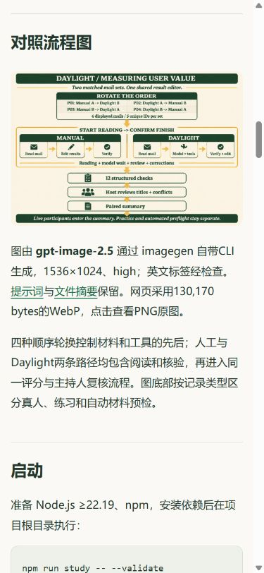

# 用户价值对照资料 v12 发布记录

2026 年 11 月 4 日，北京时间。[本轮图文方法](README.md) · [官网方法与真实模型预检](https://daylight.yunforis.com/competition/value-report.html) · [技术与实测](https://daylight.yunforis.com/evidence)。

## 发布结果

技术页新增用户价值对照入口，公开两套原创材料、主持步骤、计时与评分方法、电脑/手机截图，以及10次真实模型调用的Trace、用量和CSV。独立主持工具通过源码的`npm run study`运行。

| 项目 | 结果 |
| --- | --- |
| 当前镜像 | `daylight:public-competition-20261104-v12-r1` |
| 镜像ID | `sha256:2d12d546999aebcabef12606f3dbb2f10881505a2b939685d90447d8b9cade15` |
| 前端、资料与验证脚本源码 | `2e5a682dc988169f8eb1f2eb4f18085481c9f42c` |
| 后端业务基线 | `db3ee897a696bf5f70365f8c901237f020cf8691` |
| 基础镜像 | v11，`sha256:03f52e88c185088d6261753c0a25c9fca60d699b96fca8e9a3e19c6344632026` |
| 发布包 | 完整前端378文件与验证脚本1份，23,186,471 bytes |
| 包SHA-256 | `8ad195fd5cc4c2ac1351e787286c15edc492ac23bd375746da881d677165dba5` |
| 发布前备份 | `/opt/daylight-backups/before-value-study-20261104031242` |
| production候选 | 29/29通过，关闭网络运行 |
| 正式HTTPS综合检查 | 52项通过，含七步业务、匿名权限、静态证据及视频/PDF分段读取 |
| 关联资料 | 56份资源，HTTP、MIME和完整文件摘要一致 |
| 实际运行文件 | 三角色各396份逐文件核对，完整前端集合378份一致 |
| 服务 | 8个服务healthy，三个应用restart=0、OOM=false |

[发布清单](evidence/release-v12-manifest.json) · [包摘要](evidence/release-v12-archive.json) · [候选检查](evidence/candidate-production-tests-v12.txt) · [发布日志](evidence/deploy-v12.txt) · [公网52项](evidence/public-verification-v12.json) · [关联资料56项](evidence/static-verification-v12.json)。

## 前后变化

| 评审路径 | 发布前 | 发布后 |
| --- | --- | --- |
| 场景价值 | 文字方法与空白CSV | 共用编辑器、轮换顺序、持续计时、12项检查及主持复核 |
| 技术页 | 场景说明与七步入口 | 增加44px的“用户对照方法、工具与真实模型预检”站内入口 |
| 模型证据 | 15例固定邮件回归和8例RAG对照 | 追加两套通知10次真实模型预检、两套各12/12，以及逐次用量和耗时 |
| 图文资料 | 方法说明 | gpt-image-2.5英文流程图、中文设计逻辑、电脑与手机操作截图 |
| 发布验证 | v11的43项综合检查 | 本轮52项综合检查、56份关联资料及三角色文件摘要 |

真人配对记录当前为0。主持流程已包含阅读、模型等待、核验与修正时间，现场采集后按编号追加逐人结果。

## 发布顺序与回滚记录

1. 核对三个角色的v11镜像ID并持有发布锁；保存Compose配置、数据库custom dump、可读取的dump目录、旧前端和原镜像ID。
2. 按发布清单核对379份文件，以指定基础镜像ID构建候选；完整替换前端目录，同步revision和`DAYLIGHT_GIT_SHA`。
3. 在候选容器完成29项production检查，核对17页PDF摘要、方法图WebP文件头、预检10次与两套12/12，以及生产入口的路由装配。
4. 首个候选切换后，匿名`/api/study/config`返回401；脚本断言为404，校验失败，发布脚本自动恢复v11。恢复后重新核对三个角色均运行v11且healthy。
5. 将断言改为生产认证层的401响应，提交`2e5a682`，重新打包为v12-r1并重新完成候选29项、业务请求和三个角色健康检查。
6. 正式HTTPS完成52项综合检查及56份资料摘要；逐容器验证396份累计文件，前端完整集合为378份。
7. 从正式技术页点击方法入口，操作目录、查看原图、下载CSV；保存手机截图与下载文件摘要。

首个候选来源`6b6dde2`，备份目录`/opt/daylight-backups/before-value-study-20261104031004`。[候选清单](evidence/release-v12-candidate1-manifest.json)、[包摘要](evidence/release-v12-candidate1-archive.json)与[自动回滚日志](evidence/deploy-v12-candidate1.txt)保存这次执行过程。

## 正式页面检查

390×844手机尺寸下，技术页和方法报告的文档宽度均为375px；四张内嵌图加载完成。点击目录后，“对照流程图”定位至顶部20.16px；点击图片打开1536×1024的PNG原图。实际下载的CSV为780 bytes，与发布文件SHA-256一致。1440px桌面文档宽度为1425px，四张图均加载完成。

[技术页场景价值截图](assets/public-evidence-mobile.png) · [方法报告首屏](assets/public-value-mobile.png) · [浏览器、目录、原图与CSV记录](evidence/public-browser-verification-v12.json)。本地320/390/1440px六项报告与技术页布局记录在[公开资料布局](evidence/publication-layout.json)。

## 运行指标快照

2026-11-04 **03:14:11，北京时间**：

| 角色 | 已写样本 | 丢样 | 写入错误 | 核对文件 |
| --- | ---: | ---: | --- | ---: |
| API | 422 | 0 | 无 | 396 |
| Worker | 498 | 0 | 无 | 396 |
| Scheduler | 125 | 0 | 无 | 396 |

[运行镜像、完整文件清单与readiness](evidence/runtime-verification-v12.json)。本轮整体新增文本模型调用10次、图像调用1次、云采购0；本次服务器发布使用已有预检结果。
