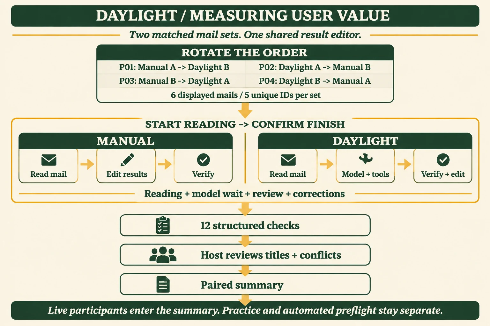

# 3–5 位真实用户对照：主持人操作包

准备日期：2026-11-04，北京时间。用户已确认可安排 3–5 位参与者。目标是记录同一参与者用人工整理和 Daylight 辅助处理通知的完整时间、最终质量及修正情况。

[现有方法与真实模型预检](README.md) · [流程图](assets/study-flow.webp) · [公网方法页](https://daylight.yunforis.com/competition/value-report.html)。本轮复用已核对的 gpt-image-2.5 英文流程图，新增图片调用 0。



## 1. 场次与顺序

优先完成 P01–P04，四种顺序各一位；可追加 P05。按到场顺序领取匿名编号，使用同一台主持电脑和浏览器。每位预留 12–15 分钟：统一说明约 1 分钟，两轮各 3–5 分钟，休息与反馈约 1 分钟，主持复核约 2 分钟。两轮由参与者自行确认完成，计时如实保留。

| 匿名编号 | 第一轮 | 第二轮 | 页面「记录用途」 |
| --- | --- | --- | --- |
| P01 | 人工 A | Daylight B | 目标用户参与 |
| P02 | Daylight A | 人工 B | 目标用户参与 |
| P03 | 人工 B | Daylight A | 目标用户参与 |
| P04 | Daylight B | 人工 A | 目标用户参与 |
| P05 | 人工 A | Daylight B | 目标用户参与 |

3 人时保留实际顺序；4 人覆盖完整轮换；5 人时第五位重复 P01 顺序。报告同时展示每位顺序、材料与结果。项目成员的自查选择「项目成员自查」，由工具在汇总中单列。

## 2. 主持人开始前

1. 主持人先运行预置练习检查按钮和导出，使用独立练习进程。参与者到场后从正式进程开始。
2. 正式场次前关闭 A/B 原文、答案和旧练习结果，只保留领取任务页面；参与者按统一说明了解操作，第一轮开始后才看到通知。
3. 固定电脑、浏览器、网络和模型配置；记录开始时间、Node 版本和运行目录，五位尽量在同一场次依次完成。
4. 预留一小时左右，备好电源；准备匿名编号卡、现场备注表和导出目录。

项目根目录命令：

```sh
# 主持人自行预演，模型调用 0
npm run study -- --practice

# 结束练习后，使用当前机器已有的顶层模型配置开启正式场次
npm run study -- --live --settings data/settings.json --max-calls 30
```

打开 `http://127.0.0.1:3190`。顶部显示「真实模型 · 本地主持」，终端显示本场 `work/value-study-*` 目录。保持终端运行，5 位在同一场进程内依次完成；每完成一位先导出，再点「下一位参与者」并改成下一个编号。

本机已准备双击启动文件，位于 `output/participant-kit-20261104/`；它们相对定位项目，读取已有配置，启动时不显示模型密钥。源码中的通用命令仍以上面三行为准。

## 3. 参与者统一说明

> 请阅读六封通知，把最终有效安排和两项材料截止整理到右侧，并选择来源通知。保留已有安排，处理改期、重复和取消，再写下你发现的时间冲突。每人两轮：人工轮自行填写，Daylight 轮点击分析后核验和修改。开始本轮就计时，阅读、模型等待、检查和修改都计入；由你判断完成。请只使用页面中的通知和工具。记录使用匿名编号，可随时结束。

领取任务前讲解三个操作：右侧「添加安排／待办」、时间输入为北京时间、「来源通知」选择对应邮件。模型草稿完成后仍需核验。参与者勾选自愿参与说明，再领取两轮任务。

## 4. 每位的实际操作

1. 确认匿名编号、用途和自愿参与；核对显示的第一轮与上表一致。
2. 点击「开始本轮」。人工轮阅读并填写；Daylight 轮点击「分析通知」，等待后核验。求助只讲解按钮和保存方式，每次记录一次，不提示正确日期和答案。
3. 参与者填写求助次数、容易程度及反馈，勾选「我已核验当前结果」，点击「完成本轮并保存」。等待回执再继续。
4. 第二轮按同样过程完成。两轮结束后，参与者可回答：哪个步骤最费时、哪条结果需要修正、日常会在哪种通知上使用。
5. 主持人逐轮打开「主持人复核」，核对冲突和标题，写下对应原文依据并保存。自动 12 项和人工两项分别记录。
6. 点击「主持人导出记录」，保存为 `P01-完成后.json` 等本地文件；点击「下一位参与者」，手动更新编号。第五位完成后再导出一次全场 JSON。

页面「完成本轮并保存」前的操作时间由服务端计量，模型等待和修正自然计入；两轮间休息不计入。刷新前保存草稿；出现网络、模型或设备问题时，在反馈和备注里写明，按现场实际继续或结束。

## 5. 主持人复核口径

自动检查固定 12 项：当前面试时间、地点、已有安排保留、旧时间释放、取消交流释放、有效安排数量、两个独立材料截止、待办数量，以及面试和两项材料的来源。

人工复核两项：

- **冲突判断：**是否识别交流曾与已有例会重叠，并正确理解交流后来取消。记录参与者自己的说明与原文依据。
- **标题含义：**安排、两项材料标题与通知一致；关注材料之间是否串项。时间正确但标题错误时，自动分和人工复核分别保留。

原始记录保存模型草稿、最终条目和逐条检查。修正统计使用条目差异：编辑一条记为移除旧条目、增加新条目；另行记录参与者反馈中的修改原因。

## 6. 成本与异常处理

每位 Daylight 轮有 5 封唯一通知，重复通知直接跳过。3/4/5 位正常分别 15/20/25 次调用，场次总上限 30 次。既有 10 次预检费用估算 ¥0.172840；按相同平均 Token 粗算，5 位正常约 ¥0.432100，30 次约 ¥0.518520，实际按本场 usage 复算。

| 现场情况 | 操作与记录 |
| --- | --- |
| 模型暂时失败 | 记录错误和等待，选择页面「重试未处理通知」；成功邮件复用已有状态 |
| 达到调用上限 | 保存当前结果，结束该次参与并导出；另开场次使用新目录继续剩余参与者 |
| 参与者想结束 | 点击「结束本次参与」，保留中断记录，导出后进入下一位 |
| 设备或网络中断 | 写明时间和影响；保留该次记录，继续时使用新编号，备注关联原编号 |
| 进程需要关闭 | 先导出已完成记录，再在终端按 Ctrl+C；原始 session 和汇总保留在本场目录 |

## 7. 现场记录与回传

现场备注只记匿名编号和操作问题：

| 编号 | 开始时间 | 两轮完成 | 两轮均复核 | 求助／中断／主要修改 | 导出文件 |
| --- | --- | --- | --- | --- | --- |
| P01 |  |  |  |  |  |
| P02 |  |  |  |  |  |
| P03 |  |  |  |  |  |
| P04 |  |  |  |  |  |
| P05 |  |  |  |  |  |

完成后回传**最终全场导出 JSON**和**本场 manifest.json**即可整理逐人配对表。文件位于终端显示的 `work/value-study-*`；保存名字与匿名编号的对应关系由主持人自行管理。

预先固定汇报形式：每位人工秒数、Daylight 秒数、差值（人工减 Daylight）、两轮自动得分、人工复核、模型草稿得分、最终条目变化、求助和原话反馈。汇总给出完成配对数、两轮均复核数、逐人配对差值中位数与范围，并并列实际中断与自查记录。慢于人工的结果同样进入逐人表。

汇报描述使用「本次 N 位目标用户在两套通知中的配对结果」，收益百分比按每位 `(人工秒数 − Daylight 秒数) ÷ 人工秒数` 计算后列明，再汇总配对百分比中位数。

## 方法参考

本操作包使用 scientific-critical-thinking 技能核对测量单位、顺序、评分与计时方法。参考资料作者与年份已从 arXiv 页面核对：Kassis, T., Agarwal, V., He, Y., Patel, D., & Brueckner, A. M. (2026). *Scientific Agent Skills: A Library of Procedural Knowledge for Research Agents*. [doi:10.48550/arXiv.2609.00065](https://doi.org/10.48550/arXiv.2609.00065)。
