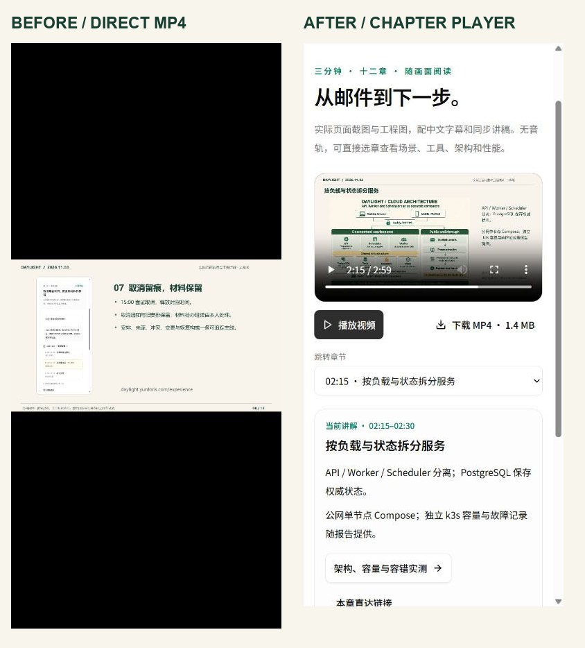
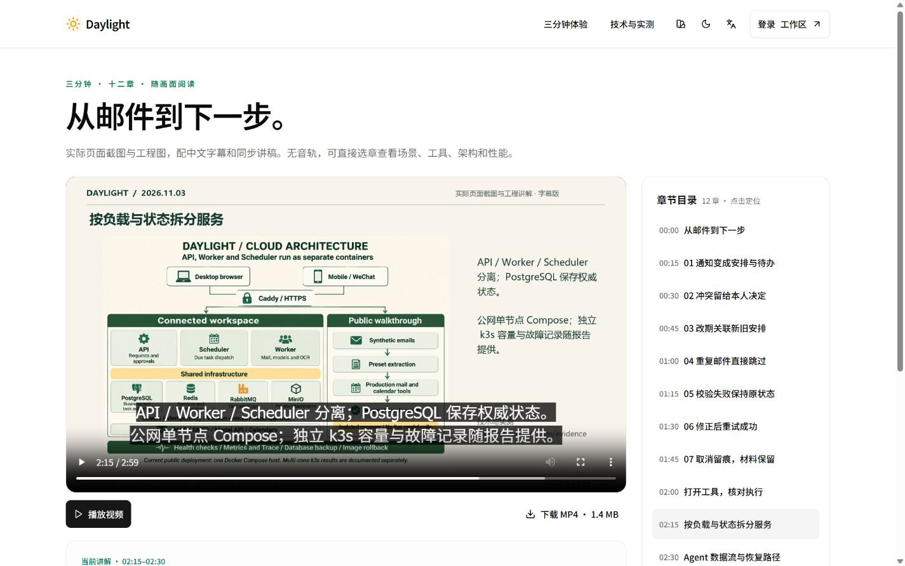
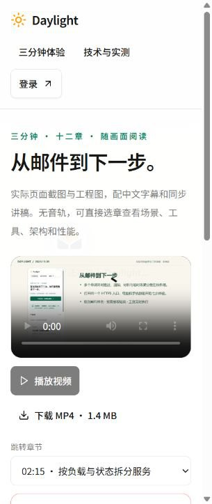
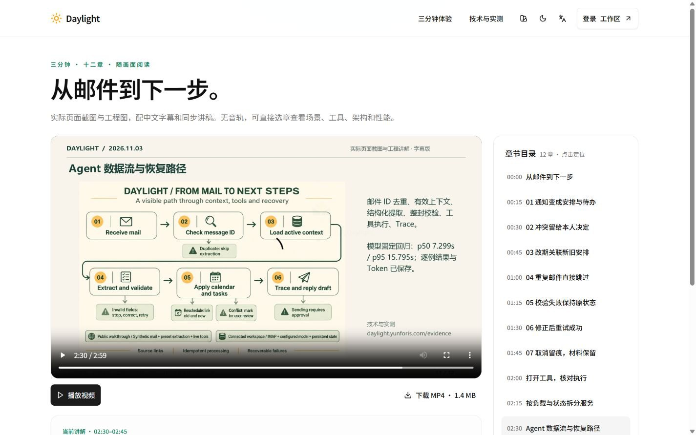

# 分章视频与手机讲稿优化

2026 年 11 月 4 日，北京时间。[分章播放器](https://daylight.yunforis.com/demo) · [十二章完整讲稿](transcript.md) · [技术与实测](https://daylight.yunforis.com/evidence)。

**v14已发布：**候选production29/29、正式HTTPS66项、116份关联资料与三角色各470份运行文件核对通过；完整前端445份。正式390/320/1440px页面、选章播放与MP4浏览器下载通过，8服务healthy。[发布过程、运行指标与正式手机截图](deployment-v14.md)。

## 目标与改前观察

评委观看三分钟演示时，需要快速找到场景结果、Agent 工具、架构与性能。原技术页直接链接 MP4，手机浏览器会进入原生视频页面：390px 竖屏里横向画面较小，图内讲解文字随画面缩小；查看相关技术证据需要再返回技术页。

本轮增加 `/demo` 分章页面。视频与当前讲稿一起呈现，十二章支持一键定位；每章提供对应的业务或实测资料。手机用原生章节选择器，桌面用右侧完整目录。

## 前后对照



| 观察项 | 优化前 | 优化后 |
| --- | --- | --- |
| 技术页视频入口 | 直接打开 MP4 | 进入站内分章播放器 |
| 手机阅读 | 随视频缩小的画内文字 | 视频下方 14px 正文、28px 行高的同步讲稿 |
| 定位内容 | 拖动原生时间进度条 | 12 章按时间命名，手机选择器、桌面目录 |
| 选章后的播放意图 | 原生拖动进度 | 保持原有播放或暂停状态 |
| 分享具体内容 | 整个 MP4 地址 | `/demo?chapter=architecture` 等固定章节链接 |
| 查证 | 返回技术页查找 | 当前章节直接连接来源与实测报告 |
| 资源异常 | 原生媒体错误 | 明确提示、重试加载、完整讲稿和下载入口 |
| 字幕与讲稿 | 烧录中文字幕 | 保留画内字幕，增加 WebVTT、完整文字稿与同步正文 |
| 媒体体积 | MP4 1,431,534 bytes | 同一 MP4；新增海报 61,383 bytes |

这些变化改善观看、阅读与查证路径。功能操作和尺寸数据随下文归档。

## 技术选型与设计逻辑

### 原生视频与响应式页面

使用浏览器原生 `<video controls playsInline preload="metadata">`，页面通过 React 懒加载。原生播放器提供进度、全屏、字幕和平台播放能力；`playsInline` 提供页面内播放提示，文字仍可在播放器下阅读。桌面保留右侧章节目录，手机使用 44px 原生选择器，便于在小屏快速定位。

播放由用户点击启动，章节选择修改 `currentTime`，沿用已有播放状态。页面从媒体的 `play`、`pause`、`timeupdate`、`ended` 事件更新界面，讲稿按当前实际播放时间切换。自定义按钮采用现有 shadcn Button，保持站点主题和键盘焦点样式。

### 同一时间轴生成所有资料

原始 [视频 manifest](../competition-2026-11-03/evidence/video-manifest.json) 保存十二幅画面的标题、15 秒时长与中文讲解。`npm run demo:assets` 从这份记录生成：

- React 与公开下载共用的 [章节 JSON](../../public/competition/demo-chapters.json)。
- [中文字幕 WebVTT](../../public/competition/demo-zh.vtt) 与 [原生章节 WebVTT](../../public/competition/demo-chapters.vtt)。
- [完整 Markdown 讲稿](transcript.md)、[纯文字下载](../../public/competition/demo-transcript.txt)与响应式 HTML。
- 1200×675 JPEG 海报，以及 [媒体字节、摘要和 MP4 结构记录](evidence/media-inventory.json)。

章节时间区间采用 `[start, end)`，最后一个编码帧归最后一章。共享链接按固定 ID 查找章节，未知 ID 从首章开始。元数据尚未加载时保存待定位时间，收到 `loadedmetadata` 后完成跳转。刷新和浏览器返回都会恢复链接中的章节。

字幕默认关闭，画内已有烧录中文字幕；提供原生章节轨，页面讲稿独立呈现。原生字幕实测发现，暂停在章节交界会叠加相邻两段；现将每段字幕结束时间提前1毫秒，消除交界重叠。讲稿与字幕文本逐条对照原始manifest，验证同时覆盖每段字幕的时间边界。



[修正前相邻两段叠加的实际画面](assets/native-subtitles.jpg)。实际浏览器中通过原生菜单选择“中文讲解”，在135秒暂停位置对照，结果与字幕文件的1毫秒间隔一致。

### 加载失败与恢复

媒体错误后保留当前章节和讲稿，展示重试按钮。重试调用原生 `load()`，元数据加载后恢复当前章起点；继续播放由用户启动。下载 MP4 和完整文字稿入口持续可见。

在本地受控代理中对视频返回 503，浏览器实际显示错误、禁用播放按钮并保留架构讲稿；恢复视频资源后点击重试，重新加载到 **135 秒**，保持暂停状态。



## 电脑与手机结果



| 尺寸 | 页面内容宽度 | 整页横向溢出 | 可见主要控件高度 |
| --- | ---: | ---: | --- |
| 1440×900 | 1425px | 0px | 播放、下载和证据入口 44px，章节按钮 48px |
| 390×844 | 375px | 0px | 播放、下载、选择器与证据入口 44px |
| 320×760 | 305px | 0px | 播放、下载、选择器与证据入口 44px |

内容宽度按浏览器 `documentElement.clientWidth` 记录，含浏览器纵向滚动条所占宽度的差值。

浏览器操作覆盖播放与暂停、播放中选择架构章、暂停中选择性能章、章节链接刷新、浏览器返回、桌面直接进入数据流章，以及视频 503 后恢复。播放中跳转后实际时间为 135.2006 秒且继续播放；刷新恢复到 135 秒并保持暂停。每个操作记录实际媒体时间、讲稿标题与可见控件尺寸。

[本地浏览器原始记录](evidence/browser-verification.json) · [320px 页面截图](assets/after-320.jpg) · [7项时间轴与媒体验证](evidence/unit-tests.txt)。

## 媒体与资源测量

| 项目 | 实际值 |
| --- | --- |
| MP4 | 1920×1080，1,431,534 bytes |
| 原始时间轴 | 180 秒，12 章，每章 15 秒 |
| MP4 movie header 时长 | 179.917 秒；浏览器报告 179.916667 秒 |
| 时长差 | 0.083 秒，约 1 个 12fps 帧 |
| 快速起播 | `moov` 从第 32 byte 开始，位于 `mdat` 之前 |
| JPEG 海报 | 1200×675，61,383 bytes |
| MP4 SHA-256 | `a1fd4dfbf4130a9ab83d5163bed71c4fc570d9870e34825cce0d800aca068a13` |

保留现有 H.264 视频及 fast-start 结构，观看页只增加轻量章节、字幕、海报与讲稿。主入口按 metadata 预加载，浏览器根据自身媒体策略请求视频；实际流量与起播时间可从部署后的请求记录核对。

本轮文字模型、图片生成、SMTP 与新增云采购均为 **0**。截图来自实际页面；沿用现有工程图。文本模型累计 42 次、公开价估算 ¥0.406820，图片累计 10 次，预算上限继续为 ¥500。

## 复现与验证

```sh
npm run demo:assets
python scripts/competition-public-report.py --only demo-transcript.html --only video-report.html --only reply-release-v13.html --only reproduce.html
node --test server/demo-video.test.js
npm run build
npm run demo -- --no-build --port 3194
```

打开 `/demo` 或 `/demo?chapter=architecture`。7 项定向验证覆盖连续时间轴、边界与最后一帧、章节参数、打包与公开数据一致、VTT、实际 MP4 摘要与 fast-start，以及讲稿内容。视频、海报、字幕、JSON 与报告由 HTTPS 复查脚本核对 MIME、Range 和逐文件摘要。

实现入口：`src/pages/demo-page.jsx`、`shared/demo-video.js`、`scripts/competition-video-assets.mjs`。页面从技术页视频卡、体验页次要链接和公开页页脚进入。
