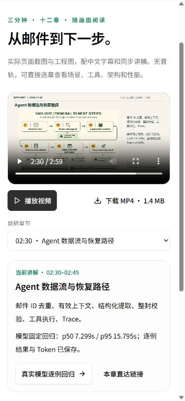

# 分章视频与同步讲稿 v14 发布记录

2026 年 11 月 4 日，北京时间。[正式分章播放器](https://daylight.yunforis.com/demo) · [图文设计与前后对照](README.md) · [官网报告](https://daylight.yunforis.com/competition/video-report.html)。

## 发布结果

技术页视频卡、体验页次要入口与公开页页脚已接入分章播放器。十二章分别连接场景结果、工具与回复、云原生架构、Agent 回归和性能实测；手机可阅读随播放更新的中文讲稿。

| 项目 | 实际结果 |
| --- | --- |
| 当前镜像 | `daylight:public-competition-20261104-v14` |
| 镜像 ID | `sha256:9d634d54c28c105207d1ca9af368b23c4c44aa50f7bb7005e0d596c94e6fcbdf` |
| 本轮前端、公开资料与验证脚本源码 | `154936206ed85098a28ebc756344bc6b438fe8be` |
| 基础镜像 | v13，`sha256:369fe6cdf3a537df7eae07759272fb6434df218214c4ff9afd5e23c9dbf5c222` |
| 后端继承 | v13 应用 `9354287`，此前基础 `db3ee89` |
| 发布包 | 446 份文件：完整前端445份、验证脚本1份 |
| 发布包体积 | 25,792,487 bytes |
| 发布包 SHA-256 | `d2ec2f0c23bc9b320b5abe707a8b5c8ab089effae0071741b5f14ddf5b3d381f` |
| 发布前备份 | `/opt/daylight-backups/before-chapter-video-20261104040719` |
| 本地时间轴与媒体检查 | 7/7 |
| 候选 production 运行与观测 | 29/29 |
| 候选媒体 | 12章、33条讲解文本、12条字幕与12条章节cue核对通过 |
| 正式 HTTPS 综合检查 | 66项，通过 |
| 关联资料 | 116份，HTTP、MIME与完整SHA-256一致 |
| 容器逐文件核对 | 三角色各470份摘要、完整前端445份文件集合一致 |
| 服务状态 | 8个healthy；应用restart=0、OOM=false |

[发布清单](evidence/release-v14-manifest.json) · [包摘要](evidence/release-v14-archive.json) · [候选运行检查](evidence/candidate-production-tests-v14.txt) · [候选媒体检查](evidence/candidate-media-checks-v14.json) · [部署日志](evidence/deploy-v14.txt)。

## 发布过程与恢复设计

1. 取得服务器发布锁，逐角色核对v13镜像名称与完整ID。
2. 保存数据库custom dump及可读取的目录、Compose配置、原镜像和旧前端。
3. 核对446份文件摘要与445份完整前端集合，按v13精确镜像ID构建v14。
4. 候选容器以production运行29项检查；关闭外网核对媒体摘要、VTT、33条讲解与页面资源。
5. 更新三个应用角色的镜像与前端提交标识，等待健康后检查七步业务、匿名401、字幕MIME和MP4 Range。
6. 核对三角色的指标写入、丢样与错误，再同步宿主机参考前端和验证脚本。
7. 通过正式HTTPS复查站内页面、报告与资源，从实际浏览器验证手机选章和桌面下载。

发布脚本保存原镜像与配置恢复流程。此次切换各项检查直接通过，数据库备份保存在上述服务器路径。

## 正式浏览器结果

| 检查 | 实际结果 |
| --- | --- |
| 390×844 进入架构链接 | 定位135秒，手机讲稿14px、行高28px |
| 播放中选择数据流章 | 实际150.1998秒，继续播放，讲稿与证据链接同步更新 |
| 点击暂停 | 实际150.248秒，暂停按钮变为播放按钮 |
| 390px / 320px | 内容宽375px / 305px，整页横向溢出0 |
| 主要手机控件 | 播放、下载、章节选择器、证据和讲稿入口均44px |
| 320px完整讲稿 | 12个章节标题、12个视频定位链接，整页横向溢出0 |
| 1440×900技术页入口 | 点击“观看三分钟分章讲解”进入`/demo`；完整目录每项48px |
| 1440px讲稿 | 正文16px、行高28px，整页横向溢出0 |
| 浏览器下载 | 成功保存1,431,534 bytes MP4，SHA-256与发布文件一致 |

[正式浏览器记录](evidence/public-browser-verification-v14.json) · [浏览器下载摘要](evidence/browser-download-v14.json)。

## 运行观测

2026-11-04 **04:09:24，北京时间**，实际运行快照：

| 角色 | 已写样本 | 丢样 | 写入错误 | 逐文件核对 |
| --- | ---: | ---: | --- | ---: |
| API | 389 | 0 | 无 | 470 |
| Worker | 705 | 0 | 无 | 470 |
| Scheduler | 149 | 0 | 无 | 470 |

[运行镜像、文件摘要、readiness与服务状态](evidence/runtime-verification-v14.json) · [正式HTTPS66项](evidence/public-verification-v14.json) · [关联资料完整摘要](evidence/static-verification-v14.json)。

本轮新增文字模型调用0、图片生成0、真实SMTP调用0、云采购0。复用现有MP4、工程图与服务器；文本累计42次，公开价估算¥0.406820；图片累计10次，继续按供应商账单登记。
