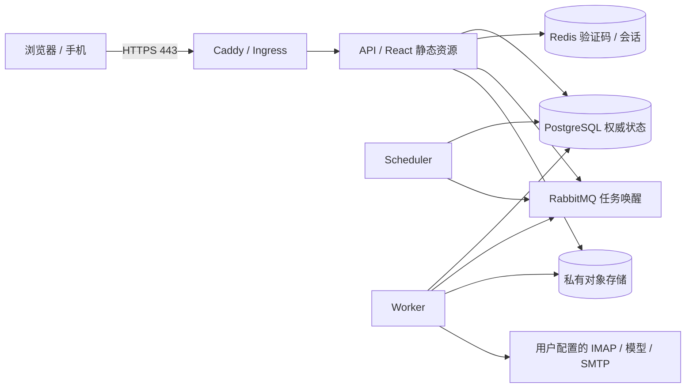

# Daylight 完整云端部署方案

版本日期：2026-10-28（北京时间）。目标是把当前 Web / API / Worker / Scheduler 部署为可持续运行、可更新和可恢复的系统。本方案不购买资源，不预设已有域名或云端验收结果。实现与本轮验证分级见 [验证记录](verification.md)。

## 1. 部署选择与资源

先以单节点 Compose 完成受控试运行；有明确跨节点可用性和扩容需求后，再使用 Kubernetes。两条路径使用相同应用镜像和共享状态协议。

| 项目 | 首次试运行建议 | 扩展部署 |
| --- | --- | --- |
| 计算 | UCloud UHost，Ubuntu 24.04 LTS，4 vCPU / 8 GiB 起步 | UK8S 或自管 Kubernetes，至少 3 个故障域节点；按实测调整节点规格 |
| 磁盘 | 系统盘及持久数据合计至少 80 GiB；开机自动挂载，监控剩余空间 | 业务状态使用独立数据库及对象存储，应用 Pod 无本地权威数据 |
| 数据库 | PostgreSQL 17，Compose 命名卷 | 有验证过的备份/PITR 与故障切换的 PostgreSQL 服务；托管引擎/地域以控制台实际可售为准 |
| 缓存 | Redis 7，持久化、独立密码 | 私网高可用 Redis；验证码和会话不可退回进程内存 |
| 通知队列 | RabbitMQ 4，独立密码 | 受控 RabbitMQ 服务/集群；当前 AMQP 适配不能直接换成 UKafka 或 RocketMQ |
| 附件 | 私有 MinIO 桶及持久卷 | 私有 S3 兼容对象存储或已有 US3 适配，验证实际 endpoint、鉴权、对象 ACL 与下载行为 |
| 公网 | 固定 EIP、自有域名、Caddy 自动 HTTPS | 负载均衡 / Ingress / TLS，固定域名与受信代理范围 |
| 备份 | 与计算实例不同故障域的私有备份存储 | 数据库 PITR、对象版本/生命周期、异地恢复演练 |

以上规格是采购起点，不是测得的容量承诺。OCR、PDF 和模型延迟会改变 Worker 内存和并发需求。iOS/Desktop 的安装包由独立工程构建，本方案交付可直接访问的 Web。

## 2. 拓扑、状态与网络



- 日历、邮件、工作台、招聘、校园资料、配置和任务使用共享 PostgreSQL；附件进入私有对象存储。生产依赖故障要失败或保持可恢复状态，不写入某个副本的旧 JSON。
- RabbitMQ 发送任务唤醒，持久任务及租约在 PostgreSQL。重启、重复投递和超时按任务仓储处理。同邮箱顺序执行；增加 Worker 主要提升不同邮箱的并行能力。
- SMTP、外部日历和会议属于外部副作用。人工确认和未知投递状态必须保留；超时后先检查结果，不能盲目重发。
- 公网入站仅 **80/443**；SSH **22** 仅管理地址。3000/3001、PostgreSQL、Redis、RabbitMQ 与对象控制台不向公网开放。Compose 依赖映射仅回环。
- 出站需要 DNS、镜像仓库、HTTPS 模型/对象/证书端点，以及实际邮箱 IMAP/SMTP 端口。学校网页采集依赖用户已登录浏览器，不能假定云服务器拥有本机学校 Cookie。
- 单节点公开覆盖文件使用独立入口网段与 Caddy 固定 IP，API 仅信任该 `/32`。Kubernetes 在确认实际 Ingress 来源网段后配置 `DAYLIGHT_TRUST_PROXY`，不要直接信任任意转发头。

## 3. 发布前在开发机完成

```sh
npm ci
npm run verify
npm run release:bundle
```

保留 `output/delivery/*.tar.gz`、对应 `.sha256` 和包内 `DELIVERY-MANIFEST.json`。记录工作区修改与源码摘要，不把 dirty 版本写成已打 Tag。首次交付可直接使用当前包，无需假定某个远程分支已有本轮修改。

容器路径：

```sh
npm run evidence:sync -- --check
npm run deploy:check
docker build -t your-registry/daylight:release-id .
docker push your-registry/daylight:release-id
docker image inspect your-registry/daylight:release-id --format '{{json .RepoDigests}}'
```

前端公开统计使用`src/data/competition-evidence.json`，由5份公开源JSON同步并受版本管理。修改源证据后执行`npm run evidence:sync`，再验证快照与来源一致。Vite检查实际解析导入文件，避免引入Docker未复制的目录。[本轮实际构建、真实依赖、前后对照与原始输出](../competition-container-2026-11-04/README.md)。

使用目标 CPU 架构构建；跨平台构建需配置对应 buildx builder。镜像不包含用户 `data/`、`.env`、报告和本地工作材料。`NODE_IMAGE` 可选择同版本 Node 官方仓库镜像；`DEBIAN_MIRROR` 只影响 apt，不解决 Docker Hub 或 npm registry 不可达；先验证三类网络。本轮默认 Debian 源构建成功，阿里镜像的字体包曾下载失败，按部署地点选择可用源。把完成验证的镜像 digest 记入发布单。

### 镜像来源与预载

首次部署前在目标网络预取全部镜像，不能假定 Docker Hub 一定可达。环境文件可配置 `NODE_IMAGE`、`DAYLIGHT_POSTGRES_IMAGE`、`DAYLIGHT_MINIO_IMAGE`，分别指向经过版本、架构和来源核验的仓库副本或 digest。本轮应用基础镜像来自官方 `public.ecr.aws/docker/library/node:22.23.3-bookworm-slim`；PostgreSQL 17.6 也从该官方镜像仓库拉取。

默认 MinIO 版本在本轮网络无法拉取，本地集成改用预先缓存的 `RELEASE.2025-04-22T22-12-26Z`，记录见验证文档；该本机依赖镜像不随交付包分发。目标环境应准备有可信来源、固定版本的 MinIO 镜像，或按 Kubernetes 路径接入已验证的私有 S3 / US3。镜像不可获得时，停止发布并保留错误。不要随意替换数据库主版本、使用未知第三方镜像或关闭 TLS 校验。

桶初始化复用 Daylight 镜像中的 `scripts/bootstrap-bucket.mjs`，不再需要额外的 `minio/mc` 镜像。它仅在桶不存在时创建，并删除匿名桶策略，保留原有对象。已有受控桶若使用供应商专有策略，应先核验初始化权限及策略管理方式。

## 4. 首次单节点 HTTPS 部署

### 4.1 主机和域名

1. 在 UCloud 创建所选 UHost/EIP，设置安全组并安装 Docker Engine、Compose **≥2.24.4**、Git、openssl、curl、tar、sha256sum。Docker 需要使用 Linux 容器。
2. 持久盘开机挂载后规划 Docker 数据目录；不要把已有数据卷直接移动到未经核对的路径。
3. 设置域名 A 记录到 EIP；没有可用 IPv6 就不要发布 AAAA。中国大陆对外域名访问按实际服务与接入要求办理备案。
4. 上传交付包与校验文件至服务器，校验后解压到一个新目录，例如 `/opt/daylight/releases/release-id`。不要覆盖用户原 `data/`。

```sh
sha256sum --check daylight-demo-RELEASE.tar.gz.sha256
mkdir -p /opt/daylight/releases/release-id /opt/daylight/config /opt/daylight/backups
tar -xzf daylight-demo-RELEASE.tar.gz -C /opt/daylight/releases/release-id
cd /opt/daylight/releases/release-id
```

### 4.2 生成配置并检查

用真实域名和管理员邮箱替换下面两个值。环境文件包含随机独立密码，只保存到受控路径，权限为 600；公开配置另存到 `.public`。脚本不会执行环境文件中的 shell 代码。

```sh
DAYLIGHT_ENV_FILE=/opt/daylight/config/compose.env \
DAYLIGHT_PROJECT=daylight \
sh deploy/public/up.sh --domain daylight.your-domain.cn --email admin@your-domain.cn --check
```

上面的域名是说明占位，脚本会拒绝占位值。已有配置会被保留，不会自动轮换服务密码。若没有域名而只做受控服务器内验证，可先运行 `sh deploy/up.sh`，用 SSH 隧道访问回环 3000。

如果主机有 Node ≥22.19，可额外运行字段预检（不调用真实服务）：

```sh
node scripts/deploy-check.mjs --compose-env /opt/daylight/config/compose.env \
  --public-env /opt/daylight/config/compose.env.public --docker
```

检查 administrator 邮箱、密码强度和独立性；根据需要设置系统 SMTP。Node 仅为此宿主机预检的可选条件，Compose 启动本身不要求宿主机安装 Node。

### 4.3 启动和健康

```sh
DAYLIGHT_ENV_FILE=/opt/daylight/config/compose.env DAYLIGHT_PROJECT=daylight \
sh deploy/public/up.sh --domain ACTUAL-DOMAIN --email ACTUAL-ADMIN-EMAIL

DAYLIGHT_ENV_FILE=/opt/daylight/config/compose.env DAYLIGHT_PROJECT=daylight sh deploy/stack.sh ps -a
curl --fail https://ACTUAL-DOMAIN/health/live
curl --fail https://ACTUAL-DOMAIN/health/ready
```

数据库与对象存储健康后，分别执行 schema 迁移和私有桶初始化，应用角色等待两者完成。预期 API / Worker / Scheduler / PostgreSQL / Redis / RabbitMQ / MinIO / Caddy healthy，迁移与桶初始化退出 0。首次构建可能因镜像或 npm/apt 网络失败；保留错误并重试，不能把半启动当成功。

若使用发布流水线已构建的不可变镜像，在环境文件中设置 `DAYLIGHT_IMAGE=实际仓库@sha256:实际摘要`，先完成 4.2 的 `--check`，然后使用下面的方式拉取并启动。`public/up.sh` 默认从源码构建，发布已有镜像时使用 `stack.sh`：

```sh
DAYLIGHT_ENV_FILE=/opt/daylight/config/compose.env DAYLIGHT_PROJECT=daylight sh deploy/stack.sh config --images
DAYLIGHT_ENV_FILE=/opt/daylight/config/compose.env DAYLIGHT_PROJECT=daylight sh deploy/stack.sh pull
DAYLIGHT_ENV_FILE=/opt/daylight/config/compose.env DAYLIGHT_PROJECT=daylight \
sh deploy/stack.sh up -d --wait --wait-timeout 600 --no-build
```

完全离线的服务器须事先通过可信流程导入上述全部依赖镜像（含 Caddy）并核对 digest，再加 `--pull never` 启动。`DAYLIGHT_COMPOSE_OVERRIDE=/受控路径/overlay.yml` 可为 `stack.sh`、备份与恢复选择同一附加覆盖文件；覆盖会改变部署，先用 `config --quiet` 核验，并将文件与环境版本一同保留。

### 4.4 创建管理员和配置真实业务

```sh
DAYLIGHT_ENV_FILE=/opt/daylight/config/compose.env DAYLIGHT_PROJECT=daylight \
sh deploy/stack.sh exec api sh -ec '
  printf "Administrator email: "; IFS= read -r DAYLIGHT_ADMIN_EMAIL
  printf "Administrator username: "; IFS= read -r DAYLIGHT_ADMIN_USERNAME
  trap "stty echo 2>/dev/null || true" EXIT
  printf "Administrator password (at least 8 characters): "; stty -echo
  IFS= read -r DAYLIGHT_ADMIN_PASSWORD
  stty echo; printf "\n"
  export DAYLIGHT_ADMIN_EMAIL DAYLIGHT_ADMIN_USERNAME DAYLIGHT_ADMIN_PASSWORD
  node scripts/bootstrap-admin.js
'
```

交互输入邮箱、用户名和至少 8 位的独立管理员口令；需要有 TTY 的终端，不要把真实口令写进 shell 历史。进入 `/admin/login` 登录。没有默认生产账号。重复引导同邮箱会更新口令和角色，首次安装只创建一次。系统 SMTP 未配置时，管理员可以维护系统，游客可看 `/campus`；普通用户邮箱验证码注册和找回密码需 SMTP 真实投递。

在设置中绑定受控工作邮箱与模型，模型需支持 OpenAI 兼容 Chat Completions 和 JSON 对象输出。QQ 使用 `imap.qq.com:993` TLS 和 IMAP 授权码。模型密钥保存在用户配置中，不能进示例、公开日志或交付包。先测试读连接，再经用户授权运行真实通知→提取→日历/待办→人工确认闭环。真实发信及付费调用单独记录授权和结果。

校园公共目录初始为示意；先导入经授权、现场核对的实际地图/活动/菜单，再按真实用途对外发布。正式二维码使用 `scripts/public-qr.mjs`，并用手机移动网络验收；具体参数见 [公开访问方案](../public-access.md)。

## 5. 已有数据迁移

- 演示 `work/demo-*` 不迁移为生产数据。已有真实 `data/` 先备份并保存原件，只在维护窗口停止旧实例写入后迁移。
- 现有迁移入口为 `scripts/migrate-production-data.mjs`；先阅读其 `--help` 与 [Windows 生产说明](../windows-production.md)，确认所有权、邮箱 ID、日历、附件与账户范围。
- 在独立库/桶执行计划和验证，核对用户、邮件、日程、待办、候选人、附件哈希、工作台、校园文档和任务状态；保留 schema / 数据版本与迁移日志。
- 切流前完成账号隔离和旧数据兼容检查；不以“设置已保存”作为邮箱/模型或对象存储实连证据。

## 6. 备份、恢复与回滚

### 6.1 单节点一致性备份

```sh
DAYLIGHT_ENV_FILE=/opt/daylight/config/compose.env DAYLIGHT_PROJECT=daylight \
sh deploy/backup.sh /opt/daylight/backups
```

脚本先检查 Compose `up` 所需选项，再暂停原本运行的 API / Worker / Scheduler。只读程序记录数据库各行与对象完整 SHA-256；随后停止 MinIO，导出 PostgreSQL custom dump 并复制冷卷。v2 备份为五份负载文件计算 SHA-256，写入完成标记，然后使用 `up --no-deps --no-recreate --wait` 等待原服务恢复。完成标记表示负载生成完成，命令退出码同时反映服务恢复结果。此流程使用维护窗口。停止 MinIO 后，数据库引用与对象内容在复制期间保持一致。[公网实际数据、兼容修复与恢复耗时](../competition-recovery-2026-11-04/README.md)。

备份包含私人邮件、用户配置及对象，需加密并复制到异地私有存储。JWT、服务环境文件及 Caddy 证书账户数据另行受控备份；本脚本不把这些运行时密钥写入包。Redis 和 RabbitMQ 不作为权威业务备份；恢复后重新登录，任务由 PostgreSQL 恢复。按部署频率配置主机定时器，并设置备份过期和失败告警。

### 6.2 在新项目恢复并验证

准备**独立恢复环境文件**，使用不同端口，保持备份时相同 MinIO 镜像和兼容 PostgreSQL 主版本。单节点也不能同时绑定同一组回环端口；恢复环境不启用原正式域名的 `.public`。

```sh
DAYLIGHT_ENV_FILE=/opt/daylight/config/restore.env DAYLIGHT_PROJECT=daylight-restore-check \
sh deploy/restore.sh /opt/daylight/backups/ACTUAL-BACKUP-DIRECTORY
```

脚本先验证校验和并检查目标项目为空，在新卷中恢复 PostgreSQL / MinIO。v2 逐行核对数据库，完整读取每个对象并验证集合、字节数及 SHA-256。默认停留在数据恢复阶段；API、Worker、Scheduler 保持停止。恢复失败时保留新项目及输出，便于复核。

完成数据与运行配置复核后，以同一恢复环境启动业务：

```sh
DAYLIGHT_ENV_FILE=/opt/daylight/config/restore.env DAYLIGHT_PROJECT=daylight-restore-check \
sh deploy/stack.sh up -d --wait
```

需要一次执行恢复、校验与业务启动时，使用 `sh deploy/restore.sh --activate BACKUP_DIR`。新业务进程会读取恢复的邮箱、模型设置和任务状态，按恢复环境的网络与配置运行。生产流量切换在部署入口单独执行。

2026-11-04 公网 v17 快照的独立新卷恢复：9 表 / 9,269 行、1 序列、187 附件 / 199,654,466 bytes 全部一致，数据导入与校验 48.0 秒；Windows 异机 AES-256-GCM 副本及 DPAPI 密钥回读校验已完成。[实测及原始输出](../competition-recovery-2026-11-04/README.md)。备份周期、业务恢复和流量切换按运营目标继续登记。

托管数据库与对象存储使用对应服务快照/PITR/版本控制，不能用这个 MinIO 冷卷脚本替代供应商恢复流程。

### 6.3 更新和回滚

1. 保存旧镜像 digest、环境版本、源码摘要和备份；用数据库克隆预演 schema 迁移，确认旧镜像仍兼容。
2. 新镜像先在隔离环境跑回归、实连与核心端到端；固定 digest。
3. 维护窗口暂停新写入，等待或记录运行中任务；使用相同 `DAYLIGHT_PROJECT` 和保留的环境文件启动新镜像，先确认迁移成功，再检查角色健康。
4. 镜像回退时恢复旧 `DAYLIGHT_IMAGE`，运行 `sh deploy/stack.sh up -d --no-build`；这**不回滚数据库 schema**。不兼容迁移应恢复到独立库/桶核验后切流。
5. 不执行生产 `down --volumes`。外部投递已成功的动作不能通过回退数据库撤销；超时未知状态按副作用记录人工核对。

## 7. Kubernetes 发布路径

前置：可用的集群、镜像仓库访问凭据、Ingress 控制器/TLS、真实 PG/Redis/AMQP/对象存储、私网与 CA 信任链。初始 API 2 副本、Worker 2 副本、Scheduler 1 副本。清单提供探针、资源限制、非 root、只读根目录、90 秒停机与 PDB；这些配置不能单独证明 HA。

1. 在发布副本中编辑 `deploy/kubernetes/configmap.yaml`，填实际 HTTPS origin、对象 endpoint/bucket、管理员和代理信任范围。Secret 由受控密钥系统创建，禁止把真实值提交到 `secret.example.yaml`。
2. 将 `apps.yaml`、`migrate.yaml` 的全部 `daylight:local` 替换为同一个不可变 digest。若镜像仓库私有，配置 `imagePullSecrets`。私有 CA 需挂载证书并使用 `NODE_EXTRA_CA_CERTS`，不能关闭 TLS 验证。
3. 使用 `kubectl kustomize deploy/kubernetes` 离线渲染，检查所有 ConfigMap/镜像/namespace；渲染结果不包含真实 Secret，也不执行迁移。

```sh
kubectl apply -f deploy/kubernetes/namespace.yaml
kubectl apply -f deploy/kubernetes/configmap.yaml
kubectl apply -f /secure/daylight-secret.yaml
kubectl apply -f deploy/kubernetes/migrate.yaml
kubectl -n daylight wait --for=condition=complete job/daylight-migrate --timeout=600s
kubectl apply -k deploy/kubernetes
kubectl -n daylight rollout status deployment/daylight-api --timeout=300s
kubectl -n daylight rollout status deployment/daylight-worker --timeout=300s
kubectl -n daylight rollout status deployment/daylight-scheduler --timeout=300s
```

再编辑并应用 `ingress.example.yaml`。后续发布只删除**已完成**的迁移 Job 后重新创建；不要中断运行中的迁移。`kubectl rollout undo` 只回退 Deployment 镜像；数据库按前述兼容性/恢复规则处理。

按节点/可用区设置调度分布并验证节点故障；外部 PG/Redis/RabbitMQ/对象存储也必须满足相同故障目标。`keda.example.yaml` 是可选模板，RabbitMQ 队列深度只是唤醒量；实际积压还需看 PostgreSQL 待处理任务和最老等待时间。启用 KEDA 前做实测，保留至少 1 Worker，避免与固定副本/HPA 争夺控制权。

## 8. 监控、告警和容量

| 指标 / 事件 | 观察与处理 |
| --- | --- |
| `/health/live` / `/health/ready` | 外部 HTTPS 与角色内部探针均检查；不可用时告警并记录依赖状态 |
| 任务积压、最老排队时间、重试/死信 | 通过任务接口、数据库与执行记录查看；先修依赖，不盲目并发重放 SMTP |
| API 5xx、p95/p99、模型延迟与超时 | 区分 API 接受任务与端到端完成；使用请求/任务/trace 关联定位 |
| PG 连接池、锁等待、查询耗时 | 各角色连接总量在数据库预算内；按真实负载调整池和 Worker |
| RSS、CPU、事件循环、磁盘与对象增长 | 测试附件、PDF/OCR 峰值；配置容器日志轮换和清理保留策略 |
| 备份年龄、失败、恢复校验 | 备份成功与可恢复分别度量；定期在新环境演练 |
| Token、覆盖率、模型/存储/流量账单 | 缺 usage 或价格保持未知；按账号/请求核对预算与实际账单 |

开启 `DAYLIGHT_METRICS=1` 时，Compose 指标写入独立持久卷；按现有 `scripts/metrics-report.mjs` 汇总。告警通知接入团队已有平台，避免把邮件正文、URL 令牌、密钥或配置全文写进日志。仓库的性能矩阵和测量脚本可复用，历史合成任务吞吐不等于真实邮件+模型吞吐。

容量实测固定镜像、CPU/内存、依赖规格、邮箱数、邮件/附件大小、模型和请求预算。分开测量冷启动、缓存/去重、新邮件、OCR、并发账号、依赖中断、Worker 重启、滚动更新和长稳。收集样本量、p50/p95/p99、成功率、队列等待、完成延迟、资源峰值与单次成本，再固定 SLO 和扩容阈值。

## 9. 月成本与运营

月总费用 = 计算 + 磁盘 + EIP/实际出站流量 + 数据库/缓存/队列 + 对象与备份 + 模型/embedding/OCR + 邮件/地图等实际启用服务。使用采购当日控制台含税报价，不填未经核实的套餐价格。

模型成本按实际输入、缓存输入、输出 token 与调用时单价累计；一封邮件可能触发多轮工具调用。分别记录每次成功同步、每份附件、每个活跃账号的成本，和用户人工处理耗时/遗漏的基线比较。设置云平台、模型服务商预算提醒及任务超时/最大重试。长期运营还需确定账号/组织权限、数据保留和删除、隐私与服务支持流程。

## 10. 云端验收单

| 验收 | 通过证据 | 状态来源 |
| --- | --- | --- |
| 干净安装、迁移重复运行 | 完整命令、退出码、镜像 digest、角色健康 | 本轮实测见 verification；目标云需重跑 |
| HTTPS、DNS、手机扫码 | 正式域名、证书、移动网络打开及私有接口 401 | 需要目标域名 |
| 真实邮件→模型→人工确认→结果 | 脱敏来信引用、任务/trace、实际结果；发信单独授权 | 需要受控账号与预算 |
| 权限与并发幂等 | 两账号隔离、重复投递、同邮箱顺序、版本冲突 | 本地回归 + 云端真实依赖复验 |
| 故障恢复与副作用未知状态 | PG/MQ/Redis 故障、强杀 Worker、断连、重启后状态 | 隔离故障演练 |
| 备份恢复、更新/回滚 | 原/恢复条数与附件哈希、实际恢复耗时、旧镜像兼容 | 新项目恢复与切流演练 |
| 容量、成本和长稳 | 固定版本下原始数据与汇总、账单覆盖 | 按目标负载执行 |

只有这些实际结果达到约定目标后，才记录“云端部署验证通过”或“生产验收通过”。本方案和离线 Demo 完成不代替上述环境验收。
