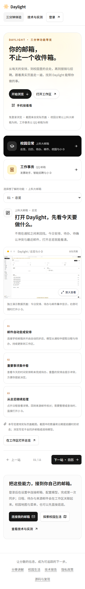
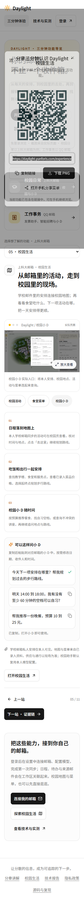

# v23 公网发布：体验账号入口与功能导览

2026-11-04（北京时间）。已将本地固定提交 `9d5d6a4d00ddfccdee7a2d38871ca5d9337ff087` 的完整前端发布至 https://daylight.yunforis.com 。

## 版本与回滚

- 镜像：`daylight:public-competition-20261104-v23`。
- 镜像 ID：`sha256:0951b290631a87bd34e0eb30e1896e910a8aaa89822b7742ebbd33ab7cadf5d3`。
- 发布目录：`/opt/daylight-tour-release-v23`。
- 备份：`/opt/daylight-backups/before-feature-tour-20261104105437`，含发布前配置、数据库 dump、前端及验证脚本。
- 回滚目标：v22，ID `sha256:11b018846e30ed419440c812d4e5e8d99f2f37e75ba1a94a481e5fd74e9b97af`。发布脚本内含失败自动回滚；人工回滚时恢复备份的 compose.env、前端与 runtime 文件，并使用 manage.sh 重建三个应用角色。
- 本次从固定 v22 镜像替换完整前端及同版验证文件；业务后端继承 v22，不涉及数据库结构变更。

## 发布内容

- 首页「登录体验账号」入口与对应说明。
- `/experience` 的校园／工作两组、11 项功能导览，7 张实际页面原图及7张预览图。
- 登录页、视频页及技术页导览入口文案。

## 本次实际验证

- 本地 `npm run build` 成功（31.56秒，保留大包提示）；源码预检16项通过。
- 本地11个章节、默认／异常／旧地址渲染、14张图片解码及构建内容检查通过。
- 发布包36,248,323 bytes、716文件；SHA-256 `1a76d411434da04bb374e558a21517d55a68a93a4c0a179d0451624557ecfa71`，服务器包及逐文件校验通过。
- Linux候选业务／指标38/38、交付6/6、构建与原生路径9/9。
- 正式HTTPS120项通过，覆盖公开页面、匿名权限、既有合成样例、资料摘要及视频／PDF Range。
- 三角色各757文件哈希一致，完整前端706文件清单一致。8服务healthy，三个应用角色restart=0、OOM=false，指标dropped=0、sinkError为空。
- Headless Microsoft Edge：11功能×1440／390／320px共33组布局及图片通过，整页无横向溢出；首页入口、校园多图切换、放大／Escape关闭、复制问法、当前功能分享弹窗、前后翻页、刷新及手机选择器通过。14张公网WebP与本地完整SHA一致，pageerror=0。
- 切换容器期间首次浏览器导航遇到HTTP错误，服务健康后完整重跑通过。未采集连续可用率，不能据此声称零中断。
- 本轮未调用真实邮箱、模型或SMTP；历史实连数据不作为本轮新增验证。手机为浏览器尺寸检查，微信真机及实际扫码仍待验证。

## 原始记录

[发布清单](release-manifest.json) · [部署脚本](deploy-v23.sh) · [完整发布输出](deploy-v23-output.txt) · [运行文件与健康](runtime-v23.json) · [HTTPS](public-http-v23.json) · [浏览器](public-ui-v23.json) · [源码预检](publish-source-check.txt)

