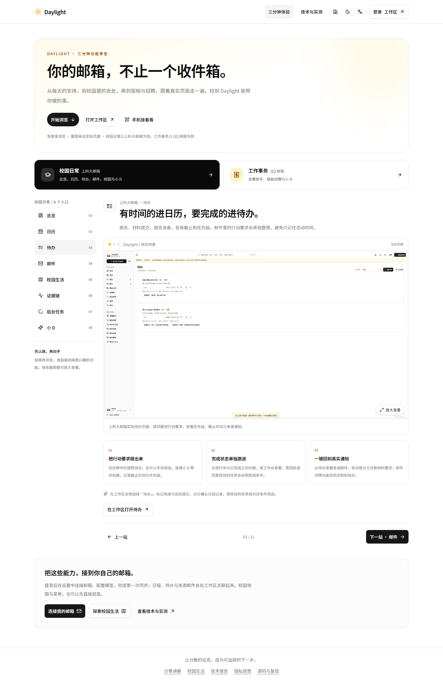

# v24 公网发布：四个功能截图

2026-11-04（北京时间），已发布至 [Daylight 功能导览](https://daylight.yunforis.com/experience?view=todos)。

## 内容与版本

- 待办、邮件、证据链、后台任务分别使用本次用户提供的图二至图五，更新图注及无障碍说明；每张提供完整图和1280px预览图。
- 镜像：`daylight:public-competition-20261104-v24`；ID：`sha256:3cdfb971a97dd1880ec51f9ad4d2d56fa83a7b0d2da4bc9aa9e4d5f6f4c6dc80`。
- 发布目录：`/opt/daylight-tour-release-v24`。以v23镜像替换完整前端，后端业务逻辑继承v23。
- 源码基于`9d5d6a4d00ddfccdee7a2d38871ca5d9337ff087`的本地未提交截图更新，运行环境如实设置`DAYLIGHT_GIT_DIRTY=1`；清单保存实际源文件及发布文件SHA。该提交号不能单独代表本轮修改。
- 包37,077,096 bytes、724文件，SHA-256：`a74ba295acc69f9a33482dd432f501d9f999a48789aefae6e6960030a2cdb749`。

## 实际验证

- 本地构建、11章节渲染与图片解码、构建产物内容检查通过。
- 服务器归档及逐文件SHA通过，候选业务／指标38/38、交付6/6、构建路径9/9通过。
- 公网HTTPS验证脚本通过，覆盖公开页面、匿名权限、合成体验、资料内容与视频／PDF范围响应。
- 正式浏览器四章节×1440／390／320px共12组布局、正确图片及放大检查通过，无整页横向溢出、pageerror=0；8张新增原图／预览图与本地完整SHA一致。
- 三角色各765个文件SHA通过，完整前端714文件清单一致；8服务healthy，应用restart=0、OOM=false，指标dropped=0、sinkError为空。
- 本轮没有新增真实IMAP、模型或SMTP调用。发布脚本中的历史容器实测资料核对仅校验已有记录，不代表本轮重新执行真实任务或对象存储实测。手机检查使用浏览器尺寸。

## 回滚

- 切换前备份：`/opt/daylight-backups/before-detail-screenshots-20261104111427`，含配置、数据库dump、前端及验证文件。
- 前版：`daylight:public-competition-20261104-v23`，ID：`sha256:0951b290631a87bd34e0eb30e1896e910a8aaa89822b7742ebbd33ab7cadf5d3`。
- 发布脚本含失败自动回滚；人工回滚应恢复备份compose.env，以manage.sh重建三个应用角色，并恢复host-dist及runtime文件。未实测零中断或本轮人工回滚。

## 记录

[清单](release-manifest.json) · [部署脚本](deploy-v24.sh) · [发布输出](deploy-v24-output.txt) · [服务及文件核对](runtime-v24.json) · [HTTPS](public-http-v24.json) · [浏览器](public-ui-v24.json)

