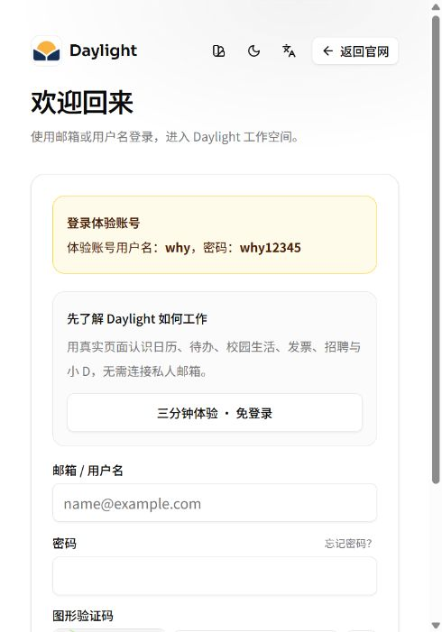

# v25：登录页体验账号提示

2026-11-04（北京时间），在 `test` 分支修改并发布至 [公网登录页](https://daylight.yunforis.com/login)。

- 普通登录表单上方新增浅金色提示卡，显示用户指定的体验账号用户名及密码；隔离演示模式沿用原提示。
- 前端基于 `de06969ae772b3d8f1cdd7239bb5ad18b8e8369d` 加本次未提交修改构建，运行配置如实标记 `DAYLIGHT_GIT_DIRTY=1`，具体源码 SHA 见清单。
- 镜像 `daylight:public-competition-20261104-v25`，ID `sha256:b27ef2e521f619283ed1364c1c66d36885baa7b4b2e4ee25430b906519586ccd`；继承 v24 业务后端并替换完整前端。
- 本地构建及差异检查通过；服务器候选检查 38/38、6/6、9/9 通过，正式 HTTPS、匿名权限和业务检查通过。
- 三角色逐文件摘要及完整前端清单核对通过，8 服务 healthy，应用 restart=0、OOM=false；浏览器实际打开公网登录页，确认提示卡和账号文案可见。
- 本轮未提交登录表单，未新增真实邮箱、模型或 SMTP 验证；浏览器核对为当前侧栏宽度，未声称全尺寸验收。
- 发布前备份 `/opt/daylight-backups/before-login-trial-20261104123710`；回滚镜像为 v24，发布脚本含失败自动回滚。

[发布清单](release-manifest.json) · [发布脚本](deploy.sh) · [发布输出](deploy-output.txt) · [运行核对](runtime.json)

