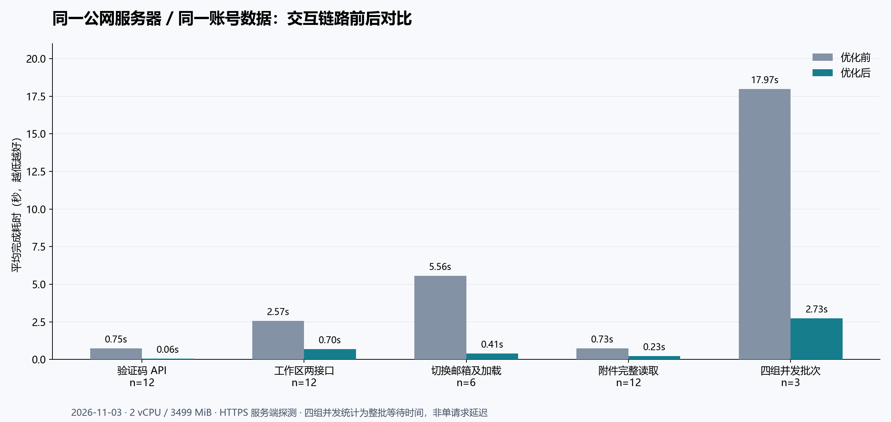
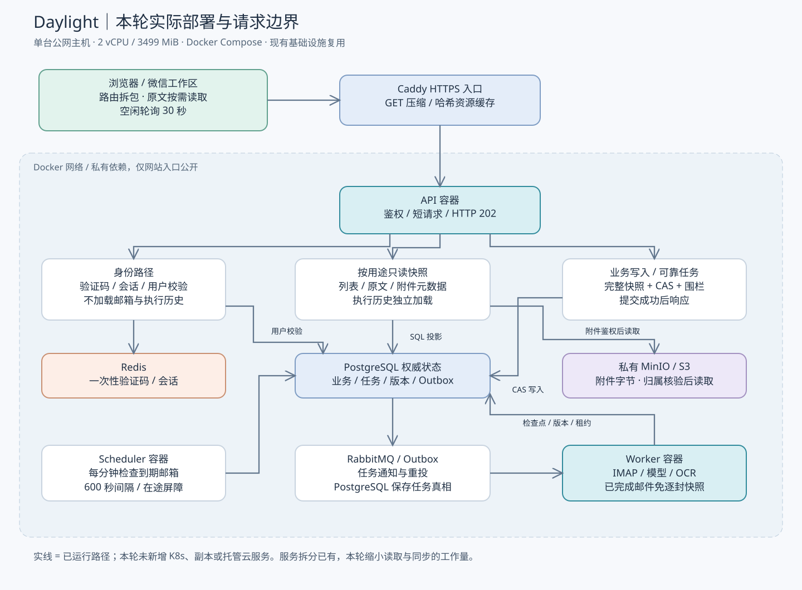
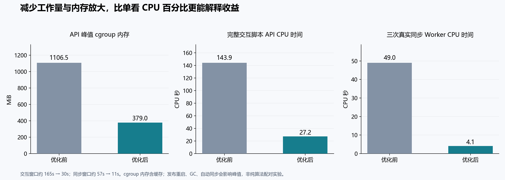

# Daylight 公网交互性能与云架构优化报告

**日期：2026 年 11 月 3 日（北京时间）**  
**交付级别：代码已实现、本地回归通过、真实 PostgreSQL / IMAP / 公网部署验证通过。**  
**适用范围：当前单节点公网部署与已有账号数据。尚未达到长期生产容量或完整高可用验收。**

## 1. 本轮完成了什么

围绕验证码、账号/邮箱切换、邮件同步、附件与工作区加载，先在原部署记录基线，再在同一台服务器发布优化版本并复测。保留原有账号、日历、邮件、附件和索引；未清空历史来制造性能提升。两阶段 HTTP 样本中，业务账号两个邮箱分别为 **41 / 93 封邮件**，数据库日历 JSON 分别为 **143,373 / 8,832,321 字节**，前后一致。

主要瓶颈是请求边界过大：大部分 API 都会加载完整邮箱数据和执行历史；切换邮箱顺带收信；重复同步又对每一封已处理邮件重读完整快照。本轮复用已有 Docker、PostgreSQL、Redis、RabbitMQ 和 Worker，通过按用途读取、按需加载和消除重复工作降低成本。没有购买新云资源，也没有把单机 Compose 改成 K8s。



## 2. 环境、版本与测试方法

| 项目 | 实际口径 |
| --- | --- |
| 公网地址 | https://daylight.yunforis.com |
| 计算与内存 | Ubuntu 24.04.2，2 vCPU，3499 MiB 内存，4 GiB swap |
| 常驻服务 | API、Worker、Scheduler、PostgreSQL 17.6、Redis 7.4.5、RabbitMQ 4.1.4、MinIO、Caddy 2.10.2，共 8 个 |
| 基线应用镜像 | `daylight:public-mail-poll-600-20261103`，原镜像 ID 前缀 `24d97bca430a` |
| 优化应用镜像 | `daylight:public-perf-20261103`；最终镜像 ID 见 evidence/deployment.json |
| 源码基础 / 分支 | 基础提交 `973ef6cec6fcf13d182befea65450ffe52e5b2ab`，`feat/cloud-latency-20261103` |
| HTTP 探测位置 | 公网服务器容器内，经正式域名 HTTPS，完整读取并解码响应；不是手机移动网络 |
| 浏览器探测 | Windows 独立无用户资料的 Edge headless，390×844，每样本新建 context |
| 数据采样 | 主机 cgroup v2，每 1 秒采集容器累计 CPU、memory.current、可用内存、swap、load average |
| 并发场景 | 每批 4 个逻辑工作区，每个同时请求 state 与 traces，共 8 个 HTTP 请求；执行 3 批 |
| 同步场景 | 同一真实业务邮箱，3 次显式手动同步；等待数据库任务成为终态 |

### 2.1 耗时定义

- **工作区 API 组合**：并发发出 state 与 traces，到两者完整读取结束。优化后前端实际首屏先显示 state，traces 独立完成，因此该组合口径较保守。
- **邮箱切换**：激活邮箱 POST，再并发读取该邮箱 state / traces，到三个请求都读完。两邮箱轮流切换。优化前切换会触发真实收信，优化后默认只切换视图，这正是本轮消除的业务耦合。
- **验证码 API**：请求开始至验证码 JSON 全部返回。SVG 是动态随机图形，体积会轻微变化，不缓存同一个验证码。
- **附件**：同一个 89,348 字节真实 PDF，从鉴权开始到附件全部返回；字节数前后一致。
- **真实同步总耗时**：数据库 `finished_at - created_at`，包含排队与执行。`HTTP 202` 只表示持久入队，不当成收信完成。
- **页面可用时间**：导航开始到验证码出现或工作区导航出现；不是 LCP，也不包含用户输入密码和验证码的时间。
- **平均、p50、p95**：使用所有样本耗时，按 nearest-rank 取分位数，不插值、不剔除慢样本。失败仍计入耗时统计。

### 2.2 账号与邮箱切换的区别

用户反馈中的“切换账号”在工作区侧栏对应切换收信邮箱。本轮完整测量此链路，并测量登录身份查询 `/auth/me`。浏览器工作区测试使用短期本人验证会话；没有将其描述为“人工输入验证码、密码后完成另一登录账号切换”的完整耗时。不同登录用户的全流程切换没有单独的配对样本。

### 2.3 解释限制

这是先前后后的一轮短时间现场测量，不是随机 AB，也没有单变量消融。公网网络、自动同步、数据库缓存、容器重启、GC 与本机浏览器资源都会影响结果。n=3 或 n=5 时，p95 实际等于最大值，不能作为稳定 SLO。报告保留优化后探索性浏览器样本与额外复测，避免只保存最快结果。

## 3. 优化前定位到的成本

### 3.1 通用中间件扩大了所有请求的依赖范围

原生产路径为 `认证 → storageHttpMiddleware → createStorageSnapshot → handler → commitStorage → 响应`。快照默认读取全部归属邮箱日历、traces、recruitment、外部日历、提示词等辅助文档，并有多次 structuredClone。只读响应也会经过第二次版本核验及锁事务。

验证码等匿名身份接口同样位于此中间件之后。匿名上下文使用系统快照，可能读取所有已注册邮箱数据，再返回一个约 10 KB 的 SVG JSON。虽然处理器没有把邮件返回给匿名用户，这仍是无必要的私有数据读取、CPU 和内存开销。

实查 app_settings 中，traces 共约 **6.68 MB**，recruitment 共约 **0.325 MB**。所有邮箱邮件字段的聚合大小中，HTML 约 **9.60 MB**，纯文本正文约 **0.310 MB**，提取结果约 **0.138 MB**。这些是服务器全部相关记录的字段聚合，不等于单个账号的响应大小。

### 3.2 约 9 MB 的工作区，加上执行历史反复轮询

基线活动邮箱 state 返回 **8,829,645 字节**，traces 返回 **2,850,561 字节**。前端每 5 秒重拉完整 state 和 traces；同步时更频繁。只看日历或待办也要下载邮件 HTML、内嵌图片和附件 OCR 文本。历史曾因 8 MiB 响应预算出现 503，先前扩大到 32 MiB 只恢复可用，没有减少工作量。

### 3.3 切换邮箱意外触发昂贵任务

激活邮箱会保存活动邮箱，然后排入 IMAP 同步。在小规格服务器上，用户快速来回切换也会带来后台收信与快照解析，和当前页面读操作争用 CPU、数据库及内存。

### 3.4 重复同步的 N 次历史加载

IMAP 端已有元数据去重，但任务循环仍先为每封邮件调用 `storage.load()`，再发现它已经处理。对 100 封已处理邮件，至少 1 次初始快照 + 100 次逐封快照。历史越大，重复成本越高。代码回归现已验证此场景只加载 **1 次**、模型调用 **0 次**、业务提交 **0 次**。

### 3.5 浏览器关键路径包含大量不需要的代码

原 App 静态引用管理、招聘、日历等页面，入口包约 1.9 MB；外部字体样式表还阻塞页面解析。附件 PDF 模块虽已有 lazy，但在附件文件取回后才触发下载，形成串行等待。

## 4. 已发布的优化与技术选型

| 改动 | 采用的设计 | 为什么适合当前规模 | 正确性边界 |
| --- | --- | --- | --- |
| 身份路径独立 | captcha/config/me/login/register/reset-password 不读业务快照；需要模板的邮件验证码/找回路径只读必要文档 | 验证码只需 Redis，身份只需会话与用户表，读取邮件没有收益 | 保留一次性验证码、共享会话、撤销与用户状态检查，不改为进程内验证码 |
| 按用途快照 | settings、workspace、workspace-summary、traces、attachment、email-detail 等服务端 profile | 在现有 PG 权威状态之上缩小请求依赖，避免先做复杂数据库迁移 | profile 由服务器路由选择，先核对邮箱所有权；投影禁止写回 |
| 数据库投影 | PostgreSQL JSONB 直接移除 HTML / OCR，只传需要的字段 | 大字段在数据库侧裁剪，减少 PG→Node 网络、解析和多次 clone | 仍需解压/扫描 JSONB，不能宣称数据库工作量与邮件数无关 |
| 原文按需读取 | `/state?view=summary` + `/emails/:id/detail?mailbox=...` | 日历、待办与邮件列表不需要预载全部原文 | 保留全部纯文本用于原有搜索、完整 extraction/附件索引；打开原信取回完整 HTML |
| 保留旧 API | 无 view 参数的 state 继续返回完整内容 | 不强制旧客户端同时升级 | 旧路径仍较重，保留 32 MiB 有限预算 |
| 只读事务缩小 | 只读投影不再执行第二次提交锁核验 | 投影没有待提交副作用，读取时的 PG 一致快照已足够 | 写路径保留 CAS、围栏、检查点和提交后响应；投影绝不用于模型写回 |
| 附件元数据鉴权 | 只加载本人附件键及事件材料、招聘附件索引，再从私有桶读字节 | 先消除为了鉴权而读取正文、简历大文本和全部 trace | 私有 MinIO 不公开；桶键不能替代权限；保留 64 MiB 有限响应缓冲 |
| 查看与执行解耦 | 默认切邮箱不触发同步；显式 `sync:true` 或手动同步可触发；600 秒自动策略继续有效 | 查看已保存邮件不必等待网络收信；减少无效任务 | 保留原任务队列与历史，不自动发信 |
| 同步去重早退出 | 在初始一致快照记录 finalized IDs，已完成邮件直接计 duplicate | 最大收益来自消除 N 次历史加载，复用 IMAP 元数据去重 | partial 邮件仍取新快照重试；新邮件、取消/改期保持原顺序及 CAS |
| 轮询治理 | 工作区空闲 30 秒、同步中 2 秒；jobs 空闲 30 秒、活动 2 秒；任务完成即 reload | 降低多标签页带来的后台 QPS | 空闲页面来自其他端的更新最多约 30 秒后显示；没有引入 WebSocket/SSE 服务 |
| 静态资源优化 | 路由/管理壳按需拆包，入口约 612 KB；哈希资源 immutable；外部字体非阻塞 | 降低验证码页和工作区首屏下载与解析 | 首次进入某页面仍需下载对应 chunk；PDF 与 rich markdown 大 chunk 警告仍保留 |
| 入口压缩 | Caddy 仅对选定 GET 响应及 assets 开启 gzip/zstd | 已有入口即可减少公网传输，无新增组件 | 私人 API `private,no-store`；不压缩 SSE 写请求；压缩消耗 CPU，不等于零成本 |
| PDF 加载并行 | 打开 PDF 时立即下载预览模块，与鉴权文件读取并行 | 利用已有浏览器能力消除串行等待 | 完整文件仍先读为鉴权 blob；本轮没有实现 Range 或大文件流式代理 |

## 5. 当前真实架构



图中的服务拆分原本已经存在，本轮重点改变它们之间的访问方式。API 承担鉴权、只读投影和短任务提交；Worker 处理 IMAP、模型、OCR；Scheduler 按到期策略派发。PostgreSQL 保存权威业务、任务与版本；RabbitMQ 传递任务通知；Redis 保存短期安全状态；MinIO 保存附件。

可编辑图源见 [architecture.mmd](architecture.mmd)。`architecture.svg` 可直接放入报告、PPT、Figma 或绘图工具作为重绘参考。仓库历史 k3s 容量测试属于另一个集群，不并入本次单节点结果。

## 6. 接口前后实测

| 行为 | 每阶段样本 | 平均 ms 前 → 后 | p50 ms 前 → 后 | p95 ms 前 → 后 | 平均下降 |
| --- | ---: | ---: | ---: | ---: | ---: |
| 验证码接口 | 12 | 749.3 → 60.8 | 715.8 → 42.0 | 920.6 → 204.1 | 91.9% |
| 身份校验接口 | 12 | 932.2 → 19.8 | 689.8 → 18.0 | 1450.8 → 30.4 | 97.9% |
| 工作区（state + traces） | 12 | 2566.4 → 697.7 | 2448.7 → 644.7 | 3044.0 → 893.9 | 72.8% |
| 全部邮箱混合工作区 | 6 | 2547.5 → 1087.7 | 2473.2 → 704.3 | 2789.6 → 2471.5 | 57.3% |
| 附件完整读取 | 12 | 726.2 → 233.0 | 706.1 → 221.0 | 887.4 → 405.3 | 67.9% |
| 切换邮箱并加载 | 6 | 5559.4 → 407.7 | 4489.3 → 207.1 | 7697.7 → 664.3 | 92.7% |
| 四组工作区并发批次 | 3 | 17972.7 → 2732.7 | 17996.2 → 2744.5 | 18236.7 → 2840.9 | 84.8% |


常规串行场景两阶段均全部成功。并发批次的详细结果：

- 原部署共 **24 个子请求，23 成功、1 个 traces 返回 503**；按逻辑工作区为 **11/12 成功（91.67%）**，按整批为 **2/3 成功**。
- 优化后 **24/24 子请求成功，12/12 逻辑工作区成功（100%）**，整批 **3/3 成功**。
- 相同并发脚本成功 HTTP 吞吐约 **0.427 → 2.928 请求/秒**。这是固定 4 组业务批次测试的有效吞吐，不能写成服务器最大 QPS。
- 全 HTTP 脚本每阶段 114 个请求，基线 **113/114（99.12%）**，优化后 **114/114（100%）**。业务总量、负载顺序和等待完成的规则一致。

state 的完整解码响应从 **8,829,645 → 563,912 字节，减少约 93.6%**。traces 内容保持原始完整结构，没有删除历史来减少指标。Caddy 压缩进一步降低线上传输量；JSON 解码字节与网络传输字节必须分别标注。

### 6.1 真正的页面时间

| 页面冷加载行为 | 每阶段样本 | 平均 ms 前 → 后 | p50 ms 前 → 后 | p95 ms 前 → 后 | 平均传输量前 → 后 |
| --- | ---: | ---: | ---: | ---: | ---: |
| 登录页到验证码出现 | 5 | 2707.9 → 359.9 | 2646.0 → 325.4 | 3102.9 → 454.1 | 0.86 → 0.35 MiB |
| 已授权会话到工作区导航可用 | 5 | 8771.3 → 2380.9 | 9424.2 → 2495.7 | 9854.1 → 3348.6 | 7.04 → 0.82 MiB |


这些样本均经本机 Windows 到正式公网地址。两阶段共 20 次主比较页面导航全部成功、未捕获页面运行异常。传输量只统计截止可用判据时已完成的 resource timing，不等于整个页面最终所有后台流量。每样本新 context，浏览器缓存不跨样本复用；服务器与操作系统缓存没有清空。

首个优化后探索窗口的工作区均值约 **6.44 秒**、p95 约 **9.53 秒**，后续复测更快；其原始样本保存在 evidence/perf-browser-after-exploratory.json。网络与字体等待的波动真实存在。报告表格使用最终版本按相同判据执行的整轮样本，不把最快一次当平均值。

### 6.2 附件预览的结论边界

附件 API 的同文件配对改善见上表。真实浏览器已完成“打开已存 PDF → 站内鉴权 blob → PDF.js canvas 呈现”，一次代表性检查约 **3.58 秒**，无新增浏览器异常。优化前未取得同文件、同冷缓存条件下的 canvas 配对样本，所以不能写成“PDF 首屏渲染提升 X%”。大 PDF 仍会有下载、解码和字体成本。

## 7. 真实邮件同步

| 指标 | 优化前 | 优化后 |
| --- | ---: | ---: |
| 实际手动同步样本 | 3 | 3 |
| 成功率 | 3/3（100%） | 3/3（100%） |
| 任务总耗时平均 | 17017.3 ms | 2593.3 ms |
| p50 | 17199.0 ms | 2231.0 ms |
| p95（小样本最大值） | 17455.0 ms | 3458.0 ms |
| 平均耗时下降 | — | 84.8% |

三次原始任务耗时为 **17,199 / 16,398 / 17,455 ms**，优化后 **3,458 / 2,231 / 2,091 ms**。均实际连接真实邮箱并等待任务成功终态，不是 mock。优化后 HTTP 接收请求到 202 的样本约 175 / 55 / 34 ms，应与任务完成分开引用。

该邮箱已有历史、近期消息以重复处理为主。本轮没有为压测专门发送新邮件，也没有构造一批需要新模型提取的付费负载。因此只能说明“已处理邮箱的再次同步”加速；不能推导新邮件提取吞吐、OCR 并发、模型 p95 或每千封邮件费用。真实同步可能按现有策略处理新到通知，但本轮未授权额外发信，未主动发送邮件。

## 8. CPU、内存与负载



| 指标 | 优化前 | 优化后 | 解读 |
| --- | ---: | ---: | --- |
| 交互窗口时长 | 164.79 s | 30.13 s | 同一脚本更快完成 |
| API 累计 CPU 时间 | 143.93 CPU s | 27.21 CPU s | 完成固定工作量所用计算量 |
| Worker 累计 CPU 时间 | 54.39 CPU s | 1.49 CPU s | 含切换触发的真实收信和自动任务 |
| PostgreSQL 累计 CPU 时间 | 43.81 CPU s | 10.94 CPU s | 减少传输与事务开销；仍有 JSONB 投影成本 |
| API cgroup 平均内存 | 726.00 MiB | 304.87 MiB | 含缓存，非 JS heap 或 RSS |
| API cgroup 峰值内存 | 1106.48 MiB | 379.03 MiB | 受重启、GC、缓存和并发重叠影响 |
| 主机最低可用内存 | 767.19 MiB | 1760.67 MiB | 窗口内的内存余量 |
| 主机 1 分钟 load average 均值 | 2.76  | 1.45  | 滞后且两个窗口不等长，只做辅助 |
| API 平均 CPU（单核=100%） | 87.34 % | 90.32 % | 优化后更短窗口内 CPU 仍忙，不能宣称利用率也同比下降 |


同步专用窗口中，Worker CPU 时间 **48.95 → 4.15 CPU 秒**，PostgreSQL CPU 时间 **13.77 → 1.15 CPU 秒**；Worker cgroup 峰值 **369.1 → 240.6 MiB**。两阶段所有采样的 swap 使用均为 0。

前后窗口长度不同，所以应优先比较完成固定操作的 **累计 CPU 秒**，不应只拿平均 CPU 百分比讲资源节省。主机 load average 有滞后，也不能据其瞬时值宣称系统容量翻倍。API 发布后重启，进程堆与缓存状态改变，峰值内存下降中有这类因素；要确认稳定态内存，需要独立长稳测试。

交互基线阶段含“切换自动同步”的真实后台成本，优化阶段去掉了该触发，这属于方案的实际收益，也使该脚本不是仅比较两个 SELECT 的纯隔离测试。两种口径都应在比赛报告里说明。

## 9. 为什么没有增加 K8s、Redis 大对象缓存和更多微服务

| 技术 | 本轮决定 | 依据与代价 |
| --- | --- | --- |
| Docker / Compose | 继续使用并发布独立 API、Worker、Scheduler 镜像角色 | 已有隔离、健康检查、共享状态和回滚路径，当前不足主要是重复计算与大快照 |
| 微服务 | 保留三个执行边界，进一步拆分读取 profile，暂不新增网络服务 | 验证码服务独立进程仍可能被共享 CPU/数据库拖慢；先缩小依赖才能实质改善 |
| Redis | 保留验证码、会话等临时状态，不新增整份邮箱缓存 | 缓存多 MB 私人数据会增加内存与失效复杂度；PG 投影先移除无用字段，避免缓存膨胀与陈旧状态 |
| PostgreSQL | 继续权威存储，一致快照读 + CAS 写，增加 SQL 投影 | 跨进程业务语义已经依赖它；本轮无需迁移所有邮件即可见效 |
| RabbitMQ | 保留任务通知与恢复机制 | 现有可靠任务、Outbox、租约与邮箱顺序已有实现；不为表面简化引入第二套队列语义 |
| MinIO / 云对象存储 | 本轮保留私有 MinIO；下一阶段优先迁到托管 US3/S3 兼容存储 | 减少同机存储运维与资源占用有价值，但必须先核对服务协议、权限、费用与附件回读，不能宣称已接 UCloud US3 |
| Kubernetes / HPA | 本轮不部署新集群、不启用自动伸缩 | 当前只有一台 2 核主机，增加 Pod 不增加物理容量，还增加控制面资源与调度复杂度；历史 k3s 数据不能替代此站验证 |
| API 多副本 | 作为下一步，在有第二节点/足够资源时再测 | 共享状态使其具备基础，但 PG、对象存储、入口仍有单点；不能仅增加副本就宣称 HA |
| CDN | 哈希资源已具备缓存策略，真实 CDN 暂未接入 | 静态加速可改善跨网首屏，但本轮先用现有 Caddy；私有邮件响应不进入公共 CDN 缓存 |

## 10. 下一阶段的可测扩展方案

### 10.1 先拆重文档，再扩副本

按本轮实测，正文和执行历史增长会继续让 JSONB 投影付出 TOAST 解压与数组扫描成本。下一步将邮件列表、正文、附件索引、执行 trace 拆为独立表或对象；列表按 `(owner_id, mailbox_id, received_at, id)` 做游标分页，正文按主键读取，trace 按任务/邮箱增量查询。迁移需双读核对、明确权威与回滚，不把投影结果覆盖回原快照。

### 10.2 扩容条件与调度依据

以下是**建议触发条件，尚未实施或验收**：

- API 使用真实交互 p95、事件循环延迟、CPU 和并发在途请求联合评估；持续超过目标才增加 API 副本。先按 1/2/3 副本做固定数据、固定到达率测试。
- Worker 用队列等待 p95、最老任务年龄、待处理邮箱数量和 CPU/内存评估。不同邮箱可并行，同一邮箱仍保持顺序与租约围栏；限制模型提供方 QPS/Token 预算，避免扩容只扩大费用。
- 单节点演示优先保障 API 的 CPU 余量；OCR 与大附件单独限并发。不要用硬内存限额替代测量，低于真实峰值会导致 OOM 与重试放大。
- 若上 K8s，先将 PG、Redis、对象存储迁到共享可靠依赖，再设置 requests/limits、Pod 反亲和、滚动更新、PDB 与节点容量。HPA 达到节点上限时必须告警，不能靠增加 Pod 数宣称物理弹性。

### 10.3 待补的验收矩阵

| 项目 | 下一步验证 |
| --- | --- |
| 稳态容量 | 1 / 4 / 8 / 16 并发或固定到达率，至少 10 分钟，记录 p50/p95/p99、错误与队列积压 |
| 真实新邮件 | 受控新邮件样本，区分无附件 / 文本 PDF / 扫描 PDF，统计提取质量、Token、成本 |
| 附件体验 | 100 KB / 5 MB / 20 MB，同文件冷/热缓存，首字节、完整下载、PDF 首屏分别测 |
| 长稳 | 24 小时轮询与自动同步，记录 heap、RSS、cgroup、重启、CPU、PG 连接、磁盘增长 |
| 多实例与故障 | Worker 中断、消息重投、数据库短断、API 滚动、缓存失效、同邮箱并发幂等、恢复后无重复发送 |
| 数据恢复 | 独立新环境完整恢复 DB + 对象，并核对 SHA-256、账号归属、任务状态与业务摘要 |
| 成本 | 获取实际账单，分计算、PG、缓存、MQ、对象、流量与模型费用，报告单位成功任务成本 |

## 11. 数据一致性、隐私与交付验证

- 投影只读，不能 stage 或注册邮箱；原业务写入仍用完整上下文进行版本比较与提交。真实 PG 验证覆盖 SQL 投影、只读拒写、所有权、并发 CAS、提交失败不返回成功。
- HTML 与附件 OCR 仅从列表传输中移除，数据库原数据保留。真实 API 对照确认正文、HTML、附件字段与完整 state 的原始记录一致。
- 浏览器快速离开邮件/切邮箱会取消原文请求；迟到响应按邮箱/邮件键隔离，工作区 reload 按请求代次避免覆盖新结果。当前只保留打开的原文，不把所有邮件写入浏览器长期缓存。
- 匿名 state、匿名附件均 401；明确越权的邮箱详情 403。附件仍需先确认归属，不暴露私有桶作为公开资源。
- 最终本地全量：**951 项，922 通过、29 条件跳过、0 失败**。真实服务器 PG 定向：**87/87 通过、0 跳过**。构建成功，保留 PDF/入口等超过 500 KB chunk 提示。
- 公网手机宽度浏览器确认工作区、邮件深链原文、真实 PDF canvas、权限拒绝与无运行异常。这是独立 Edge 浏览器验证，不是微信真机、GPS 或移动网络验收。
- 原有密码/密钥不写入报告。本人验证会话为短期临时会话，验证完成撤销；报告不保存令牌、真实邮件正文和附件截图。

## 12. 发布、备份和回滚

发布前停止 Scheduler / Worker，备份数据库、应用源码、dist、镜像 ID、Compose 环境与实际 Caddy 配置。备份目录 `/opt/daylight-backups/before-perf-20261103/`。数据库 dump 已能列出归档目录；**本轮没有执行完整恢复演练**。没有修改既有数据库 schema 或迁移邮件记录；测试在独立随机 schema 中运行并清理。

最终镜像与健康状态在 evidence/deployment.json。8 个常驻服务 healthy，应用容器在最终检查中 restart=0、OOM=false。单次健康检查只代表当时就绪，不代表长稳或并发生产验收。

需要回滚时，恢复备份中的 Compose 环境、实际 Caddy 配置和应用文件，用原镜像重建 API / Worker / Scheduler 并 reload Caddy。不要恢复旧数据库 dump 覆盖用户在发布后的新邮件；应用回滚与数据灾难恢复是不同操作。本轮存储格式兼容，无需为应用回滚清空或降级数据库。

## 13. 重现、图稿与引用建议

报告目录包括 Markdown、离线 HTML、Mermaid 图源、SVG 架构/图表、PNG 图表、逐样本 JSON、cgroup JSONL、汇总 JSON 和 CSV。可直接使用 `comparison.csv` 重画平均/p50/p95 图表；每行都有测量类别与阶段。

```bash
python scripts/performance/summarize.py
python scripts/performance/figures.py
python scripts/performance/build-report.py
```

真实服务重测方式见 [复测脚本说明](../../scripts/performance/README.md)。脚本需在有 `/app/server` 和真实共享依赖的授权容器中执行，不含任何服务密码；真实同步脚本会实际读取邮箱，必须选定授权账号并遵守现有模型费用范围。

建议在比赛报告中表述为：“在 2 vCPU / 3499 MiB 的现有单节点部署中，通过缩小请求数据边界与去重任务的重复工作量，工作区 API 组合平均延迟下降约 72.8%，邮箱切换下降约 92.7%，重复邮箱同步下降约 84.8%。小样本四组并发成功率从 11/12 提升至 12/12。结果为该环境现场实测，后续补充容量、长稳和故障验收。”

不要改写为“生产高可用已完成”“系统最大 QPS 已提升到某值”“新邮件模型吞吐提升 84.8%”或“手机 PDF 渲染提升 67.9%”。
