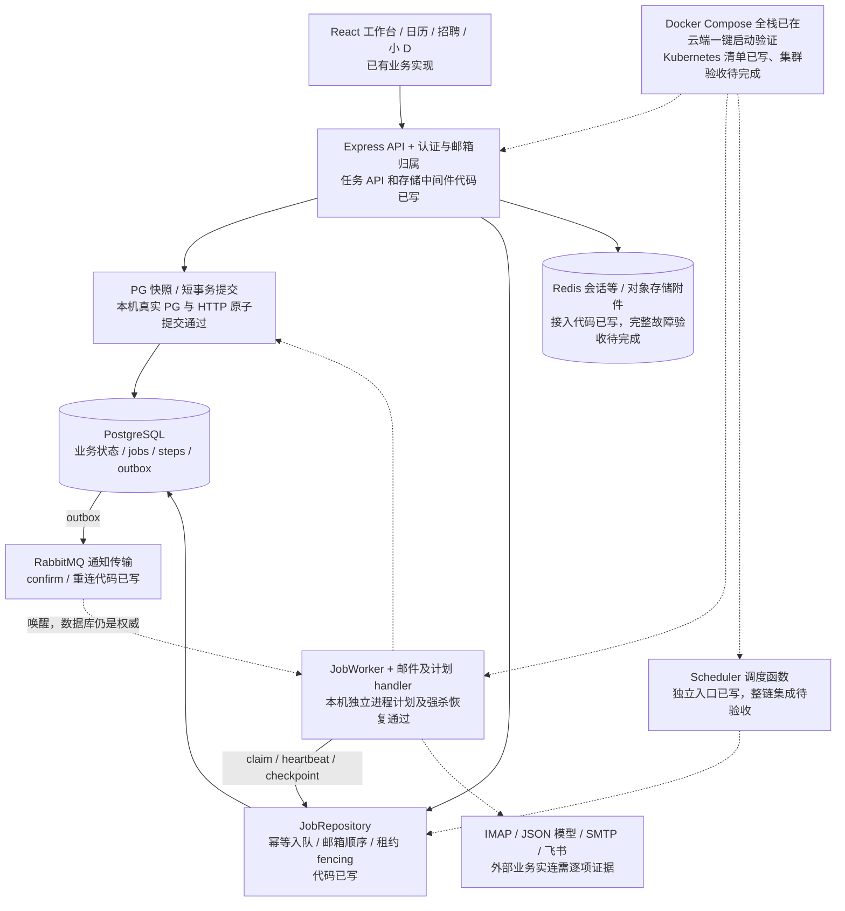

# 架构与交付边界

核对日期：2026-10-17。本文描述当前工作区的代码，不代表冻结版本或部署证明。并行集成仍在进行；最终以提交 SHA、实际运行日志和 [发布清单](release.md) 为准。历史验证见根目录 STATUS；本材料不把历史测试算作本次复验。

实线表示代码中的逻辑依赖，虚线表示通知、外部服务或待确认的部署/业务集成关系，均不表示已云验收。现有开发模式仍可由单个 Node 进程提供前端和 API。`docker-compose.yml` 已是完整 9 服务栈，并已在真实云端做到一键干净启动与全量验证；Kubernetes 仅有清单，仍不能据清单存在推断集群可用。

## 一条任务的状态与一致性

1. API 从认证上下文取得用户，验证邮箱归属；请求幂等键在租户与邮箱范围去重。`job-api.js` 返回公开字段，不返回原始 payload 或凭据。
2. `jobs/repository.js` 在同一事务写任务和 outbox。MQ 发布确认后更新 outbox；确认后数据库更新前崩溃可能产生重复通知。
3. Worker 从 PG claim。邮箱行锁与任务 sequence 保证同一租户同一邮箱串行，其他邮箱可并行。延迟重试会挡住本邮箱后续任务，这是顺序与吞吐的明确取舍。
4. 租约 token、generation 和提交前再次校验拒绝过期执行者；心跳维持租约，过期任务可恢复并使用有限重试预算和退避。
5. checkpoint 与数据库副作用用同一 client 提交；已有步骤返回保存结果。邮件及场景 handler 的业务写入需要遵守同一事务约束。
6. SMTP、飞书等远程副作用不受 PG 事务回滚保护。沿用发送意图、人工确认、未知结果与回执核验；不能宣称端到端 exactly-once。

## 代码定位与集成检查点

| 边界 | 代码入口 | 当前证据范围 |
| --- | --- | --- |
| 认证、健康、生产任务路由 | `server/index.js`、`server/job-api.js`、`server/service-health.js` | 代码可见；最终 HTTP 与启动测试由集成验收提供 |
| 持久任务及通知 | `server/jobs/{repository,runtime,rabbit,schema}.js` | 仓库、运行器与真实依赖验证脚本已写 |
| 业务 handler / 显式邮箱调度 | `server/mail-job.js`、`server/job-service.js`、`server/worker.js`、`server/scheduler.js` | 本机 HTTP→独立 Worker 规则计划及强杀恢复通过；真实邮箱与真实模型已在云端验证；完整业务闭环与多副本 HA 待验收 |
| 部署 | `Dockerfile`、`docker-compose.yml`、`deploy/kubernetes/` | Compose 全栈已在云端一键启动并通过套件/依赖/真实模型验证；Kubernetes 集群、滚动更新与回滚待验收 |
| 权威状态与提交 | `server/storage/`、`server/storage-http.js` | PG 快照及提交模块已写；全部业务写路径需回归 |
| 生产故障策略 | `server/runtime-mode.js`、`server/infra/` | 显式生产模式严格依赖；不将 JSON 缓存当故障恢复权威 |

扩容首先受不同邮箱数、数据库连接池和外部服务配额约束。API、Worker 和 Scheduler 的副本数必须来自容量实验；KEDA 示例不能作为已实现自动伸缩的证据。数据库备份、对象存储恢复、TLS 入口、密钥注入和云网络策略均需实际部署验证。
