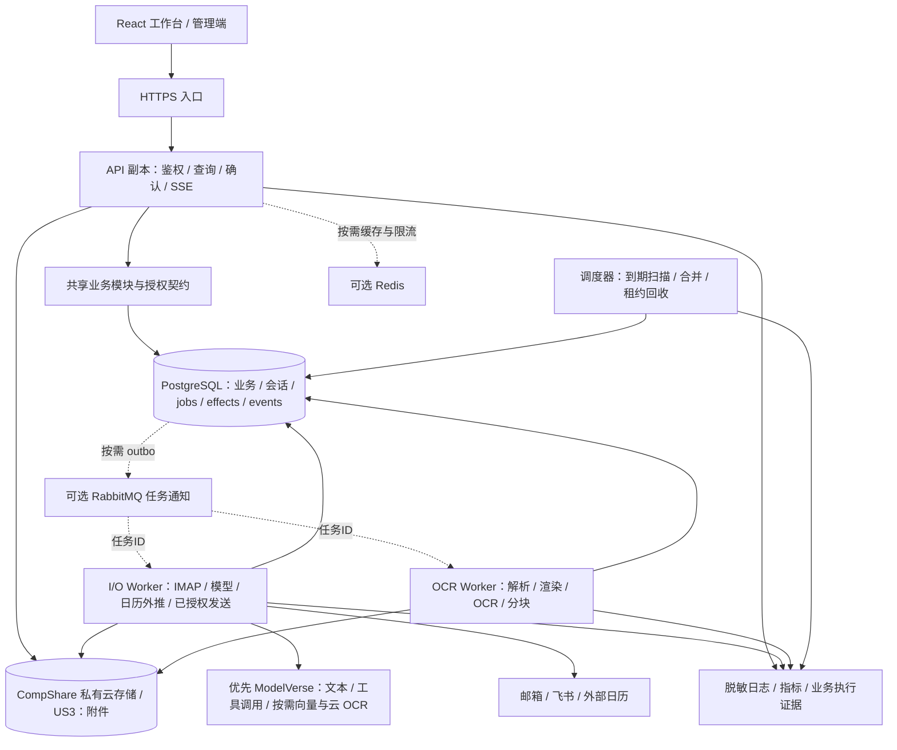
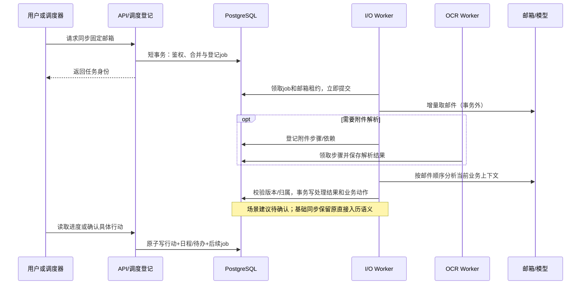

# 架构设计与当前代码依据

日期：2026-10-17（北京时间）。初始核查版本：`ada690ccf228`。本文件区分现状和目标；图中的目标组件、表、角色及流程不代表已经部署。实现与历史验证以 [STATUS](../../STATUS.md) 为准。

本次供应商优先级调整为优云智算 CompShare：ModelVerse负责优先评估的模型推理，满足准入条件的无卡Ubuntu虚机承载S1应用，平台云存储提供附件对象服务。PG与后续UK8S等缺口由UCloud标准云按需补齐，不假设同品牌意味着私网、账号或SLA自动打通。依据与接口边界见 [06](06-compshare-service-plan.md)。

## 1. 从业务问题推导架构

Daylight的价值链是：感知邮件或手动来源 → 提取信息并关联事项 → 结合日历、材料与检索证据规划 → 确认后调用工具 → 跟踪回执与变更。核心场景是多校申请、个人安排及招聘等工作流，发票、附件检索、其他模板复用相同平台能力。

| 业务特征 | 真正需要解决的问题 | 对应架构决定 |
| --- | --- | --- |
| 同步、模型调用耗时不稳定 | 页面不应随某封邮件阻塞；进程退出不丢进度 | 请求与持久任务解耦，API返回可查询的请求/任务身份 |
| OCR消耗CPU和内存 | 大PDF不应拖慢登录、日历和发信审核 | OCR单独进程、队列种类、并发与资源限额 |
| 同一邮箱可能连续收到创建、取消和改期 | 乱序或旧快照覆盖会产生错误日程 | 邮箱内有序推进，统一业务事务、版本和去重 |
| 多用户、多个邮箱、多个工作台 | 活动邮箱切换不能改变已排队任务归属 | 服务端固定执行身份、显式邮箱范围，Worker重新校验授权 |
| 发信、建会存在不可回滚效果 | 超时不代表未执行，盲重试可能重复发送 | 持久副作用账本、审批绑定、unknown状态和核验流程 |
| 邮件、简历、材料需要来源回查 | 节点切换后仍能访问附件与证据 | PG元数据与私有对象存储，引用带权限和版本 |
| 申请季/招聘批次带来突发负载 | 需要有界排队、租户公平和预算保护 | 分类任务池、共享配额、受控Worker伸缩 |
| 需要可部署运营和参赛证据 | 能解释失败、恢复和单位成本 | 版本化交付、观测、恢复演练和同版本基准 |

这些要求不直接推导出“大量微服务”。它们首先要求可靠状态与执行边界；服务数量取决于负载、发布及团队边界，而不是页面数量。

## 2. 当前运行形态及缺口

```mermaid
flowchart LR
  U[浏览器] --> N[单个 Node / Express 进程]
  N --> WEB[静态前端或 Vite]
  N --> API[HTTP API / SSE / 鉴权]
  N --> AUTO[定时同步 / 单个 IDLE watcher]
  N --> TASK[同步 / 模型 / PDF OCR / 队列消费]
  API --> LOCAL[JSON / sql.js / 进程内状态]
  AUTO --> TASK
  TASK --> LOCAL
  N -.可选且各路径语义不同.-> PG[(PostgreSQL)]
  N -.会话与验证码.-> R[(Redis 或内存)]
  N -.mail.sync.-> MQ[RabbitMQ 或进程内执行]
  N -.部分附件路径.-> OBJ[对象存储或本地附件]
```

图表示代码结构而非用户当前机器实际启用的服务。下列行号是核查起点，可因后续编辑变化；文件链接为相对路径，便于换机器阅读。

| 当前事实与证据 | 上云影响 |
| --- | --- |
| [package.json](../../package.json)第10–14行、[index.js](../../server/index.js)第1635–1643行：dev/start进入同一入口，API/前端共进程且监听127.0.0.1 | 独立角色入口与容器监听尚待实现，单写部署清单不能完成拆分 |
| [index.js](../../server/index.js)第759–760、965–985行：全局同步状态、注册消费者和setInterval；任务只载mode/trigger，执行时再读设置 | API扩容会同时复制调度；排队期间切邮箱可能改变执行上下文，必须显式固定身份 |
| [request-context.js](../../server/request-context.js)、[store.js](../../server/store.js)第157–185行：用户上下文依赖请求作用域 | 后台任务不能依赖HTTP的AsyncLocalStorage或全局activeMailbox |
| [idle-sync.js](../../server/idle-sync.js)第4–6、22–50行：单一watcher按活动邮箱监听 | 不是多用户共享调度器；IDLE需要按邮箱租约与连接配额运行 |
| [store.js](../../server/store.js)第265–288、335–363行：JSON先写、PG异步双写并吞错，启动还会从本地回填 | 普通写路径尚未实现工程约定中的PG唯一权威；多个Pod可能相互覆盖 |
| [infra/postgres.js](../../server/infra/postgres.js)第96–100、135–140行：池上限5，TLS关闭证书拒绝，失败切文件 | 需完整连接预算、CA校验和生产启动门槛；不能直接把本机配置搬云端 |
| [scenarios/repository.js](../../server/scenarios/repository.js)和[service.js](../../server/scenarios/service.js)：局部PG行锁，但行动回调仍用普通saveStore，初始化无pool时可走文件 | 已有并发基础但不构成行动/日历/待办统一事务 |
| [assistant-state.js](../../server/assistant-state.js)、[assistant-meetings-store.js](../../server/assistant-meetings-store.js)：已有更严格PG屏障、版本与发送未知状态 | 复用已有成果并推广到其他回复/邀约/日历入口，不能声称全站已经统一 |
| [infra/sessions.js](../../server/infra/sessions.js)、[auth.js](../../server/auth.js)第293–305行：JWT仍校验jti和session_version | Redis/内存会话必须迁为共享持久/可撤销机制；粘滞会话不解决节点故障 |
| [infra/queue.js](../../server/infra/queue.js)第31–40、118–133、196–203行：内存任务历史、失联转本地、普通channel发布 | 缺可靠任务账本、发布确认及完整重试/死信恢复 |
| [db.js](../../server/db.js)、[recruitment-store.js](../../server/recruitment-store.js)、[traces.js](../../server/traces.js) | sql.js整库导出、招聘和trace整文件读改写都要迁移；共享目录不够 |
| [infra/oss.js](../../server/infra/oss.js)第115–145行及[recruitment-store.js](../../server/recruitment-store.js) | US3使用S3客户端路径，失败可落本地；招聘附件另存本地，需逐路径迁移 |
| [rag/store.js](../../server/rag/store.js)与[rag/retrieve.js](../../server/rag/retrieve.js) | 已有RAG，查询仍加载chunk在Node排序，不能称已有pgvector索引加速 |
| [external-calendar.js](../../server/external-calendar.js)第528–547行、[pdf.js](../../server/pdf.js) | 日历异步推送需要持久任务；OCR需隔离资源并固定运行依赖 |

目前已有不少本地业务测试和历史实连记录，本方案不否定这些证据；它们与“全部状态跨节点一致、节点失效可恢复、云端容量达标”是不同层次的结论。

## 3. 目标逻辑架构

下图是S1/S2共同的逻辑架构，不表示S1已有多节点冗余。S1首选经核验的CompShare Ubuntu虚机无卡8核16G，用Docker容器承载运行角色；若常驻或安全连接PG不满足要求则用UHost补齐。S2按需在UCloud UK8S部署不同角色的Deployment；实际网络、资源和节点拓扑见 [04](04-deployment-and-capacity.md)。



图中API、调度和Worker对数据库的访问都经过所归属模块的仓储契约；图为保持简洁没有重复画共享代码。浏览器不直接访问PG或队列，不获得云资源凭据。静态前端可随API镜像交付，流量增长后按实际需求独立托管。

连接PG的箭头是经过身份与TLS验证的数据路径，不能解释成CompShare与UCloud私网已经互通。模型使用公开HTTPS接口，正文仅按已配置、已授权的用途传给选定模型；备用服务不可静默接收邮件。对象存储优先验证HTTPS S3路径，默认不依赖桶多版本能力。更换平台不改变现有的邮箱归属、人工审核和任务状态契约。

### 3.1 各运行角色的职责

| 角色 | 承担的工作 | 隔离原因与伸缩方式 |
| --- | --- | --- |
| API | 身份/邮箱权限、短事务、请求登记、状态查询、完整草稿审核、附件鉴权、SSE事件读取 | 保持请求低延迟；按请求负载/CPU/连接数扩容，副本不自动承担调度和OCR |
| Scheduler | 扫描到期邮箱/重试、合并重复触发、登记任务、回收可重试租约、清理过期挑战 | 定时工作与用户请求解耦；S1单副本，S2可两副本使用PG原子领取/唯一键协调 |
| I/O Worker | IMAP增量读取、模型抽取、助手步骤、embedding及可选云OCR调用、日历外推、已批准邮件/会议动作 | 网络等待为主；按可运行任务与提供方额度扩容，按任务类保留并发槽 |
| OCR Worker | PDF文本层读取、页面渲染、本地OCR、云OCR结果校验、附件解析与分块 | CPU/内存密集且输入不可信；单独限额/超时。渲染后将需要云OCR的页登记为I/O子任务，等待期间释放CPU槽 |
| 可选 Connector | 为需要低延迟通知的邮箱维护IMAP IDLE租约与连接，产生同步任务 | 只有轮询不能满足新鲜度或轮询成本过高时独立；长连接不能随API副本无界增加 |

I/O Worker的逻辑队列至少区分同步、交互Agent、外部动作和索引任务。先用同一镜像不同消费集合/并发槽隔离，防止批量同步占满交互或发信；实测仍相互干扰再拆Deployment。系统验证码与用户外发的权限、配额和优先级分别控制，不能让模型访问系统邮件权限。

可选云OCR使用“CPU渲染页面 → PG登记带私有对象引用的子任务 → I/O Worker按模型额度调用ModelVerse → OCR Worker校验并入库”的链路。CPU角色不因云OCR开放模型互联网出口；I/O中的云OCR另有并发槽和预算，不与交互助手无界争用。父任务持久等待依赖，远端返回前不占CPU执行槽。

服务内部优先函数调用与共享事务；跨运行进程通过PG持久任务和结果协作。新长任务接口可采用`202 + requestId/jobId`及状态查询/SSE，旧客户端接口用兼容层渐进迁移；不要一次性破坏现有API契约。

### 3.2 业务模块所有权

| 模块 | 所有的数据/行为 | 与其他模块的合作 |
| --- | --- | --- |
| 身份与配置 | 用户、角色、会话、邮箱归属、加密凭据引用、配置版本 | 提供授权判断，任务固定身份并在执行前重新核验 |
| 邮箱与日历 | 邮件身份、游标、处理结果、日程、待办与变更关联 | 接受场景/助手/招聘的受约束命令，统一并发写入口 |
| 场景与招聘/发票 | 事项、材料、候选人、提取结果、行动与回执 | 引用原邮件与附件，不为每个工作台复制同一邮箱事实 |
| Agent与执行 | 请求/步骤、工具契约、审批、任务和外部效果账本 | 执行身份来自服务端，模型不能扩大能力范围 |
| 附件与检索 | 对象元数据、OCR产物、chunk、引用及索引版本 | 下载与检索都验证用户/邮箱，删除/撤权向派生产物传播 |

生产的数据库账号和对象权限按角色最小化。初期共享数据库减少分布式事务，但不是所有模块可任意改表的许可；独立服务候选的前提是边界已在代码和数据上明确。

## 4. 两条关键执行链

### 4.1 邮件到日程/事项



解析依赖不能让Worker占住事务或线程无限等待：将当前步骤记为等待依赖并让出执行槽，依赖完成后再领取。相同邮箱的日程推理与提交保序，跨邮箱并行；模型之外的下载、OCR可按依赖关系提前处理。失败邮件仍保留最近N封重试边界，不因“后台化”就无限扫描全部历史邮件。

### 4.2 审核后发送邮件

草稿已持久保存 → 用户看见并批准完整当前版本 → API原子消费审批并登记effect/job → Worker重新核验授权、相关日程及版本 → 先提交发送检查点 → 调SMTP → 保存接受/拒绝回执。

用户断开页面不撤回已批准动作；内容变化使旧审批失效。SMTP超时或部分收件人接受进入`unknown/需核验`，不能自动整封重发。SMTP接受、最终送达和对方确认是三种不同证据。普通邮件回复、招聘邀约和小D必须统一执行保护，而不是只改新增入口。模型生成结果与工作台人工“已发送”回执都不能替代真实发送凭证。

## 5. 分布式状态与可用性原则

1. **只有一个权威。** PG负责业务/任务/审批/会话；US3负责对象内容。进程内Map、JSON缓存和Redis缓存不仲裁业务真相。
2. **失败可见。** 生产必要依赖不可用时暂停相关工作或拒绝写入并告警，不在某个Pod里悄悄创建第二份状态。
3. **先提交意图，再做外部动作。** 数据库内幂等与版本能阻止重复提交；对不支持幂等的远端保留不确定结果，不宣称端到端exactly-once。
4. **入口相同约束。** 手动页面、小D、场景、招聘与自动同步修改同一实体时使用同一仓储事务；页面锁和单进程Set不算分布式互斥。
5. **恢复优先于扩容。** 任务与进度可重建后再开多副本；伸缩必须受数据库连接、邮箱连接、模型RPM/TPM及预算上限约束。
6. **观测有业务意义。** 持久记录来源、状态、工具调用和外部回执，观测管道只存脱敏诊断数据。日志不是业务成功的唯一凭据。

具体事务、租约、审批、SSE恢复、迁移和PITR风险见 [03](03-state-and-task-reliability.md)。具体云拓扑及灾备目标见 [04](04-deployment-and-capacity.md)。

## 6. 何时进一步拆服务

| 变化信号 | 可采取的演进 | 不应采取的捷径 |
| --- | --- | --- |
| OCR影响其他Worker且需要独立依赖升级 | 独立OCR镜像/Deployment，必要时专用节点池 | 仅增加所有API副本或直接采购GPU |
| 交互模型任务与批量提取争抢额度 | 按交互/批量区分并发与预算，必要时独立I/O池 | 无限制并发调用同一个模型账号 |
| IMAP连接数和轮询成为负担 | 受租约控制的connector、增量游标、调度错峰 | 每个API副本给每个邮箱建IDLE连接 |
| 数据库任务调度拖慢业务事务 | 先索引/归档/连接配额，再比较RabbitMQ传输 | 用MQ掩盖JSON写入和权限上下文问题 |
| 多团队独立开发一个领域，需独立发布和故障域 | 抽取有明确API、数据所有权和迁移计划的服务 | 按页面或表名机械拆分全部系统 |
| 企业共享招聘工作区成为实际需求 | 建组织/成员/资源授权模型，迁移租户归属 | 将ownerUserId简单改名tenantId就开放共享 |

无论演进到哪一步，都保留开发单机模式与明确标记的示例回放；它们用于开发与演示，不能覆盖或替代云端权威状态及真实链路验收。
