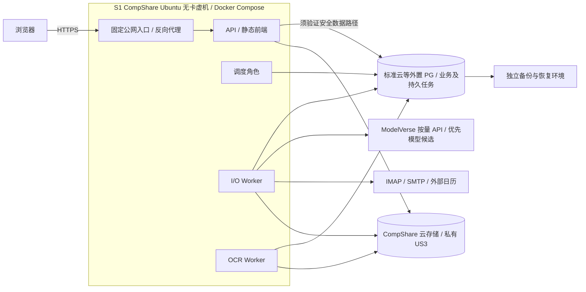
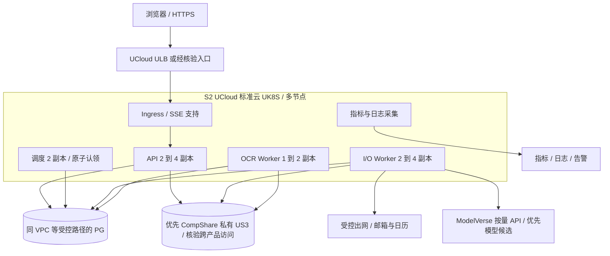

# 部署、弹性伸缩、容量与成本方案

设计日期：2026-10-17（北京时间）。状态：**方案设计，尚未实现或部署**。本文不提供可直接执行的 Dockerfile、Compose、Kubernetes 或 Terraform 文件，也不创建云资源、修改现有配置或迁移用户数据。资源数字、伸缩阈值与恢复时间均为起步假设或验收目标，不是实测结论。

## 1. 先决定需要什么，再选择部署工具

Daylight 的在线交互、邮箱等待、模型调用和 PDF/OCR 的资源特点不同。在线 API 需要稳定响应；IMAP、模型及 SMTP 主要等待外部服务，增加 CPU 未必加速；OCR 会持续消耗 CPU、内存与临时磁盘。因此先将同一仓库的模块化单体划分为 API、调度、I/O Worker、OCR Worker 四种运行角色。角色共享业务契约和版本，不因进程分开就变成四套独立微服务。

部署以 PostgreSQL 为共享权威存储，首期用 PostgreSQL 持久任务表承担任务认领、重试和检查点。**云服务优先评估优云智算（CompShare）：模型采用 ModelVerse 按量 API 候选，附件优先经平台云存储入口接入私有 US3，计算优先评估支持 Ubuntu 系统镜像的无卡实例。** PostgreSQL、托管 Kubernetes 和负载均衡尚无 CompShare 对应产品的核实证据，按需由 UCloud 标准云等服务补齐；不把同属 UCloud 视为网络、权限、SLA 自动互通。详细能力证据与采购矩阵见 [06 优云智算服务方案](06-compshare-service-plan.md)。

Redis、RabbitMQ、独立向量数据库、服务网格和持续占用的 GPU 均不作为首期硬依赖。普通 API、调度和当前 CPU OCR 不采购 GPU 算力来运行；无卡模式的首次创建路径可能先产生 GPU 实例费用，须单独计入，而不是宣称存在已核实的直接 CPU SKU。ModelVerse 的具体模型仍需验证 JSON 输出、工具调用、usage、延迟、额度与数据处理约定，不能只填 Base URL 就当作兼容完成。

| 阶段 | 形态与用途 | 进入条件 | 得到的收益与明确代价 |
| --- | --- | --- | --- |
| S0：当前实现 | 一个 Node 进程提供前端、API 和后台任务；依赖可选 | 现状，以根目录 `STATUS.md` 为准 | 适合开发；文件、内存和部分数据库路径混合，不能直接复制进程实现可靠多实例 |
| S1：可恢复试点 | 首选 CompShare 华北二A/上海二B 的 Ubuntu 系统虚机，以 8核16G 无卡模式运行 Docker Compose 及四种角色；PG、US3 外置。关键能力不满足时改用 UHost 应用主机与同 VPC PG | 权威状态、持久任务、权限、备份已通过；另核验无卡常驻/配额、首次 GPU 创建成本、实例生命周期及安全可用的 PG 数据路径 | 优先使用已适配的平台能力；单应用主机仍是故障单点，不承诺无中断；补充方案仍保留 ModelVerse 与平台 US3 优先 |
| S2：多节点运行 | 由 UCloud 标准云 UK8S 补充应用编排，按需 ULB；PG 采用已验证的数据网络，继续使用适配通过的 ModelVerse/US3 | 需要多节点故障恢复、独立角色伸缩或发布窗口缩短，且收益足以覆盖常驻成本 | 自动补副本、调度和滚动发布；UK8S 不是已证实的 CompShare 功能，也不要求把平台容器硬接成 K8s 节点 |
| S3：实测后增强 | 按瓶颈增加缓存、消息代理、数据库容量或专用 Worker 节点池 | 有压测、告警、账单和故障证据 | 每项增量单独解释收益，不把“服务数量”当作架构成熟度 |

Docker 在 S1 就有价值：固定 Node、原生 PDF 依赖和 OCR 语言包版本，避免主机环境差异，并通过 cgroup 限制附件处理对 API 的影响。[CompShare Docker 指南](https://www.compshare.cn/docs/operation/bestpractices/installdocker)适用于系统镜像虚机；平台基础/社区镜像本身是容器，不能据此推断支持 Docker-in-Docker、特权容器或 kubelet。Kubernetes 的价值从多节点调度、自动补副本、滚动发布和按角色伸缩产生；单机试点若尚无这些需要，先不支付集群常驻成本。只把现有单进程放进多个 Pod，不能获得安全的并发处理能力，也不为“优先 CompShare”额外自建 K8s 控制面。

首期不改成函数计算：现有 IMAP 会话、SSE、长链路、OCR 大依赖和人工审核后的恢复状态更适合常驻进程。后续独立、短时、无副作用的附件转换可另作评估。Node.js 继续复用现有 Express 和业务代码，不因上云重写语言；CPU 密集任务通过角色隔离解决。

## 2. 当前代码与目标部署之间的缺口

以下来自本次只读核查，不代表已修复：

| 当前证据 | 部署前必须完成的变化 |
| --- | --- |
| `server/index.js` 监听 `127.0.0.1`，启动时注册定时同步、消费者及 IDLE 监听 | 提供显式运行角色和容器监听地址；API 启动不再隐式运行调度与 Worker；依赖实际角色决定健康检查 |
| `server/infra/queue.js` 将 jobs 放进进程内数组，RabbitMQ 使用普通 channel；不可用时回退进程内执行 | 新增持久任务实现及事务入队；生产模式依赖失败时拒绝或暂停，不能回退本地；旧 RabbitMQ 配置不等于已有可靠任务系统 |
| `server/infra/redis.js` 在未启用或连接失败时使用内存，`sessions.js` 依赖此适配层 | 首期将验证码、会话、撤销、限流等需要跨副本一致的状态实现为 PG 存储，含 TTL 清理与原子消费；不能只关闭 Redis 后直接扩 API 副本 |
| PG、JSON 缓存、邮件/招聘/附件等路径并存，部分路径已有事务及权威标记 | 逐项完成共享状态清单、迁移和跨路径并发控制；本地文件只作可丢弃缓存或受控开发模式 |
| `server/infra/postgres.js` 当前每进程连接池 `max: 5`，配置 TLS 时使用 `rejectUnauthorized: false` | 按运行角色设置池上限和超时，生产验证服务端证书及 CA；数据库迁移从应用启动中独立出来 |
| US3 路径复用 S3 SDK；当前探测主要是桶检查、写入与删除 | 在选定地域实测上传、下载、权限拒绝、大小边界、签名和生命周期；配置入口不能代替协议与生产可用性验证 |
| 当前 `docker-compose.yml` 仅启动开发 RabbitMQ | 后续才设计完整镜像、配置和发布制品；本文件不把当前 Compose 视为全栈部署 |

## 3. 优云智算优先的资源映射与采购核验

2026-10-17 已阅读优云智算官方产品、区域、计费与协议文档正文；本轮未登录控制台、询价下单、创建实例或实连云服务。以下“文档支持”与“项目已验证”不同。优先采用匹配业务的 CompShare 能力，PG、UK8S、ULB 等缺口用 UCloud 标准云等服务补充；具体版本、库存、地域、权限、网络与订单价格仍须复核。

| 资源方向 | Daylight 需要的能力 | 选择原因及替代边界 | 采购/实连必须核验 |
| --- | --- | --- | --- |
| CompShare Ubuntu 虚机无卡模式；必要时 UHost 补充 | Linux 计算、Docker Compose、固定入口及可控数据网络 | 首选华北二A/上海二B 的 8核16G 无卡档；系统虚机能运行当前角色，无需 GPU 常驻。UHost 用于无卡常驻或安全数据库网络不满足时 | 先创建按量 GPU 实例再无卡启动的完整成本；当前账户配额、长期在线用途、镜像/CPU架构、库存、磁盘生命周期、SMTP出口、重建时延 |
| ModelVerse 按量模型 API | Chat Completions、JSON、工具调用、usage 与额度管理 | 优先调用平台模型服务，避免为低到中等负载常驻 GPU；保留用户已配置的兼容服务接口 | 各模型具体协议、上下文/输出上限、工具支持、计费项、数据处理、RPM/TPM及超时；不用客户端订阅套餐推导后端服务授权 |
| UCloud 标准云等托管 PostgreSQL 补充 | 事务、唯一约束、行锁、JSONB、TLS、备份与恢复 | CompShare 尚无已核实的托管 PG 产品；业务和首期任务继续同库，不为平台统一而改用不适合的状态存储 | 与应用之间经过验证的私有或等效隔离路径；PG版本、连接数、IOPS、PITR、主备/跨区能力、CA和费用；不要预设 `pgvector` |
| CompShare 云存储入口的私有 US3 | 保存邮件附件和受控导出，跨实例读取 | 前两区的云存储文档说明对象存储及 HTTP/S3 访问；优先复用现有对象适配，符合不可变附件用途 | endpoint/region/签名、凭据作用域、私有读写、对象下载、删除/版本、生命周期、网络路径、请求/外网流量及异地备份；平台账号与标准云权限不能直接等同 |
| CompShare 外网防火墙；标准云 VPC/安全组按需补充 | 限制公网入口、隔离数据路径与可控出网 | 前两区有固定公网IP与源IP规则；这不等于拥有可接标准云PG的VPC | 外网规则只控制其覆盖的公网流量；内网隔离/跨产品互通、DNS、路由、TLS、IPv6与费用必须另外验证 |
| UCloud 标准云 UK8S 补充 | 多节点调度、Deployment、探针、资源配额、可选节点伸缩 | S2 确需多节点时使用托管编排，不把 CompShare 计算 API 当作已经支持 K8s 节点伸缩 | 支持版本、控制面费用/可用性、节点池、CSI/CNI、metrics-server、自定义指标、伸缩集成和权限、拓扑标签及对 CompShare 服务的出网 |
| S1 自管 HTTPS 反向代理；S2 按需 UCloud ULB | HTTPS、健康检查、连接转发 | S1 使用固定公网IP上的虚机代理；ULB为多节点入口补充，CompShare映射端口不能自动视为等价负载均衡 | 域名/TLS、SSE、空闲超时、连接数、源IP、入口故障切换；ULB的集成和费用另核验 |
| 镜像仓库、日志/监控、密钥管理 | 镜像拉取、版本追踪、告警和受控注入 | 优先用可验证的现有或托管能力；不要求这些能力都采购独立产品 | 镜像仓库私有访问/扫描、日志保留和计费、告警送达、密钥审计/轮换、Kubernetes 集成 |

**CompShare 应用实例到外置 PG 的安全数据路径是 S1 首选方案的准入条件。** 不假设它与 UCloud 标准云同地域就能私网访问，不把开放公网数据库作为默认解法。如果不能验证安全、可用且成本合理的数据路径，S1 计算改为 UHost，并将 PG 放在同 VPC 的受控网络内；ModelVerse 和经验证的 CompShare US3 仍优先采用。只有另有明确需求时才设计跨产品专用连接，不为保持计算平台名称而额外搭建复杂隧道。

如托管 PostgreSQL 的价格或功能不适合试点，可评估独立主机自建 PG，但须把持久盘、备份、补丁、监控、复制和值守成本一起比较。CompShare 云存储 Pro 是文件存储，不是托管数据库；支持 POSIX 不等于已验证 PG 的 fsync、故障一致性和延迟。把数据库与全部应用放在同一台主机只保留为开发/演示选项，不作为高可用生产方案。

[服务框架协议](https://www.compshare.cn/docs/overview/serviceagreement/frame)第1.2.1条包含不对服务可用性、可靠性作出承诺的表述；实施前须核验其适用产品、订单和另行签署合同，不据此替所有产品作法律结论。不能因其属于 UCloud 就继承其他云产品的 SLA。本方案中的 SLO/RTO/RPO 是 Daylight 的设计与演练目标，不能写成 CompShare 的服务保证。

## 4. 两种目标拓扑

S1 只有一个计算故障域；PG、附件与备份离开应用主机，支持主机丢失后重建。首选计算为 CompShare 前两区的无卡 Ubuntu 虚机，图中的 PG 数据连接须先通过第3节准入，不能把箭头当作已有私网互通。若不通过，应用和 PG 改放标准云同 VPC。静态前端暂由 API/反向代理服务，只有静态流量或跨地域延迟有证据时再引入独立 CDN。

PG 持久任务与业务状态同在外置 PostgreSQL，运行角色只持有可丢弃的执行中状态。图中 CompShare 计算的补充方案是 UHost + 同 VPC PG，不是把 PG 公网端口放开。S2 将相同角色移到 UCloud 标准云 UK8S，不同时重写业务接口、任务协议和存储模型；ModelVerse/平台 US3 的网络、权限和费用按跨产品实际连接再次验收。

S1/S2 共用一套不可变版本号和数据库兼容策略。API 与轻量 I/O 可从同一构建基础生成镜像；OCR 镜像仅增加其所需原生库和已固定版本的语言包。运行时不以联网下载语言包作为健康启动前提，不能将用户邮件、密钥或 `data/` 放入镜像层。镜像使用非 root 用户、只读根文件系统与显式临时目录，按 digest 发布。

## 5. 起步资源、并发与节点容量

下表是压测起点。`requests` 表示 Kubernetes 调度预留，`limits` 表示容器上限；Docker 阶段使用等价 cgroup 上限，并通过主机监控验证余量，不能把 Compose 当作具备 Kubernetes requests 调度能力。

| 运行角色 | S1 副本 | S2 基线 / 初始上限 | 每副本 CPU request / limit | 每副本内存 request / limit | 起步并发与临时空间 |
| --- | --- | --- | --- | --- | --- |
| API（含静态前端） | 1 | 2 / 4 | 250m / 1000m | 256Mi / 512Mi | SSE 连接数、请求体及上传大小单独设上限；不在 API 进程执行 OCR |
| 调度 | 1 | 2 / 2 | 100m / 250m | 128Mi / 256Mi | 批量认领到期邮箱，短事务提交；两副本不表示同邮箱运行两次 |
| I/O Worker | 1 | 2 / 4 | 250m / 1000m | 512Mi / 1024Mi | 每副本初始最多 2 个就绪任务；同邮箱变更链按序，模型/SMTP另有全局额度 |
| OCR Worker | 1 | 1 / 2 | 1000m / 2000m | 1536Mi / 3072Mi | 每副本 1 份文档；临时盘 request 1Gi / limit 4Gi，文档字节/页数另有限制 |
| 入口代理 | 1 | 2 / 2 | 100m / 500m | 128Mi / 256Mi | SSE 连接、下载和超时按实测配置 |

S2 的 1 个 OCR 副本允许节点故障后重新调度，期间 OCR 排队；若服务目标要求在一个节点退出时仍能开始新 OCR 任务，基线改为 2，且分散到不同节点。I/O 初始并发 2 只是本地槽位，不是允许任意数量的模型并发，更不是对邮箱供应商连接数的承诺。

S1 首选资源按官方 **8核16G 无卡档**评估；上述角色 request 类比合计仍为 **1.7 vCPU / 2.5GiB**，副本和业务并发不因主机规格变大而自动增加。[无卡模式文档](https://www.compshare.cn/docs/operation/gpu/cardlessmode)只给出前两区 2核4G/8核16G 两档，未证明可直接创建任意 CPU SKU；8核16G 为容纳 OCR 峰值及操作系统余量的起步候选，资源闲置成本也要进入对照。平台的 G 单位与容器 Mi/GiB 需以实际可见内存复核，不能只按商品名称推定全部可分配容量。

2核4G 档虽可能容纳较低的日常 request，仍不足以凭配置就承诺本方案的 OCR 峰值、镜像操作和故障余量；若用于纯 API/I/O 小样本试点，应关闭或外置 OCR 后重新测量，不直接套用完整角色验收。其他三区仅支持2核4G且每区同时最多一个无卡开机实例，也不能用它们推导多节点无卡集群。

**UHost 补充方案**保留 4 vCPU / 8GiB 应用主机算例，而不是称 CompShare 有该规格。两种方案均需给操作系统、镜像拉取、解析峰值与监控留空间。各容器 CPU limit 在较小主机上相加可能超过主机 CPU，同时繁忙时会竞争和节流；先限制 OCR 并发，不以理论上限相加推断吞吐。最终比较完整费用、实测延迟、资源利用率与安全数据连接，再确定 S1 落点。

S2 的 **UCloud 标准云 UK8S** 容量示例取 **3 台 4 vCPU / 8GiB 节点**，不表示 CompShare 提供该节点规格或支持直接接入。仅为算例，假设每台扣除系统、kubelet、网络与日志/指标 DaemonSet 后，留给上表工作负载的有效容量为 **3.4 vCPU / 7GiB**；落地必须读取节点真实 allocatable，再扣未包含的 DaemonSet 开销，不能重复计算或遗漏。

- 基线 2 API + 2 调度 + 2 I/O + 1 OCR + 2 入口：request 合计 **2.4 vCPU / 3.5GiB**。
- OCR 基线改为 2：request 合计 **3.4 vCPU / 5GiB**。
- 初始上限 4 API + 2 调度 + 4 I/O + 2 OCR + 2 入口：request 合计 **4.4 vCPU / 6.5GiB**。
- 三节点合计为 10.2 vCPU / 21GiB；失去一台后为 6.8 vCPU / 14GiB。正常容量规划先保留约 30% 余量，计算条件为 `Σ workload_requests + 滚动发布 surge_requests ≤ 0.7 × 有效总容量`。
- 初始上限加 1 个 API 和 1 个 OCR 的发布 surge 为 5.65 vCPU / 8.25GiB，在三节点示例的 70% 预算内；单节点故障期间不同时做这两项 surge，暂停发布并冻结扩容目标，先恢复节点。不能据上面总量断言每个 Pod 必能放下：还须检查单 Pod 可容纳性、拓扑分散、污点、临时盘和端口等约束。

这些数字说明需要如何计算，不证明三台节点已是最优规格。若实测 CPU 低而内存高，就改节点规格和 Pod request；如果模型额度已满，增加节点没有业务吞吐收益。limit 合计不代表保证容量，CPU 节流、OOM、节点失效后的持续负载必须单独压测。

API、调度、入口以及多个 I/O/OCR 副本用拓扑分散约束跨节点放置；只有云资源确有不同故障域时才配置跨可用区分散。起步使用共享通用节点池，避免为一个低利用率 OCR 常驻专用池。OCR 饱和、噪声干扰或规格明显不同时，再增 CPU/内存型专用池并加污点和容忍。API 优先级高于可重试 OCR，但优先级不能替代容量，抢占同样可能中断附件处理。

开发/测试与生产隔离命名空间及凭据；用 ResourceQuota 限制各环境的总 requests、limits、Pod 和临时存储，并用 LimitRange 为漏配工作负载提供边界。配额应覆盖已核算的最大副本与发布余量，不能在HPA扩容时才发现被配额拒绝。集群规模小时不为每个用户建命名空间，租户隔离仍由应用授权、数据范围和任务配额完成。

## 6. 伸缩由队列与瓶颈决定

下表 HPA、KEDA 和节点伸缩适用于 S2 已验证的 UK8S 环境。S1 Compose 使用固定角色副本、队列背压和受控变更；CompShare 有启停/创建 API 不等于已集成 Kubernetes Cluster Autoscaler，也不等于无卡实例能够无条件快速扩出。不得用频繁关机/有卡无卡切换代替在线 API 的弹性方案。

| 控制层 | 输入和初始策略 | 不负责什么 |
| --- | --- | --- |
| API HPA | 起步 2–4 副本，CPU request 使用率目标约 60%；结合在途请求、SSE 数和事件循环延迟校验；缩容稳定窗口起步 5 分钟 | 不负责扩数据库、采购更多模型配额，也不能补救同步执行 OCR 的阻塞 |
| Worker 副本控制 | 首期先固定副本并测量。确需自动伸缩时选 HPA 自定义指标，或经核验的 KEDA PostgreSQL/custom scaler；每类 Worker 只使用一个副本控制器 | 不同时让两个 HPA/ScaledObject 管同一 Deployment；不能把人工审批和供应商退避任务当成待抢占工作 |
| 节点自动伸缩 | 在支持并核验的 UK8S 节点池实现上，依据调度不下的 Pod requests 增减节点，设置最小/最大数及费用上限 | 不直接读取业务队列，不会自动提高 Worker 副本，也不会突破数据库连接数和外部额度 |
| 应用配额与背压 | 全局/租户/邮箱限流、供应商 token/RPM/连接预算、任务准入和熔断 | 不因集群剩余 CPU 多就发起更多外部调用 |

I/O 不宜仅按 CPU 伸缩：外部等待时 CPU 低，但排队可能很高。优先观察“**可运行任务**的最老等待时间、积压工作秒数与可用槽位”，剔除 `waiting_approval`、未来 `retry_at`、依赖未满足和供应商熔断期间的任务。初始目标可取可运行任务排队 p95 ≤ 60 秒，须和服务目标文档一起验收；模型执行时间、OCR 时间和用户审核时间单独统计。

启用ModelVerse云OCR时按阶段计量：CPU渲染/本地OCR/结果校验计入OCR Worker积压，云OCR请求计入I/O Worker的独立并发与模型额度，远端等待不占CPU槽。不能把云OCR排队全部折算成CPU工作量，导致扩OCR节点却没有增加可用模型额度。

Worker 数量的估算为 `所需副本 = ceil(到达率 × 平均服务时间 ÷ 每副本并发 ÷ 目标利用率)`，再取数据库、外部额度、节点及预算允许的上限。这里服务时间按 I/O/OCR 类型分别采样；高方差文档不能只用平均值，需同时观察 p95、超长文档和每邮箱顺序约束。增加邮箱间并行，不能乱序并发处理同邮箱中的邀请、改期与取消。

例如，假设模型额度 120 请求/分钟、120,000 Token/分钟，平均一次合计 4,000 Token，则 Token 预算只支持约 30 请求/分钟；按 80% 使用预算为 24 请求/分钟。若平均调用耗时 8 秒，初始全局模型并发可设 3，配合请求和 Token 双重限流，逐步测量。此处所有数字均是假设，**不是 ModelVerse 或其他当前模型的已核实额度/延迟**。真实限流按预估输入及最大输出预留 Token，回执后校正；平均 Token 算法只能做容量估算，不能作为硬限流的唯一依据。ModelVerse 的 HTTP 429、请求并发限制与按量预算必须独立于 Worker 副本数执行。

调度采用每邮箱的 `next_run_at`、原子认领和唯一任务键，抖动触发时间，避免整点同时扫描全部账号。手动同步合并已有待执行任务并反馈进度；每邮箱最多一个有序变更处理链。对 IMAP IDLE，连接占有者也要租约和 fencing token，连接预算由供应商和自有出口资源决定；不把每个 API 副本的 IDLE 监听都开启。长 IMAP、OCR、模型或 SMTP 周期内不得持续持有数据库事务和行锁，认领与检查点使用短事务，执行阶段依靠租约续期、过期恢复和提交时校验所有权。

首期固定上限仍不足以约束供应商消耗。API 和 Worker 均须使用共享的额度状态，避免每个副本各自允许 24 请求/分钟。额度耗尽时保存可解释的排队状态，不即时重试放大 429；达到队列长度、单租户占比或预算上限时拒绝新增低优先级工作并给出重试时间。

## 7. 数据库连接、容量与共享状态边界

应用连接预算必须随最大副本数计算，不能沿用当前每进程 5 个连接的默认值后无限扩容。起步可设 API 每副本 5、调度 2、I/O 3、OCR 2，均按需建立并及时释放。以初始最大副本计：

`C_app = 4×5 + 2×2 + 4×3 + 2×2 = 40`。

若启用03中的 LISTEN/NOTIFY 唤醒，可按每个API进程最多1条专用监听连接、全局最多4条另计，所有SSE客户端复用该进程的通知分发，不为每个浏览器连接建立PG连接。如给发布 surge 留10（含额外监听）、运维迁移/监控留10、故障诊断与系统保留20，则示例连接上限至少需要 `40 + 4 + 10 + 10 + 20 = 84`；不使用额外监听时为80。采购核验后可按100档预算，这些不是已知云套餐规格。真实约束为 `最大应用连接 + 额外监听 + surge + 运维与系统预留 ≤ 已购实例允许连接数`。若实际只允许60，必须降低副本/池上限或调整规格，不允许上线后依靠连接超时报错“自然限流”。

数据库事务只覆盖认领、状态更新和业务提交，不包含外部等待；池等待超时、语句超时、空闲事务超时分别设置并观测。仅在连接数量或建立成本成为瓶颈后评估 PgBouncer，先验证事务池对会话变量、锁、监听和现有驱动使用方式的影响。任务查询有 `status / run_at / type` 等匹配索引，过期任务与审计记录按保留策略归档/清理，避免队列表膨胀拖慢用户查询。

PG durable jobs 并非把全部业务锁在一张表里。任务记录、外部效果记录和租户权限仍有明确边界；业务变更与任务创建在同一事务，任务 payload 保存引用和必要版本，不复制整封邮件、授权码或 API Key。Redis 仅在共享短时状态或热点缓存的测量收益足够时引入；RabbitMQ 仅在队列负载、路由、消费者扩展等需求证明 PG 方案不合适时引入。届时必须核验 AMQP 协议、confirm/ack、持久化、重投和故障行为，不能把其他云 MQ 名称直接替换现有 RabbitMQ 配置。

## 8. 网络、SSE、附件和密钥

业务公网只开放 HTTPS 入口；管理 SSH 仅从受控运维来源进入，管理页面另有限流与强认证。数据库、队列和集群控制接口不向公网开放。API 可访问数据库及私有附件读取；调度原则上只需数据库；I/O Worker 需要数据库、US3、邮箱和模型/日历供应商；OCR 只需领取任务、读取附件和提交结果，不默认允许任意互联网访问。S1 使用虚机/容器网络及主机和云侧访问控制，S2 才加入经过验证的 NetworkPolicy。

可选云OCR仍由I/O Worker调用ModelVerse HTTPS：OCR Worker先渲染页面并保存受控临时对象引用，在PG登记子任务后让出CPU槽；I/O Worker经授权与配额检查读取页图、调用模型并保存结果，随后由OCR Worker校验。对象引用不开放匿名访问，清理等待任务/恢复窗口结束。这样无需把模型出口或API Key授予CPU解析角色，具体契约见06。

[CompShare 区域](https://www.compshare.cn/docs/operation/introduce/region)及[端口文档](https://www.compshare.cn/docs/operation/gpu/firewall)说明：华北二A/上海二B 支持 Ubuntu 系统虚机、固定独立公网 IP、源 IP/网段防火墙；其他三区仅容器和 HTTP/TCP 端口映射，没有独立公网 IP、不支持源地址限制，出口 IP 可能随重启变化。因此 S1 优先前两区，默认关闭不需要的 Jupyter/RDP/应用直连端口，不能照搬镜像预置防火墙。Ubuntu 虚机 SSH 通常为 `ubuntu:22`，平台容器为 `root:23` 或映射端口，具体以实例类型为准。

固定公网 IP 不证明有固定私网路径，外网防火墙也不能替代数据库内网隔离。跨 CompShare 与 UCloud PG 的连接先确认路由、双方访问控制、TLS/CA、出口及费用；不能因为实例 ID 形式像 UHost 就认定同 VPC。无法满足时按第3节改用 UHost + 同 VPC PG。CompShare 前两区的共享带宽文档说明是平台共享2Gb、单IP上限150Mbps，不是每台独享2Gb或可用性保证；只有测得附件流量/交互拥塞后才比较独享带宽费用。

收信是客户端出网，通常不需要开放服务器入站 993；IMAP 993、强制 STARTTLS 143，以及 SMTP 465/587、模型/日历 HTTPS 443 等出口根据账号实际配置放行。不能假定学校邮箱一定公网可达，也不能假定云主机允许所有 SMTP 出站端口；这些是迁移前实连核验项目。连接保持证书校验，不通过关闭 TLS 验证或硬编码临时 IP 解决连通性问题。

用户可配置模型 Base URL、邮箱服务器或外部日历地址，这使外联带有 SSRF 风险。网络策略不能替代应用校验：生产拒绝 loopback、link-local、云元数据、未授权私网和危险端口；对 DNS 解析结果、IPv4/IPv6、跳转链和连接实际地址持续校验，防止 DNS 重绑定。公网域名 allowlist 适合已支持供应商，自定义供应商通过管理批准的出网规则扩展。确需学校/VPN私网邮箱时，使用租户受控连接器或隔离出口，显式授权具体网段，不能为了一个账号开放整个 VPC。标准 NetworkPolicy 通常不能直接按域名表达全部规则，因此是否需要 egress proxy/gateway 应由自定义接入规模决定。

SSE 入口需要关闭响应缓冲、缓存和不适合流式响应的压缩，验证代理到后端各层的空闲超时、连接上限和断开行为。起步可设计 15 秒心跳与大于 60 秒的空闲容忍，最终值应根据供应商延迟及入口能力核验；一个多步任务不能因为单次模型超时为 60 秒就把整条 SSE 强制限制为 60 秒。页面断开不代表取消已持久化任务；通过 `requestId`、事件游标或状态查询恢复结果，多副本不依赖粘性会话。若当前事件只能由正在执行的进程内存提供，先补共享进度与重连语义，再通过入口扩副本。

附件桶默认私有，API 按用户、邮箱和资源归属鉴权后代理流式读取，或在接口验证支持后签发短时、单对象的受控下载 URL。对象 key 不可猜测不是权限控制。[官方 S3 兼容说明](https://docs.ucloud.cn/ufile/s3/s3_introduction)列出 V4 签名/path-style、同账号桶与Key/Token、Versioning不支持等边界，不能依赖桶版本控制保存业务历史；采用不可变对象 key、PG 版本引用与独立备份。PutObject单次大小边界、Range、ACL和生命周期适用地域仍须按当前版本验证，业务附件限额应低于已核实的接口上限。

对象传输默认走已验证的 HTTPS 接口；该兼容说明还列出内网不支持 HTTPS，不能为了省流量静默切成 HTTP。私网端点是否存在符合本项目加密要求的访问方式需另行核验，否则评估 HTTPS 路径费用及延迟。上传限制字节数、页数和解析时间，PDF/OCR 在隔离 Worker 内处理，临时文件按任务清理；失败上传不将不存在的对象标为可用，孤立对象由有保留窗口的清理任务回收。敏感附件不配置公开 `publicBaseUrl`。

密钥由部署环境注入，配置界面中的用户邮箱/模型凭据需要加密存储，密文与解密根密钥分离；具备经核验的托管密钥服务时采用密钥封装，否则选择等效受控方案并记录轮换责任。Kubernetes Secret 的 Base64 不是加密；限制 RBAC、开启可用的静态加密及审计，禁止写进镜像、Git、任务 payload 或日志。日志只记录任务/租户不可逆标识、状态、错误类别、阶段耗时和 usage，邮件正文、简历内容、授权码、完整模型提示词和含签名的下载 URL 不进入默认日志。

## 9. 健康检查、排空与发布

| 机制 | 设计要求 |
| --- | --- |
| Startup probe | 容器加载和必要初始化完成后再启用存活判断；镜像内准备 OCR 依赖，不因首次下载延迟触发重启风暴 |
| Liveness | 仅检测进程/事件循环是否失去响应，不因模型供应商或数据库短暂故障连续杀死全部副本 |
| Readiness | API 验证接单所需的关键状态能力；数据库不可用时拒绝新写入。Worker 停止领取任务并上报告警。具体可读降级要有契约，禁止改写本地缓存冒充成功 |
| 优雅停止 | API 先摘流，再排空短请求并通知 SSE 客户端重连；Worker 停止领取新任务，保存检查点，完成安全提交后退出 |
| 关闭时限 | API 起步 30 秒、I/O 120 秒、OCR 180 秒，再按任务切片/超时实测调整；Kubernetes grace period 与入口摘流延迟留出余量，不试图无限等完整批次结束 |
| 被强制结束 | 租约到期后恢复可重试工作，提交校验 fencing token；SMTP/建会等结果未知的操作保留 `unknown` 并核验，不能把杀进程当作“安全重试”信号 |

发布使用已扫描、带版本/digest 的制品；开发、测试、生产配置独立。数据库迁移使用单独、受控的一次性 Job/流程，不让每个 API Pod 启动时同时执行 DDL 和隐式导入。先执行兼容性扩展迁移，再发布支持新旧格式的角色，最后才收缩旧字段。

API 起步设置滚动 `maxUnavailable=0`、`maxSurge=1`；Worker 根据队列可等待性设置 surge，禁止在节点故障和容量不足期间无控制地并发滚动。API/入口有两副本时可设 `minAvailable=1` 的 PodDisruptionBudget；调度同理，OCR 单副本不设置阻止维护的虚假高可用约束。**PDB 只约束部分自愿中断，不抵御主机宕机、可用区中断或数据库故障**，也不自动创造空余容量。

第一批真实流量采用受控账号/小范围租户，观察错误率、任务等待、重复效果、数据库池等待和供应商 429，再扩大流量。使用数据库 `expand → 兼容运行 → 数据回填/核验 → contract` 策略；旧字段和旧镜像保留至约定回滚窗口结束。回滚镜像只能回到与现有 schema 兼容的版本，不能简单还原旧数据库快照覆盖新业务写入。数据变更不可逆时采用向前修复或经过业务确认的恢复流程，禁止自动回滚时重复发信。

## 10. 故障恢复、备份及 RTO/RPO

CompShare 的实例、系统盘、数据盘、对象存储和镜像具有不同生命周期，恢复设计必须先区分它们，不能将“关机保留”写成“永远不会回收”：

| 资源/操作 | 已核实的文档行为 | Daylight 的设计要求 |
| --- | --- | --- |
| 按量实例关机 | CPU/GPU/内存释放并停计算费；超免费额度的系统盘、数据盘和镜像等仍计费 | 停计算不等于总账单归零；常驻 API 不以关机省费；保存可恢复制品和外置状态 |
| 连续关机/欠费回收 | [回收规则](https://www.compshare.cn/docs/operation/charge/recycle)说明，无欠费按量实例连续关机7天可自动回收实例、系统盘及EIP，挂载数据盘被卸载保留；欠费有更短的停服/回收期限 | 余额、订单、关机时长和资源生命周期纳入告警；不把暂关机主机当作长期备份，恢复时须能重新分配入口 |
| 系统盘 | [云盘文档](https://www.compshare.cn/docs/operation/gpu/disk)说明系统盘跟随实例创建和释放；前两区为云盘，其他区为本地盘，重开机可能迁移 | 系统盘只保存可重建环境/受控临时内容；系统盘本身不是备份，也不保存唯一的任务账本、邮件或密钥副本 |
| 独立数据盘 | 仅前两区支持，卸载后可保留并继续收费；[删除 API](https://www.compshare.cn/docs/gpus/instance/terminatecompshareinstance)的 `ReleaseUDisk=true` 可同时删除 | 不自动随应用释放删除持久盘；另管理孤立收费盘和备份。未核实独立盘快照/应用一致性能力，不以“云硬盘”推断已具备 PITR |
| 云存储/云存储Pro | [云存储文档](https://www.compshare.cn/docs/operation/gpu/networkvolume)说明独立于实例生命周期，不随镜像保存；欠费到期仍有数据删除规则 | 前两区对象存储用于附件；Pro是其他区域的文件服务，不能直接套对象协议或数据库承诺。备份、账号权限与续费监控另做 |
| 自制镜像 | [镜像文档](https://www.compshare.cn/docs/operation/gpu/releasecommunity)说明分层存储，已有层文件删除后可能仍留在层中 | 只存代码/固定依赖；不放密钥和邮件正文。镜像不包含云存储内容，也不是数据库一致性备份 |

无卡首选方案的恢复还取决于平台库存、账户配额、Ubuntu镜像可用性及重新创建/启动路径；必须演练完整重建，不将文档标注的典型启动速度作为 RTO 保证。抢占式实例可能被随时中断，首期不用于 API、PG、调度或外部发送；仅在未来可重算 GPU 批任务有实测收益时另行评估。

| 故障范围 | 预期处理 | 起步恢复目标与适用前提 |
| --- | --- | --- |
| S1 应用主机重建或必要的数据恢复 | 按已验证的 CompShare 无卡重建路径或 UHost 补充方案恢复镜像、配置、权限与入口；必要时恢复 PG，校验任务后恢复调度 | RTO ≤ 4 小时；PG 完好时应用主机损失对已提交事务的 RPO=0。涉及数据库恢复时目标 RPO ≤ 15 分钟，须先完成备份/PITR与异机恢复验证；平台库存和协议不提供此目标的自动保证 |
| S2 单应用节点失效 | 入口摘除失效副本，其他节点继续服务；租约到期后恢复可重试任务 | RTO ≤ 10 分钟；对已提交且数据库仍完好的事务 RPO=0。该范围不包含供应商外部结果未知、数据库故障或未提交的内存工作 |
| S2 PostgreSQL 故障 | 按实际主备/备份能力切换或恢复，应用停止新副作用，重连后核验检查点与 unknown 操作 | 设计目标 RTO ≤ 30 分钟、RPO ≤ 5 分钟；是否可达由所购实例复制方式、PITR、数据量及演练决定，不能从“托管”二字推出 |
| US3 暂不可用 | 附件任务退避，保留错误；独立的日历/待办读写可在不依赖附件的范围继续 | 不承诺对象服务恢复时间；依赖恢复后任务续做，不能静默落到某 Pod 磁盘 |
| 模型/邮箱供应商不可用 | 熔断和退避，显示等待；保留已确认业务状态 | 不承诺第三方可用性；不通过扩 Worker 反复请求放大故障 |
| 整个地域不可用 | 首期不提供双活或自动跨地域接管；依据独立异地备份和演练执行恢复 | 可评估 RTO ≤ 24 小时、RPO ≤ 24 小时的灾备目标，只有异地加密备份、密钥和恢复环境验证后才能采用；不计入首期已具备能力 |

RTO 从可确定的故障发生时刻到约定核心服务恢复计时，并单列检测、确认、处置和业务核验耗时；无法确定故障起点时说明测量限制，不把检测延迟从用户停机时间中隐去。RPO 指允许丢失的已提交状态时间窗口；各范围需分开记录，不能将应用节点的 RPO=0推广成整个系统无数据丢失。任务状态恢复不等于外部世界回滚，尤其 SMTP 已接受、模型已计费或会议已创建的操作必须对账。

备份至少包括 PG 全量/PITR链路、附件元数据和对象、模板/配置版本、可恢复的密钥授权、镜像与发布记录。数据库恢复点和对象保留窗口应相互覆盖：首选 US3 路径用不可变对象 key + PG 版本引用 + 独立备份，不依赖当前 S3 兼容接口未支持的 Versioning。删除保留足够窗口；恢复后对账缺失/孤立对象，不假设对象存储与数据库存在跨系统原子快照。备份账号权限与运行账号分离，不让被攻陷的应用同时删除主数据和所有备份。

试点建议每日备份并按实际服务能力连续归档日志，起步保留 7–14 天供评估；具体频率与保留期由已约定 RPO、隐私及费用确定，不由“每天备份”推断 15 分钟 RPO。首次上线前在独立环境完整恢复一次，之后定期与重要 schema 变更后复验，记录数据量、完整性、用时和演练版本。未完成恢复演练时只可写“备份配置已保存”，不能写“灾备已通过”。

## 11. 成本如何估算和控制

价格分为官方文档标价、控制台订单价和实际账单，本轮只核实了公开文档，未报价下单。2026-10-17 读取的[无卡模式官方文档](https://www.compshare.cn/docs/operation/gpu/cardlessmode)列出8核16G为 **0.6元/小时**；按30天连续运行720小时计算为 **432元计算费**。它不是总成本或价格承诺：首次创建 GPU 实例至转入无卡模式的费用、超额系统盘、独立盘、镜像、PG、US3、带宽、模型调用及运维另算，会员折扣和最终订单需复核。平台无卡档非直接 CPU SKU 的事实应和价格同时展示，不能仅用432元推销“整套系统包月”。

UHost 补充方案和 S2 UK8S 的报价另查，不从 CompShare 标价推导；按月成本模型为：

`C_total = C_compute + C_cluster + C_ingress + C_database + C_storage + C_network + C_observability + C_model + C_ops`。

| 项目 | 可复用估算方法 | 容易漏计的成本 |
| --- | --- | --- |
| 计算 | `Σ 实例小时数 × 对应计费状态单价`；S1优先1台8核16G无卡虚机，UHost补充报价单列；S2为标准云3节点示例 | 首次有卡创建/重建阶段、系统盘、镜像、空闲HA容量；无卡与有卡不能混同单价 |
| 集群/入口 | S1固定IP上的自管HTTPS代理；S2控制面/负载均衡等按实际产品计价 | UCloud补充服务、独享带宽、NAT/出口IP；平台共享带宽不是每台实例独享额度 |
| PostgreSQL | 实例规格 + 数据/日志/备份空间 + HA/恢复相关费用 | 任务历史、trace、索引、数据库膨胀、备份保留、恢复演练 |
| CompShare US3 | 存储用量×文档/订单计费周期 + 对应请求数 + HTTPS下载流量 + 独立备份；与云存储Pro容量计费分开 | 附件反复下载、孤立对象、不可变旧对象、跨地域备份、HTTPS路径流量，不能假设内网免费路径满足TLS要求 |
| ModelVerse等模型 | `Σ (未缓存输入Token×对应单价 + 缓存输入Token×缓存单价 + 输出Token×输出单价)`，按各模型价格与usage口径换算；供应商不单列缓存时按其账单规则计算 | 不把总输入中的缓存Token重复计费；独立缓存写入等项目按供应商口径另列；另计重试、未知usage、税/汇率/折扣 |
| 可观测性与运维 | 日志写入/保留、指标时间序列、Trace采样、告警 + 人工维护时间 | 高基数用户/邮件标签、全文日志、集群升级、自建数据库值守 |

以 **100 个活跃邮箱**作为容量讨论样本，假设平均每邮箱每天 30 封新邮件、每封一次 4,000 输入 + 500 输出 Token 的调用：一天 3,000 次调用，对应 1,200 万输入与 150 万输出 Token。若 10% 邮件各含一份平均 2MiB 附件，一天约新增 600MiB，30 天约 17.6GiB 原始附件；备份、副本、索引与历史保留另算。这是工作量假设，不是当前使用量；应按真实去重率、规则过滤、页数和模型 usage 替换。若 100 邮箱都每分钟连接一次，则最多约 14.4 万次轮询/日，说明闲置邮箱自适应调度、UID 增量和连接复用可能比加节点更值得先优化；任何降低轮询频率都需明确它对通知延迟目标的影响。

单位成本至少报告“每封成功处理新邮件”“每份成功 OCR 文档”“每个完成工作流”三项，并单列固定 HA 资源分摊。费用未知不能计为零。S1 比较 CompShare 8核16G 无卡和 UHost 4vCPU/8GiB补充方案时，要用相同任务负载比较完整费用、闲置资源、网络及恢复成本；不能只看核数或单小时价。S1 与 S2 比较将三节点、入口、监控及数据库 HA 的固定成本纳入，同时记录容器重建与人工运维耗时。

控制成本的优先次序是：邮件 ID/附件内容哈希去重，减少重复模型和 OCR；限制上下文与输出并记录质量变化；共享供应商额度并退避；按队列压缩空闲 Worker；再依据实测调整节点规格。GPU 或自托管模型只有在数据合规、延迟、持续用量及运维能力的综合测算优于托管 API 时才讨论，不能为了比赛展示先采购。

## 12. 部署和扩容门槛

S1 上线前应完成：生产模式禁止静默文件/内存回退；角色边界明确；全部权威状态与会话可恢复；持久任务及租户隔离通过；真实依赖使用受控账号连通；SSE/附件鉴权与外联策略验证；失败与未知外部效果不盲重试；备份异机恢复、发布回滚和成本采样有记录。仅有容器能启动不算达成。

CompShare 首选路径另有六项准入：①所选区域/Ubuntu系统镜像支持实际Docker部署；②8核16G无卡长期运行、配额、首次创建及重建成本清楚；③外置PG安全数据路径通过，否则改UHost同VPC方案；④固定入口、TLS/SSE、IMAP/SMTP与ModelVerse调用通过；⑤私有US3接口、权限、不可变对象/备份和HTTPS下载通过；⑥欠费/连续关机回收、余额告警、镜像与独立状态恢复演练通过。平台资源售出或客户端页面显示“运行中”不能代替这些门槛。

进入 S2 前还要核验标准云 UK8S/ULB 的实际采购和网络、从该环境访问 CompShare 模型与对象服务的权限/费用，再验证两个以上 API/Worker 的并发行为、同邮箱顺序、租约过期与旧持有者回写拒绝、滚动排空、节点失效、数据库中断、共享限流和跨副本会话撤销。不为保留平台名称而假设 CompShare 已有托管K8s或节点伸缩。根目录已有本地/模拟/历史真实测试不替代这一轮云端验收。

自动伸缩启用前需提供：代表性负载下队列到达率及服务时间，CPU/RSS/临时盘曲线，PG 池等待与最大连接预算，供应商额度和 429 行为，实际扩容启动时延，最大账单边界，以及缩容中的任务完成/恢复证据。先固定副本测基线，再启用指标控制；确认扩容确实改善排队而未抬高外部失败率。

生产验收将读 API p95 ≤ 500ms、5xx < 1% 与可运行任务排队 p95 ≤ 60 秒作为可讨论的起步目标，在确定额定负载、突发包络、测量窗口和外部依赖额度后固定。超过供给能力的过载试验另验收有界准入、排队公平及恢复时间，不承诺靠增加副本保持同一等待目标。模型/OCR/人工审核的端到端时间另行分段报告。任何目标未通过实测时记录差距与下一项改进，不将本文件中的设计值写入“已验证”栏目。

## 13. 依据与待核实事项

仓库依据：[README](../../README.md)、[STATUS](../../STATUS.md)、[DEPLOY](../../DEPLOY.md)、[云原生建设与比赛验收基线](../cloud-native-roadmap.md)、[基础设施目录](../../server/infra/)、[现有服务入口](../../server/index.js)、[现有 Compose](../../docker-compose.yml)。这些链接用于区分现状和方案，并不表示已执行部署。

官方资料：CompShare [区域说明](https://www.compshare.cn/docs/operation/introduce/region)、[无卡模式](https://www.compshare.cn/docs/operation/gpu/cardlessmode)、[创建GPU实例接口](https://www.compshare.cn/docs/gpus/instance/createcompshareinstance)、[无卡启动接口](https://www.compshare.cn/docs/gpus/instance/startcompshareinstance)、[Docker适用镜像](https://www.compshare.cn/docs/operation/bestpractices/installdocker)、[防火墙/端口](https://www.compshare.cn/docs/operation/gpu/firewall)、[云盘](https://www.compshare.cn/docs/operation/gpu/disk)、[云存储](https://www.compshare.cn/docs/operation/gpu/networkvolume)、[计费](https://www.compshare.cn/docs/operation/charge/billdescribe)、[回收](https://www.compshare.cn/docs/operation/charge/recycle)、[服务框架协议](https://www.compshare.cn/docs/overview/serviceagreement/frame)，及[US3 S3兼容范围](https://docs.ucloud.cn/ufile/s3/s3_introduction)。本轮读取日期为2026-10-17，具体产品/区域文档优先于笼统宣传；可能变化的价格、配额及合同须在采购时再次核实。跨文档服务决策见 [06](06-compshare-service-plan.md)。

实施前待核实：CompShare无卡创建/常驻/配额、Docker镜像、存储与实例生命周期；ModelVerse模型协议、数据处理和额度；平台US3账号权限、S3子集及HTTPS路径；外置PG安全连接，必要时启用UHost同VPC补充；标准云PG/UK8S/ULB版本和费用；SSE与SMTP出口；PG迁移/连接预算；备份/PITR及密钥恢复；实际资源、成本与RTO/RPO。没有将模型API、云存储或计算入口“已存在”解释为全栈能力已经具备。本轮未采购、未实连云依赖、未使用用户真实凭据，未进行具体部署。
